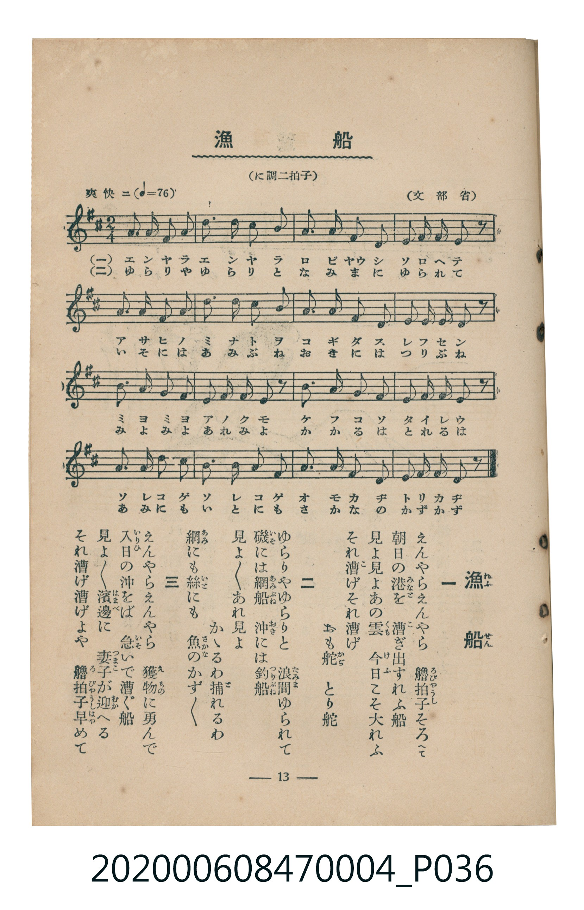

# 漁船

<audio controls src="gyosen.mp3"></audio>

- 詞：文部省
- 曲：文部省
- 臺灣教育會公認《新定兒童唱歌》尋常科第四學年用（2020.006.0847.0004）

## 說明

原書資訊與歌詞全文（對應 P036.jpg，書頁 p. 13，第二學期第 2 首）：
調性與拍號：に調二拍子（D 大調 2/4 拍）
速度指示：爽快ニ（♩=76）

## 歌詞

```text
一
えんやらえんやら　艪拍子（ろびゃうし）そろへて
朝日（あさひ）の港（みなと）を　漕（こ）ぎ出す舟（ふね）舟
見よ見よあの雲（くも）　今日（けふ）こそ大漁（たいれう）
それ漕げそれ漕げ　おも舵（かぢ）とり舵

二
ゆらりやゆらりと　浪間（なみま）にゆられて
磯（いそ）には網船（あみぶね）　沖（おき）には釣船（つりぶね）
見よ見よあれ見よ　かゝるわ捕（と）れるわ
網（あみ）にも絲（いと）にも　魚（さかな）のかずかず

三
えんやらえんやら　獲物（えもの）に勇（いさ）んで
入日（いりひ）の沖をば　急（いそ）いで漕ぐ船
見よ見よ濱邊（はまべ）に　妻子（つまこ）が迎（むか）へる
それ漕げ漕げよや　艪拍子早（はや）めて
```

## ABC

```abc
X:1
T:漁船
C:曲：文部省
M:2/4
L:1/16
Q:1/4=76
K:D
V:V1 name="Piano" snm="Pia"
[V:V1]
A2 A2 B2 A2 | F2 A2 B2 A2 | d2 e2 d2 B2 | A2 B2 A2 z2 |
B2 B2 A2 B2 | d2 B2 A2 F2 | A2 A2 B2 d2 | e2 d2 e2 z2 |
e2 B2 d2 B2 | A2 B2 A2 z2 | F2 A2 B2 A2 | F2 E2 D2 z2 |
A2 B2 d2 B2 | A2 B2 d2 B2 | A2 A2 F2 A2 | B2 e2 d2 z2 |
```

## TMD 檔案連結

- [主旋律 TMD 檔案](gyosen.tmd) [[在 TMD Studio 編輯](https://tmdlang.github.io/Tmd-TS/#tmd=s7IKdvYPcrWy4tLSUni2p_FFx04FLS0uRVsFczMue1sFFy4bI30TO646BaUXK-e93zPr2bT2l80rns9pVAKJPZu9CUPsRfuu542Ln02d-aJp07M5zU9b17xY1fu4oevZtA1P18162jrp-eqlT6dsfLa253FD99MN3U937Hi-fOLzNWuezp79dO2Opzu3PJ-y4v2eDiMDIwM9AwMzPQMLE3Mgw8Dk_Z5OJS4ufS0FW2oBLgUFhad985_N3vFic_uLFV0vOtqB7gL69GnrCqCvgK54uqH3WXunQoCBsZleVkH6-z09QMUvFzQqFOgpGBoDuUCHP9nVA3T4sznzgWwFI4WXy6YBXQoMF5DpL1btf9awHGRud--LmfOBoo8bVwMFgXqAIk_XTgDa4aLwdMlyoJgCMKgVgKJA3SCtLxvmP9217FlP-_Mlu4D6nnfsfbp_9ePmbqCORzNX2pqbgdSBFD7Z0QCiHjd2PG6a_Lip5XFTJwq7oeFF5yq4bY-beh83bn7c1Py4se1x43SgIY8b54IFdzxuXAYy6Nmcuc-mLwUpbWx63Dj1cSMwkoGK1j3bsR4suP9x46rHjcA46nzcNAlo-rM9U8Hik8HK-p6273rcOPNFB9CzQMGtjxvXAsWBXHBwLOt-3NQBIcGmr3sJSkJAdv_jpiaQ_oaGJ7u7YNZPBOoHGzoZ6EZgIAFTKFh8_uNGoM96gD6AhhXYCz1AhzxunITCbmh43NgFNPpFB9AgoM7ux42LwCaueNwEjO6tkADc1QM2pKkNFFxNQPVA02FsoEqgF7euejkN6D-gCUCvAwNgH9iQ1TBlQKeAg-75YkgQtQAdAVXRuP75tk3AfAULT6DmbZAwAZm7CZhWgOJAa0DRDlH_sn0xTP0SsAug6rEFYFMPlA3yKJAB9DqQ7H_WC4kSSCT1QATBDtwGCW6QQ2BeaHq-FSIIdDVYA1gQaOLLtbPA4sCQBIbbKkgqALOBqRhEQpMfNApwJr_nvZued64EGwUUB8U6xJan3aAsBrYX6FygQ4HRvBycJ1uXwpIA0AhgCMBS4KZpoCTXuAEUdA0wBdCgBjKACQTo1gnA0EMPq2f7N75s6gJrWA-MvceNwPAFe7Sh4emy3dCcAQxukBQkHfe82N8Hzi6ggAWL7AAGI3pigyYzYAQAPYuU0Z5Nh_h3PVAc7LVGaAqhvNCCAgUtfS4u98r84tQ8q4DMxLx8hxqDGoVqkB0KNhZadmAGtsJSAVRk7Wh4sbBHQcNE4emG_ufrG3TgJZwmFg1Am6CGaQA1aloBc8oKhcfNm4F4CRCvVKjBJtK8FognP25e_LhpGVB-O1jVXqj4DCBuQzF4Vw_Y4DYg7gTiLiBuAWtBEmlcARJpXAXE-4F4HxCvRlHTAxRZBjO2RsEUCM2AuEbBGM4yjFMwigORZmAFIEEDhRpwSsYdXLt6KAuuRUC8FejlSUDcBw6c-UAM9FFzBxBvAvsBGHhN64C8BiC9E6xmKhD3wmnMwGpsAaVFcCAAUxo4aJqgQbMNiNeCRUDBBjQESQ0whsCBCVEDDywzcFiAQgUcOKbAMIOFIFCgBhpqQJJwcO3opCi4wIEDSk8QGhQ4wAAEBtzjpvVAehFYZCMkYMDBthcsAvR3Eyj1rQHS8ESAHFwgBcDwhtLQ4AKnGYRINwQ3gXA_WAToEJAaqAg8uIABAQ4YlGSElM6MgU0BQ8JhBWz1UJa0QDkK5GNQOEASEqYIMMMAQ-1xEzANNDeBkxYo2QFFoSJYwgqWkIAKmsBawIkNGBZIIsDgB4cXKD-ug4feLDiNlA9RggrOBKUxUFiZQRMXKLRqubh07RQgBZsCkKXMxQUA)]
- [鋼琴伴奏 TMD 檔案](gyosen_piano.tmd) [[在 TMD Studio 編輯](https://tmdlang.github.io/Tmd-TS/#tmd=s7IKdvYPcrWy4tLSUni2p_FFx873ezpedu95PmHLkz1bni7tf97Z8X5Pp4KWFpeirYK5GZe9rYILl42RvokdV52C0ouV897vmfVsWvvL5hXP5zQqgcSezd6EIfaifdfzxsXPps580bTp2Zzmp61rXqzqfdzQ9WzahqfrZj1tnfR89dKnUzY-W9vzuKH76Ybupzt2PF8-8fmaNU9nz366dsfTnVueT1kBdJmRgZGBnoGBmZ6BhYk5kGFgAnScEheXe2V-cWqeVUBmYl5-kIdDjUGNQjWXAhDYWGjZgRn6Wgq26EABaMGTHQ0vFvYoaJgoPN3Q_3x9g45CgIGxmV5WQbomFg1a-mDDahRMgdAMiGsUjOEswzgFozgQaQZWABI0UKjhwm_9rh5yrDcDmw6yB2ydKdAVMDcBBWqg7gCShB2wo5McBwCNBluF4lWksDBWMFIwJGw7MHrJC30Uy-FMUDiAbDeDBgDI_lrU1OGDNXUAwzFeIdowVsEESJnEIvhQqgYmgUUeZAnEDNxqIGaYxgNZpvGxCmYghll8LoogiIEwywgoagRUgN1CDOfCTUFxEA5PEXYg1BRg2OnaKUCCTwGFpczFBQA)]

## 分析

```text
================================================================================
📊 TMD Song Profile: [ 漁船 ]
================================================================================
⏱  Duration:       0:25 (25.3s), 16 measures total
🎼 Key & Tempo:    首調基準 D, != 76.0 BPM, <2/4>
   - 分析範圍：      由實際發聲的音符與和弦推測調性；播放脈絡另行呈現
🎤 人聲音域:    D4 (MIDI 62) – E5 (MIDI 76) [跨度: 14 個半音 / 1.2 個八度, 難度: moderate]
   - 最低音:  D4 in [Gyosen #1 @ m.12, 0:18]
   - 最高音: E5 in [Gyosen #1 @ m.3, 0:03]
   - 適合: soprano, mezzo-soprano, contralto, tenor, baritone, bass
🏛  結構:      Gyosen (25.3s)
⚡ 編曲密度:        Peak 1 軌道同時演奏
🗝  調性診斷：       A 大調（純淨自然大調，未偵測到可信轉調）
   - 風格氣質:    純淨自然大調（陽光明朗、易唱易記，無明顯調外色彩）
   - 轉調歷程:    全曲維持單一推測調性（未偵測到可信轉調）
   - 核心骨幹音:  A, B, D, E, F#
   - 調性數值:    A 大調 [相關度: 0.70, 穩定度: Moderate, 自然音純度: 100.0%]
   - 候選調性 (K-S): A 大調 (0.70), D 大調 (0.66), B 小調 (0.62)
   - 五度圈歷程:   +3
   - 各段落調性細節:
     • [Gyosen #1]: A 大調 (r: 0.70, 自然音純度: 100.0%)

  [ 五度圈游移軌跡 ]
               C  
         F            G  
      Bb               D  
      Eb              [A ]*
         Ab           E  
            Db       B  
               F# 
     (* = active key center)

  [ 十二半音累積音高分佈 ]
     C  :                            0.0%
     C# :                            0.0%
     D  : ████████████              16.9%
     D# :                            0.0%
     E  : ███████                   10.2%
     F  :                            0.0%
     F# : ██████                     8.5%
     G  :                            0.0%
     G# :                            0.0%
     A  : ████████████████████████  33.9%
     A# :                            0.0%
     B  : ██████████████████████    30.5%
--------------------------------------------------------------------------------
Assignment 軌道音域：
  - Piano         : D4 – E5 (14 個半音 / 1.2 個八度, 59 個音符)
================================================================================
```


## 原書掃描頁




