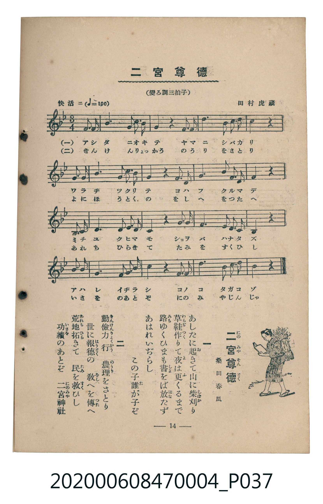

# 二宮尊徳

> Re:Shōka 使用 AI 協助辨識與重建樂譜，可能會有錯誤。歡迎回報。

- **鋼琴伴奏版**：<br><audio controls src="ninomiya_sontoku.mp3"></audio>
- **NEUTRINO 歌聲合成版**：<br><audio controls src="ninomiya_sontoku_neutrino.mp3"></audio>

- lyrics: 桑田春風
- composer: 田村虎藏
- 臺灣教育會公認《新定兒童唱歌》尋常科第四學年用（2020.006.0847.0004）

## 說明

原書資訊與歌詞全文（對應 P037.jpg，書頁 p. 14，第二學期第 3 首）：
調性與拍號：變ろ調三拍子（B♭ 大調 3/4 拍）
速度指示：快活ニ（♩= 100）
作詞：桑田春風　作曲：田村虎藏
版面校勘：


## 歌詞

```text
1. 弱起拍及各樂句連接拍（m.0, m.2, m.4, m.6, m.8, m.10, m.12, m.14 第 3 拍）與 m.7、m.11 第 3 拍於原譜均印為「附點八分音符＋十六分音符」（第 2 音符具雙符尾）。
2. 第 3 小節原譜五線譜明確記為 `3. 1 2. 3`（D5–B♭4–C5–D5，與 1923 年《唱歌教材集》之 `1. 6_ 2. 3` 不同）。
3. 第一行第 1 小節第 1 拍譜下第一段印作「ダ」（「アシダニ」，活字誤植，底欄作「あしたに」）；第二行第 1 小節（m.5）譜下第二段印作「ほうとく」，底欄振假名則印作「はうとく」。

一
あしたに起（お）きて山に柴刈（しばか）り
草鞋（わらぢ）作（つく）りて夜（よ）は更（ふ）くるまで
路（みち）ゆくひまも書（しょ）をば放（はな）たず
あはれいぢらし　この子誰（た）が子ぞ

二
勤儉力行（きんけんりよくかう）　農理（のうり）をさとり
世に報徳（はうとく）の　教（をし）へを傳（つた）へ
荒地（あれち）拓（ひら）きて　民（たみ）を救（すく）ひし
功績（いさを）のあとぞ　二宮神社（にのみやじんじゃ）
```

## ABC

<div class="abc-score" data-abc-src="ninomiya_sontoku.abc" aria-label="五線譜載入中"></div>

[下載 ABC 原始檔](ninomiya_sontoku.abc)

## TMD 檔案連結

- [主旋律 TMD 檔案](ninomiya_sontoku.tmd) [[在 TMD Studio 編輯](https://tmdlang.github.io/Tmd-TS/#tmd=s7IKdvYPcrWy4qpTUCpJTLdSSM7PyUlNLsnMz7MqzsjMK0nNjM_KTMmPL87Iz05Ugisry88pzU21Si9KTEmNN4k3MjAyiDcwMIs3sDAxBzIMTBBKi_NLi5JTrYqTM_Lzc-JLUitKkvLzs9Hl4wsS01OtAgyMzREyBUX5Zal5iXlA3QVFILekgLUjFKSWZaakgqSLkxPz4stSizLTMlNTEPL5RSUZ-UA3FmRUWmVkFpfkF2UmJ-bEZyfmIXsltagY7F2IO0qKEvOKk4syC0BhgFBVkpEK9C_EkEpkGzLTM_OscvPzkkqBQYQpkZqZlYnF01DpksRMoC5Q4JYnxucmZublJOYB3a-lpfBkV8_Tdeuebuh6um-zgpYWl6KtgqGBAZe9rYKTDpeNsb6JHcisnEqgj4qtFJ4tnPh8yoZnM5a-XLQCbElyfm5BfnFqkZUCSHzuxBcz-15M7wdLvWjf9bxx8bOpM180bXo2p_lp65oXq3ofN3Q9m7bh6bpZT1snPV-99OmUjc_W9jxu6H66ofvpjh3Pl098vmbN09mzn67d8XTnludTVrzf0wGKcz1gnOuB4hzIMDB5v6dTiYtLX0vBllqAS0FB4Wnf_Gezd7zY3P5iRdeLjnagu16snPe0dcWzae1AVzzd0PusvVMBlHD0sgrS3-_pASp-uaBRoUBPwRDooh6gw0FhuXbHsznzgWwFY4WXy6YBXfp-zyyQ6S9W7X_WsBxkbnfvi5nzgaIv1nU9buoFij_Z0QkUfLp2AtAap0cz1yo8XbIcKKwADHwFoATQDJABLxvmP9217FlP-_Mlu4C6n-5f_WzL7sfN3UBNj2auBMcaVOWTvXOALgeqQY6txw0NQPFnszcBxZGjCqTheWfHy7mLni1Y-LR7BtS5hnoKT_dsfLF1O8hl_V1PJ7Q8W9H0tH_py4bFz_qWgl3VkatnoKOQq2cEIkxAhBmIsAARhmAZQ7CUoYkCJDwgfgEGAVDQ_HFDI1DKECH1bNoeYAy8WDvn6dz2p70bnjftetzQ83Jmy8vdwEhY_bSj7eX8zc_XLHu_p_tpb-PT1rVwkccNIMeAzDFSgIg8bd3-cvZMEGPDPqCNjxuaQF4y0oNa9nRD__P1DRDLnuya8nz7LCDj2Yy-54t2vVgxA2ixQoIxMFJBGowTgEa7mD5qmAyKGBMg7QziuJgCIxzkEUNLI6B5O7cAkzUkKQOT-7O5E17ObgOm6Sc7uxUSgAFpFg8xSuHJjt6nE3oQLgLaAko1OxpeLAQlH6CVEKdB2KCEAnTgjm6ImmfrtgKDBRiHwGB53NwA8TWI3bTocdN2kEhzN1iwB5gunq6d_mLVkmdLQNynu6Y-W9MC1djY9Lhx-uPG-Y8bV4MVA5PnbEjKRXMDOH6B3uxEuGFXD4obGnc_bmx73LjicWM_xF6IRc961j9tbH86ofdpJygeYYrXIysG-R-cUnc0gChkVwGTHMhfjV2gYGrsfdy47OnGjUDxZ_O3PO3oAEsBVW543AhM-J2Pm7rAeau38-U8UEZ43NT_uAmobRFQDmgxWPUSoJUQpSCzloAFm4AGAZWtfzZ7C1jNVjAXqLf7ceO-x43LwYZuXw-W2_-4cSFYP9D5_Y8bN4FUNDUBMz_ULU3A0gEoOwnoqGdTgMkNKAj06yqwiUAPgXMT2IPrHzcBw6EF6DqwG6cDc-TjxsmPG9cBc_6LVRvAOoHlAlAKWIpMeNw4DxJEu3rAhVP3kqctnU-7ZgOjCayy93ETUO9EEAn0WRNQBOg4oPPbwMmr4cW-Tc8nANlA8XWgkG8ChyfIlVNBsQAJtyc7pgFD9umCjcCyH-ZwaCSB3bEOaBAwQYNDDKhzOlhwB5D9tAmiHhi2EBfvgETDpKdzIP5oAvsVFG7PuieDRTYBPQ2PUpC5GyZCfAwMYYjTnk2FiMyEWQ8M6ulgv3fNf74DErLA0JsKVAp1HShUgY6dByrbwNXY86Xzni-BqFwNVrD_cRNQywxwWAHJZmgJSXmFAQUKWvpcXH6Zefm5mZWJwfl5JfnZpVYBmYl5-Q41uoY11SDLFGwMzbTswCxsVRa0nFXQgOU8HXglo4lFNdBCkEk1CgYKumAIo03jYVQNWIWPYY0CREgXTgPLCii9HabKCIuqxl6oqslAVbgdDi-7FDRMSHO7IdQmEASWjrrAkhvENARKgbk4_AUsuxH6QGZAtBkDZSAshC6oMUAKERqPm_Yj6QcWl2A_roL6dS3QlMfNbehh0bwESs8Dy4P0wE0AhiJIZgKUtxqsAmIesgnrofRKpDAHZl0UkyaDSWBGbocINC4GGQbO0OjmNa6D0m0gJU1dKOZMAstMhapYgaICkQo6oPJAFxOIX3C9QI_4NQbFL1wSFsHIklA2QqchRMAIJY6bm5DDo7kF7F9YDKzCEccroHQ_WB4SerCwAul93LwaqgKSCiCRhGzCfCjdiBLHu5FNAsckKE4gPLBd0LhEjhtQDILkp4Pld6C4BRK70BTZOB9FBSJ9QEIAWAITzr2d5MQuMDYQjgJzTJCiCRgdqNGElBURcQiCYF1Qw0CRCItQpBiGksjxuwwlRCCxAw0zaOxAyjjkMAU2j5ZDlWwCK4FkWVjk9YNJSDYBFRKgTLMLwxBo0QlKJEhRvBDZpMZNYJWdUF4vOIJgDkZEEDSxNEJsgjgeJjcTTIJcBDEPZMJ0DBNAyRqS0QlEMbAvRU4Uo2REcKRBRUBZGL2sJa6EhpUJ6PUWctyuQQ6KJlA6h-VncOkJLXFRo2UzVL4PLA_hweRA5f3jJoipIDmQin1oJsBopEhFixJQHoXnKkiZ2jgP3R3AshSmGiSPUtM0gUuhxhlQHrBWBfGAzRGcTqnl4tK1U0BrWET7GMYqYBM2AgsrcwEA)]
- [鋼琴伴奏 TMD 檔案](ninomiya_sontoku_piano.tmd) [[在 TMD Studio 編輯](https://tmdlang.github.io/Tmd-TS/#tmd=s7IKdvYPcrWy4tLSUniyq-fpunVPN3Q93bf5_Z6Ol917nk_Y8mTPlqdL-593drzf06mgpcWlaKtgaGDAZW-r4KTDZWOsb2LHVaeglFNZlJlcbKXwbOHE51M2PJux9OWiFUogieT83IL84tQiKwWQ-NyJL2b2vZjeD5Z60b7reePiZ1Nnvmja9GxO89PWNS9W9T5u6Ho2bcPTdbOetk56vnrp0ykbn63tedzQ_XRD99MdO54vn_h8zZqns2c_Xbvj6c4tz6esALrTyMDIQM_AwEzPwMLEHMgwMAE6VYmLyy8zLz83szIxOD-vJD-71CogMzEvP8jDoUbXsKaaSwEIbAzNtOzALH0tBVt0oPB0z8YXW7craBgqPN3Q_3x9g45CgIGxuV5WQbomFtVa-mCTahQMFHTBEEabxsOoGrAKH8MaBYiQLpx-3LQISm-HqTLCoqqxF6pqMlAVbocDw-jJjoYXC3sUNExIc7sh1CYQNANZawRmGgKlwFwc_lIwRtIHMgOizRgoA2EhdEGNAVKI0HjctB9J_-PmbrAfV0H9uhZoyuPmNvSwaF4CpeeB5UF64CYAQxEkMwHKWw1WATEP2YT1UHolUpg_bpyIYtJkMNn1uKkdItC4GGRYY_fjRgwXNa6D0m0gJU1dKOZMAstMhapYgaICkQo6oPJAFxOI3109dIpfY1D8wiVhEYwsCWUjdBpCBIxQ4ri5CTk8mlvA_oXFwCoccbwCSveD5SGhBwsrkN7HzauhKiCpABJJyCbMh9KNKHG8G9kkcEyC4gTCA9sFjUvkuAHFIEh-Olh-B4pbILELTZGN81FUINIHJAQeN_UQzr2d5MQuMDYQjgJzTJCiCRgdqNGElBURcQiCYF1Qw0CRCItQpBiGksjxuwwlRCCxAw0zaOxAyjjkMN3-uHk5VMkmsBJIloVFXj-YhGQTUCEByjS7MAyBFp2gRIIUxQuRTWrcBFbZCeX1giMI5mBEBEETSyPEJojjYXIzwSTIRRDzQCZMxzABlKwhGZ1AFAMrMXKiGCUjgiMNKgLKwuhlLXElNKxMQK-3kON2DXJQNIHSOSw_g0tPaImLGi2bofJ9YHkIDyYHKu8fN0FMBcmBVOxDMwFGI0UqWpSA8ig8V0HK1MZ56O4AlqUw1SB5lJqmCVwKNc6A8oC1Koj3uKkZp1NqcbQrfFDaFSbQZgWsMQDxAjgfRRvGAiMEUqYCeWbxubFARXCpaNP4WHB2BHJBTKAUYb0IXrQhXu1AEYh-ZAUIDlQ3TClCM5IFYBLNAFS3Q3kg3cDQ0rVTQAuwaB-gLDZhI7CwMhcA)]

## 分析

```text
================================================================================
📊 TMD Song Profile: [ 二宮尊徳 ]
================================================================================
⏱  Duration:       0:57 (57.6s), 32 measures total
🎼 Key & Tempo:    首調基準 B,, != 100.0 BPM, <3/4>
   - 分析範圍：      由實際發聲的音符與和弦推測調性；播放脈絡另行呈現
🎤 人聲音域:    A#3 (MIDI 58) – D5 (MIDI 74) [跨度: 16 個半音 / 1.3 個八度, 難度: moderate]
   - 最低音:  A#3 in [NinomiyaSontoku[L1] #1 @ m.9, 0:15]
   - 最高音: D5 in [NinomiyaSontoku[L1] #1 @ m.4, 0:05]
   - 適合: soprano, mezzo-soprano, contralto, tenor, baritone, bass
🏛  結構:      NinomiyaSontoku[L1] (28.8s) -> NinomiyaSontoku[L2] (28.8s)
⚡ 編曲密度:        Peak 1 軌道同時演奏
🗝  調性診斷：       A# 調性不明確（純淨自然大調，未偵測到可信轉調）
   - 風格氣質:    純淨自然大調（陽光明朗、易唱易記，無明顯調外色彩）
   - 轉調歷程:    全曲維持單一推測調性（未偵測到可信轉調）
   - 核心骨幹音:  A#, G, F, D, C
   - 調性數值:    A# 調性不明確 [相關度: 0.82, 穩定度: Ambiguous, 自然音純度: 100.0%]
   - 候選調性 (K-S): A# 大調 (0.82), G 小調 (0.79), F 大調 (0.66)
   - 五度圈歷程:   -2 -> -2
   - 各段落調性細節:
     • [NinomiyaSontoku[L1] #1]: A# 調性不明確 (r: 0.79, 自然音純度: 100.0%)
     • [NinomiyaSontoku[L2] #1]: A# 調性不明確 (r: 0.82, 自然音純度: 100.0%)

  [ 五度圈游移軌跡 ]
               C  
         F            G  
     [Bb]*              D  
      Eb               A  
         Ab           E  
            Db       B  
               F# 
     (* = active key center)

  [ 十二半音累積音高分佈 ]
     C  : █████████████████         16.2%
     C# :                            0.0%
     D  : ███████████████████       17.5%
     D# : ███                        3.1%
     E  :                            0.0%
     F  : ████████████████████      18.7%
     F# :                            0.0%
     G  : ███████████████████████   21.9%
     G# :                            0.0%
     A  :                            0.0%
     A# : ████████████████████████  22.5%
     B  :                            0.0%
--------------------------------------------------------------------------------
Assignment 軌道音域：
  - Piano         : A#3 – D5 (16 個半音 / 1.3 個八度, 112 個音符)
================================================================================
```


## 原書掃描頁




