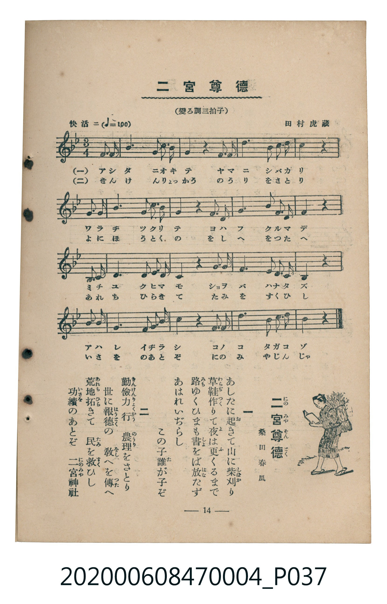

# 二宮尊徳

<audio controls src="ninomiya_sontoku.mp3"></audio>

- 詞：桑田春風
- 曲：田村虎藏
- 臺灣教育會公認《新定兒童唱歌》尋常科第四學年用（2020.006.0847.0004）

## 說明

原書資訊與歌詞全文（對應 P037.jpg，書頁 p. 14，第二學期第 3 首）：
調性與拍號：變ろ調三拍子（Bb 大調 3/4 拍）
速度指示：快活ニ（♩=100）

## 歌詞

```text
一
あしたに起（お）きて山に柴刈（しばか）り
草鞋（わらぢ）作（つく）りて夜（よ）は更（ふ）くるまで
路（みち）ゆくひまも書（しょ）をば放（はな）たず
あはれいぢらし　この子誰（た）が子ぞ

二
勤儉力行（きんけんりょくかう）　農理（のうり）をさとり
世に報徳（ほうとく）の　教（をし）へを傳（つた）へ
荒地（あれち）拓（ひら）きて　民（たみ）を救（すく）ひし
功績（いさを）のあとぞ　二宮神社（にのみやじんじゃ）
```

## 原書掃描頁



## 分析

```text
================================================================================
📊 TMD Song Profile: [ 二宮尊徳 ]
================================================================================
⏱  Duration:       0:28 (28.8s), 16 measures total
🎼 Key & Tempo:    首調基準 B,, != 100.0 BPM, <3/4>
   - 分析範圍：      由實際發聲的音符與和弦推測調性；播放脈絡另行呈現
🎤 人聲音域:    D4 (MIDI 62) – D#5 (MIDI 75) [跨度: 13 個半音 / 1.1 個八度, 難度: moderate]
   - 最低音:  D4 in [NinomiyaSontoku #1 @ m.9, 0:14]
   - 最高音: D#5 in [NinomiyaSontoku #1 @ m.13, 0:22]
   - 適合: soprano, mezzo-soprano, contralto, tenor, baritone, bass
🏛  結構:      NinomiyaSontoku (28.8s)
⚡ 編曲密度:        Peak 1 軌道同時演奏
🗝  調性診斷：       A# 大調（純淨自然大調，未偵測到可信轉調）
   - 風格氣質:    純淨自然大調（陽光明朗、易唱易記，無明顯調外色彩）
   - 轉調歷程:    全曲維持單一推測調性（未偵測到可信轉調）
   - 核心骨幹音:  D, A#, F, C, G
   - 調性數值:    A# 大調 [相關度: 0.84, 穩定度: High, 自然音純度: 100.0%]
   - 候選調性 (K-S): A# 大調 (0.84), G 小調 (0.69), D 小調 (0.67)
   - 五度圈歷程:   -2
   - 各段落調性細節:
     • [NinomiyaSontoku #1]: A# 大調 (r: 0.84, 自然音純度: 100.0%)

  [ 五度圈游移軌跡 ]
               C  
         F            G  
     [Bb]*              D  
      Eb               A  
         Ab           E  
            Db       B  
               F# 
     (* = active key center)

  [ 十二半音累積音高分佈 ]
     C  : ███████████████           16.2%
     C# :                            0.0%
     D  : ████████████████████████  25.6%
     D# : ██                         2.5%
     E  :                            0.0%
     F  : ████████████████          17.5%
     F# :                            0.0%
     G  : █████████████             13.7%
     G# :                            0.0%
     A  :                            0.0%
     A# : ███████████████████████   24.4%
     B  :                            0.0%
--------------------------------------------------------------------------------
Assignment 軌道音域：
  - Piano         : D4 – D#5 (13 個半音 / 1.1 個八度, 56 個音符)
================================================================================
```

## ABC

```abc
X:1
T:二宮尊徳
C:曲：田村虎藏
M:3/4
L:1/16
Q:1/4=100
K:Bb

V:V1 name="Piano" snm="Pia"

[V:V1]
f2 f2 b4 d3 c | b4 b4 z4 | c2 c2 d4 b3 c | d4 d4 z4 |
c2 c2 d4 c3 b | g4 f4 z4 | g2 g2 f4 b3 c | g4 f4 z4 |
d2 d2 f4 f3 f | g4 f4 z4 | g2 g2 b4 d3 d | c4 c4 z4 |
d2 d2 e4 d3 c | b4 d4 z4 | c2 g2 b4 d3 c | b4 b4 z4 |
```

- [主旋律 TMD 檔案](ninomiya_sontoku.tmd)
- [鋼琴伴奏 TMD 檔案](ninomiya_sontoku_piano.tmd)
