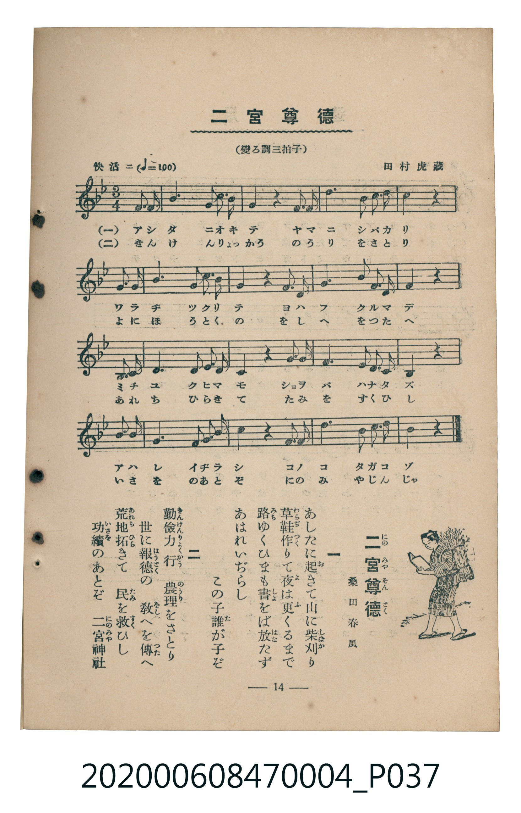

# 二宮尊徳

> Re:Shōka 使用 AI 協助辨識與重建樂譜，可能會有錯誤。歡迎回報。

- **NEUTRINO 歌聲合成版**：<br><audio controls src="ninomiya_sontoku_neutrino.mp3"></audio>
- **鋼琴伴奏版**：<br><audio controls src="ninomiya_sontoku.mp3"></audio>


- 詞：桑田春風
- 曲：田村虎藏
- 臺灣教育會公認《新定兒童唱歌》尋常科第四學年用（2020.006.0847.0004）

## 說明

原書資訊與歌詞全文（對應 P037.jpg，書頁 p. 14，第二學期第 3 首）：
調性與拍號：變ろ調三拍子（Bb 大調 3/4 拍）
速度指示：快活ニ（♩=100）


## 歌詞

```text
一
あしたに起（お）きて山に柴刈（しばか）り
草鞋（わらぢ）作（つく）りて夜（よ）は更（ふ）くるまで
路（みち）ゆくひまも書（しょ）をば放（はな）たず
あはれいぢらし　この子誰（た）が子ぞ

二
勤儉力行（きんけんりょくかう）　農理（のうり）をさとり
世に報徳（ほうとく）の　教（をし）へを傳（つた）へ
荒地（あれち）拓（ひら）きて　民（たみ）を救（すく）ひし
功績（いさを）のあとぞ　二宮神社（にのみやじんじゃ）
```

## ABC

```abc
X:1
T:二宮尊徳
C:曲：田村虎藏
M:3/4
L:1/16
Q:1/4=100
K:Bb
V:V1 name="Piano" snm="Pia"
[V:V1]
z4 z4 F2 F2 | B6 G2 c3 B | G4 z4 F2 F2 | d6 B2 c3 d |
w: 1.~ア シ | タ ニ オ キ | テ ヤ マ | ニ シ バ カ
w: 2.~き ん | け ん りょっ か | う の う | り を さ と
c4 z4 G2 G2 | B6 G2 c3 B | G4 z4 F2 D2 | G6 B2 F3 D |
w: 1.~リ ワ ラ | ヂ ツ ク リ | テ ヨ ハ | フ ク ル マ
w: 2.~り よ に | ほ う と く | の を し | へ を つ た
F4 z4 B,2 C2 | D6 D2 E3 D | C4 z4 G2 G2 | F6 E2 D3 C |
w: 1.~デ ミ チ | ユ ク ヒ マ | モ ショ ヲ | バ ハ ナ タ
w: 2.~へ あ れ | ち ひ ら き | て た み | を す く ひ
B,4 z4 B2 B2 | G6 F2 G3 B | c4 z4 F2 F2 | d6 B2 c3 d |
w: 1.~ズ ア ハ | レ イ ヂ ラ | シ コ ノ | コ タ ガ コ
w: 2.~し い さ | を の あ と | ぞ に の | み や じ ん
B4 z4 z4 |
w: 1.~ゾ
w: 2.~じゃ
```

## TMD 檔案連結

- [主旋律 TMD 檔案](ninomiya_sontoku.tmd) [[在 TMD Studio 編輯](https://tmdlang.github.io/Tmd-TS/#tmd=s7IKdvYPcrWy4qpTUCpJTLdSSM7PyUlNLsnMz7MqzsjMK0nNjM_KTMmPL87Iz05Ugisry88pzU21Si9KTEmNN4k3MjAyiDcwMIs3sDAxBzIMTBBKi_NLi5JTrYqTM_Lzc-JLUitKkvLzsxHyBUX5Zal5iXlANQVFIBtTwIoQClLLMlNSQdKpKZkl-UWZiTlI7kgtKga7FWxJfElRYl5xclFmAcgDCFUlGalAx2ZkFgO1VypxaWkpPNnV83Tduqcbup7u26ygpcWlaKtgaGDAZW-r4KTDZWOsb2IH0vxi5bz3e2Y9Wzjx-ZQNz2YsfbloBdjMZ7M3AYVBYnMnvpjZ92J6P1j4Rfuu542Ln02d-aJp07M5zU9b17xY1fu4oevZtA1P18162jrp-eqlT6dsfLa253FD99MN3U937Hi-fOLzNWuezp79dO2Opzu3PJ-y4v2eDlBg6gEDUw8UmECGgcn7PZ1KXFz6Wgq21AJcCgoKT_vmP5u948Xm9hcrul50tAPdBfTv09YVz6a1A13xdEPvs_ZOhQADY3O9rIL093t6gIpfLmhUKNBTMAS6qAfocFAort3xbM58IFvBWOHlsmlAlwKDBmT6i1X7nzUsB5nb3fti5nyg6It1XY-beoHiT3Z0AgWfrp0AtMYpSeHpkuVAQQVgoCsAhYEmgLS_bJj_dNeyZz3tz5fsAup9un_1sy27Hzd3A7U8mrnSFhhZIIUglU92NICox41NjxunP26c_7hx9Yut24HqHjd2AdU8bux93Ljs6caNQPFn87c87egASwFVbnjcCDSu83FTF9i9vZ0v54GMf9zU_7gJqG0RUO7J3jlg1UseN_ZDlILMWgIWbAIaBFS2_tnsLWA1W8FcoN7ux437HjcuBxu6fT1Ybv_jxoVg_W0gFY2bQCqamoABCnVLEzDEgbKTgI56NmUfWHD948ZVYBOBHgIHKNiD6x839TxubAG6DuzG6Y8bGh43Tn7cuA4Ymi9WbQDrBIY1UAoYMxMeN86DBNGuHnCEdy952tL5tGv2i4U9YJW9j5uAeieCSKDPmtrBjgM6vw1kQkPDi32bnk8AsoEq1wEFgWpgrpz6uHEFNNye7JgGDNmnCzYCcxJY6W6QUqA0JMSAOhsagHkCHGJAndPBgjuA7KdNEPXAsIW4eAckGiY9nQPxRxPYr6Bwe9Y9GSyyCehpeJSCzN0wEeJjYAhDnPZsKkRkJsx6YFBPB_u9a_7zHZCQBYbeVKBSqOtAoQp07DygcZBC4fnSec-XQFSuBivY_7gJqGUGOKyAZDM0hVKeCaFAQUufi8svMy8_N7MyMTg_ryQ_u9QqIDMxL9-hxqCmGmSXgo2hmZYdmIWtFFB4umcjMM0raBgqPN3Q_3x9gw4832piUQ20D2qSBjDzaFopPG5aBEpgTduBJLLkrh6QZGMvWHIyQrJGwUBBFwxhtGk8jKgBq_AxrFEA8UAQRoNsAZHbEaqMsKgCWgdSNRmsCreXQcXPjgZgSlbQMCHX1_tBAlAALFvA3lwF4TWtBfrycXMbkgqIqiVgch44FCB64HLg8HvcPAHKWw1WATEPAbCE70QUQ0DhDMuOi4Gy3SBjGjEc0rgOTILEgfJNXShmTALLTYWqXIGhAskhNQqG0JAHQTNQNBiBmYZAKTAXRzwDC3yEPpAZEG3GQBkIC6ELbAyYQKQOUOgj9INCEhTrq6ApBRb6aGkDGPogch7YfogeuAngdAUKfQgPFvroJqwHkysRbgGmQVAUIJsESnuIKICkSlg0oKfWdWASJA4JZGRzJoHlpkJVwqIBPVd0gGVXg12EP73v6qEovQP9jpRIgGEAIpugvBaw62AqEOkWkgceN6-AJLTmfhQzQEkMputxMyTMQXkDwm9HTWpIaR7oaSRjgJ4HkbuhvDZwUIMshPBhVkLTPDh1g1RMRzFjB1wOxFsCVjEfRRbJKWSkemNIqodLwpI9WBIsXQNjI3Qagk1GS_nAMEdO-S3gVABKlyDeKhwpfwWY7IekM2C4I6czSJoGpSBI7gCpaMcwYT6YbES4BZzydyObBE7HoKCH8PrBgQhK4agpFpKup0PcAgxazDQPyqcgej6KCkSuAYUAsHoHu4VAGd9JWZqHJQFwMgD6HkQug_CA4QYKKUiSgZXqEBa0PnzcvBysZBOKIaACHpYRHjd3gTMOrCp53LQLNaUhF_SQvAZT2AMiGxdCeI2bwMZ0wmTBlS6EBXItJCmDwhKlzoIW9DOhKiHxBXMsIoPAEz04DcMgmGOClHrB6RQ59SKV24ikDYJgXVDDgLqAuQkj4UMxcrJfhpJQIIkWlFwQiRbUQEBNauAoACnYBElt0PIdlqZB-QEUBRDF-8FhuAvDEHC7A5J3kFL-QmSTgKEGUtkJ5fWCQxLmYES6BechYBxASnuI42FyM8EkyBaIeZAiCt0EcG4H1wkEUj6wV0hZ6waUhuEpBZxcHzevgaYbcPEILfthdQFEBtyGadoMSW3NfSipDSQKS-qPm9aAwwAkBuHvQ01tyAm_BdkYcLsEUVKvAwcU3ClI5T4oO0LqBkgxhGwGyBHAdjmUNwPsFFDLCcoHNtOR3YJWbIPTMlQEVOCjt1eIa-XAahD0tjBykl-DnEKAoQ5Kh5DSHxTmIEeDWi2oqXUzWLYPbDuEhzABlPJAIQ9TCVKxD80EGI2U1tFSKqTNAnUHpF0CDGz0lAqqTyBqIeUOsjsgqXgGlDcZrAIc6LicUsvFpWungNbLUQAKKXMBAA)]
- [鋼琴伴奏 TMD 檔案](ninomiya_sontoku_piano.tmd) [[在 TMD Studio 編輯](https://tmdlang.github.io/Tmd-TS/#tmd=s7IKdvYPcrWy4tLSUniyq-fpunVPN3Q93bf5_Z6Ol917nk_Y8mTPlqdL-593drzf06mgpcWlaKtgaGDAZW-r4KTDZWOsb2LHVaeg9GLlvPd7Zj1bOPH5lA3PZix9uWiFEkj42exNQGGQ2NyJL2b2vZjeDxZ-0b7reePiZ1Nnvmja9GxO89PWNS9W9T5u6Ho2bcPTdbOetk56vnrp0ykbn63tedzQ_XRD99MdO54vn_h8zZqns2c_Xbvj6c4tz6esALrQyMDIQM_AwEzPwMLEHMgwMAE6UomLyy8zLz83szIxOD-vJD-71CogMzEvP8jDoUbXsKaaSwEIbAzNtOzALH0tBVt0oPB0z8YXW7craBgqPN3Q_3x9g45CgIGxuV5WQbomFtVa-jCTNJ7saNC0UnjctAjIf9y0HUgiS-7qAUk29oIlJyMkaxQMFHTBEEabxsOIGrAKH8MaBRAPBGE0yBYQuR2hygiLKqB1IFWTwapwexkYukDHv1jYo6BhQq6v94MEoOBxczfYm6sgvKa1QF8-bm5DUgFRtQRMzgOHAkQPXA4cfo-bJ0B5q8EqIOYhAJbwnYhiCCicHzd1PW5qf9y4GCjbDTKmEcMhjevAJEgcKN_UhWLGJLDcVKjKFRgqkBxSo2AIDXkQNANFgxGYaQiUAnNxxLOCMZI-kBkQbcZAGQgLoQtsDJhApA5Q6CP0g0ISFOuroCkFFvpoaQMY-iByHth-iB64CeB0BQp9CA8W-ugmrAeTKxFuAaZBUBQgmwRKe4gogKRKWDSgp9Z1YBIkDglkZHMmgeWmQlXCogE9V3SAZVeDXYQ_ve_qoSi9A_2OlEiAYQAim6C8FrDrYCoQ6RaSBx43r4AktOZ-FDNASQym63EzJMxBeQPCb0dNakhpHuhpJGOAngeRu6G8NnBQgyyE8GFWQtM8OHWDVExHMWMHXA7EWwJWMR9FFskpZKR6Y0iqh0vCkj1YEixdA2MjdBqCTUZL-cAwR075LeBUAEqXIN4qHCl_BZjsh6QzYLgjpzNImgalIEjuAKloxzBhPphsRLgFnPJ3I5sETsegoIfw-sGBCErhqCkWkq6nQ9wCDFrMNA_KpyB6PooKRK4BhcDjph6wWwiU8Z2UpXlYEgAnA6DvQeQyCA8YbqCQgiQZWKkOYUHrw8fNy8FKNqEYAirgYRnhcXMXOOPAqpLHTbtQUxpyQQ_JazCFPSCycSGE17gJbEwnTBZc6UJYINdCkjIoLFHqLGhBPxOqEhJfMMciMgg80YPTMAyCOSZIqRecTpFTL1K5jUjaIAjWBTUMqAuYmzASPhQjJ_tlKAkFkmhByQWRaEENBNSkBo4CkIJNkNQGLd9haRqUH0BRAFG8HxyGuzAMAbc7IHkHKeUvRDYJGGoglZ1QXi84JGEORqRbcB4CxgGktIc4HiY3E0yCbIGYBymi0E0A53ZwnUAg5QPbjpS1bkBpGJ5SwMn1cfMaaLoBF4_Qsh9WF0BkwG2Yps2Q1Nbch5LaQKKwpP64aQ04DEBiEP4-1NSGnPBbkI0Bt0sQJfU6cEDBnYJU7oOyI6RugBRDyGaAHPG4CWLu48YZYKeAWk5Q_uOmZmS3oBXb4LQMFQEV-OjtFeJaObAaBL0tjJzk1yCnEGCog9IhpPQHhTnI0aBWC2pq3QyW7QPbDuEhTAClPFDIw1SCVOxDMwFGI6V1tJQKabNA3QFplwADGz2lguoTiFpIuYPsDkgqngHlTQarAAc6LqfU4ujl-KD0ckygnRxYBwORRRDNfUQNHq8QbRgLxqD4BfLM4nNjgToRUqbxIDljkJwxVA7FREiDCruJUA7IOIThEBLNOlRHgusruJGmIIUgZ0DdgupOJIPBduJ0KbQwwHCpCZpLUT2OkACFv66dAloURPsAZbEJG4GFlbkA)]

## 分析

```text
================================================================================
📊 TMD Song Profile: [ 二宮尊徳 ]
================================================================================
⏱  Duration:       0:30 (30.6s), 17 measures total
🎼 Key & Tempo:    首調基準 B,, != 100.0 BPM, <3/4>
   - 分析範圍：      由實際發聲的音符與和弦推測調性；播放脈絡另行呈現
🎤 人聲音域:    A#3 (MIDI 58) – D5 (MIDI 74) [跨度: 16 個半音 / 1.3 個八度, 難度: moderate]
   - 最低音:  A#3 in [NinomiyaSontoku #1 @ m.9, 0:15]
   - 最高音: D5 in [NinomiyaSontoku #1 @ m.4, 0:05]
   - 適合: soprano, mezzo-soprano, contralto, tenor, baritone, bass
🏛  結構:      NinomiyaSontoku (30.6s)
⚡ 編曲密度:        Peak 1 軌道同時演奏
🗝  調性診斷：       A# 調性不明確（純淨自然大調，未偵測到可信轉調）
   - 風格氣質:    純淨自然大調（陽光明朗、易唱易記，無明顯調外色彩）
   - 轉調歷程:    全曲維持單一推測調性（未偵測到可信轉調）
   - 核心骨幹音:  G, A#, D, F, C
   - 調性數值:    A# 調性不明確 [相關度: 0.81, 穩定度: Ambiguous, 自然音純度: 100.0%]
   - 候選調性 (K-S): A# 大調 (0.81), G 小調 (0.79), F 大調 (0.65)
   - 五度圈歷程:   -2
   - 各段落調性細節:
     • [NinomiyaSontoku #1]: A# 調性不明確 (r: 0.81, 自然音純度: 100.0%)

  [ 五度圈游移軌跡 ]
               C  
         F            G  
     [Bb]*              D  
      Eb               A  
         Ab           E  
            Db       B  
               F# 
     (* = active key center)

  [ 十二半音累積音高分佈 ]
     C  : ███████████████████       16.9%
     C# :                            0.0%
     D  : ████████████████████      18.1%
     D# : ███                        3.1%
     E  :                            0.0%
     F  : ████████████████████      18.1%
     F# :                            0.0%
     G  : ████████████████████████  21.9%
     G# :                            0.0%
     A  :                            0.0%
     A# : ████████████████████████  21.9%
     B  :                            0.0%
--------------------------------------------------------------------------------
Assignment 軌道音域：
  - Piano         : A#3 – D5 (16 個半音 / 1.3 個八度, 56 個音符)
================================================================================
```


## 原書掃描頁




