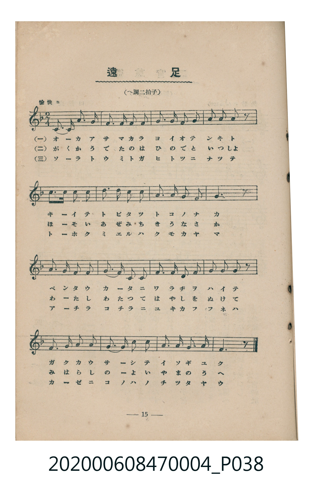
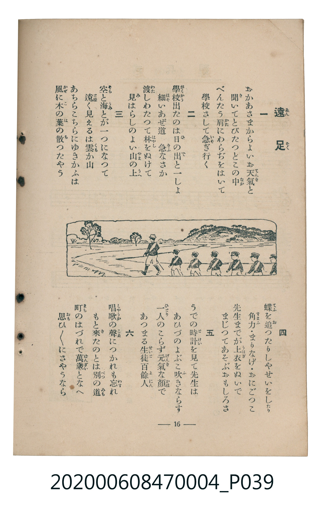

# 遠足

> Re:Shōka 使用 AI 協助辨識與重建樂譜，可能會有錯誤。歡迎回報。

- **鋼琴伴奏版**：<br><audio controls src="ensoku.mp3"></audio>
- **NEUTRINO 歌聲合成版**：<br><audio controls src="ensoku_neutrino.mp3"></audio>

- 詞：文部省
- 曲：文部省
- 臺灣教育會公認《新定兒童唱歌》尋常科第四學年用（2020.006.0847.0004）

## 說明

原書資訊與歌詞全文（對應 P038.jpg–P039.jpg，書頁 pp. 15–16，第二學期第 4 首）：
調性與拍號：へ調二拍子（F 大調 2/4 拍）
速度指示：愉快ニ


## 歌詞

```text
一
おかあさまからよいお天氣（てんき）と
聞（き）いてとびたつとこの中（なか）
べんたう肩（かた）にわらぢをはいて
學校（がくかう）さして急（いそ）ぎ行く

二
學校出たのは日（ひ）の出（で）と一しょ
細（ほそ）いあぜ道　急（きふ）なさか
渡（わた）しわたつて林（はやし）をぬけて
見（み）はらしのよい山（やま）の上（うへ）

三
空（そら）と海（うみ）とが一つになつて
遠（とほ）く見えるは雲（くも）か山
あちらこちらにゆきかふふねは
風（かぜ）に木（こ）の葉（は）の散（ち）つたやう

四
蝶（てふ）を追（お）つたりしやせいをしたり
角力（すまふ）・まりなげ・おにごつこ
先生までが上衣（うはぎ）をぬいで
まじつてあそぶおもしろさ

五
うでの時計（とけい）を見て先生は
あひづのよぶこ吹（ふ）きならす
一人（ひとり）のこらず元氣（げんき）な顏（かほ）で
あつまる生徒（せいと）百餘人（よにん）

六
唱歌（しゃうか）の聲（こゑ）につかれも忘（わす）れ
もと來（き）たのとは別（べつ）の道（みち）
町（まち）のはづれで萬歲（ばんざい）となへ
思（おも）ひ思ひにさやうなら
```

## ABC

<div class="abc-score" data-abc-src="ensoku.abc" aria-label="五線譜載入中"></div>

[下載 ABC 原始檔](ensoku.abc)

## TMD 檔案連結

- [主旋律 TMD 檔案](ensoku.tmd) [[在 TMD Studio 編輯](https://tmdlang.github.io/Tmd-TS/#tmd=s7IKdvYPcrWy4qpTUCpJTLdSSM7PyUlNLsnMz7MqzsjMK0nNjM_KTMmPL87Iz05Ugisry88pzU21Si9KTEmNN4k3MjAyiDcwMIs3sDAxBzIMTBBKi_NLi5JTrYqTM_Lzc-JLUitKkvLzsxHyBUX5Zal5iXlANQVFIBtTwIoQClLLMlNSQdKpKZkl-UWZiTlI7kgtKga7FWxJfElRYl5xclFmAcgDCFUlGalAx0JdkJOZloqQApqXnplnlZufl1QK9COyRElGPtB_BRmVVhmZxSCLkxNz4rMT85CCAWptQWJ6qlWAgbGFLpCwVOLS0lJ42bjgxbbNClpaXIq2CoYGFlz2tgpuXDZG-iZ2IN0vVs57v2fWs2ntL5tXPJ_TCDbx2exNGGIv2nc9b1z8bOrMF02bns1pftq65sWq3scNXc-mbXi6btbT1knPVy99OmXjs7U9jxu6n27ofrpjx_PlE5-vWfN09uyna3c83bnl-ZQV7_d0gCJIDxhBeqAIAjIMTN7v6VTi4tLXUrClFuBSUFB42jf_2ewdLza3v1jR9aKjHeguoE-ftq4A-groiqcbep-1dyqAQkovqyD9UcNkUHiBmO_39AD1vVzQqFBQoKdgaAqUMjQDCgJ98mRXD9Anz-bMB7IVTBReLpsGdDowoEDWvVi1_1nDcpBF3b0vZs4Hij5u3AEUBOoBijxdOwFoqZvC0yXLgWIKwLBXAIoCdYO0vmyY_3TXsmc97c-X7AIFe0vn0_2rHzd3c4Ekn-xoAFGPG7seN3Y_bmx63Dj1ceM-ELup83FTx-PGFqDU0yUrn21YDLThceOyx02THzeCjH7cuALssEZg_AIlIEJA1cuAEo8bNz9unP-4cQmYDdSw7smOtWBlq4BGQ931uHEn2DCgurYXTSvB0kAnAP0GNGj146Z-kBMaFz1umvS4cT3EaHDAA4NowUKw6p7Hjf1gPW1gPUCXTwcqetawFCwL1DAXLN73YiFIJcS_u3oQhjxt3wW2fh3QgmfTIbqAKROoZR1QCsxdDvEpMJhAhje1gzQ_37IBLLcbZgHQJmDAzXkJ9GlDA8z63seNW8GyQC8DXdYN0vlsB9jhQK9BvQk0EsQGh9SyZ_Omg3Wuf9wENBHIBsYA0O9rHjdOhPr9xTJg4AFV7AdrBqoDGwF0Pzimnm7cCDYdqHkfxBdPdnSB1bcBEwso1CExDg795yshHpwLNATix2dbt8MUQ8wHRl0P2ONAx60G-wPkSnCSalwAVgpUsRustB_osseNQLuB5PqXoOwNlAVGYBNYthvoMkiMA4NpIdjVwHiHMIARDbQQGFhAnVvBaC3QCLAli0D5GSwxB5Imns2BiEyG-O7FRKDLQeEF4T6bCkmiwCAGcoFOnQ8Oijawr4GlBDgA526DJmNI5DRNerF_L1gEGFBwXcC8AIwYoN7ZoLgFxQEwkEHiYCOWT3raNRusZyY4q4ANagYmhn1gncBgmgTmAtnAUJsCNnQy2A2tHc-nAOMaqGc5OGi7XiyEOBkYAsAU3ocU40DLl0OCDKh6BiTkwcE393HjNpDZTUA20JHAgJsKTdhTIOqBZgFNX_dsZtOLFR2wWAImoBaof0ERtQzmFHBAg83d9LhxKSwlAS2Y_HTCTrBmSBoGWrMKHF0zoYXGk12Q5APUtgLobUgMgKIVpAhYXDfDCoxJSAXGqpcL-2FRCkk3UD8C7Qd6EBh-3UBXPd03CawIHPiNwBjvfD5z38slM6BWghwITDSgNACJ2da1YApcN4A1AoOlGRwOoJIGlE5AmRqUbB43TYQWLiDrgEVcDzAYn-6fAcuTM8FBBC4gwOG74sk-YMkCL9wgJQUwNNc_7YDk8Z1AgyB2APM-JGdC0h84h02BBBEwAiFJElTMgEIZaG3j8hcT1jxbC3HXBnAQTYNGEcgCYBraAS4vGoAFDChxwnLSJqAIONCBXpgKSd6QmAGpprxigwIFLX0uLte84vzsUquAzMS8fIcag5pqkBUKNoZmWnZgFrYKVQFUi-1oAJa3ChomCk839D9f36ADrwU1sWgA2gQ1TAOoUdMKGPCrFB437wHSq4F4kUINkNwKFJkHEWleCRJpXgHkLYGqbQOLbAby1gLpDqBpyIbu6gEZ2tgDxP1A3A3KISANjcuBeD4QrwPi9WCRTVAeSGYFWKQFiBcDMajkR3VqJ9ipeyFOBToKZDHIqcuALKCpQN7jpjVgh02C8JqBZjV3g0W6gLgZ7HC4U2sUTOMVdIEQSBmDGUZAMUMwyxBMg3ANUBQiB-KB2DVg1TBsABIBm-djCHJ-F1g1xNNNYDZIBzDlQMX3geWArKZOiExTB1QG5HGQbmBRAZWZDOb1gskVQBLkXKhdRiAze6A6IYEMYcMCGsKDBDaItR7qjk1QGUigw0yGBDyItxhMggMfxUJjkJK5UA9BHA_RDBJvg_L2Q42DOA3ZOmDiaVwCZq2GyqxCsg7kYYhd-JP5rh7KkjkosYKSOTAZQ5MwKJVMBooAXQ5MLVCRJmDCbu4DpxpQNKwGGQMGWBL5boiRwKABhSDIY01APAcaGAvBIr3gIAJ5GZQOQCLdWI2EpHCwm0ApfDbQbnAuAaXuJmAINoMyYz_YTeuBrEXQ7LkErGYeupHA9A0OfFMwDcI1CmZgETMkEUjKNwanbOT0DoHoqRuUFmGpFSmlgiMdxAcGHDDNgVigyEaWAQYyNCWCIh4SBgh70FP2brg9oCQHsQ0SthBRSPiCWAuhMhCXAetOeNIC5Tg89oATNMR1INUgG0E5CaIHZDaID0oM4NwKzz8gFaAMAIplSD6GuW0fhj0EyuxOihJz80xoCQxMZ8AiEJJQIckblJghxR4omYAKSqBrmzeBRYBlBTT5Y0vOTUBpcHIGFRzTwYaCChcQD1Qmg60BBgXI0yB5YNsGLLIGiCeC5bElaGCNAknQjbC6BJzBIDyYS4GFOCh7gv0AziNA8nEzMOcAXYyUpGEFNXrxbAgpzMEEohA3B3ERykCaQTR6qt4JjVNQGoWkXlCBhpx2YOLQwgsYKLBiENhbArMmQXWA0gly7kBL2VCdCBOno5oIDWrkvAUyEZLOIKoRdq0Bq5uIzS5w6obVP5BcAq9xgHkRJgoRQ_gLVpCDSixIut8K1QOigf0EMAlyEREpHNj-p6y4BiYrUEEHbpVAUjioVQJK4dthBTi4RQJsEjQB6zNgGoIUjXiKa1ChDDISFHHg9A2qCMFGArM6pAAHBzSomgZVkZDqdAee4hqe60ApHJyW4dUHKDP1gdMyKK0Dmx_gnAkuroH-wSiuIanWCN60QDQ9sBfXEDUQXdiLa_QGAiJhQ5ojsASISGyghAspdoF9I3CigemAJVxsxTWsuISELFKyBhf5kOQLaubAC3JwoQniQ8IZ2WU7sNsDTtCI7DgHTMLaErAEDWlXQlgQGVDCB_FBpRc4w8GLa0hSR7anlotL104B0gZXALKUuQA)]
- [鋼琴伴奏 TMD 檔案](ensoku_piano.tmd) [[在 TMD Studio 編輯](https://tmdlang.github.io/Tmd-TS/#tmd=s7IKdvYPcrWy4qpTUCpJTLdSyC8qychPL0osyKi0ysgsLskvykxOzInPTsxLVIIrKs4vLUpOjS9ITE-1CjAwttAFEpZKXFpaCi8bF7zYtvn9no6X3XueT9jyZM-Wp0v7n3d2vN_TqaClxaVoq2BoYMFlb6vgxmVjpG9iBzLyxcp57_fMejat_WXziudzGsHWPJu9CUPsRfuu542Ln02d-aJp07M5zU9b17xY1fu4oevZtA1P18162jrp-eqlT6dsfLa253FD99MN3U937Hi-fOLzNWuezp79dO2Opzu3PJ-yAug0IwMjAz0DAzM9AwsTcyDDwAToOiUuLte84vzsUquAzMS8_CAPhxqDmmouBSCwMTTTsgOz9LUUbNGBAtCCJzsaXizsUdAwUXi6of_5-gYdBVCo6GUVpGti0aClDzNMA6hR00rhcdMqhcfNe4D0aiBepFADJLcCReZBRJpXgkSaVwB5S6Bq28Aim4G8tUC6A2gasqG7ekCGNvYAcT8QdwMxWEPjciCeD8TrgHg9WGQTlAeSWQEWaQHixUA8_XFTO6pTO8FO3QtxKtBRIItBTl0GZAFNBfIeN60BO2wShNcMNKu5GyzSBcTNYIfDnVqjYBqvoAuEQMoYzDACihmCWYZgGoRrgKIQORAPxK4Bq4ZhA5AI2DwfQ5Dzu8CqIZ5uArNBOh43ToWK7wPLAVlNnRCZpg6oDMjjIN2PG5dBZSaDeb1gcgWQBDkXapcRyMweqE5IIEPYsICG8CCBDWKth7pjE1QGEugwkyEBD-ItBpPgwEex0BikZC7UQxDHQzSDxNugvP1Q4yBOQ7YOmHgal4BZq6Eyq5CsA3kYYhf-ZL6rh7JkDkqsoGQOTMbQJAxKJZOBIkCXA1MLVKQJmLCb-8CpBhQNq0HGgAGWRL4bYiQwaEAhCPJYExDPgQbGQrBILziIQF4GpQOQSDdWIyEpHOwmUAqfDbQbnEtAqbsJGILNoMzYD3bTeiBrETR7LgGrmYduJDB9gwPfFEyDcI2CGVjEDEkEkvKNwSkbOb1DIHrqBqVFWGpFSqngSAfxgQEHTHMgFiiykWWAgQxNiaCIh4QBwh70lL0bbg8oyUFsg4QtRBQSviDWQqgMxGWPG4HlFjRpgXIcHnvACRriOpBqkI2gnATRAzIbxAclBnBuhecfkApQBgDFMiQfw9y2D8MeAmV2J0WJuXkmtAQGpjNgEQhJqJDkDUrMkGIPlExABSXQtc2bwCLAsgKa_LEl5yagNDg5gwqO6WBDQYULiAcqk8HWAIMC5GmQ_OOmSWCRNUA8ESyPLUEDaxRIgm6E1SXgDAbhwVwKLMRB2RPsB3AeAZKPm4E5B-hipCQNK6jRi2dDSGEOJhCFuDmIi1AG0gyi0VP1TmicgtIoJPWCCjTktAMThxZewECBFYOPG2eAWZOgOkDpBDl3oKVsqE6EidNRTYQGNXLeApkISWcQ1Qi71oDVTcRmFzh1w-ofSC6B1zjAvAgThYgh_AUryEElFiTdb4XqAdGPG9eCSZCLiEjhwGYPZcU1MFmBCjpwqwSSwkGtElAK3w4rwMEtEmCToAlYnwHTEKRoxFNcgwplkJGgiAOnb1BFCDYSmNUhBTg4oEHVNKiKhFSnO_AU1_BcB0rh4LQMrz5AmakPnJZBaR3Y_ADnTHBxDfQPRnENSbVG8KYFoumBvbiGqIHowl5cozcQEAkb0hyBJUBEYgMlXEix-7ixD5xoYDpgCRdbcQ0rLiEhi5SswUU-JPmCmjnwghxcaIL4kHBGdtkO7PaAEzQiO84Bk7C2BCxBQ9qVEBZEBpTwQXxQ6QXOcPDiGpLUke2pRW2C-yA3wS1o0QIHRl68QrRhLLDYgtBYBMAsZ3OoEIgBVwSkDGjSZMLiDBMgwwRsJaY7nRHuhIgQdhU5dR_OwEF2BiJoMFUQdBZZBRYpzsLmTpCrgClP104BkviifYDiSDwjFJ4xmKfMBQA)]

## 分析

```text
================================================================================
📊 TMD Song Profile: [ 遠足 ]
================================================================================
⏱  Duration:       0:17 (17.8s), 16 measures total
🎼 Key & Tempo:    首調基準 F, != 108.0 BPM, <2/4>
   - 分析範圍：      由實際發聲的音符與和弦推測調性；播放脈絡另行呈現
🎤 人聲音域:    C4 (MIDI 60) – D5 (MIDI 74) [跨度: 14 個半音 / 1.2 個八度, 難度: moderate]
   - 最低音:  C4 in [Ensoku #1 @ m.1, 0:00]
   - 最高音: D5 in [Ensoku #1 @ m.6, 0:05]
   - 適合: soprano, mezzo-soprano, contralto, tenor, baritone, bass
🏛  結構:      Ensoku (17.8s)
⚡ 編曲密度:        Peak 1 軌道同時演奏
🗝  調性診斷：       F 大調（純淨自然大調，未偵測到可信轉調）
   - 風格氣質:    純淨自然大調（陽光明朗、易唱易記，無明顯調外色彩）
   - 轉調歷程:    全曲維持單一推測調性（未偵測到可信轉調）
   - 核心骨幹音:  F, G, A, C, D
   - 調性數值:    F 大調 [相關度: 0.78, 穩定度: Moderate, 自然音純度: 100.0%]
   - 候選調性 (K-S): F 大調 (0.78), C 大調 (0.73), A 小調 (0.61)
   - 五度圈歷程:   -1
   - 各段落調性細節:
     • [Ensoku #1]: F 大調 (r: 0.78, 自然音純度: 100.0%)

  [ 五度圈游移軌跡 ]
               C  
        [F ]*          G  
      Bb               D  
      Eb               A  
         Ab           E  
            Db       B  
               F# 
     (* = active key center)

  [ 十二半音累積音高分佈 ]
     C  : ██████████████████        20.0%
     C# :                            0.0%
     D  : ███                        3.3%
     D# :                            0.0%
     E  : ██                         1.7%
     F  : ████████████████████████  26.7%
     F# :                            0.0%
     G  : ███████████████████████   25.0%
     G# :                            0.0%
     A  : █████████████████████     23.3%
     A# :                            0.0%
     B  :                            0.0%
--------------------------------------------------------------------------------
Assignment 軌道音域：
  - Piano         : C4 – D5 (14 個半音 / 1.2 個八度, 56 個音符)
================================================================================
```


## 原書掃描頁






