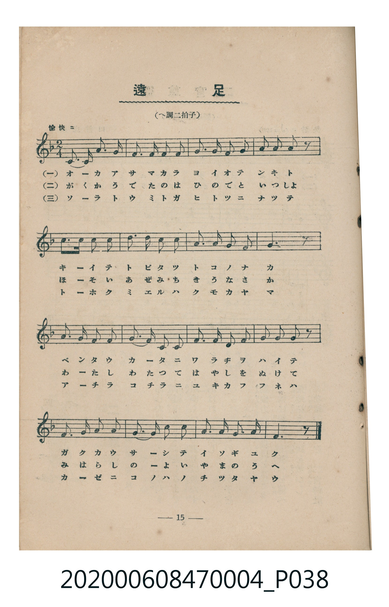
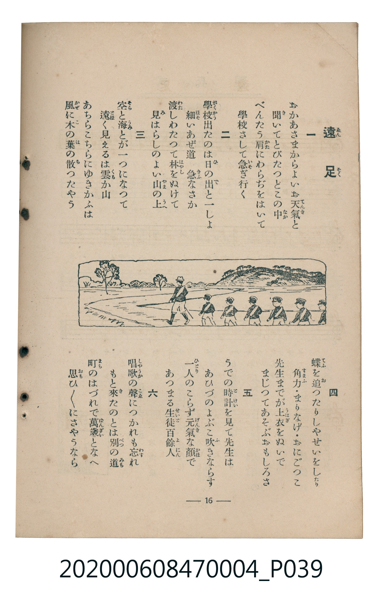

# 遠足

> Re:Shōka 使用 AI 協助辨識與重建樂譜，可能會有錯誤。歡迎回報。

- **NEUTRINO 歌聲合成版**：<br><audio controls src="ensoku_neutrino.mp3"></audio>
- **鋼琴伴奏版**：<br><audio controls src="ensoku.mp3"></audio>


- 詞：文部省
- 曲：文部省
- 臺灣教育會公認《新定兒童唱歌》尋常科第四學年用（2020.006.0847.0004）

## 說明

原書資訊與歌詞全文（對應 P038.jpg–P039.jpg，書頁 pp. 15–16，第二學期第 4 首）：
調性與拍號：へ調二拍子（F 大調 2/4 拍）
速度指示：愉快ニ

## 歌詞

```text
一
おかあさまからよいお天氣（てんき）と
聞（き）いてとびたつとこの中（なか）
べんたう肩（かた）にわらぢをはいて
學校（がくかう）さして急（いそ）ぎ行く

二
學校出たのは日（ひ）の出（で）と一しょ
細（ほそ）いあぜ道　急（きふ）なさか
渡（わた）しわたつて林（はやし）をぬけて
見（み）はらしのよい山（やま）の上（うへ）

三
空（そら）と海（うみ）とが一つになつて
遠（とほ）く見えるは雲（くも）か山
あちらこちらにゆきかふふねは
風（かぜ）に木（こ）の葉（は）の散（ち）つたやう

四
蝶（てふ）を追（お）つたりしやせいをしたり
角力（すまふ）・まりなげ・おにごつこ
先生までが上衣（うはぎ）をぬいで
まじつてあそぶおもしろさ

五
うでの時計（とけい）を見て先生は
あひづのよぶこ吹（ふ）きならす
一人（ひとり）のこらず元氣（げんき）な顏（かほ）で
あつまる生徒（せいと）百餘人（よにん）

六
唱歌（しゃうか）の聲（こゑ）につかれも忘（わす）れ
もと來（き）たのとは別（べつ）の道（みち）
町（まち）のはづれで萬歲（ばんざい）となへ
思（おも）ひ思ひにさやうなら
```

## ABC

```abc
X:1
T:遠足
C:曲：文部省
M:2/4
L:1/16
Q:1/4=108
K:F
V:V1 name="Piano" snm="Pia"
[V:V1]
C3 C A3 G | F3 F F2 F2 | G3 G F2 G2 | A2 A2 A2 z2 |
w: 1.~お か あ _ | さ ま か ら | よ い お て | ん き と
w: 2.~が く か う | で た の は | ひ の で と | い っ しょ
w: 3.~そ _ ら と | う み と が | ひ と つ に | な っ て
c3 c c2 c2 | d3 d c2 c2 | A3 A G2 F2 | G6 z2 |
w: 1.~き _ い て | と び た つ | と こ の な | か
w: 2.~ほ _ そ い | あ ぜ み ち | き ふ な さ | か
w: 3.~と _ ほ く | み え る は | く も か や | ま
A3 G F2 F2 | G3 F C2 C2 | F3 F E2 F2 | G2 A2 G2 z2 |
w: 1.~べ ん た う | か _ た に | わ ら ぢ を | は い て
w: 2.~わ _ た し | わ た っ て | は や し を | ぬ け て
w: 3.~あ _ ち ら | こ ち ら に | ゆ き か ふ | ふ ね は
F3 G A2 A2 | G3 G c2 c2 | A3 A G2 A2 | F6 z2 |
w: 1.~が く か う | さ _ し て | い そ ぎ ゆ | く
w: 2.~み は ら し | の _ よ い | や ま の う | へ
w: 3.~か _ ぜ に | こ の は の | ち っ た や | う
```

## TMD 檔案連結

- [主旋律 TMD 檔案](ensoku.tmd) [[在 TMD Studio 編輯](https://tmdlang.github.io/Tmd-TS/#tmd=s7IKdvYPcrWy4qpTUCpJTLdSSM7PyUlNLsnMz7MqzsjMK0nNjM_KTMmPL87Iz05Ugisry88pzU21Si9KTEmNN4k3MjAyiDcwMIs3sDAxBzIMTBBKi_NLi5JTrYqTM_Lzc-JLUitKkvLzsxHyBUX5Zal5iXlANQVFIBtTwIoQClLLMlNSQdKpKZkl-UWZiTlI7kgtKga7FWxJfElRYl5xclFmAcgDCFUlGalAx0JdkJOZlqrEpaWl8LJxwYttmxW0tLgUbRUMDSy47G0V3LhsjPRN7EA6X6yc937PrGfT2l82r3g-pxFs2rPZmzDEXrTvet64-NnUmS-aNj2b0_y0dc2LVb2PG7qeTdvwdN2sp62Tnq9e-nTKxmdrex43dD_d0P10x47nyyc-X7Pm6ezZT9fueLpzy_MpK97v6QCFoR4wDPVAYQhkGJi839OpxMWlr6VgSy3ApaCg8LRv_rPZO15sbn-xoutFRzvQXUCfPm1dAfQV0BVPN_Q-a-9UCDAwttDLKkh_1DAZyLQEMd_v6QHqe7mgUaGgQE_B0BQoZWgGFAT65MmuHqBPns2ZD2QrmCi8XDYN6HRgQIGse7Fq_7OG5SCLuntfzJwPFH3cuAMoCNQDFHm6dgLQUjeFp0uWA8UUgGGvABQF6gZpfdkw_-muZc962p8v2QUK9pbOp_tXP27u5gJJPtnRAKIeN3Y9bux-3Nj0uHHq48Z9IHZT5-OmjseNLUCpp0tWPtuwGGjD48Zlj5smP24EGf24cQXYYY3A-AVKQISAqpcBJR43bn7cOP9x4xIwG6hh3ZMda8HKVgGNhrrrceNOsGFAdW0vmlaCpYFOAPoNaNDqx039ICc0LnrcNOlx43qI0eCABwbRgoVg1T2PG_vBetrAeoAunw5U9KxhKVgWqGEuWLzvxUKQSoh_d_UgDHnavgts_TqgBc-mQ3QBUyZQyzqgFJi7HOJTYDCBDG9qB2l-vmUDWG43zAKgTcCAm_MS6NOGBpj1vY8bt4JlgV4GuqwbpPPZDrDDgV6DehNoJIgNDqllz-ZNB-tc_7gJaCKQDYwBoN_XPG6cCPX7i2XAwAOq2A_WDFQHNgLofnBMPd24EWw6UPM-iC-e7OgCq28DJhZQqENiHBz6z1dCPDgXaAjEj8-2bocphpgPjLoesMeBjlsN9gfIleAk1bgArBSoYjdYaT_QZY8bgXYDyfUvQdkbKAuMwCawbDfQZZAYBwbTQrCrgfEOYQAjGmghMLCAOreC0VqgEWBLFoHyM1hiDiRNPJsDEZkM8d2LiUCXg8ILwn02FZJEgUEM5AKdOh8cFG1gXwNLCXAAzt0GTcaQyGma9GL_XrAIMKDguoB5ARgxQL2zQXELigNgIIPEwUYsn_S0azZYz0xwVgEb1AxMDPvAOoHBNAnMBbKBoTYFbOhksBtaO55PAcY1UM9ycNB2vVgIcTIwBIApvA8pxoGWL4cEGVD1DEjIg4Nv7uPGbSCzm4BsoCOBATcVmrCnQNQDzQKavu7ZzKYXKzpgsQRMQC1Q_4IiahnMKeCABpu76XHjUlhKAlow-emEnWDNkDQMtGYVOLpmQguNJ7sgyQeobQXQ25AYAEUrSBGwuG6GFRiTkAqMVS8X9sOiFJJuoH4E2g_0IDD8uoGuerpvElgROPAbgTHe-XzmvpdLZkCtBDkQmGhAaQASs61rwRS4bgBrBAZLMzgcQCUNKJ2AMjUo2TxumggtXEDWAYu4HmAwPt0_A5YnZ4KDCFxAgMN3xZN9wJIFXrhBSgpgaK5_2gHJ4zuBBkHsAOZ9SM6EpD9wDpsCCSJgBEKSJKiYAYUy0NrG5S8mrHm2FuKuDeAgmgaNIpAFwDS0A1xeNAALGFDihOWkTUARcKADvTAVkrwhMQNSTXnFBgUKWvpcXK55xfnZpVYBmYl5-Q41BjXVICsUbAzNtOzALGwVqgKoFtvRACxvFTRMFJ5u6H--vkEHXgtqYtEAtAlqmAZQo6YVMOBXKTxu3gOkVwPxIoUaILkVKDIPItK8EiTSvALIWwJV2wYW2QzkrQXSHUDTkA3d1QMytLEHiPuBuBuUQ0AaGpcD8XwgXgfE68Eim6A8kMwKsEgLEC8GYlDJj-rUTrBT90KcCnQUyGKQU5cBWUBTgbzHTWvADpsE4TUDzWruBot0AXEz2OFwp9YomMYr6AIhkDIGM4yAYoZgliGYBuEaoChEDsQDsWvAqmHYACQCNs_HEOT8LrBqiKebwGyQDmDKgYrvA8sBWU2dEJmmDqgMyOMg3cCiAiozGczrBZMrgCTIuVC7jEBm9kB1QgIZwoYFNIQHCWwQaz3UHZugMpBAh5kMCXgQbzGYBAc-ioXGICVzoR6COB6iGSTeBuXthxoHcRqydcDE07gEzFoNlVmFZB3IwxC78CfzXT2UJXNQYgUlc2AyhiZhUCqZDBQBuhyYWqAiTcCE3dwHTjWgaFgNMgYMsCTy3RAjgUEDCkGQx5qAeA40MBaCRXrBQQTyMigdgES6sRoJSeFgN4FS-Gyg3eBcAkrdTcAQbAZlxn6wm9YDWYug2XMJWM08dCOB6Rsc-KZgGoRrFMzAImZIIpCUbwxO2cjpHQLRUzcoLcJSK1JKBUc6iA8MOGCaA7FAkY0sAwxkaEoERTwkDBD2oKfs3XB7QEkOYhskbCGikPAFsRZCZSAuA9ad8KQFynF47AEnaIjrQKpBNoJyEkQPyGwQH5QYwLkVnn9AKkAZABTLkHwMc9s-DHsIlNmdFCXm5pnQEhiYzoBFICShQpI3KDFDij1QMgEVlEDXNm8CiwDLCmjyx5acm4DS4OQMKjimgw0FFS4gHqhMBlsDDAqQp0HywLYNWGQNEE8Ey2NL0MAaBZKgG2F1CTiDQXgwlwILcVD2BPsBnEeA5ONmYM4BuhgpScMKavTi2RBSmIMJRCFuDuIilIE0g2j0VL0TGqegNApJvaACDTntwMShhRcwUGDFILC3BGZNguoApRPk3IGWsqE6ESZORzURGtTIeQtkIiSdQVQj7FoDVjcRm13g1A2rfyC5BF7jAPMiTBQihvAXrCAHlViQdL8VqgdEA_sJYBLkIiJSOLD9T1lxDUxWoIIO3CqBpHBQqwSUwrfDCnBwiwTYJGgC1mfANAQpGvEU16BCGWQkKOLA6RtUEYKNBGZ1SAEODmhQNQ2qIiHV6Q48xTU814FSODgtw6sPUGbqA6dlUFoHNj_AORNcXAP9g1FcQ1KtEbxpgWh6YC-uIWogurAX1-gNBETChjRHYAkQkdhACRdS7AL7RuBEA9MBS7jYimtYcQkJWaRkDS7yIckX1MyBF-TgQhPEh4Qzsst2YLcHnKAR2XEOmIS1JWAJGtKuhLAgMqCED-KDSi9whoMX15CkjmxPLReXrp0CpA2uAGQpcwEA)]
- [鋼琴伴奏 TMD 檔案](ensoku_piano.tmd) [[在 TMD Studio 編輯](https://tmdlang.github.io/Tmd-TS/#tmd=s7IKdvYPcrWy4tLSUnjZuODFts3v93S87N7zfMKWJ3u2PF3a_7yz4_2eTgUtLS5FWwVDAwsue1sFNy4bI30TO646BaUXK-e93zPr2bT2l80rns9pVAKJPZu9CUPsRfuu542Ln02d-aJp07M5zU9b17xY1fu4oevZtA1P18162jrp-eqlT6dsfLa253FD99MN3U937Hi-fOLzNWuezp79dO2Opzu3PJ-yAug0IwMjAz0DAzM9AwsTcyDDwAToOiUuLte84vzsUquAzMS8_CAPhxqDmmouBSCwMTTTsgOz9LUUbNGBAtCCJzsaXizsUdAwUXi6of_5-gYdhQADYwu9rIJ0TSwatPRhhmkANWpaKTxuWqXwuHkPkF4NxIsUaoDkVqDIPIhI80qQSPMKIG8JVG0bWGQzkLcWSHcATUM2dFcPyNDGHiDuB-JuIAZraFwOxPOBeB0QrweLbILyQDIrwCItQLwYiKc_bmpHdWon2Kl7IU4FOgpkMcipy4AsoKlA3uOmNWCHTYLwmoFmNXeDRbqAuBnscLhTaxRM4xV0gRBIGYMZRkAxQzDLEEyDcA1QFCIH4oHYNWDVMGwAEgGb52MIcn4XWDXE001gNkjH48apUPF9YDkgq6kTItPUAZUBeRyk-3HjMqjMZDCvF0yuAJIg50LtMgKZ2QPVCQlkCBsW0BAeJLBBrPVQd2yCykACHWYyJOBBvMVgEhz4KBYag5TMhXoI4niIZpB4G5S3H2ocxGnI1gETT-MSMGs1VGYVknUgD0Pswp_Md_VQlsxBiRWUzIHJGJqEQalkMlAE6HJgaoGKNAETdnMfONWAomE1yBgwwJLId0OMBAYNKARBHmsC4jnQwFgIFukFBxHIy6B0ABLpxmokJIWD3QRK4bOBdoNzCSh1NwFDsBmUGfvBbloPZC2CZs8lYDXz0I0Epm9w4JuCaRCuUTADi5ghiUBSvjE4ZSOndwhET92gtAhLrUgpFRzpID4w4IBpDsQCRTayDDCQoSkRFPGQMEDYg56yd8PtASU5iG2QsIWIQsIXxFoIlYG47HEjsNyCJi1QjsNjDzhBQ1wHUg2yEZSTIHpAZoP4oMQAzq3w_ANSAcoAoFiG5GOY2_Zh2EOgzO6kKDE3z4SWwMB0BiwCIQkVkrxBiRlS7IGSCaigBLq2eRNYBFhWQJM_tuTcBJQGJ2dQwTEdbCiocAHxQGUy2BpgUIA8DZJ_3DQJLLIGiCeC5bElaGCNAknQjbC6BJzBIDyYS4GFOCh7gv0AziNA8nEzMOcAXYyUpGEFNXrxbAgpzMEEohA3B3ERykCaQTR6qt4JjVNQGoWkXlCBhpx2YOLQwgsYKLBi8HHjIjBrElQHKJ0g5w60lA3ViTBxOqqJ0KBGzlsgEyHpDKIaYdcasLqJ2OwCp25Y_QPJJfAaB5gXYaIQMYS_YAU5qMSCpPutUD0g-nHjWjAJchERKRzY7KGsuAYmK1BBB26VQFI4qFUCSuHbYQU4uEUCbBI0AeszYBqCFI14imtQoQwyEhRx4PQNqgjBRgKzOqQABwc0qJoGVZGQ6nQHnuIanutAKRycluHVBygz9YHTMiitA5sf4JwJLq6B_sEoriGp1gjetEA0PbAX1xA1EF3Yi2v0BgIiYUOaI7AEiEhsoIQLKXYfN_aBEw1MByzhYiuuYcUlJGSRkjW4yIckX1AzB16QgwtNEB8Szsgu24HdHnCCRmTHOWAS1paAJWhIuxLCgsiAEj6IDyq9wBkOXlxDkjqyPbWoTXAf5Ca4BS1a4MDIi1eINowFFlsQGosAmOVsDhUCMeCKgJQBTZpMWJxhAmSYgK3EdKczwp0QEcKuIqfuwxk4yM5ABA2mCoLOIqvAIsVZ2NwJchUw5enaKUASX7QPUByJZ4TCMwbzlLkA)]

## 分析

```text
================================================================================
📊 TMD Song Profile: [ 遠足 ]
================================================================================
⏱  Duration:       0:17 (17.8s), 16 measures total
🎼 Key & Tempo:    首調基準 F, != 108.0 BPM, <2/4>
   - 分析範圍：      由實際發聲的音符與和弦推測調性；播放脈絡另行呈現
🎤 人聲音域:    C4 (MIDI 60) – D5 (MIDI 74) [跨度: 14 個半音 / 1.2 個八度, 難度: moderate]
   - 最低音:  C4 in [Ensoku #1 @ m.1, 0:00]
   - 最高音: D5 in [Ensoku #1 @ m.6, 0:05]
   - 適合: soprano, mezzo-soprano, contralto, tenor, baritone, bass
🏛  結構:      Ensoku (17.8s)
⚡ 編曲密度:        Peak 1 軌道同時演奏
🗝  調性診斷：       F 大調（純淨自然大調，未偵測到可信轉調）
   - 風格氣質:    純淨自然大調（陽光明朗、易唱易記，無明顯調外色彩）
   - 轉調歷程:    全曲維持單一推測調性（未偵測到可信轉調）
   - 核心骨幹音:  F, G, A, C, D
   - 調性數值:    F 大調 [相關度: 0.78, 穩定度: Moderate, 自然音純度: 100.0%]
   - 候選調性 (K-S): F 大調 (0.78), C 大調 (0.73), A 小調 (0.61)
   - 五度圈歷程:   -1
   - 各段落調性細節:
     • [Ensoku #1]: F 大調 (r: 0.78, 自然音純度: 100.0%)

  [ 五度圈游移軌跡 ]
               C  
        [F ]*          G  
      Bb               D  
      Eb               A  
         Ab           E  
            Db       B  
               F# 
     (* = active key center)

  [ 十二半音累積音高分佈 ]
     C  : ██████████████████        20.0%
     C# :                            0.0%
     D  : ███                        3.3%
     D# :                            0.0%
     E  : ██                         1.7%
     F  : ████████████████████████  26.7%
     F# :                            0.0%
     G  : ███████████████████████   25.0%
     G# :                            0.0%
     A  : █████████████████████     23.3%
     A# :                            0.0%
     B  :                            0.0%
--------------------------------------------------------------------------------
Assignment 軌道音域：
  - Piano         : C4 – D5 (14 個半音 / 1.2 個八度, 56 個音符)
================================================================================
```


## 原書掃描頁






