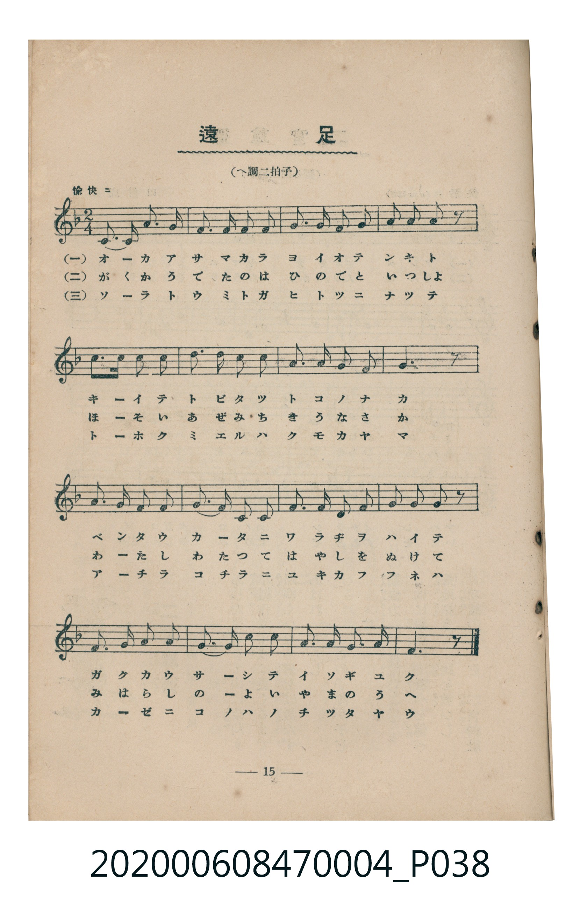
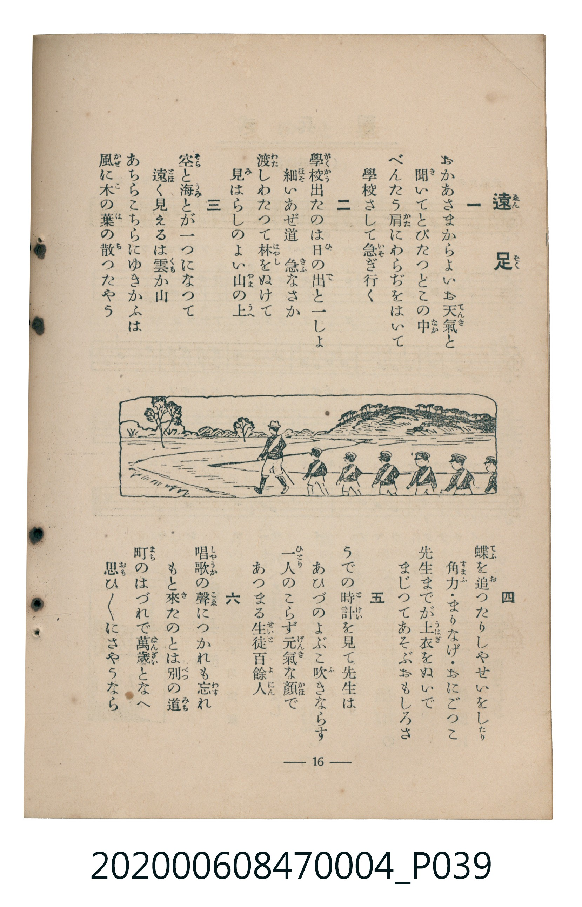

# 遠足

<audio controls src="ensoku.mp3"></audio>

- 詞：文部省
- 曲：文部省
- 臺灣教育會公認《新定兒童唱歌》尋常科第四學年用（2020.006.0847.0004）

- note

原書資訊與歌詞全文（對應 P038.jpg–P039.jpg，書頁 pp. 15–16，第二學期第 4 首）：
調性與拍號：へ調二拍子（F 大調 2/4 拍）
速度指示：愉快ニ

## 歌詞

```text
一
おかあさまからよいお天氣（てんき）と
聞（き）いてとびたつとこの中（なか）
べんたう肩（かた）にわらぢをはいて
學校（がくかう）さして急（いそ）ぎ行く

二
學校出たのは日（ひ）の出（で）と一しょ
細（ほそ）いあぜ道　急（きふ）なさか
渡（わた）しわたつて林（はやし）をぬけて
見（み）はらしのよい山（やま）の上（うへ）

三
空（そら）と海（うみ）とが一つになつて
遠（とほ）く見えるは雲（くも）か山
あちらこちらにゆきかふふねは
風（かぜ）に木（こ）の葉（は）の散（ち）つたやう

四
蝶（てふ）を追（お）つたりしやせいをしたり
角力（すまふ）・まりなげ・おにごつこ
先生までが上衣（うはぎ）をぬいで
まじつてあそぶおもしろさ

五
うでの時計（とけい）を見て先生は
あひづのよぶこ吹（ふ）きならす
一人（ひとり）のこらず元氣（げんき）な顏（かほ）で
あつまる生徒（せいと）百餘人（よにん）

六
唱歌（しゃうか）の聲（こゑ）につかれも忘（わす）れ
もと來（き）たのとは別（べつ）の道（みち）
町（まち）のはづれで萬歲（ばんざい）となへ
思（おも）ひ思ひにさやうなら
```

## 原書掃描頁





## 調性分析

```text
================================================================================
📊 TMD Song Profile: [ 遠足 ]
================================================================================
⏱  Duration:       0:17 (17.8s), 16 measures total
🎼 Key & Tempo:    首調基準 F, != 108.0 BPM, <2/4>
   - 分析範圍：      由實際發聲的音符與和弦推測調性；播放脈絡另行呈現
🎤 人聲音域:    C4 (MIDI 60) – D5 (MIDI 74) [跨度: 14 個半音 / 1.2 個八度, 難度: moderate]
   - 最低音:  C4 in [Ensoku #1 @ m.1, 0:00]
   - 最高音: D5 in [Ensoku #1 @ m.6, 0:05]
   - 適合: soprano, mezzo-soprano, contralto, tenor, baritone, bass
🏛  結構:      Ensoku (17.8s)
⚡ 編曲密度:        Peak 1 軌道同時演奏
🗝  調性診斷：       F 調性不明確（純淨自然大調，未偵測到可信轉調）
   - 風格氣質:    純淨自然大調（陽光明朗、易唱易記，無明顯調外色彩）
   - 轉調歷程:    全曲維持單一推測調性（未偵測到可信轉調）
   - 核心骨幹音:  F, G, C, D, A
   - 調性數值:    F 調性不明確 [相關度: 0.78, 穩定度: Ambiguous, 自然音純度: 100.0%]
   - 候選調性 (K-S): F 大調 (0.78), C 大調 (0.76), F 小調 (0.51)
   - 五度圈歷程:   -1
   - 各段落調性細節:
     • [Ensoku #1]: F 調性不明確 (r: 0.78, 自然音純度: 100.0%)

  [ 五度圈游移軌跡 ]
               C  
        [F ]*          G  
      Bb               D  
      Eb               A  
         Ab           E  
            Db       B  
               F# 
     (* = active key center)

  [ 十二半音累積音高分佈 ]
     C  : ████████████████          21.7%
     C# :                            0.0%
     D  : ██████                     8.3%
     D# :                            0.0%
     E  : █                          1.7%
     F  : ████████████████████████  31.7%
     F# :                            0.0%
     G  : █████████████████████     28.3%
     G# :                            0.0%
     A  : ██████                     8.3%
     A# :                            0.0%
     B  :                            0.0%
--------------------------------------------------------------------------------
Assignment 軌道音域：
  - Piano         : C4 – D5 (14 個半音 / 1.2 個八度, 56 個音符)
================================================================================
```

## ABC

```abc
X:1
T:遠足
C:曲：文部省
M:2/4
L:1/16
Q:1/4=108
K:F

V:V1 name="Piano" snm="Pia"

[V:V1]
c2 c2 f2 f2 | g2 f2 g2 a2 | g2 f2 d2 f2 | g2 g2 g2 z2 |
c2 c2 c2 c2 | d2 c2 a2 c2 | g2 g2 f2 d2 | f6 z2 |
g2 g2 f2 d2 | f2 g2 f2 d2 | c2 c2 c2 f2 | g2 a2 g2 z2 |
f2 f2 g2 g2 | a2 a2 c2 c2 | g2 f2 e2 g2 | f6 z2 |
```

- [主旋律 TMD 檔案](ensoku.tmd)
- [鋼琴伴奏 TMD 檔案](ensoku_piano.tmd)
