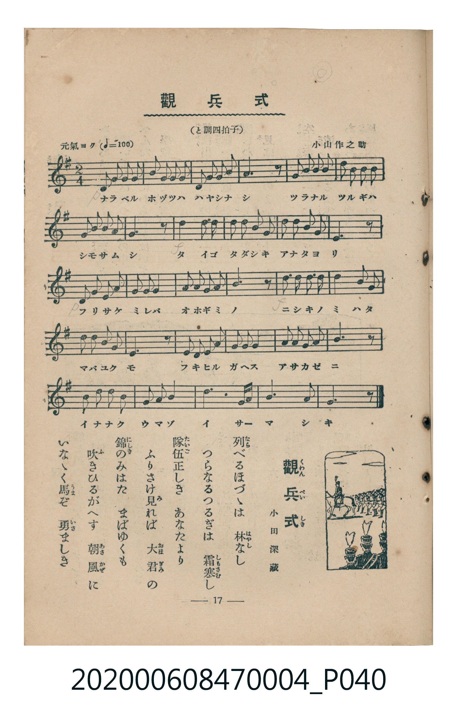

# 觀兵式

> Re:Shoka 使用 AI 協助辨識與重建樂譜，可能會有錯誤。歡迎回報。

<audio controls src="kanpeishiki.mp3"></audio>

- 詞：小田深藏
- 曲：小山作之助
- 臺灣教育會公認《新定兒童唱歌》尋常科第四學年用（2020.006.0847.0004）

## 說明

原書資訊與歌詞全文（對應 P040.jpg，書頁 p. 17，第二學期第 5 首）：
調性與拍號：標題註記「と調四拍子」，譜面拍號為 2/4 拍（G 大調 2/4 拍）
速度指示：元氣ヨク（♩=100）

## 歌詞

```text
列（なら）べるほづゝは　林（はやし）なし
つらなるつるぎは　霜寒（しもさむ）し
隊伍（たいご）正しき　あなたより
ふりさけ見（み）れば　大君（おほぎみ）の
錦（にしき）のみはた　まばゆくも
吹（ふ）きひるがへす　朝風（あさかぜ）に
いなゝく馬（うま）ぞ　勇（いさ）ましき
```

## ABC

```abc
X:1
T:觀兵式
C:曲：小山作之助
M:2/4
L:1/16
Q:1/4=100
K:G
V:V1 name="Piano" snm="Pia"
[V:V1]
D2 G2 G2 A2 | B2 A2 G2 E2 | D2 G2 A2 B2 | A6 z2 |
B2 d2 d2 B2 | e2 d2 B2 d2 | A2 B2 A2 E2 | G6 z2 |
!f! B8 | B4 c4 | d2 d2 e2 d2 | d2 B2 d2 B2 |
A6 z2 | !p! A2 A2 G2 A2 | B2 A2 G2 E2 | G2 A2 A2 B2 |
A6 z2 | !f! d2 d2 d2 d2 | e4 d2 B2 | d2 B2 A2 G2 |
E6 z2 | D2 D2 E2 D2 | G2 G2 A4 | A2 A2 G2 A2 |
B6 z2 | B2 d2 d2 B2 | A2 G2 A4 | d6 e d |
B6 A2 | G6 z2 |
```

## TMD 檔案連結

- [主旋律 TMD 檔案](kanpeishiki.tmd) [[在 TMD Studio 編輯](https://tmdlang.github.io/Tmd-TS/#tmd=s7IKdvYPcrWy4qpTUCpJTLdSSM7PyUlNLsnMz7MqzsjMK0nNjM_KTMmPL87Iz05Ugisry88pzU21Si9KTEmNN4k3MjAyiDcwMIs3sDAxBzIMTBBKi_NLi5JTrYqTM_Lzc-JLUitKkvLzsxHyBUX5Zal5iXlANQVFIBtTwIoQClLLMlNSQdKpKZkl-UWZiTlI7kgtKga7FWxJfElRYl5xclFmAcgDCFUlGalAxyanFqXm5ueB9WtpKbxY3vC0devTPf0KWlpcirYKhgYGXPa2Cu5cNkb6JnYgvS9Wznu_Z9bTDf3Pp2x4tn3ji-n9YCOfzd4EEX66ceOTvXOe7Ox-2rUSLPOifdfzxsXPps580bTp2Zzmp61rXqzqfdzQ9WzahqfrZj1tnfR89dKnUzY-W9vzuKH76Ybupzt2PF8-8fmaNU9nz366dsfTnVueT1nxfk8HKDj1gMGpBwpOIMPA5P2eTiUuLn0tBVtqAS4FBYWnffOfzd7xYnP7ixVdLzrage4Cevlp64pn09qBrni6ofdZe6dCgIGJgV5WQfr7PT1AxS8XNCoU6CkYmgO5QIc_2dUDdPizOfOBbAVThZfLpgFdCgwdkOkvVu1_1rAcZG5374uZ84Giz1bMfLmw58WK3S9WzHjc0PO4cQVQDdDvQAVP10543NALNPTF2jkv5y6CaHnetEsBGBkKQB7QPe4KT5csB2pACHWCrHnZMP_prmXPetqfL9kFipfW5mcbFj9uXvG4aT1Q06OZK22BMQtSC_Zxx3Sg4OPGVY-bgM7sfNy483FT9-PG3Y8blz5umvu4cf3jhoZn8yBq1j9uanncCGQDla0CMkD6HzcuAeoE6wdqA7KBZB9E28s5c56unwTWOf1xU9PjxqmPmxrAmsE6X87qerIH5I3HjfMfNwINngKUe7Z2MUh1IzCRNDxuBOoB2jP_cVPH46YuiG1bgSyQSY0TXyzrBmveDzKyCRh2G4B6gAHydMJssDhQGdAXQLeAFTSuA9vZswwstxpiCUQCqALkYKA9IDv3gQxqanvc2A90MziEJuwE69kKVt37uHET2JNAC3c8bpwJCp45c18uAqVSsIOBTgPKzgErXg1xM9BvwOABBmb_y2VrwOqAxu8Dq5gHcnM3KHGBlU0FCwKdAHIdSDPlyRoKFLT0ubi8E_MKUjOBxVh2plVAZmJevkONQY1CNcgiBRtDMy07MAtbplIAJe0dDS8W9ihomCmASoD1DTrwnKCJRQPQPqhhj5u7gHglEM8E4tUKNUByNhC3AnELEPeDRfqBeInC46btYPVAESALAkCyIHUgE0AmQUwAiawGqloH1gu1rUbBNF5BV8EQio2AuEbBGMoCiZiBpJFUgcRB8jVgFgwawPWZQjFEjRkSD0TXgLMQ7gDb1QMOMHNSAwwcCIuA9FYgvQA9MJr2I7GXgFJY0xa4zOPmBoj-prVgEaApoEADy6wAB9wqqG54kMHCAERDwwcUNKiBUZ1WC1aEDCFBBIImcBFYgMGCCiICCzAcQU0gGHd0kpnupoK9Cw7Gpo1gz88HBVfzGiCeAA4eoCwoLYJT0Xywij6kVNcND0qQOEI_MK0CAxQegNUFtWA_wRIZzmQHk8SX6kABDQtEGIakPBCEByL-IANWIWQG2Txw0DxuXgb04nqwlxchBQgwQMGBMQmWDZtAQTkDSO-EpkBoqm0CZc090EBES28wP8ACB-g7UPCgBgM4h4IJsCSYBQlAWCBC0hv2cCclde2aAg4qU5IzKbC0ApdHoOwFDqomYKCBArBpH1LmBGXPrY-bIWExDyqwHSy9Fj1kMEscZK8hMhgMmgF5qB6GBAFG9uWq5eLStVNAKv8VgFxlLi4A)]
- [鋼琴伴奏 TMD 檔案](kanpeishiki_piano.tmd) [[在 TMD Studio 編輯](https://tmdlang.github.io/Tmd-TS/#tmd=s7IKdvYPcrWy4tLSUnixvOFp69ane_rf7-l42b3n-YQtT_Zsebq0_3lnx_s9nQpaWlyKtgqGBgZc9rYK7lw2Rvomdlx1CkovVs57v2fW0w39z6dseLZ944vp_Uog4WezN0GEn27c-GTvnCc7u592rQTLvGjf9bxx8bOpM180bXo2p_lp65oXq3ofN3Q9m7bh6bpZT1snPV-99OmUjc_W9jxu6H66ofvpjh3Pl098vmbN09mzn67d8XTnludTVgDdaGRgZKBnYGCmZ2BhYg5kGJgAnanExeWdmFeQmlmckZmdaRWQmZiXH-ThUGNQo1DNpQAENoZmWnZglr6Wgi06UABa82RHw4uFPQoaZgogT61v0FEIMDAx0MsqSNfEokFLH2xYjYJpvIKugiEUGwFxjYIxlAUSMQNJI6kCiYPka8AsGDSA6zOFYogaMyQeiK7hwu-FXT1gL5iT5gWYm0A01L0gp6I6rjqtFqwIGUKcDIImcBGYB2BOh4jAPIDD6wS8taOTnJipLqgF2wSLCpyRA5PEFzcg78O8BsOQ-AFBuNfwewSYkslKYkjxA3Ir0F6Qw1EdCE5hYAIsCWZBvAbzHiR-sIcIKbGxawrYE6akeQIzcSO7ApF2YNAMyEN1G8S1GCmTqxZL3vdByfsW0KwP1B2vEG0YC6PgfLN4IG0WnwsSMgWxTeORFMFFQAwDLKaYABkmCD68ZEDSBmSYI1kIpEAGgVIVDidBzcTJx-k6pNSP7gIcPoYKISnC8DE2h2L3NaZhCKtALJBpeNyFyxGoqiDBhyNO8ehDD0ScMQNKVLp2CkjpSgHIVebiAgA)]

## 分析

```text
================================================================================
📊 TMD Song Profile: [ 觀兵式 ]
================================================================================
⏱  Duration:       0:36 (36.0s), 30 measures total
🎼 Key & Tempo:    首調基準 G, != 100.0 BPM, <2/4>
   - 分析範圍：      由實際發聲的音符與和弦推測調性；播放脈絡另行呈現
🎤 人聲音域:    D4 (MIDI 62) – E5 (MIDI 76) [跨度: 14 個半音 / 1.2 個八度, 難度: moderate]
   - 最低音:  D4 in [Kanpeishiki #1 @ m.1, 0:00]
   - 最高音: E5 in [Kanpeishiki #1 @ m.6, 0:06]
   - 適合: soprano, mezzo-soprano, contralto, tenor, baritone, bass
🏛  結構:      Kanpeishiki (36.0s)
⚡ 編曲密度:        Peak 1 軌道同時演奏
🗝  調性診斷：       D 大調（純淨自然大調，未偵測到可信轉調）
   - 風格氣質:    純淨自然大調（陽光明朗、易唱易記，無明顯調外色彩）
   - 轉調歷程:    全曲維持單一推測調性（未偵測到可信轉調）
   - 核心骨幹音:  A, B, D, G, E
   - 調性數值:    D 大調 [相關度: 0.78, 穩定度: Moderate, 自然音純度: 98.2%]
   - 候選調性 (K-S): D 大調 (0.78), G 大調 (0.69), B 小調 (0.62)
   - 五度圈歷程:   +2
   - 各段落調性細節:
     • [Kanpeishiki #1]: D 大調 (r: 0.78, 自然音純度: 98.2%, 調外音: C)

  [ 五度圈游移軌跡 ]
               C  
         F            G  
      Bb              [D ]*
      Eb               A  
         Ab           E  
            Db       B  
               F# 
     (* = active key center)

  [ 十二半音累積音高分佈 ]
     C  : ██                         1.8%
     C# :                            0.0%
     D  : ████████████████████      22.6%
     D# :                            0.0%
     E  : █████████                 10.2%
     F  :                            0.0%
     F# :                            0.0%
     G  : ██████████████            15.9%
     G# :                            0.0%
     A  : ████████████████████████  26.5%
     A# :                            0.0%
     B  : █████████████████████     23.0%
--------------------------------------------------------------------------------
Assignment 軌道音域：
  - Piano         : D4 – E5 (14 個半音 / 1.2 個八度, 88 個音符)
================================================================================
```


## 原書掃描頁




