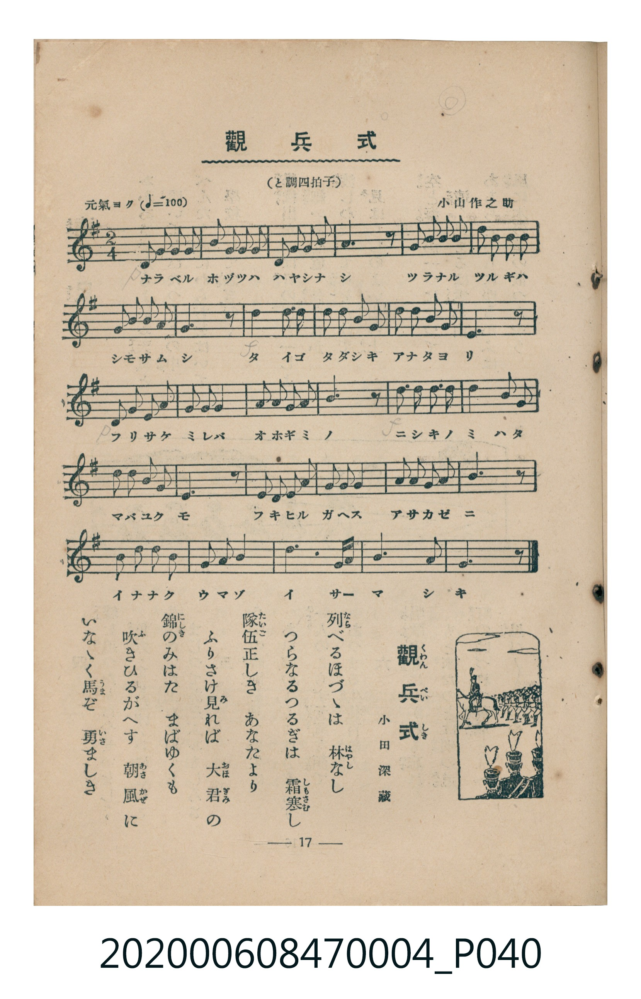

# 觀兵式

> Re:Shōka 使用 AI 協助辨識與重建樂譜，可能會有錯誤。歡迎回報。

- **NEUTRINO 歌聲合成版**：<br><audio controls src="kanpeishiki_neutrino.mp3"></audio>
- **鋼琴伴奏版**：<br><audio controls src="kanpeishiki.mp3"></audio>


- 詞：小田深藏
- 曲：小山作之助
- 臺灣教育會公認《新定兒童唱歌》尋常科第四學年用（2020.006.0847.0004）

## 說明

原書資訊與歌詞全文（對應 P040.jpg，書頁 p. 17，第二學期第 5 首）：
調性與拍號：標題註記「と調四拍子」，譜面拍號為 2/4 拍（G 大調 2/4 拍）
速度指示：元氣ヨク（♩=100）


## 歌詞

```text
列（なら）べるほづゝは　林（はやし）なし
つらなるつるぎは　霜寒（しもさむ）し
隊伍（たいご）正しき　あなたより
ふりさけ見（み）れば　大君（おほぎみ）の
錦（にしき）のみはた　まばゆくも
吹（ふ）きひるがへす　朝風（あさかぜ）に
いなゝく馬（うま）ぞ　勇（いさ）ましき
```

## ABC

```abc
X:1
T:觀兵式
C:曲：小山作之助
M:2/4
L:1/16
Q:1/4=100
K:G
V:V1 name="Piano" snm="Pia"
[V:V1]
D2 G2 G2 G2 | B2 G2 G2 G2 | D2 G2 A2 B2 | A6 z2 |
w: な ら べ る | ほ づ つ は | は や し な | し
G2 B2 B2 B2 | d2 B2 B2 B2 | G2 B2 B2 A2 | G6 z2 |
w: つ ら な る | つ る ぎ は | し も さ む | し
!f! d4 d3 d | d2 d2 B2 G2 | d2 d2 B2 G2 | D6 z2 |
w: た い ご | た だ し き | あ な た よ | り
!p! D2 G2 D2 A2 | G2 G2 G4 | A2 A2 G2 A2 | B6 z2 |
w: ふ り さ け | み れ ば | お ほ ぎ み | の
!f! d3 d d3 d | d4 B2 G2 | d2 d2 B2 G2 | E6 z2 |
w: に し き の | み は た | ま ば ゆ く | も
E2 D2 E2 A2 | G2 G2 G4 | A2 A2 G2 A2 | B6 z2 |
w: ふ き ひ る | が へ す | あ さ か ぜ | に
B2 d2 d2 B2 | G2 A2 B4 | d6 G A | B6 A2 |
w: い な な く | う ま ぞ | い さ _ | ま し
G6 z2 |
w: き
```

## TMD 檔案連結

- [主旋律 TMD 檔案](kanpeishiki.tmd) [[在 TMD Studio 編輯](https://tmdlang.github.io/Tmd-TS/#tmd=s7IKdvYPcrWy4qpTUCpJTLdSSM7PyUlNLsnMz7MqzsjMK0nNjM_KTMmPL87Iz05Ugisry88pzU21Si9KTEmNN4k3MjAyiDcwMIs3sDAxBzIMTBBKi_NLi5JTrYqTM_Lzc-JLUitKkvLzsxHyBUX5Zal5iXlANQVFIBtTwIoQClLLMlNSQdKpKZkl-UWZiTlI7kgtKga7FWxJfElRYl5xclFmAcgDCFUlGalAxyanFqXm5ueh6Acal56ZZ5WbmpmVieQ2LS2FF8sbnrZufbqnX0FLi0vRVsHQwIDL3lbBncvGSN_EDmTAi5Xz3u-Z9XRD__MpG55t3_hiej_Y3GezN0GEn27c-GTvnCc7u592rQTLvGjf9bxx8bOpM180bXo2p_lp65oXq3ofN3Q9m7bh6bpZT1snPV-99OmUjc_W9jxu6H66ofvpjh3Pl098vmbN09mzn67d8XTnludTVrzf0wEKbT1gaOuBQhvIMDB5v6dTiYtLX0vBllqAS0FB4Wnf_Gezd7zY3P5iRdeLjnagu4Beftq64tm0dqArnm7ofdbeqRBgYGKgl1WQ_n5PD1DxywWNCgV6CobmQC7Q4U929QAd_mzOfCBbwVTh5bJpQJcCQwdk-otV-581LAeZ2937YuZ8oOizFTNfLux5sWL3ixUzHjf0PG5cAVQD9DtQwdO1Ex439AINfbF2zsu5iyBanjftUgBGhgKQB3SPu8LTJcuBGhBCnSBrXjbMf7pr2bOe9udLdoHipbX52YbFj5tXPG5aD9T0aOZKW2DMgtSCfdwxHSj4uHHV4yagMzsfN-583NT9uHH348alj5vmPm5c_7ih4dk8iJr1j5taHjcC2UBlq4AMkP7HjUuAOsH6gdqAbCDZB9H2cs6cp-sngXVOf9zU9Lhx6uOmBrBmsM6Xs7qe7AF543Hj_MeNQIOnAOWerV0MUt0ITCQNjxuBeoD2zH_c1PG4qQti21YgC2RS48QXy7rBmveDjGwCht0GoB5ggDydMBssDlQG9AXQLWAFjevAdvYsA8uthlgCkQCqADkYaA_Izn0gg5raHjf2A90MDqEJO8F6toJV9z5u3AT2JNDCHY8bZ4KCZ87cl4tAqRTsYKDTgLJzwIpXQ9wM9BsweICB2f9y2RqwOqDx-8Aq5oHc3A1KXGBlU8GCQCeAXAfSTHmyhgIFLX0uLu_EvILUTGApl51pFZCZmJfvUGNQUw2yR8HG0EzLDszClqcUQCl7R8OLhT0KGmYKoAJgfYMOPCNoYtEAtA5q2OPmLiBeCcQzgXi1Qg2QnA3ErUDcAsT9YJF-IF6i8LhpO1g9UATIggCQLEgdyASQSRATQCKrgarWgfVCbatRMI1X0FUwRMI1CsYYInBFRkAMkq4Bs2DQACwCkgfJwTBQG7oI2E4foGsaVwG5wGwAIht3gtndYC3AJAgWWwoml4DJ9VAZEA3MUGCx6WASZApIBsSDQZBTQWJgvVAbILbBbIDIgHjA1I6wAZy7cUfmrh7yIhMcQYuA9FYgvQA9opr2g1mPm0BRuQUq8ri5AaKvaS1YBKgbFJFgmRXgyFwFNQEejciBD4oaiAhqBFWn1YKjBAQhtCk0kmARBY1tTBFQoKIYhohJcEw0NYHDcSqY3YAnVuZD-cDMC6WnwMUfNy5AitteqA6IyeAYhKhq6oDINHWhm08gBnd0kpkdp4JDHByDTRvB4T8fFGfNa4B4AtgpQFlQFgVnrvlgFX1ImbEbHpsgcYR-YBYGxik8DqsLgPEDy2lgBiImYRgEIZkPhGFZEpJnccW2KVpsgyA8bhERuRUcuKBAhUZk40RoFOwHy_SAxTbAHQGsMMAikAwLyUgglSCZdehRAxRbDY3w6dDIBbHXwc2H8MFZHBzNBCITWOWTGZnzwJH2uHkZ0EvrwZGxCCmqgFENjqZJsHKzCRTJM4D0TmiGhWblJlBZugcavWiZETMDmWFkIIgQOJbBLAqiGhGF--BRBKyQwex-SOCD8yd6hIAjHBwVwCoarAdWQkKiegeYnAl3CiwvQhIHpPycgxK5xOfFXVPA0WdKcmkKLCfBlRqoPARHXxMwIkGR2rQPGkFLoCXq1sfNkPiZBxXYDpZeix5boPBEjjFILMBqOojXYdkGBA2BcqixgKPARcQLpM6ClGEQEhovjZBYgsTbPKSQhpSOsGwBCnFY_CJEQeUkSBSSmZDDvpaLS9dOAanxogDkKnMBAA)]
- [鋼琴伴奏 TMD 檔案](kanpeishiki_piano.tmd) [[在 TMD Studio 編輯](https://tmdlang.github.io/Tmd-TS/#tmd=s7IKdvYPcrWy4tLSUnixvOFp69ane_rf7-l42b3n-YQtT_Zsebq0_3lnx_s9nQpaWlyKtgqGBgZc9rYK7lw2Rvomdlx1CkovVs57v2fW0w39z6dseLZ944vp_Uog4WezN0GEn27c-GTvnCc7u592rQTLvGjf9bxx8bOpM180bXo2p_lp65oXq3ofN3Q9m7bh6bpZT1snPV-99OmUjc_W9jxu6H66ofvpjh3Pl098vmbN09mzn67d8XTnludTVgDdaGRgZKBnYGCmZ2BhYg5kGJgAnanExeWdmFeQmlmckZmdaRWQmZiXH-ThUGNQU82lAAQ2hmZadmCWvpaCLTpQANryZEfDi4U9ChpmCiA_rW_QUQgwMDHQyypI18SiQUsfZtjj5i4gXgnEM4F4tUINkJwNxK1A3ALE_WCRfiBeovC4aTtYPVAEyIIAkCxIHcgEkEkQE0Aiq4Gq1oH1Qm2rUTCNV9BVMETCNQrGGCJwRUZADJKuAbNg0AAsApIHycEwUBu6CNhOH6BrGlcBuY-bOkFk404wuxus5XHjbrDYUjC5BEyuh8qA6MdNLWCx6WASZApIBsSDQZBTQWJgvVAbILbBbIDIgHiPG_sQNnDhj8xdPeRFJjiCFgHprUB6AXpENe0Hsx43gaJyC1TkcXMDRF_TWrAIUDcoIsEyK8CRuQpqAjwakQMfFDUQEdQIqk6rBUcJCEJoU2gkwSIKGtuYIqBARTEMEZPgmGhqAofjVDC7AU-szIfyHzeC4hFET4GLP25cgBS3vVAdEJPBMQhR1dQBkWnqQjefQAzu6CQzO04Fhzg4Bps2gsN_PijOmtcA8QSwU4CyoCwKzlzzwSr6kDJjNzw2QeII_cAsDIxTeBxWFwDjB5bTwAxETMIwCEIyHwjDsiQkz-KKbVO02AZBeNwiInIrOHBBgQqNyMaJ0CjYD5bpAYttgDvicSNELSTDQjISSCVIZh161ADFVkMjfDo0ckHsdXDzIXxwFgdHM4HIBJbgZEbmPHCkPW5eBvTSenBkLEKKKmBUg6NpEqzcbAJF8gwgvROaYaFZuQlUlu6BRi9aZsTMQGYYGQgiBI5lMIuCqEZE4T54FD1uagOz-yGBD86f6BECjnBwVDxu3ATWAyshIVG9A0zOhDsFlhchiQNSfs5BiVzi8-KuKeDoMyW5NAWWk-BKDVQegqOvCRiRoEht2geNoCXQEnXr42ZI_MyDCmwHS69Fjy1QeCLHGCQWYDUdxOuwbAOChkA51FjAUeAi4gVSZ0HKMAgJjZdGSCxB4m0eUkhDSkdYtgCFOCx-EaKgchIkCslMyGFfi6Xt4oPcdrGANl2Aro5XiDaMhVFwvlk8kDaLzwUJmYLYpvFIiuAiIIYBFlNMgAwTBB_e1kDSBmSYI1kIpEAGgUotHE6CmolpGbprUIpTVBtx-BAqhKQIw4fYHIbdl5iGIawCsUCm4XEXLkegqoIEF444xKMPPRBxxgQoDenaKSAlIwUgV5kLAA)]

## 分析

```text
================================================================================
📊 TMD Song Profile: [ 觀兵式 ]
================================================================================
⏱  Duration:       0:34 (34.8s), 29 measures total
🎼 Key & Tempo:    首調基準 G, != 100.0 BPM, <2/4>
   - 分析範圍：      由實際發聲的音符與和弦推測調性；播放脈絡另行呈現
🎤 人聲音域:    D4 (MIDI 62) – D5 (MIDI 74) [跨度: 12 個半音 / 1.0 個八度, 難度: easy]
   - 最低音:  D4 in [Kanpeishiki #1 @ m.1, 0:00]
   - 最高音: D5 in [Kanpeishiki #1 @ m.6, 0:06]
   - 適合: soprano, mezzo-soprano, contralto, tenor, baritone, bass
🏛  結構:      Kanpeishiki (34.8s)
⚡ 編曲密度:        Peak 1 軌道同時演奏
🗝  調性診斷：       G 大調（純淨自然大調，未偵測到可信轉調）
   - 風格氣質:    純淨自然大調（陽光明朗、易唱易記，無明顯調外色彩）
   - 轉調歷程:    全曲維持單一推測調性（未偵測到可信轉調）
   - 核心骨幹音:  G, D, B, A, E
   - 調性數值:    G 大調 [相關度: 0.87, 穩定度: High, 自然音純度: 100.0%]
   - 候選調性 (K-S): G 大調 (0.87), D 大調 (0.72), B 小調 (0.70)
   - 五度圈歷程:   +1
   - 各段落調性細節:
     • [Kanpeishiki #1]: G 大調 (r: 0.87, 自然音純度: 100.0%)

  [ 五度圈游移軌跡 ]
               C  
         F           [G ]*
      Bb               D  
      Eb               A  
         Ab           E  
            Db       B  
               F# 
     (* = active key center)

  [ 十二半音累積音高分佈 ]
     C  :                            0.0%
     C# :                            0.0%
     D  : ███████████████████████   27.5%
     D# :                            0.0%
     E  : ████                       4.6%
     F  :                            0.0%
     F# :                            0.0%
     G  : ████████████████████████  28.9%
     G# :                            0.0%
     A  : ████████████              14.2%
     A# :                            0.0%
     B  : █████████████████████     24.8%
--------------------------------------------------------------------------------
Assignment 軌道音域：
  - Piano         : D4 – D5 (12 個半音 / 1.0 個八度, 87 個音符)
================================================================================
```


## 原書掃描頁




