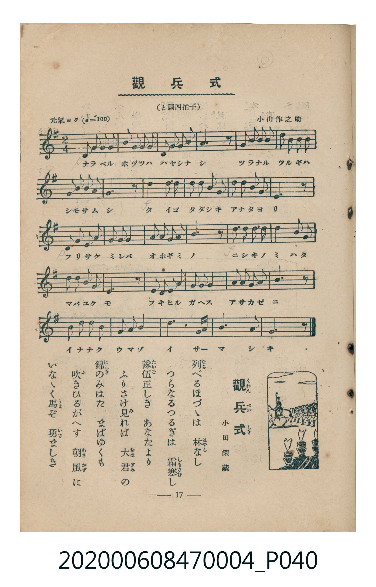

# 觀兵式

> Re:Shōka 使用 AI 協助辨識與重建樂譜，可能會有錯誤。歡迎[回報](https://github.com/TMDLang/reshoka/issues)。

- **鋼琴伴奏版**：<br><audio controls src="kanpeishiki.mp3"></audio>
- **NEUTRINO 歌聲合成版**：<br><audio controls src="kanpeishiki_neutrino.mp3"></audio>

- 詞：小田深藏
- 曲：小山作之助
- 臺灣教育會公認《新定兒童唱歌》尋常科第四學年用（2020.006.0847.0004）

## 說明

原書資訊與歌詞全文（對應 P040.jpg，書頁 p. 17，第二學期第 5 首）：
調性與拍號：標題註記「と調四拍子」，譜面拍號為 2/4 拍（G 大調 2/4 拍）
速度指示：元氣ヨク（♩=100）


## 歌詞

```text
列（なら）べるほづゝは　林（はやし）なし
つらなるつるぎは　霜寒（しもさむ）し
隊伍（たいご）正しき　あなたより
ふりさけ見（み）れば　大君（おほぎみ）の
錦（にしき）のみはた　まばゆくも
吹（ふ）きひるがへす　朝風（あさかぜ）に
いなゝく馬（うま）ぞ　勇（いさ）ましき
```

## ABC

<div class="abc-score" data-abc-src="kanpeishiki.abc" aria-label="五線譜載入中"></div>

[下載 ABC 原始檔](kanpeishiki.abc)

## TMD 檔案連結

- [主旋律 TMD 檔案](kanpeishiki.tmd) [[在 TMD Studio 編輯](https://tmdlang.github.io/Tmd-TS/#tmd=s7IKdvYPcrWy4qpTUCpJTLdSSM7PyUlNLsnMz7MqzsjMK0nNjM_KTMmPL87Iz05Ugisry88pzU21Si9KTEmNN4k3MjAyiDcwMIs3sDAxBzIMTBBKi_NLi5JTrYqTM_Lzc-JLUitKkvLzsxHyBUX5Zal5iXlANQVFIBtTwIoQClLLMlNSQdKpKZkl-UWZiTlI7kgtKga7FWxJfElRYl5xclFmAcgDCFUlGalAxyanFqXm5ueh6Acal56ZZ5WbmpmVicVt-UUlGflATxZkVFplZBaDbE9OzInPTsxDCguo3QWJ6alWAQYmBkpcWloKL5Y3PG3d-nRPv4KWFpeirYKhgQGXva2CO5eNkb6JHUjvi5Xz3u-Z9XRD__MpG55t3_hiej_YyGezN0GEn27c-GTvnCc7u592rQTLvGjf9bxx8bOpM180bXo2p_lp65oXq3ofN3Q9m7bh6bpZT1snPV-99OmUjc_W9jxu6H66ofvpjh3Pl098vmbN09mzn67d8XTnludTVrzf0wGKLD1gZOmBIgvIMDB5v6dTiYtLX0vBllqAS0FB4Wnf_Gezd7zY3P5iRdeLjnagu4Beftq64tm0dqArnm7ofdbeqQAKML2sgvT3e3qAil8uaFQo0FMwNAdygQ5_sqsH6PBnc-YD2QqmCi-XTQO6FBg6INNfrNr_rGE5yNzu3hcz5wNFn62Y-XJhz4sVu1-smPG4oedx4wqgGqDfgQqerp3wuKEXaOiLtXNezl0E0fK8aZcCMDIUgDyge9wVni5ZDtSAEOoEWfOyYf7TXcue9bQ_X7ILFC-tzc82LH7cvOJx03qgpkczV9oCYxakFuzjjulAwceNqx43AZ3Z-bhx5-Om7seNux83Ln3cNPdx4_rHDQ3P5kHUrH_c1PK4EcgGKlsFZID0P25cAtQJ1g_UBmQDyT6Itpdz5jxdPwmsc_rjpqbHjVMfNzWANYN1vpzV9WQPyBuPG-c_bgQaPAUo92ztYpDqRmAiaXjcCNQDtGf-46aOx01dENu2AlkgkxonvljWDda8H2RkEzDsNgD1AAPk6YTZYHGgMqAvgG4BK2hcB7azZxlYbjXEEogEUAXIwUB7QHbuAxnU1Pa4sR_oZnAITdgJ1rMVrLr3ceMmsCeBFu543DgTFDxz5r5cBEqlYAcDnQaUnQNWvBriZqDfgMEDDMz-l8vWgNUBjd8HVjEP5OZuUOICK5sKFgQ6AeQ6kGbKkzUUKGjpc3F5J-YVpGYCC8nsTKuAzMS8fIcag5pqkD0KNoZmWnZgFrY8pQBK2TsaXizsUdAwUwAVAOsbdOAZQROLBqB1UMMeN3cB8UogngnEqxVqgORsIG4F4hYg7geL9APxEoXHTdvB6oEiQBYEgGRB6kAmgEyCmAASWQ1UtQ6sF2pbjYJpvIKugiESrlEwxhCBKzICYpB0DZgFgwZgEZA8SA6GgdrQRcB2-gBd07gKyAVmAxDZuBPM7gZrASZBsNhSMLkETK6HyoBoYIYCi00HkyBTQDIgHgyCnAoSA-uF2gCxDWYDRAbEA6Z2hA3g3I07Mnf1kBeZ4AhaBKS3AukF6BHVtB_MetwEisotUJHHzQ0QfU1rwSJA3aCIBMusAEfmKqgJ8GhEDnxQ1EBEUCOoOq0WHCUgCKFNoZEEiyhobGOKgAIVxTBETIJjoqkJHI5TwewGPLEyH8oHZl4oPQUu_rhxAVLc9kJ1QEwGxyBEVVMHRKapC918AjG4o5PM7DgVHOLgGGzaCA7_-aA4a14DxBPATgHKgrIoOHPNB6voQ8qM3fDYBIkj9AOzMDBO4XFYXQCMH1hOAzMQMQnDIAjJfCAMy5KQPIsrtk3RYhsE4XGLiMit4MAFBSo0IhsnQqNgP1imByy2Ae4IYIUBFoFkWEhGAqkEyaxDjxqg2GpohE-HRi6IvQ5uPoQPzuLgaCYQmcAqn8zInAeOtMfNy4BeWg-OjEVIUQWManA0TYKVm02gSJ4BpHdCMyw0KzeBytI90OhFy4yYGcgMIwNBhMCxDGZRENWIKNwHjyJghQxm90MCH5w_0SMEHOHgqABW0WA9sBISEtU7wORMuFNgeRGSOCDl5xyUyCU-L-6aAo4-U5JLU2A5Ca7UQOUhOPqagBEJitSmfdAIWgItUbc-bobEzzyowHaw9Fr02AKFJ3KMQWIBVtNBvA7LNiBoCJRDjQUcBS4iXiB1FqQMg5DQeGmExBIk3uYhhTSkdIRlC1CIw-IXIQoqJ0GikMyEHPa1XFy6dgpIjRcFIFeZCwA)]
- [鋼琴伴奏 TMD 檔案](kanpeishiki_piano.tmd) [[在 TMD Studio 編輯](https://tmdlang.github.io/Tmd-TS/#tmd=s7IKdvYPcrWy4qpTUCpJTLdSyC8qychPL0osyKi0ysgsLskvykxOzInPTsxLVIIrKs4vLUpOjS9ITE-1CjAwMVDi0tJSeLG84Wnr1qd7-t_v6XjZvef5hC1P9mx5urT_eWfH-z2dClpaXIq2CoYGBlz2tgruXDZG-iZ2IANfrJz3fs-spxv6n0_Z8Gz7xhfT-8H2PJu9CSL8dOPGJ3vnPNnZ_bRrJVjmRfuu542Ln02d-aJp07M5zU9b17xY1fu4oevZtA1P18162jrp-eqlT6dsfLa253FD99MN3U937Hi-fOLzNWuezp79dO2Opzu3PJ-yAuhGIwMjAz0DAzM9AwsTcyDDwAToTCUuLu_EvILUzOKMzOxMq4DMxLz8IA-HGoOaai4FILAxNNOyA7P0tRRs0YEC0JYnOxpeLOxR0DBTAPlpfYOOAiiE9LIK0jWxaNDShxn2uLkLiFcC8UwgXq1QAyRnA3ErELcAcT9YpB-Ilyg8btoOVg8UAbIgACQLUgcyAWQSxASQyGqgqnVgvVDbahRM4xV0FQyRcI2CMYYIXJEREIOka8AsGDQAi4DkQXIwDNSGLgK20wfomsZVQO7jpk4Q2bgTzO4Ga3ncuBssthRMLgGT66EyIPpxUwtYbDqYBJkCkgHxYBDkVJAYWC_UBohtMBsgMiDe48Y-hA1c-CNzVw95kQmOoEVAeiuQXoAeUU37wazHTaCo3AIVedzcANHXtBYsAtQNikiwzApwZK6CmgCPRuTAB0UNRAQ1gqrTasFRAoIQ2hQaSbCIgsY2pggoUFEMQ8QkOCaamsDhOBXMbsATK_Oh_MeNoHgE0VPg4o8bFyDFbS9UB8RkcAxCVDV1QGSautDNJxCDOzrJzI5TwSEOjsGmjeDwnw-Ks-Y1QDwB7BSgLCiLgjPXfLCKPqTM2A2PTZA4Qj8wCwPjFB6H1QXA-IHlNDADEZMwDIKQzAfCsCwJybO4YtsULbZBEB63iIjcCg5cUKBCI7JxIjQK9oNlesBiG-COeNwIUQvJsJCMBFIJklmHHjVAsdXQCJ8OjVwQex3cfAgfnMXB0UwgMoElOJmROQ8caY-blwG9tB4cGYuQogoY1eBomgQrN5tAkTwDSO-EZlhoVm4ClaV7oNGLlhkxM5AZRgaCCIFjGcyiIKoRUbgPHkWPm9rA7H5I4IPzJ3qEgCMcHBWPGzeB9cBKSEhU7wCTM-FOgeVFSOKAlJ9zUCKX-Ly4awo4-kxJLk2B5SS4UgOVh-DoawJGJChSm_ZBI2gJtETd-rgZEj_zoALbwdJr0WMLFJ7IMQaJBVhNB_E6LNuAoCFQDjUWcBS4iHiB1FmQMgxCQuOlERJLkHibhxTSkNIRli1AIQ6LX4QoqJwEiUIyE3LY12Jpu_ggt10soE0XoKvjFaINY2EUnG8WD6TN4nNBQqYgtmk8kiK4CIhhgMUUEyDDBMGHtzWQtAEZ5kgWAimQQaBSC4eToGZiWobuGpTiFNVGHD6ECiEpwvAhNodh9yWmYQirQCyQaXjchcsRqKogwYUjDvHoQw9EnDEBSkO6dgpIyUgByFXmAgA)]

## 分析

```text
================================================================================
📊 TMD Song Profile: [ 觀兵式 ]
================================================================================
⏱  Duration:       0:34 (34.8s), 29 measures total
🎼 Key & Tempo:    首調基準 G, != 100.0 BPM, <2/4>
   - 分析範圍：      由實際發聲的音符與和弦推測調性；播放脈絡另行呈現
🎤 人聲音域:    D4 (MIDI 62) – D5 (MIDI 74) [跨度: 12 個半音 / 1.0 個八度, 難度: easy]
   - 最低音:  D4 in [Kanpeishiki #1 @ m.1, 0:00]
   - 最高音: D5 in [Kanpeishiki #1 @ m.6, 0:06]
   - 適合: soprano, mezzo-soprano, contralto, tenor, baritone, bass
🏛  結構:      Kanpeishiki (34.8s)
⚡ 編曲密度:        Peak 1 軌道同時演奏
🗝  調性診斷：       G 大調（純淨自然大調，未偵測到可信轉調）
   - 風格氣質:    純淨自然大調（陽光明朗、易唱易記，無明顯調外色彩）
   - 轉調歷程:    全曲維持單一推測調性（未偵測到可信轉調）
   - 核心骨幹音:  G, D, B, A, E
   - 調性數值:    G 大調 [相關度: 0.87, 穩定度: High, 自然音純度: 100.0%]
   - 候選調性 (K-S): G 大調 (0.87), D 大調 (0.72), B 小調 (0.70)
   - 五度圈歷程:   +1
   - 各段落調性細節:
     • [Kanpeishiki #1]: G 大調 (r: 0.87, 自然音純度: 100.0%)

  [ 五度圈游移軌跡 ]
               C  
         F           [G ]*
      Bb               D  
      Eb               A  
         Ab           E  
            Db       B  
               F# 
     (* = active key center)

  [ 十二半音累積音高分佈 ]
     C  :                            0.0%
     C# :                            0.0%
     D  : ███████████████████████   27.5%
     D# :                            0.0%
     E  : ████                       4.6%
     F  :                            0.0%
     F# :                            0.0%
     G  : ████████████████████████  28.9%
     G# :                            0.0%
     A  : ████████████              14.2%
     A# :                            0.0%
     B  : █████████████████████     24.8%
--------------------------------------------------------------------------------
Assignment 軌道音域：
  - Piano         : D4 – D5 (12 個半音 / 1.0 個八度, 87 個音符)
================================================================================
```


## 原書掃描頁




