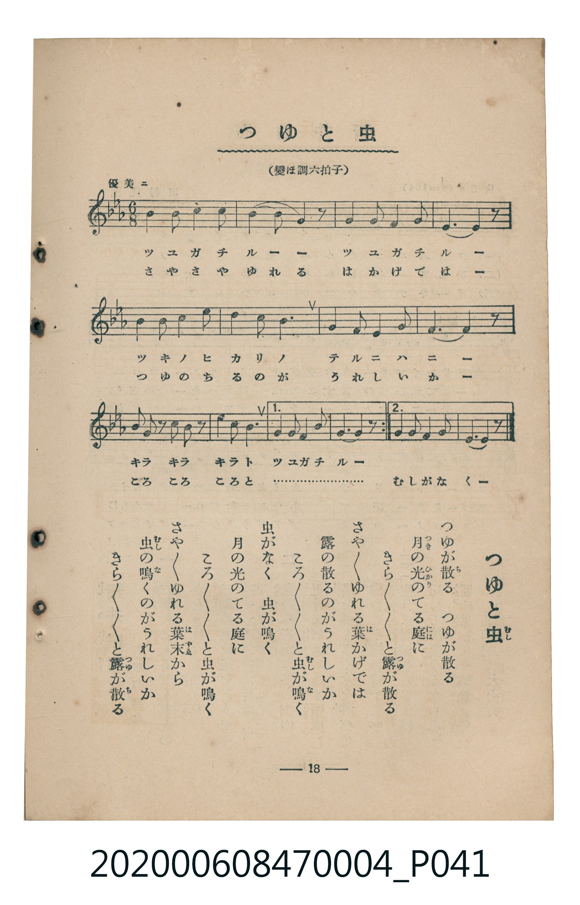

# つゆと虫

> Re:Shōka 使用 AI 協助辨識與重建樂譜，可能會有錯誤。歡迎回報。

- **鋼琴伴奏版**：<br><audio controls src="tsuyu_to_mushi.mp3"></audio>
- **NEUTRINO 歌聲合成版**：<br><audio controls src="tsuyu_to_mushi_neutrino.mp3"></audio>

- 臺灣教育會公認《新定兒童唱歌》尋常科第四學年用（2020.006.0847.0004）

## 說明

原書資訊與歌詞全文（對應 P041.jpg，書頁 p. 18，第二學期第 6 首）：
調性與拍號：變ほ調六拍子（Eb 大調 6/8 拍）
速度指示：優美ニ


## 歌詞

```text
一
つゆが散（ち）る　つゆが散る
月（つき）の光（ひかり）のてる庭（には）に
きらきらきらと露（つゆ）が散る
さやさやゆれる葉（は）かげでは
露の散るのがうれしいか
ころころころと虫（むし）が鳴（な）く

二
虫がなく　虫が鳴く
月の光のてる庭に
ころころころと虫が鳴く
さやさやゆれる葉末（はずゑ）から
虫の鳴くのがうれしいか
きらきらきらと露が散る
```

## ABC

<div class="abc-score" data-abc-src="tsuyu_to_mushi.abc" aria-label="五線譜載入中"></div>

[下載 ABC 原始檔](tsuyu_to_mushi.abc)

## TMD 檔案連結

- [主旋律 TMD 檔案](tsuyu_to_mushi.tmd) [[在 TMD Studio 編輯](https://tmdlang.github.io/Tmd-TS/#tmd=s7IKdvYPcrWy4qpTUCpJTLdSSM7PyUlNLsnMz7MqzsjMK0nNjM_KTMmPL87Iz05Ugisry88pzU21Si9KTEmNN4k3MjAyiDcwMIs3sDAxBzIMTBBKi_NLi5JTrYqTM_Lzc-JLUitKkvLzsxHyBUX5Zal5iXlANQVFIBtTwIoQClLLMlNSQdKpKZkl-UWZiTlI7kgtKga7FWxJfElRYl5xclFmAcgDCFUlGalAxybmZeYi64WIlqcmAhlF6MLFqYnF-XnFCGGgxemZeVYliZnliXnx-WlpmckoLskvKsnIB4ZHQUalVUZmMcihyYk58dmJeUjBBnVmQWJ6qlWAgYmhEpeWlsLjxiWPm9oeN654MXO1gpYWl6KtgqUZl72tgqsOl42ZvoUdSPuL9l3PGxc_mzrzRdOmZ3Oan7auebGq93FD17NpG56um_W0ddLz1UufTtn4bG3P44bupxu6n-7Y8Xz5xOdr1jydPfvp2h1Pd255PmXF-z0doJjSA8aUHiimgAwDk_d7OpW4uPS1FGypBbgUFBSe9s1_NnvHi83tL1Z0vehoB7rrxcp5T1tXPJvWDnTF0w29z9o7FUBBoJdVkP5-Tw9Q8csFjQoFegqGFkAu0OFPdvUAHf5sznwgW8FM4eWyaUCXvt8zC2T6i1X7nzUsB5nb3fti5nyg6It1XY8bdwPFn7auBQo-XTsBaI1rksLTJcuBggrAYFQACgNNAGl_2TD_6a5lz3rany_ZBdT7tGXV8319j5u7uUCST3Y0gChYrPQ8m7oYaNTjxoVAzY-buh83NCBLAUVAqp_N6QArWvK4EWTJ48Z1T1uBjgWKbHrc2P24qQsi-LhxGVDD011rwVKrHzeuB4uvhljY-7gJyEEmV7ycswlqblMbWCmSnY8bpz5uaoGSQPc09QAlXkyEWAsxuPtx46THjcuBXLC35wAdsw5iANgxPY8bwdoapz9uBBoENXXy46ZeVBKUMkGmNgG9Ph3ijJebt4DtWQXm9kNCblcPOHJmAj0GNHQVUBwYWhAuUD1IGSSoIMGDHB7wMMBuOYoBuPz9bA7YkY3rHzfOetw0ERoATeAYB5uxDmIGHq9jjwGUUKc8e0CBgpY-F1dIcWllaUi-bymwsLUKyEzMy3eoMaipBlmkYGOhZQdmYMubCqAcsqPh2bqtTzt7n_Z2KWhYKDzd0P98fQMw9zydsBok17H_-dYJTzfs04FnNE0sBgGdAbXkcXMLKBSalyk8bloDZjUq1ADJ1SB5MADxCKmBmlejYKqgC8RmQNIMzjMGkgZAHog2VjACkzUKhkBaF0wC5cC6fQyBhjYuAYoAYxjI6gGxGheCrGrqBqsGwXgQnxhVEDONQOINYDXT4apXgc3oRzWTGFVooda0FsjqA4fIJLARoBB53LwKKgoKozawyGog7gaz-sGiIDbOkDOMA3LNwUEIEtSFBp0ROLBAQQcKQhAfa9A19gLxOjBrE9gDoEABFkZQUZBpwBwIFusGslaDVa4Hi4LYWIKPBuaCghAceCvhwQhigYJwLTiYVgJxB1hEw1BPExzesPSHnvqQQtAYGCCgQAOlNmAooocgJPGZQnkgPnoIAv3Y1Al0JYIFEQX5qhPIWgH3KUkJsHEyUK4XbC6MBREFmQEKV7i5RCVCYgqIfT0YBUR_74tlbUCJlw2bnrYuBRbcpBcWjVPB8QWMDDgL5GhwIm_qAQcAOBaBEQ8qWkEJYRKYtRwuSvUCYyo4FCFOgrAgTgKxIU6CFRrrwSEKcRSIBXMU9jgj1dxZQLGJUBtAKjuxpnpgwgGFFSjhrAOHDCzhgNjrwNEOCUF4mAITA0gObD3QaJoVHFA3oSZmmJtgyR7ufaCrQLIwVxEqdyHmIhIzueaCgxCSh8AtBygLkptAAQbJTeCCwwhUcADdAMtOCPvJKzjwJULqZnBEIqRugVTLxaVrp4Dc_lAA8pW5AA)]
- [鋼琴伴奏 TMD 檔案](tsuyu_to_mushi_piano.tmd) [[在 TMD Studio 編輯](https://tmdlang.github.io/Tmd-TS/#tmd=s7IKdvYPcrWy4qpTUCpJTLdSyC8qychPL0osyKi0ysgsLskvykxOzInPTsxLVIIrKs4vLUpOjS9ITE-1CjAwMVTi0tJSeNy45HFT2-PGFS9mrn6_p-Nl957nE7Y82bPl6dL-550d7_d0KmhpcSnaKliacdnbKrjqcNmY6VvYgcx80b7reePiZ1Nnvmja9GxO89PWNS9W9T5u6Ho2bcPTdbOetk56vnrp0ykbn63tedzQ_XRD99MdO54vn_h8zZqns2c_Xbvj6c4tz6esAFppZGBkoGdgYKZnYGFiDmQYmABtVeLiCikurSwNyfctLc7ItArITMzLD_JwqDGoqeZSAAIbCy07MENfS8EWHSgAbXmyo-HZuq1PO3uf9nYpaFgoPN3Q_3x9w_s9PU8nrAbJdex_vnXC0w37dBRAYaGXVZCuicUgLX2YJY-bW4CMx83LFB43rQGzGhVqgORqkDwYgHiE1EDNq1EwVdAFYjMgaQbnGQNJAyAPRBsrGIHJGgVDIK0LJoFyYN0-hkBDG5cARYBRB2T1gFiNC0FWNXWDVYNgPIhPjCqImUYg8Qawmulw1avAZvSjmkmMKrRQa1oLZPWBQ2QS2AhQiDxuXgUVBYVRG1hkNRB3g1n9YFEQG2fIGcYBuebgIAQJ6kKDzggcWKCgAwUhiI816Bp7gXgdmLUJ7AFQoDxu6oKKgkx73LgMLNYNZK0Gq1wPFgWxsQQfDcwFBSE48FbCgxHEAgXhWnAwrQTiDrCIhqGeJji8YekPPfUhhaAxMEBAgQZKbcBQRA9BSOIzhfJAfPQQBPqxqRPoSgQLIgryVSeQtQLuU5ISYONkoFwv2FwYCyIKMgMUrnBziUqExBQQ-3owCoj-3hfL2oASLxs2PW1d-mRXD-mFReNUcHwBIwPOAjkanMibesABAI5FYMQDRYBJ5HHjJDBrOVyU6gXGVHAoQpwEYUGcBGJDnAQrNNaDQxTiKBAL5ijscUaqubOAYhOhNoBUdmJN9cCEAworUMJZBw4ZWMIBsdeBox0SgvAwBSYGkBzYeqDRNCs4oG5CTcwwN8GSPdz7QFeBZGGuIlTuQsxFJGZyzQUHISQPgQIFxoLkJlCAQXITuOAwAhUcQDfAshPCfvIKDnyJkLoZHJEIqVsg1WJrfvhga34AfRqvEG0YC8YmQKYJkAnEKOJQJjjQMERBGBi08UCeaTyQCyLgPFjg4daIZCeKOBZnkWSRAbKribAEapI52GAgiSMAIGXyaKiRGGrABKlrp4CcJqN9gFIYYkZgMWUuAA)]

## 分析

```text
================================================================================
📊 TMD Song Profile: [ つゆと虫 ]
================================================================================
⏱  Duration:       0:45 (45.0s), 24 measures total
🎼 Key & Tempo:    首調基準 E,, != 96.0 BPM, <6/8>
   - 分析範圍：      由實際發聲的音符與和弦推測調性；播放脈絡另行呈現
🎤 人聲音域:    D#4 (MIDI 63) – D#5 (MIDI 75) [跨度: 12 個半音 / 1.0 個八度, 難度: easy]
   - 最低音:  D#4 in [TsuyuToMushi #1 @ m.4, 0:05]
   - 最高音: D#5 in [TsuyuToMushi #1 @ m.5, 0:09]
   - 適合: soprano, mezzo-soprano, contralto, tenor, baritone, bass
🏛  結構:      TsuyuToMushi (45.0s)
⚡ 編曲密度:        Peak 1 軌道同時演奏
🗝  調性診斷：       D# 調性不明確（純淨自然大調，未偵測到可信轉調）
   - 風格氣質:    純淨自然大調（陽光明朗、易唱易記，無明顯調外色彩）
   - 轉調歷程:    全曲維持單一推測調性（未偵測到可信轉調）
   - 核心骨幹音:  A#, G, D#, F, C
   - 調性數值:    D# 調性不明確 [相關度: 0.80, 穩定度: Ambiguous, 自然音純度: 100.0%]
   - 候選調性 (K-S): D# 大調 (0.80), A# 大調 (0.79), G 小調 (0.78)
   - 五度圈歷程:   -3
   - 各段落調性細節:
     • [TsuyuToMushi #1]: D# 調性不明確 (r: 0.80, 自然音純度: 100.0%)

  [ 五度圈游移軌跡 ]
               C  
         F            G  
      Bb               D  
     [Eb]*              A  
         Ab           E  
            Db       B  
               F# 
     (* = active key center)

  [ 十二半音累積音高分佈 ]
     C  : ███████████               12.1%
     C# :                            0.0%
     D  : ███                        3.0%
     D# : █████████████████         18.9%
     E  :                            0.0%
     F  : ██████████████            15.2%
     F# :                            0.0%
     G  : ██████████████████████    24.2%
     G# :                            0.0%
     A  :                            0.0%
     A# : ████████████████████████  26.5%
     B  :                            0.0%
--------------------------------------------------------------------------------
Assignment 軌道音域：
  - Piano         : D#4 – D#5 (12 個半音 / 1.0 個八度, 78 個音符)
================================================================================
```


## 原書掃描頁




