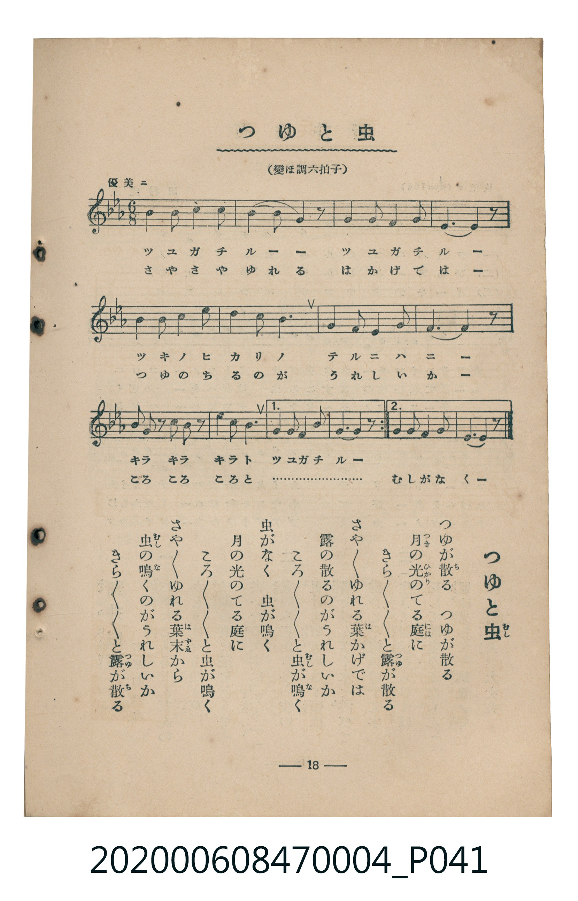

# つゆと虫

<audio controls src="tsuyu_to_mushi.mp3"></audio>

- 臺灣教育會公認《新定兒童唱歌》尋常科第四學年用（2020.006.0847.0004）

- note

原書資訊與歌詞全文（對應 P041.jpg，書頁 p. 18，第二學期第 6 首）：
調性與拍號：變ほ調六拍子（Eb 大調 6/8 拍）
速度指示：優美ニ

## 歌詞

```text
一
つゆが散（ち）る　つゆが散る
月（つき）の光（ひかり）のてる庭（には）に
きらきらきらと露（つゆ）が散る
さやさやゆれる葉（は）かげでは
露の散るのがうれしいか
ころころころと虫（むし）が鳴（な）く

二
虫がなく　虫が鳴く
月の光のてる庭に
ころころころと虫が鳴く
さやさやゆれる葉末（はずゑ）から
虫の鳴くのがうれしいか
きらきらきらと露が散る
```

## 原書掃描頁



## 調性分析

```text
================================================================================
📊 TMD Song Profile: [ つゆと虫 ]
================================================================================
⏱  Duration:       0:45 (45.0s), 24 measures total
🎼 Key & Tempo:    首調基準 E,, != 96.0 BPM, <6/8>
   - 分析範圍：      由實際發聲的音符與和弦推測調性；播放脈絡另行呈現
🎤 人聲音域:    D#4 (MIDI 63) – C5 (MIDI 72) [跨度: 9 個半音 / 0.8 個八度, 難度: easy]
   - 最低音:  D#4 in [TsuyuToMushi #1 @ m.12, 0:20]
   - 最高音: C5 in [TsuyuToMushi #1 @ m.1, 0:00]
   - 適合: soprano, mezzo-soprano, contralto, tenor, baritone, bass
🏛  結構:      TsuyuToMushi (45.0s)
⚡ 編曲密度:        Peak 1 軌道同時演奏
🗝  調性診斷：       A# 大調（純淨自然大調，未偵測到可信轉調）
   - 風格氣質:    純淨自然大調（陽光明朗、易唱易記，無明顯調外色彩）
   - 轉調歷程:    全曲維持單一推測調性（未偵測到可信轉調）
   - 核心骨幹音:  A#, F, G, C, D#
   - 調性數值:    A# 大調 [相關度: 0.84, 穩定度: High, 自然音純度: 100.0%]
   - 候選調性 (K-S): A# 大調 (0.84), G 小調 (0.64), A# 小調 (0.60)
   - 五度圈歷程:   -2
   - 各段落調性細節:
     • [TsuyuToMushi #1]: A# 大調 (r: 0.84, 自然音純度: 100.0%)

  [ 五度圈游移軌跡 ]
               C  
         F            G  
     [Bb]*              D  
      Eb               A  
         Ab           E  
            Db       B  
               F# 
     (* = active key center)

  [ 十二半音累積音高分佈 ]
     C  : ██████████                16.7%
     C# :                            0.0%
     D  :                            0.0%
     D# : █████                      7.6%
     E  :                            0.0%
     F  : ████████████              18.9%
     F# :                            0.0%
     G  : ███████████               18.2%
     G# :                            0.0%
     A  :                            0.0%
     A# : ████████████████████████  38.6%
     B  :                            0.0%
--------------------------------------------------------------------------------
Assignment 軌道音域：
  - Piano         : D#4 – C5 (9 個半音 / 0.8 個八度, 70 個音符)
================================================================================
```

## ABC

```abc
X:1
T:つゆと虫
C:TMD (Chen, Chih-Han / aguai)
M:6/8
L:1/16
Q:3/8=64
K:Eb

V:V1 name="Piano" snm="Pia"

[V:V1]
b4 b2 c4 c2 | b10 z2 | b4 b2 g4 b2 | f10 z2 |
g4 g2 b4 b2 | c4 c2 b6 | g4 b2 c4 b2 | f10 z2 |
g2 b2 z2 g2 b2 z2 | c4 c2 b6 | g4 g2 f4 f2 | e10 z2 |
b4 b2 c4 c2 | b4 b2 b4 z2 | b4 b2 g4 b2 | f10 z2 |
g4 g2 b4 b2 | c4 c2 b6 | g4 b2 c4 b2 | f10 z2 |
g2 b2 z2 g2 b2 z2 | c4 c2 b6 | g4 b2 f4 g2 | e10 z2 |
```

- [主旋律 TMD 檔案](tsuyu_to_mushi.tmd)
- [鋼琴伴奏 TMD 檔案](tsuyu_to_mushi_piano.tmd)
