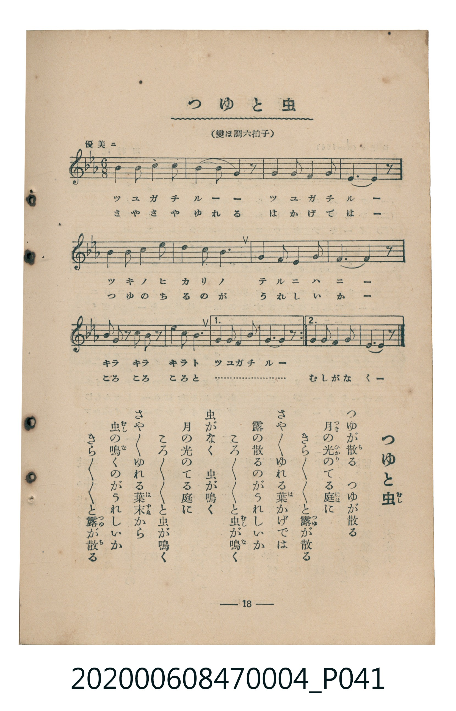

# つゆと虫

> Re:Shōka 使用 AI 協助辨識與重建樂譜，可能會有錯誤。歡迎回報。

- **NEUTRINO 歌聲合成版**：<br><audio controls src="tsuyu_to_mushi_neutrino.mp3"></audio>
- **鋼琴伴奏版**：<br><audio controls src="tsuyu_to_mushi.mp3"></audio>


- 臺灣教育會公認《新定兒童唱歌》尋常科第四學年用（2020.006.0847.0004）

## 說明

原書資訊與歌詞全文（對應 P041.jpg，書頁 p. 18，第二學期第 6 首）：
調性與拍號：變ほ調六拍子（Eb 大調 6/8 拍）
速度指示：優美ニ

## 歌詞

```text
一
つゆが散（ち）る　つゆが散る
月（つき）の光（ひかり）のてる庭（には）に
きらきらきらと露（つゆ）が散る
さやさやゆれる葉（は）かげでは
露の散るのがうれしいか
ころころころと虫（むし）が鳴（な）く

二
虫がなく　虫が鳴く
月の光のてる庭に
ころころころと虫が鳴く
さやさやゆれる葉末（はずゑ）から
虫の鳴くのがうれしいか
きらきらきらと露が散る
```

## ABC

```abc
X:1
T:つゆと虫
M:6/8
L:1/16
Q:3/8=64
K:Eb
V:V1 name="Piano" snm="Pia"
[V:V1]
B4 B2 c4 c2 | B4 B2 G4 z2 | G4 G2 F4 G2 | E6 E4 z2 |
w: 1.~つ ゆ が ち | る _ _ | つ ゆ が ち | る _
w: 2.~む し が な | く _ _ | む し が な | く _
B4 B2 c4 e2 | d4 c2 B6 | G4 F2 E4 G2 | F6 F4 z2 |
w: 1.~つ き の ひ | か り の | て る に は | に _
w: 2.~つ き の ひ | か り の | て る に は | に _
B2 G2 z2 c2 B2 z2 | e4 c2 B6 | G4 G2 F4 B2 | G6 G4 z2 |
w: 1.~き ら き ら | き ら と | つ ゆ が ち | る _
w: 2.~こ ろ こ ろ | こ ろ と | む し が な | く _
B4 B2 c4 c2 | B4 B2 G4 z2 | G4 G2 F4 G2 | E6 E4 z2 |
w: 1.~さ や さ や | ゆ れ る | は か げ で | は _
w: 2.~さ や さ や | ゆ れ る | は ず ゑ か | ら _
B4 B2 c4 e2 | d4 c2 B6 | G4 F2 E4 G2 | F6 F4 z2 |
w: 1.~つ ゆ の ち | る の が | う れ し い | か _
w: 2.~む し の な | く の が | う れ し い | か _
B2 G2 z2 c2 B2 z2 | e4 c2 B6 | G4 G2 F4 G2 | E6 E4 z2 |
w: 1.~こ ろ こ ろ | こ ろ と | む し が な | く _
w: 2.~き ら き ら | き ら と | つ ゆ が ち | る _
```

## TMD 檔案連結

- [主旋律 TMD 檔案](tsuyu_to_mushi.tmd) [[在 TMD Studio 編輯](https://tmdlang.github.io/Tmd-TS/#tmd=s7IKdvYPcrWy4qpTUCpJTLdSSM7PyUlNLsnMz7MqzsjMK0nNjM_KTMmPL87Iz05Ugisry88pzU21Si9KTEmNN4k3MjAyiDcwMIs3sDAxBzIMTBBKi_NLi5JTrYqTM_Lzc-JLUitKkvLzsxHyBUX5Zal5iXlANQVFIBtTwIoQClLLMlNSQdKpKZkl-UWZiTlI7kgtKga7FWxJfElRYl5xclFmAcgDCFUlGalAxybmZeYi64WIlqcmAhlF6MLFqYnF-XnFSlxaWgqPG5c8bmp73LjixczVClpaXIq2CpZmXPa2Cq46XDZm-hZ2IL0v2nc9b1z8bOrMF02bns1pftq65sWq3scNXc-mbXi6btbT1knPVy99OmXjs7U9jxu6n27ofrpjx_PlE5-vWfN09uyna3c83bnl-ZQV7_d0gIJSDxiUeqCgBDIMTN7v6VTi4tLXUrClFuBSUFB42jf_2ewdLza3v1jR9aKjHeiuFyvnPW1d8WxaO9AVTzf0PmvvVAgwMDHUyypIf7-nB6j45YJGhQI9BUMLIBfo8Ce7eoAOfzZnPpCtYKbwctk0oEvf75kFMv3Fqv3PGpaDzO3ufTFzPlD0xbqux427geJPW9cCBZ-unQC0xjVJ4emS5UBBBWAwKgCFgSaAtL9smP9017JnPe3Pl-wC6n3asur5vr7Hzd1cIMknOxpAFCxWep5NXQw06nHjQqDmx03djxsakKWAIiDVz-Z0gBUtedwIsuRx47qnrUDHAkU2PW7sftzUBRF83LgMqOHprrVgqdWPG9eDxVdDLOx93ATkIJMrXs7ZBDW3qQ2sFMnOx41THze1QEmge5p6gBIvJkKshRjc_bhx0uPG5UAu2NtzgI5ZBzEA7Jiex41gbY3THzcCDYKaOvlxUy8qCUqZIFObgF6fDnHGy81bwPasAnP7ISG3qwccOTOBHgMaugooDgwtCBeoHqQMElSQ4EEOD3gYYLccxQBc_n42B-zIxvWPG2c9bpoIDYAmcIyDzVgHMQOP17HHAEqoU549oEBBS5-LK6S4tLI0JN-3FFgaWgVkJublO9QY1FSDLFKwsdCyAzOw5U0FUA7Z0fBs3dannb1Pe7sUNCwUnm7of76-AZh7nk5YDZLr2P9864SnG_bpwDOaJhaDgM6AWvK4uQUUCs3LFB43rQGzGhVqgORqkDwYgHiE1EDNq1EwVdAFYjMgaQbnGQNJAyAPRBsrGIHJGgVDIK0LJoFyYN0-hkBDG5cARYAxDGT1gFiNC0FWNXWDVYNgPIhPjCqImUYg8Qawmulw1avAZvSjmkmMKrRQa1oLZPWBQ2QS2AhQiDxuXgUVBYVRG1hkNRB3g1n9YFEQG2fIGcYBuebgIAQJ6kKDzggcWKCgAwUhiI816Bp7gXgdmLUJ7AFQoAALI6goyDRgDgSLdQNZq8Eq14NFQWwswUcDc0FBCA68lfBgBLFAQbgWHEwrgbgDLKJhqKcJDm9Y-kNPfUghaAwMEFCggVIbMBTRQxCS-EyhPBAfPQSBfmzqBLoSwYKIgnzVCWStgPuUpATYOBko1ws2F8aCiILMAIUr3FyiEiExBcS-HowCor_3xbI2oMTLhk1PW5cCC27SC4vGqeD4AkYGnAVyNDiRN_WAAwAci8CIBxWtoIQwCcxaDheleoExFRyKECdBWBAngdgQJ8EKjfXgEIU4CsSCOQp7nJFq7iyg2ESoDSCVnVhTPTDhgMIKlHDWgUMGlnBA7HXgaIeEIDxMgYkBJAe2Hmg0zQoOqJtQEzPMTbBkD_c-0FUgWZirCJW7EHMRiZlcc8FBCMlD4JYDlAXJTaAAg-QmcMFhBCo4gG6AZSeE_eQVHPgSIXUzOCIRUrdAquXi0rVTQG5_KAD5ylwA)]
- [鋼琴伴奏 TMD 檔案](tsuyu_to_mushi_piano.tmd) [[在 TMD Studio 編輯](https://tmdlang.github.io/Tmd-TS/#tmd=s7IKdvYPcrWy4tLSUnjcuORxU9vjxhUvZq5-v6fjZfee5xO2PNmz5enS_uedHe_3dCpoaXEp2ipYmnHZ2yq46nDZmOlb2HHVKSi9aN_1vHHxs6kzXzRtejan-Wnrmhereh83dD2btuHpullPWyc9X7306ZSNz9b2PG7ofrqh--mOHc-XT3y-Zs3T2bOfrt3xdOeW51NWAK00MjAy0DMwMNMzsDAxBzIMTIC2KnFxhRSXVpaG5PuWFmdkWgVkJublB3k41BjUVHMpAIGNhZYdmKGvpWCLDhSAtjzZ0fBs3dannb1Pe7sUNCwUnm7of76-4f2enqcTVoPkOvY_3zrh6YZ9OgoBBiaGelkF6ZpYDNLSh1nyuLkFyHjcvEzhcdMaMKtRoQZIrgbJgwGIR0gN1LwaBVMFXSA2A5JmcJ4xkDQA8kC0sYIRmKxRMATSumASKAfW7WMINLRxCVAEGHVAVg-I1bgQZFVTN1g1CMaD-MSogphpBBJvAKuZDle9CmxGP6qZxKhCC7WmtUBWHzhEJoGNAIXI4-ZVUFFQGLWBRVYDcTeY1Q8WBbFxhpxhHJBrDg5CkKAuNOiMwIEFCjpQEIL4WIOusReI14FZm8AeAAXK46YuqCjItMeNy8Bi3UDWarDK9WBREBtL8NHAXFAQggNvJTwYQSxQEK4FB9NKIO4Ai2gY6mmCwxuW_tBTH1IIGgMDBBRooNQGDEX0EIQkPlMoD8RHD0GgH5s6ga5EsCCiIF91Alkr4D4lKQE2TgbK9YLNhbEgoiAzQOEKN5eoREhMAbGvB6OA6O99sawNKPGyYdPT1qVPdvWQXlg0TgXHFzAy4CyQo8GJvKkHHADgWARGPFAEmEQeN04Cs5bDRaleYEwFhyLESRAWxEkgNsRJsEJjPThEIY4CsWCOwh5npJo7Cyg2EWoDSGUn1lQPTDigsAIlnHXgkIElHBB7HTjaISEID1NgYgDJga0HGk2zggPqJtTEDHMTLNnDvQ90FUgW5ipC5S7EXERiJtdccBBC8hAoUGAsSG4CBRgkN4ELDiNQwQF0Ayw7Iewnr-DAlwipm8ERiZC6BVIttuaHD7bmB9Cn8QrRhrFgbAJkmgCZQIwiDmWCAw1DFISBQRsP5JnGA7kgAs6DBR5ujUh2oohjcRZJFhkgu5oIS6AmmYMNBpI4AgBSJo-GGomhBkyQunYKyGky2gcohSFmBBZT5gIA)]

## 分析

```text
================================================================================
📊 TMD Song Profile: [ つゆと虫 ]
================================================================================
⏱  Duration:       0:45 (45.0s), 24 measures total
🎼 Key & Tempo:    首調基準 E,, != 96.0 BPM, <6/8>
   - 分析範圍：      由實際發聲的音符與和弦推測調性；播放脈絡另行呈現
🎤 人聲音域:    D#4 (MIDI 63) – D#5 (MIDI 75) [跨度: 12 個半音 / 1.0 個八度, 難度: easy]
   - 最低音:  D#4 in [TsuyuToMushi #1 @ m.4, 0:05]
   - 最高音: D#5 in [TsuyuToMushi #1 @ m.5, 0:09]
   - 適合: soprano, mezzo-soprano, contralto, tenor, baritone, bass
🏛  結構:      TsuyuToMushi (45.0s)
⚡ 編曲密度:        Peak 1 軌道同時演奏
🗝  調性診斷：       D# 調性不明確（純淨自然大調，未偵測到可信轉調）
   - 風格氣質:    純淨自然大調（陽光明朗、易唱易記，無明顯調外色彩）
   - 轉調歷程:    全曲維持單一推測調性（未偵測到可信轉調）
   - 核心骨幹音:  A#, G, D#, F, C
   - 調性數值:    D# 調性不明確 [相關度: 0.80, 穩定度: Ambiguous, 自然音純度: 100.0%]
   - 候選調性 (K-S): D# 大調 (0.80), A# 大調 (0.79), G 小調 (0.78)
   - 五度圈歷程:   -3
   - 各段落調性細節:
     • [TsuyuToMushi #1]: D# 調性不明確 (r: 0.80, 自然音純度: 100.0%)

  [ 五度圈游移軌跡 ]
               C  
         F            G  
      Bb               D  
     [Eb]*              A  
         Ab           E  
            Db       B  
               F# 
     (* = active key center)

  [ 十二半音累積音高分佈 ]
     C  : ███████████               12.1%
     C# :                            0.0%
     D  : ███                        3.0%
     D# : █████████████████         18.9%
     E  :                            0.0%
     F  : ██████████████            15.2%
     F# :                            0.0%
     G  : ██████████████████████    24.2%
     G# :                            0.0%
     A  :                            0.0%
     A# : ████████████████████████  26.5%
     B  :                            0.0%
--------------------------------------------------------------------------------
Assignment 軌道音域：
  - Piano         : D#4 – D#5 (12 個半音 / 1.0 個八度, 78 個音符)
================================================================================
```


## 原書掃描頁




