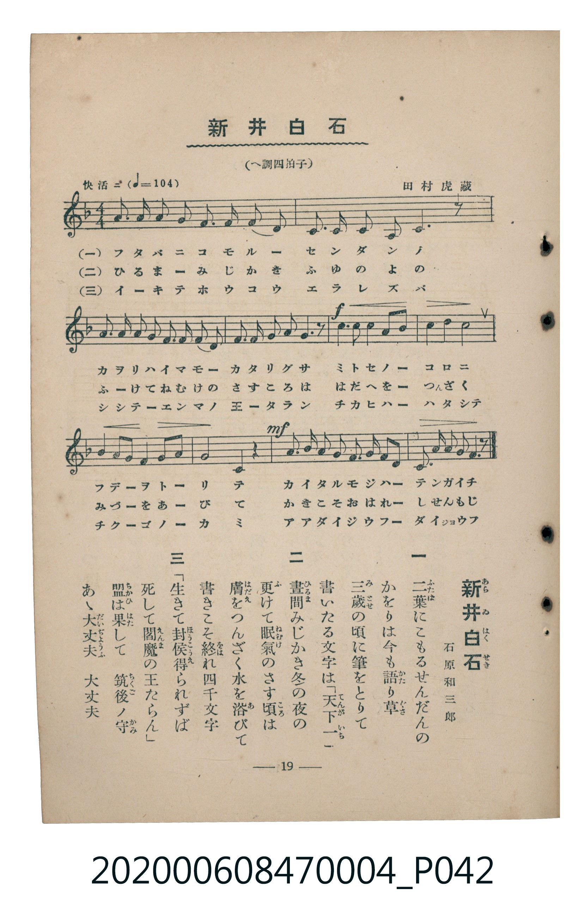

# 新井白石

> Re:Shoka 使用 AI 協助辨識與重建樂譜，可能會有錯誤。歡迎回報。

<audio controls src="arai_hakuseki.mp3"></audio>

- 詞：石原和三郎
- 曲：田村虎藏
- 臺灣教育會公認《新定兒童唱歌》尋常科第四學年用（2020.006.0847.0004）

## 說明

原書資訊與歌詞全文（對應 P042.jpg，書頁 p. 19，第二學期第 7 首）：
調性與拍號：へ調四拍子（F 大調 4/4 拍）
速度指示：快活ニ（♩=104）

## 歌詞

```text
一
二葉（ふたば）にこもるせんだんの
かをりは今も語（かた）り草（ぐさ）
三歲（みとせ）の頃に筆をとりて
書いたる文字は「天下一（てんがいち）」

二
晝間（ひるま）みじかき冬の夜の
更（ふ）けて眠氣（ねむけ）のさす頃（ころ）は
膚（はだえ）をつんざく水を浴（あ）びて
書きこそ終（をは）れ四千文字

三
「生きて封侯（ほうこう）得（え）られずば
死して閻魔（えんま）の王たらん」
盟（ちかひ）は果（はた）して　筑後ノ守（ちくごのかみ）
あゝ大丈夫（だいぢょうふ）　大丈夫
```

## ABC

```abc
X:1
T:新井白石
C:曲：田村虎藏
M:4/4
L:1/16
Q:1/4=104
K:F
V:V1 name="Piano" snm="Pia"
[V:V1]
A2 A2 A2 G2 F2 F2 D2 F2 | C2 D2 F2 D2 C6 z2 | F2 F2 F2 G2 A2 A2 G2 A2 | c2 d2 c2 A2 G6 z2 |
!f! c4 c4 c4 d2 c2 | A4 c4 c8 | G4 A2 G2 F4 G2 A2 | G8 C4 z4 |
!mf! F2 G2 A2 F2 G2 G2 A2 C2 | D2 F2 A2 G2 F6 z2 |
```

## TMD 檔案連結

- [主旋律 TMD 檔案](arai_hakuseki.tmd) [[在 TMD Studio 編輯](https://tmdlang.github.io/Tmd-TS/#tmd=s7IKdvYPcrWy4qpTUCpJTLdSSM7PyUlNLsnMz7MqzsjMK0nNjM_KTMmPL87Iz05Ugisry88pzU21Si9KTEmNN4k3MjAyiDcwMIs3sDAxBzIMTBBKi_NLi5JTrYqTM_Lzc-JLUitKkvLzsxHyBUX5Zal5iXlANQVFIBtTwIoQClLLMlNSQdKpKZkl-UWZiTlI7kgtKga7FWxJfElRYl5xclFmAcgDCFUlGalAx2ZkFgO1VypxaWkpPJu24cmuqc9n7n0-f7OClhaXoq2CoYEJl72tghuXjYm-iR1I74uV897vmQVU8bRv_tNJPU92dL5s7gOb-mz2JpDMlA3P5k58MbPvxfR-sPCL9l3PGxc_mzrzRdOmZ3Oan7auebGq93FDF9C2p-tmPW2d9Hz10qdTNj5b2_O4ofvphu6nO3Y8Xz7x-Zo1T2fPfrp2x9OdW55PWfF-TwcoOPWAwakHCk4gw8Dk_Z5OJS4ufS0FW2oBLgUFBaC_ns3e8WJz-4sVXS862oHuAnr5aeuKZ9Paga54uqH3WXunQoCBiZFeVkH6-z09QMUvFzQqFOgpGFoCuUCHP9nVA3T4sznzgWwFc4WXy6YBXQoMGpDpL1btf9awHGRud--LmfOBoo8bdwAFgZ4FijxdOwFoh5vC0yXLgWIKwDBXAIoCdYO0vmyY_3TXsmc97c-X7ALqe7p_9bMtux83dwN1PJq50hYYVSCFIJVPdjSAqV09LyYCLe543Lj1ceP8x40bgAoeN65-3Dj5cVPT46bux42zHzdNfty4AEyuA-l53Nj9uGnS46aux43rn-zuAqp7sQoY4UAjgKqBzu0ESr3ohRg64XHjVKjbgMng2Vpg9ANF9z9uXAE0GGzVupcLmoEWPl_bBjIUKA4ydxlIAzDUHje2gFzV1A0M2adrpwMtfNzQ83TJyic7uoEeAJu1DOywHrDKhSATG3ohHtzVAzZk5tyX0yaDVW4Ce2cf2FagC2aA3dv7tG0N0BFPl8yB-u7Z7C2Q4ACrmwi04PmcBc82LAYLrn3c1AAUhDgc6LXHjTOBzgdLAcMLFAtAJ4LjsG0WWHQ9KOQaO8CBAvTdErBjpz1u7H-2YQtQ5NlWiGVNYJ2bkT3eCzKyce7zrUC5DrDm9WBTekBpvrcZEiDQqASHLzBknk8BxiBQ47KnGxqf7AOqBxq9-3FjG9ioNqD2p_umgwUhDgKZ9rgRmLo2gG1dC1QKDOJlL6ftfrl2CkQd2L2QIFv3vA8Uv2Btk0GhDNTzfDYwvoHqFoLDEhi5IP8_mzcH5ndwagAb-rih4fnaiU_39Txu7nu6Dmg_RFf_48Yp4KAEat8PTSjA4HjcNBeYvp_s6Hi6ZDVYKTAQgfG76HFTO9g74MhpaICrAWmjPGtDgYKWPheXY1FipkdidmlxanamVUBmYl6-Q41BjUI1yCYFGwstOzADW8GiAMreOxpeLOxR0DBSeLqh__n6Bh14aaCJRQPQPqhhGkCNmlYKj5unKjxu2g-kJwBxN5C9GUgvAuLVQLxHoQYoshvIAok2QOk-kBFggGzcrh6QcY2bgBqAxjTuA2sHBjUQzwBlZCDuBRnXuBWoog1IrwPSHWAam3E7OkHGNS2BGNO0FkgDNTXPBrKXQVwJpEGuWwEUXQnEa4DsXWB_oBlXo2AMhkYKhkBoFg8kahRM4yEsIAFk6gKhgUINOI3jDmlgAQYKaRMyQ7oJFKLA4GleBcT9UL_Ng4Y2JKSBKsBxAVTRtAGIt8L9ApRtng9Ksc0dIBIYJyB2H1znZjB_LZjshuvCGkPA8AfHzEQgBgZlIzBom4BRC-avA8cQMEk0zgTiyUCZXiC9HtkZYB4wm4DJHWDHTII5A1zqAKlpYMl-HO6ARu12CAZHKyiKQREJSl6gIOkDmgYsBKAyoCABRTHIk4jgaATbvRrs5UlgEhioEHc094M1AY0HCbdhuqMGnBYMgWkCkjKMQUlCwQyIQTxoclCoTqsFiujCMUgelJoQIiBIKNns6KQo2QAzKMgT7ZCwACYgSCKA-XQV1GMIb8ISEjB5gUMOlOyASaxpB0oIgUIdlIlA2QaUEEGhiRlV0CSzHxyfS6HRAQ7sxiZ4pMOiBZSc4E6AZnhwImqcC8Rd4KQDrAfg-qYDMSg_g5IZ0DRgMYHNCZDUAo1toAFgJ2wB-xiR_EGpABIKoEwCCwWQr0GZC5i6waEBDAFQ4QEq8qChAJd53LwcLonihhpweoCUHrrQlAJJIcAUACo5DEBJQKE6F5hWIOkJRIJooGwNpJCB6YYUMrVcXLp2CsilvgKQr8zFBQA)]
- [鋼琴伴奏 TMD 檔案](arai_hakuseki_piano.tmd) [[在 TMD Studio 編輯](https://tmdlang.github.io/Tmd-TS/#tmd=s7IKdvYPcrWy4tLSUng2bcOTXVOfz9z7fP7m93s6XnbveT5hy5M9W54u7X_e2fF-T6eClhaXoq2CoYEJl72tghuXjYm-iR1XnYLSi5Xz3u-ZBdT2tG_-00k9T3Z0vmzuUwLJPJu9CSQzZcOzuRNfzOx7Mb0fLPyifdfzxsXPps580bTp2Zzmp61rXqzqfdzQBXTC03WznrZOer566dMpG5-t7Xnc0P10Q_fTHTueL5_4fM2ap7NnP1274-nOLc-nrAC60cjAyEDPwMBMz8DCxBzIMDABOlOJi8uxKDHTIzG7tDg1O9MqIDMxLz_Iw6HGoEahmksBCGwstOzADH0tBVt0oAC05smOhhcLexQ0jBSebuh_vr5BRyHAwMRIL6sgXROLBi19sGE1CsZgaKRgCIRm8UCiRsE0HsICEkCmLhAaKNRw4bd8Vw_YchPSLAdZagi0HOIEY5DdCmZADOJB7VWoTqsFiujCMUge5GyECAgSct-OTnLcB3IFJHB0oe6DuAtoLyhgDEAWK1TnAl0I8QWIBNFA2RpIGMJ0Q8KwFls0-6BEswk0moGBE68QbRirYAKkTGIRfNN4IG0aDxRBVQelsKgDByGSKmTTYLqgZsE1wU2Di4AY4PgAexfDDjMQ0yw-FyoINhPoXV07BWQfK2DhK3NxAQA)]

## 分析

```text
================================================================================
📊 TMD Song Profile: [ 新井白石 ]
================================================================================
⏱  Duration:       0:23 (23.1s), 10 measures total
🎼 Key & Tempo:    首調基準 F, != 104.0 BPM, <4/4>
   - 分析範圍：      由實際發聲的音符與和弦推測調性；播放脈絡另行呈現
🎤 人聲音域:    C4 (MIDI 60) – D5 (MIDI 74) [跨度: 14 個半音 / 1.2 個八度, 難度: moderate]
   - 最低音:  C4 in [AraiHakuseki #1 @ m.2, 0:02]
   - 最高音: D5 in [AraiHakuseki #1 @ m.4, 0:07]
   - 適合: soprano, mezzo-soprano, contralto, tenor, baritone, bass
🏛  結構:      AraiHakuseki (23.1s)
⚡ 編曲密度:        Peak 1 軌道同時演奏
🗝  調性診斷：       C 大調（純淨自然大調，未偵測到可信轉調）
   - 風格氣質:    純淨自然大調（陽光明朗、易唱易記，無明顯調外色彩）
   - 轉調歷程:    全曲維持單一推測調性（未偵測到可信轉調）
   - 核心骨幹音:  C, G, F, A, D
   - 調性數值:    C 大調 [相關度: 0.85, 穩定度: Moderate, 自然音純度: 100.0%]
   - 候選調性 (K-S): C 大調 (0.85), F 大調 (0.76), A 小調 (0.62)
   - 五度圈歷程:   +0
   - 各段落調性細節:
     • [AraiHakuseki #1]: C 大調 (r: 0.85, 自然音純度: 100.0%)

  [ 五度圈游移軌跡 ]
              [C ]*
         F            G  
      Bb               D  
      Eb               A  
         Ab           E  
            Db       B  
               F# 
     (* = active key center)

  [ 十二半音累積音高分佈 ]
     C  : ████████████████████████  29.3%
     C# :                            0.0%
     D  : ███████                    8.0%
     D# :                            0.0%
     E  :                            0.0%
     F  : ████████████████          20.0%
     F# :                            0.0%
     G  : ████████████████████      24.0%
     G# :                            0.0%
     A  : ███████████████           18.7%
     A# :                            0.0%
     B  :                            0.0%
--------------------------------------------------------------------------------
Assignment 軌道音域：
  - Piano         : C4 – D5 (14 個半音 / 1.2 個八度, 55 個音符)
================================================================================
```


## 原書掃描頁




