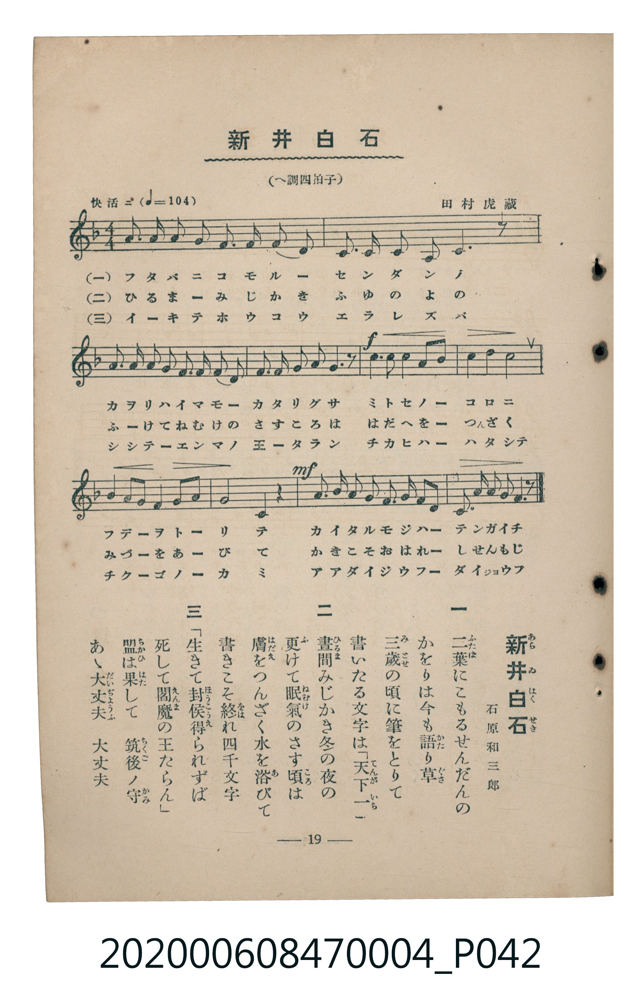

# 新井白石

> Re:Shōka 使用 AI 協助辨識與重建樂譜，可能會有錯誤。歡迎[回報](https://github.com/TMDLang/reshoka/issues)。

- **鋼琴伴奏版**：<br><audio controls src="arai_hakuseki.mp3"></audio>
- **NEUTRINO 歌聲合成版**：<br><audio controls src="arai_hakuseki_neutrino.mp3"></audio>

- 詞：石原和三郎
- 曲：田村虎藏
- 臺灣教育會公認《新定兒童唱歌》尋常科第四學年用（2020.006.0847.0004）

## 說明

原書資訊與歌詞全文（對應 P042.jpg，書頁 p. 19，第二學期第 7 首）：
調性與拍號：へ調四拍子（F 大調 4/4 拍）
速度指示：快活ニ（♩=104）


## 歌詞

```text
一
二葉（ふたば）にこもるせんだんの
かをりは今も語（かた）り草（ぐさ）
三歲（みとせ）の頃に筆をとりて
書いたる文字は「天下一（てんがいち）」

二
晝間（ひるま）みじかき冬の夜の
更（ふ）けて眠氣（ねむけ）のさす頃（ころ）は
膚（はだえ）をつんざく水を浴（あ）びて
書きこそ終（をは）れ四千文字

三
「生きて封侯（ほうこう）得（え）られずば
死して閻魔（えんま）の王たらん」
盟（ちかひ）は果（はた）して　筑後ノ守（ちくごのかみ）
あゝ大丈夫（だいぢょうふ）　大丈夫
```

## ABC

<div class="abc-score" data-abc-src="arai_hakuseki.abc" aria-label="五線譜載入中"></div>

[下載 ABC 原始檔](arai_hakuseki.abc)

## TMD 檔案連結

- [主旋律 TMD 檔案](arai_hakuseki.tmd) [[在 TMD Studio 編輯](https://tmdlang.github.io/Tmd-TS/#tmd=s7IKdvYPcrWy4qpTUCpJTLdSSM7PyUlNLsnMz7MqzsjMK0nNjM_KTMmPL87Iz05Ugisry88pzU21Si9KTEmNN4k3MjAyiDcwMIs3sDAxBzIMTBBKi_NLi5JTrYqTM_Lzc-JLUitKkvLzsxHyBUX5Zal5iXlANQVFIBtTwIoQClLLMlNSQdKpKZkl-UWZiTlI7kgtKga7FWxJfElRYl5xclFmAcgDCFUlGalAx2ZkFgO1VyKEgWalZ-ZZ5aZmZmVicVh-UUlGPtCHBRmVUL2ZyYk58dmJeUgBAbW4IDE91SrAwMRIiUtLS-HZtA1Pdk19PnPv8_mbFbS0uBRtFQwNTLjsbRXcuGxM9E3sQNpfrJz3fs8soIqnffOfTup5sqPzZXMf2OBnszeBZKZseDZ34ouZfS-m94OFX7Tvet64-NnUmS-aNj2b0_y0dc2LVb2PG7qAtj1dN-tp66Tnq5c-nbLx2dqexw3dTzd0P92x4_nyic_XrHk6e_bTtTue7tzyfMqK93s6QJGlB4wsPVBkARkGJu_3dCpxcelrKdhSC3ApKCgA_fVs9o4Xm9tfrOh60dEOdBfQy09bVzyb1g50xdMNvc_aOxVAYaaXVZD-fk8PUPHLBY0KBXoKhpZALtDhT3b1AB3-bM58IFvBXOHlsmlAlwKDBmT6i1X7nzUsB5nb3fti5nyg6OPGHUBBoGeBIk_XTgDa4abwdMlyoJgCMMwVgKJA3SCtLxvmP9217FlP-_Mlu4D6nu5f_WzL7sfN3UAdj2autAVGFUghSOWTHQ1galfPi4lAizseN2593Dj_ceMGoILHjasfN05-3NT0uKn7cePsx02THzcuAJPrQHoeN3Y_bpr0uKnrceP6J7u7gOperAJGONAIoGqgczuBUi96IYZOeNw4Feo2YDJ4thYY_UDR_Y8bVwANBlu17uWCZqCFz9e2gQwFioPMXQbSAAy1x40tIFc1dQND9una6UALHzf0PF2y8smObqAHwGYtAzusB6xyIcjEhl6IB3f1gA2ZOffltMlglZvA3tkHthXoghlg9_Y-bVsDdMTTJXOgvns2ewskOMDqJgIteD5nwbMNi8GCax83NQAFIQ4Heu1x40yg88FSwPACxQLQieA4bJsFFl0PCrnGDnCgAH23BOzYaY8b-59t2AIUebYVYlkTWOdmZI_3goxsnPt8K1CuA6x5PdiUHlCa722GBAg0KsHhCwyZ51OAMQjUuOzphsYn-4DqgUbvftzYBjaqDaj96b7pYEGIg0CmPW4Epq4NYFvXApUCg3jZy2m7X66dAlEHdi8kyNY97wPFL1jbZFAoA_U8nw2Mb6C6heCwBEYuyP_P5s2B-R2cGsCGPm5oeL524tN9PY-b-56uA9oP0dX_uHEKOCiB2vdDEwowOB43zQWm7yc7Op4uWQ1WCgxEYPwuetzUDvYOOHIaGuBqQNooz9pQoKClz8XlWJSY6ZGYXVqcmp1pFZCZmJfvUGNQUw2ySMHG0EzLDszCVrAogLL3joYXC3sUNIwUnm7of76-QQdeGmhi0QC0D2qYBlCjppXC4-apCo-b9gPpCUDcDWRvBtKLgHg1EO9RqAGK7AayQKINULoPZAQYIBu3qwdkXOMmoAagMY37wNqBQQ3EM0AZGYh7QcY1bgWqaAPS64B0B5jGZtyOTpBxTUsgxjStBdJATc2zgexlEFcCaZDrVgBFVwLxGiB7F9gfaMbVKBgr6AKhMZg2AmJDMN8QTJvFA4kaBVMQpQuiwCxjEAEVg0ADkDKweT6GEF-ARIHpDog3gFmrweRkiHhTEzgcIHpB6mdDxScD2QugLJD6dUh2gJ0CscMIpGcTVA8kPCFqQCEKoSGhCmL1Qu2AugkauiBWBz47jEF6WuDmgkwBZh8wuRsqBjIJ4s42qB0gE0EmdwJxD1hmFpgEhQGqHfiTLbA2ACVbEzKTbRMoeQLTWvMqIO6HJpR50KQLSbZAFeCEDVTRtAGIt8ITBlC2eT6U_bi5A0QCEzmI3QfXvRnMXwsmu-E6sSZ5YIIGJ_WJ4OADFt1A7cC8AuavAwcaMI81zgQHJbDoBtLrkZ0C54ESBojcAXbQJJhTwEU5kJoGluzH4RZoftkOweC8Aso3oNwByrOgoOkDmgYsWaEyoKAB5RuQRxHB0ghzCzD4QF6fBCaBAQxxS3M_WCPQCpBwG6ZbiMpsMCGQNEwZSj5TqE6rVTBFEgWxYXyQDhOwKpiIGZIqZIicXyF5ERysTV3gFLseTELSP7i8AuZZRH6Fqgflb6j6CWByKno6h-dIWD5aASYh-R0594FUQkoHkDtAuQ0iDyo3sLgaXAJAcjRI1UQwCcmda6FmQBIZzA5IQoOohiQ2mD0Qv6K7GlkMWiYBkx7MfZOQXA1OgDCF0-CsfuwOBxcr06FqpkMdDeHBCg9QcgYVaHCHN0HMghQ488FqOqEqMR2-EMXhkCIQUlQiexXsRYhhMKfAWDAHIRxOoIrtpKisAlaxoNzSDsl4wFILUurAstQqWJaD5ydY6QUs08DZFFTWAcu1ph0oWRGUxUHVIKjiA5V-sKyLtYzaD7KgcSk074NzdSOwioKWMLAyABQ0cCdAq2xwqdU4F4i7wKELKvZh-kCxC6qRQeUa0DRglYTNCZCiCey-x01AA8BO2AL2MaK8BRU3kFCAlcwgUZCvQSU6MKWDQwMYAqDqH9RogYYCXOZx83K4JIobasClBQiiFkkQNkisBqUEAkF41Q8qjiCpqToXWCZBCjcTFJNgtDkkfYLLOMwCEGEcZisClCaXw1jwnAcpSaBJGVwGIUNEKoY5FbnUaoFnI3D2AJdsoOhBzyAQMyAZElKbg8pD1CyG3iqBlXag5ITpZuQydDNJboYkNRBrLtxMaCkNbmnA1MOKFkjCQ_UdFjeDiyOYfxCFFrA3AGchl9CwNhvCzTD_IrsZ4ktwFoKWnJBwA3YbmsEMUHMJEb0gLSBlsKjBoQzh8louLl07BeSegQKQr8wFAA)]
- [鋼琴伴奏 TMD 檔案](arai_hakuseki_piano.tmd) [[在 TMD Studio 編輯](https://tmdlang.github.io/Tmd-TS/#tmd=s7IKdvYPcrWy4qpTUCpJTLdSyC8qychPL0osyKi0ysgsLskvykxOzInPTsxLVIIrKs4vLUpOjS9ITE-1CjAwMVLi0tJSeDZtw5NdU5_P3Pt8_ub3ezpedu95PmHLkz1bni7tf97Z8X5Pp4KWFpeirYKhgQmXva2CG5eNib6JHcjMFyvnvd8zC6jtad_8p5N6nuzofNncB7bt2exNIJkpG57NnfhiZt-L6f1g4Rftu543Ln42deaLpk3P5jQ_bV3zYlXv44YuoBOerpv1tHXS89VLn07Z-Gxtz-OG7qcbup_u2PF8-cTna9Y8nT376dodT3dueT5lBdCNRgZGBnoGBmZ6BhYm5kCGgQnQmUpcXI5FiZkeidmlxanZmVYBmYl5-UEeDjUGNdVcCkBgY2imZQdm6Wsp2KIDBaA1T3Y0vFjYo6BhpPB0Q__z9Q06CqBQ0ssqSNfEokFLH2aYBlCjppXC4-apCo-b9gPpCUDcDWRvBtKLgHg1EO9RqAGK7AayQKINULoPZAQYIBu3qwdkXOMmoAagMY37wNofNwKNbpwBxCCxXpBxjVuBKtqA9Dog3QGmsRm3oxNkXNMSiDFNa4E0UFPzbCB7GcSVQBrkuhVA0ZVAvAbI3gX2B5pxNQrGCrpAaAymjYDYEMw3BNNm8UCiRsEUROmCKDDLGERAxSDQAKQMbJ6PIcQXINHHjfOBeAOYtRpMToaINzWBwwGiF6R-NlR8MpC9AMoCqV-HZAfYKRA7jEB6NkH1QMITogYUohAaEqogVi_UDqiboKELYnXgs8MYpKcFbi7IlMeNy8DkbqgYyCSIO9ugdoBMBJncCcQ9YJlZYBIUBqh24E-2u3rAydaEzGTbBEqewLTWvAqI-6EJZR406UKSLVAFOGEDVTRtAOKt8IQBlG2eD2U_bu4AkcBEDmL3wXVvBvPXgsluuE6sSR6YoMFJfSI4-B43AtNqEzCvgPnrwIEGzGONM8FB-bipF0ivR3YKnAdKGCByB9hBk2BOaVwCSTXTwJL9ONwCzS_bIRicV0D5BpQ7QHkWFDR9QNOe9wETE1gGFDSgfAPyKCJYGmFuAQYfyOuTwCQwgCFuae4HawRaARJuw3QLUZkNJgSShilDyWcK1Wm1CqZIoiA2jA_SYQJWBRMxQ1KFDJHzKyQvgoO1qQucYteDSUj6B5dXwDyLyK9Q9aD8DVU_AUxORU_n8BwJy0crwCQkvyPnPpBKSOkAcgcot0HkQeUGFleDSwBIjgapmggmIblzLdQMSCKD2QFJaBDVkMQGswfiV3RXI4tByyRg0oO5bxKSq8EJEKZwGpzVj93h4GJlOlTNdKijITxY4QFKzqACDe7wJohZkAJnPlhNJ1QlpsMXojgcUgRCikpkr4K9CDEM5hQYC-YghMMJVLGdFJVVwCoWlFvaIRkPWGpBSh1YlloFy3Lw_AQrvYBlGjibgso6YLnWtAMlK4KyOKgaBFV8oNIPlnWxllH7QRY0LoXmfXCubgRWUdASBlYGgIIG7gRolQ0utRrnAnEXOHRBxT5MHyh2QTUyqFwDmgaskrA5AVI0gd33uAloANgJW8A-RpS3oOIGEgqwkhkkCvI1qEQHpnRwaABDAFT9gxot0FCAyzxuXg6XRHFDDbi0AEHUIgnCBonVoJRAIAiv-kHFESQ1VecCyyRI4WaCYhKMNoekT3AZh1kAIozDbEWA0uRyGAue8yAlCTQpg8sgZIhIxTCnIpdaLfBsBM4e4JINFD3oGQRiBiRDQmpzUHmImsXQWyWw0g5S86O7GbkM3UySmyFJDcSaCzcTWkqDWxow9bCiBZLwUH2Hxc3g4gjmH0Sh9bhxCpyFXELD2mwIN8P8i-xmiC_BWQhackLCbcbjpmYwA9RcQkQvSAtIGSxqcChDuLwWW8fAB7ljYEKjfoEbPAsjQA2yqDNaFgdW5_EK0YaxMArON40H0qZAAdq0BIlwqMbT3q7nW5uerV2kSYJriTUfDuBGg1otyMYhmw-zjzZVjbM53DVwF9aghQAWB4Nd6WyOFBqwYADRBlgDA24VKDA0nrauAHacn61d_GzBHiSLEEECKjWRwwRkG3KggCwBpnZdOwXkBB_tA5TFEDPCImYMFlPmAgA)]

## 分析

```text
================================================================================
📊 TMD Song Profile: [ 新井白石 ]
================================================================================
⏱  Duration:       0:23 (23.1s), 10 measures total
🎼 Key & Tempo:    首調基準 F, != 104.0 BPM, <4/4>
   - 分析範圍：      由實際發聲的音符與和弦推測調性；播放脈絡另行呈現
🎤 人聲音域:    A3 (MIDI 57) – D5 (MIDI 74) [跨度: 17 個半音 / 1.4 個八度, 難度: challenging]
   - 最低音:  A3 in [AraiHakuseki #1 @ m.2, 0:03]
   - 最高音: D5 in [AraiHakuseki #1 @ m.6, 0:12]
   - 適合: soprano, mezzo-soprano, contralto, tenor, baritone, bass
🏛  結構:      AraiHakuseki (23.1s)
⚡ 編曲密度:        Peak 1 軌道同時演奏
🗝  調性診斷：       F 調性不明確（純淨自然大調，未偵測到可信轉調）
   - 風格氣質:    純淨自然大調（陽光明朗、易唱易記，無明顯調外色彩）
   - 轉調歷程:    全曲維持單一推測調性（未偵測到可信轉調）
   - 核心骨幹音:  C, F, G, A, D
   - 調性數值:    F 調性不明確 [相關度: 0.83, 穩定度: Ambiguous, 自然音純度: 100.0%]
   - 候選調性 (K-S): F 大調 (0.83), C 大調 (0.82), A 小調 (0.66)
   - 五度圈歷程:   -1
   - 各段落調性細節:
     • [AraiHakuseki #1]: F 調性不明確 (r: 0.83, 自然音純度: 100.0%)

  [ 五度圈游移軌跡 ]
               C  
        [F ]*          G  
      Bb               D  
      Eb               A  
         Ab           E  
            Db       B  
               F# 
     (* = active key center)

  [ 十二半音累積音高分佈 ]
     C  : ████████████████████████  26.7%
     C# :                            0.0%
     D  : ███████                    7.3%
     D# :                            0.0%
     E  : █                          1.3%
     F  : ██████████████████        20.0%
     F# :                            0.0%
     G  : ██████████████████        20.0%
     G# :                            0.0%
     A  : ██████████████████        20.0%
     A# : ████                       4.7%
     B  :                            0.0%
--------------------------------------------------------------------------------
Assignment 軌道音域：
  - Piano         : A3 – D5 (17 個半音 / 1.4 個八度, 55 個音符)
================================================================================
```


## 原書掃描頁




