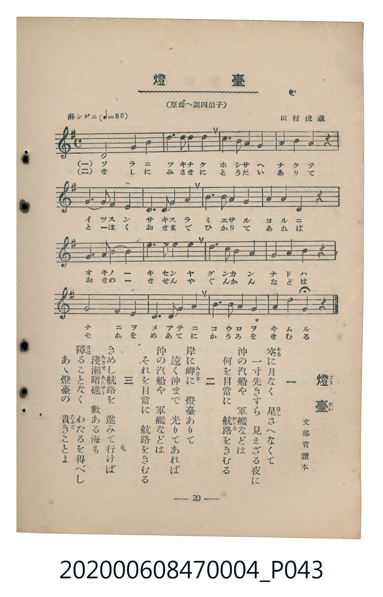

# 燈臺

<audio controls src="todai.mp3"></audio>

- 詞：文部省讀本
- 曲：田村虎藏
- 臺灣教育會公認《新定兒童唱歌》尋常科第四學年用（2020.006.0847.0004）

## 說明

原書資訊與歌詞全文（對應 P043.jpg，書頁 p. 20，第二學期第 8 首）：
調性與拍號：標題註記「原曲へ調四拍子」，譜面為一升記號（E 小調 / G 大調關係小調 4/4 拍）
速度指示：淋シゲニ（♩=80）

## 歌詞

```text
一
空（そら）に月なく　星（ほし）さへなくて
一寸先きすら　見えざる夜に
沖の汽船や　軍艦などは
何を目當に　航路（かうろ）をきむる

二
岸に岬（みさき）に　燈臺ありて
遠く沖まで　光りてあれば
沖の汽船や　軍艦などは
それを目當に　航路をきむる

三
きめし航路を　進みて行けば
淺瀨暗礁（あさせあんせう）　數ある海も
障（さは）ることなく　わたるを得べし
あゝ燈臺の　貴（たふと）きことよ
```

## ABC

```abc
X:1
T:燈臺
C:曲：田村虎藏
M:4/4
L:1/16
Q:1/4=80
K:Em
V:V1 name="Piano" snm="Pia"
[V:V1]
e8 e4 a4 | b6 c2 b4 a4 | g6 a2 g4 e4 | a4 a4 f4 z4 |
e4 e2 e2 a8 | f6 e2 f4 a4 | b6 a2 b4 e4 | f4 f4 e4 z4 |
e4 e4 b4 c4 | b6 a2 g4 e4 | b6 c2 b4 a4 | g4 f4 b4 z4 |
e8 B4 e4 | f6 e2 f4 a4 | b6 a2 g4 e4 | f4 f4 e4 z4 |
```

## TMD 檔案連結

- [主旋律 TMD 檔案](todai.tmd)
- [鋼琴伴奏 TMD 檔案](todai_piano.tmd)

## 分析

```text
================================================================================
📊 TMD Song Profile: [ 燈臺 ]
================================================================================
⏱  Duration:       0:48 (48.0s), 16 measures total
🎼 Key & Tempo:    首調基準 G, != 80.0 BPM, <4/4>
   - 分析範圍：      由實際發聲的音符與和弦推測調性；播放脈絡另行呈現
🎤 人聲音域:    B3 (MIDI 59) – E5 (MIDI 76) [跨度: 17 個半音 / 1.4 個八度, 難度: challenging]
   - 最低音:  B3 in [Todai #1 @ m.13, 0:37]
   - 最高音: E5 in [Todai #1 @ m.7, 0:20]
   - 適合: soprano, mezzo-soprano, contralto, tenor, baritone, bass
🏛  結構:      Todai (48.0s)
⚡ 編曲密度:        Peak 1 軌道同時演奏
🗝  調性診斷：       E 調性不明確（純淨自然大調，未偵測到可信轉調）
   - 風格氣質:    純淨自然大調（陽光明朗、易唱易記，無明顯調外色彩）
   - 轉調歷程:    全曲維持單一推測調性（未偵測到可信轉調）
   - 核心骨幹音:  E, B, F#, A, G
   - 調性數值:    E 調性不明確 [相關度: 0.76, 穩定度: Ambiguous, 自然音純度: 100.0%]
   - 候選調性 (K-S): E 小調 (0.76), E 大調 (0.76), A 大調 (0.58)
   - 五度圈歷程:   +4
   - 各段落調性細節:
     • [Todai #1]: E 調性不明確 (r: 0.76, 自然音純度: 100.0%)

  [ 五度圈游移軌跡 ]
               C  
         F            G  
      Bb               D  
      Eb               A  
         Ab          [E ]*
            Db       B  
               F# 
     (* = active key center)

  [ 十二半音累積音高分佈 ]
     C  : ███                        3.3%
     C# :                            0.0%
     D  :                            0.0%
     D# :                            0.0%
     E  : ████████████████████████  28.3%
     F  :                            0.0%
     F# : ████████████████          18.3%
     G  : ████████                   9.2%
     G# :                            0.0%
     A  : ████████████████          18.3%
     A# :                            0.0%
     B  : ███████████████████       22.5%
--------------------------------------------------------------------------------
Assignment 軌道音域：
  - Piano         : B3 – E5 (17 個半音 / 1.4 個八度, 58 個音符)
================================================================================
```


## 原書掃描頁




