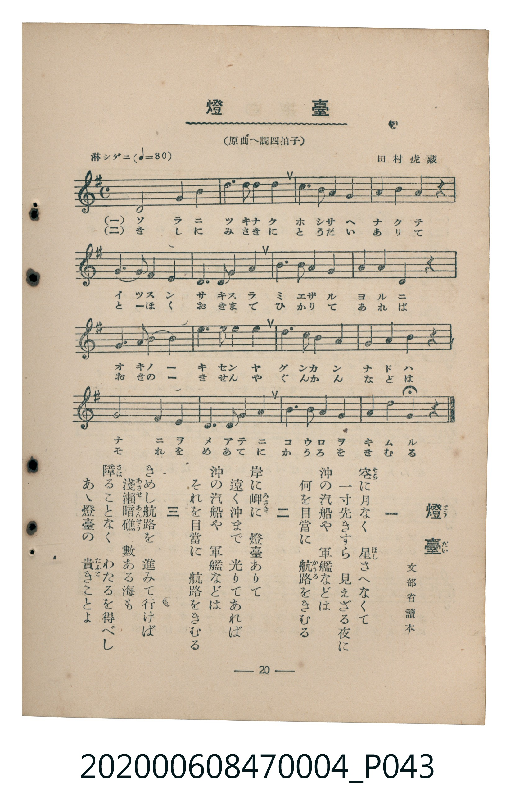

# 燈臺

> Re:Shōka 使用 AI 協助辨識與重建樂譜，可能會有錯誤。歡迎回報。

- **NEUTRINO 歌聲合成版**：<br><audio controls src="todai_neutrino.mp3"></audio>
- **鋼琴伴奏版**：<br><audio controls src="todai.mp3"></audio>


- 詞：文部省讀本
- 曲：田村虎藏
- 臺灣教育會公認《新定兒童唱歌》尋常科第四學年用（2020.006.0847.0004）

## 說明

原書資訊與歌詞全文（對應 P043.jpg，書頁 p. 20，第二學期第 8 首）：
調性與拍號：標題註記「原曲へ調四拍子」，譜面為一升記號（E 小調 / G 大調關係小調 4/4 拍）
速度指示：淋シゲニ（♩=80）


## 歌詞

```text
一
空（そら）に月なく　星（ほし）さへなくて
一寸先きすら　見えざる夜に
沖の汽船や　軍艦などは
何を目當に　航路（かうろ）をきむる

二
岸に岬（みさき）に　燈臺ありて
遠く沖まで　光りてあれば
沖の汽船や　軍艦などは
それを目當に　航路をきむる

三
きめし航路を　進みて行けば
淺瀨暗礁（あさせあんせう）　數ある海も
障（さは）ることなく　わたるを得べし
あゝ燈臺の　貴（たふと）きことよ
```

## ABC

```abc
X:1
T:燈臺
C:曲：田村虎藏
M:4/4
L:1/16
Q:1/4=80
K:Em
V:V1 name="Piano" snm="Pia"
[V:V1]
E8 E4 A4 | B6 c2 B4 A4 | G6 A2 G4 E4 | A4 A4 F4 z4 |
w: 1.~そ ら に | つ き な く | ほ し さ へ | な く て
w: 2.~き し に | み さ き に | と う だ い | あ り て
w: 3.~き め し | か う ろ を | す す み て | ゆ け ば
E6 E2 D4 D4 | C6 D2 E8 | B6 c2 B4 A4 | F4 F4 E4 z4 |
w: 1.~い っ す ん | さ き す | み え ざ る | よ る に
w: 2.~と _ ほ く | お き ま | ひ か り て | あ れ ば
w: 3.~あ さ せ あ | ん せ う | か ず あ る | う み も
E6 G2 G8 | B6 c2 B4 A4 | B6 c2 B4 A4 | G4 F4 E4 z4 |
w: 1.~お き の | き せ ん や | ぐ ん か ん | な ど は
w: 2.~お き の | き せ ん や | ぐ ん か ん | な ど は
w: 3.~さ は る | こ と な く | わ た る を | う べ し
E8 E4 D4 | C6 D2 E4 G4 | B6 c2 B4 A4 | G4 F4 E4 z4 |
w: 1.~な に を | め あ て に | か う ろ を | き む る
w: 2.~そ れ を | め あ て に | か う ろ を | き む る
w: 3.~あ あ と | う だ い の | た ふ と き | こ と よ
```

## TMD 檔案連結

- [主旋律 TMD 檔案](todai.tmd) [[在 TMD Studio 編輯](https://tmdlang.github.io/Tmd-TS/#tmd=s7IKdvYPcrWy4qpTUCpJTLdSSM7PyUlNLsnMz7MqzsjMK0nNjM_KTMmPL87Iz05Ugisry88pzU21Si9KTEmNN4k3MjAyiDcwMIs3sDAxBzIMTBBKi_NLi5JTrYqTM_Lzc-JLUitKkvLzsxHyBUX5Zal5iXlANQVFIBtTwIoQClLLMlNSQdKpKZkl-UWZiTlI7kgtKga7FWxJfElRYl5xclFmAcgDCFUlGalAxxbkJCanKnFpaSk8b-940b5LQUuLS9FWwcKAy95WwZ0rO7XSVsE1l8vGRN_EDqT1xcp57_fMejat_WXziudzGl-sa3g2Zw3Y0GezNwFlnk_Z8GzuxBcz-15M7wcLA8183rj42dSZL5o2PZvT_LR1zYtVvY8bup5N2_B03aynrZOer176dMrGZ2t7Hjd0P93Q_XTHjufLJz5fs-bp7NlP1-54unPL8ykr3u_pAIWmHjA09UChCWQYmLzf06nExaWvpWBLLcCloKDwtG_-s9k7Xmxuf7Gi60VHO9BdQC8_bV0B9DLQFU839D5r71QIMDAx1ssqSH-_pweo-OWCRoUCPQUjAyAX6PAnu3qADn82Zz6QrWCh8HLZNKBLgUEDMv3Fqv3PGpaDzO3ufTFzPigoV8x8ubDnxYrdL1bMeNzQA7Z-0-PGHUCVwBAAKnu6dsLjhl6g0S_Wznk5d9Hzpl1PdjQ87QW6bwbYhA5Xhacb-oHKFfQV3BWeLlkOZL6cPufJ_iaoMDDqFIDmAB0BcsHLhvlPdy171tP-fMkukPXbux83bX_ctOlxczfQrEczV9paAP3RyQVSC7QIRD1fCVTZ8bhx7uMmoD86HzeufjYHyF31uLH_cUPDsxkgRzxu3P24cTpYdirQ9VDZxmVQY56u3_G0Faio93HjTKApQG0vlnU_bgSKTHvc1P10yRygoSClzzZNe9y47tnGvS86dj5uagGp2937onMZ2LyVjxvXg83bO_Vx06Tns9c9n7oNqA-kqGPVi-3rwc4Amtr2uAnkW6AakIVNDUAbIN7Z1QOO4U1A561-umkNWP1-sIPB6sFGQbLB48amx01dUPe_bFwA9AzYafseNy4HKnraCjQdJA1W1_O4cQPRjgcHYw9W92M6eAc4ysCCjcDgRShraHjZAEwlQMcve7EQaP9EmBO273resOLZrOnPlzSCvdcE9t5ssDsngxltIK8Co20qMBSAgt3PtgKjvwnsz1lzwHqAGoBhCfQhMCyBelbAo_pxEzBK54PEmyY93Tf9ceNOoKMgLgSaNBcWdOtAPtq0BWzW_MeNW4FGgIMXGPlg45o6QHooz65QoKClz8UVkp-SmGkVkJmYl-9QY1BTDbJBwcZCyw7MwFZIKICy6o4GYPApaJiAstDz9Q068JytiUUD0B6oYRpAjZpWCo-b9oIEQAHQvBJMdgPJGiDdAhFtWgtkd4FZ66Eys6Ey24F4K1jPDKgMQt3j5jaouchW7uoBWdnYC7OycTqYXA3R3rgfKjoVqgYhswIq0wbEC8AskPNAMk1gK8EWNy5DtbJGwSxeQRcMwQwjIK5RMAYLmIBpiIghWMQITIMV1oAlQNgcxDUACYFN9DEEWTkXaiiwFACRQEeCtDxuXAIRBTodmNzArH6ozG6ozHSw50CsHVAZhDqQ83UVwNZD7DICyffC7ALqRbZrP1QUElTIMiugMpCgArFaoDJNYDd3YbPLGMWupka4jSDxboSJTWC7miZBZWZCZWZCXQQxFyjT1AbmTQSTG-B24U_Ju3ooS8lLwOmuGZwgdoLZmyGJBJxKoWkZKgNK66AUOx8qswKIt4FloEmuGZTkIDxInsCRliHK9oDT324w2Q9NmaA0CS75gHgfmLUcKrMJKtONknIRqbkHLLYBR2oGUqYgFpioUTCBiAJ58NSOLZGDUzKYACtDT9OgNAKKq8XQWAUWtdA4BqVXWKqGyIBSPXIa7ADiaWAZUEoBhXcHnAdJl-ipGpJGQbKgnIHIJ6C0CbNrH5i1HCqzCSoDCTKklAZN1T1oKQ2RqkHysJwyG8wCiYBcCfIhiD8bnLZhQYdI77PgpkP9BVYFTelNIBliUvWOTspS9SpoygUlsz54YgO5HyQGktsNTemPm0E5ACQDSTog0cdNkBQMzQmQErq5E0yCEiqOVA1JlZAyeB2ypdCyGxxowAAEWQ8riSdAnTMZHIQQFkQG7IVGcPXSCKocsKVqQ2gxjD31Yi-0cSdn5IS0DilqIUUczPWgaIQVjhMgMlDXI2cASBG9EkyuR01g4MRMJ7vAiRmWGddDEyXMLlhSBhZjqFVPE4gG8efDMiS88IYk5p1gElTUE5GYgc15ihIzOPlBkiY4hTSDSkJQslwITTuLoA0HeDOkCZRwQTLLgGKQTADVA80SC8AkKJHjSMpzYVZCilWg9yHaG6EJuQlcliA3NiClPay-Q9IDyRBNDWASrU5Ab2xgL51BqZb01AyKUUgsggpTeAyCq2lIgQYpDhGNANxVNoTXACZBqtBTM6JxAy5SaWUXUtEMK5Ih1QIsZYL4C4AYlGcg-QokMx8qsxWqGmIHLAdAxcDVD8SuWi4uXTsFcMtaAchQ5gIA)]
- [鋼琴伴奏 TMD 檔案](todai_piano.tmd) [[在 TMD Studio 編輯](https://tmdlang.github.io/Tmd-TS/#tmd=s7IKdvYPcrWy4tLSUnje3vGifdf7PR0vu_c8n7DlyZ4tT5f2P-_seL-nU0FLi0vRVsHCgMveVsGdKzu10lbBNZfLxkTfxI6rTkHpxcp57_fMejat_WXziudzGl-sa3g2Z40SSObZ7E1AmedTNjybO_HFzL4X0_vBwkCLnjcufjZ15oumTc_mND9tXfNiVe_jhq5n0zY8XTfraeuk56uXPp2y8dnanscN3U83dD_dseP58onP16x5Onv207U7nu7c8nzKCqBTjQyMDPQMDMz0DCxMzIEMAxOga5W4uELyUxIzrQIyE_PygzwcagxqqrkUgMDGQssOzNDXUrBFBwpA45_saHixsEdBw0Th6Yb-5-sbdBQCDEyM9bIK0jWxaNDSBxtWo2AWr6ALhmCGERDXKBiDBUzANETEECxiBKbBCmvAEiBsDuIagITAJvoY1ig8bpwLNfRxUyeIbFwN1vK4cQlEtLEXiFeBWf1Qmd1QmelAPBXM2gGVQah73LgMSIKth9hlBJLvhdkF1Its136o6FSoGoTMCqhMGxAvALNaoDJNYDd3YbPLGMWupka4jSDxboSJTWC7miZBZWZCZWZCXQQxFyjT1AbmTQSTG-B24Y_jXT0UxDGQMgWxwESNgglEFMiDpwFsUQ-OXzABVoYe06CQA_lgMdSvj5smQ30OikVYXENkQGkBOWY6gHgaWAYUfqAw6YDzILGFHteQmAPJgtILIvWAYgxm1z4wazlUZhNUphslXhFx3YMW_oi4BsnD0s9sMAskAnIlyIcg_mxwjMOCDpEKZsFNh_oLrAoa_00gGWLiekcnBXFtCM2y2OMUewbHHcnIwbsOycOQ7AAOCHCgPG6CZaQJEBmgKCRYEMkCkp1Xgsn1qMEOjmI62QWOYlgSXQ-NKphdsAheATcDmtCaQDSIPx-WTOEZHRLFO8EkqFggIoqBNQLlRTb23AyKT9LjGeRXiP9AmQ_uN3BhB8kAkOyDKEpxF3wQXgOYBKlCj2dEFQHOgrSyCykrw7IwpBiBxRmIvwCIQakJkuJAMvOhMluhqiF2wNIGVAxcXEHsqkWpuH2QK24T4ipuvBEerxBtFp8bC2EZARkQQWAkGsEFDIEsQ6gSsGJgHQ2VNAaKGRBZuRDlDlMQyzQeZIcJiGmCai-G20AOiDaON4coI-wUSNlHlFOg3sZiKYYAiEW8I6C5kybhgeESYPrRtVMAJ6FoH6B3EBwjZI4xmKPMBQA)]

## 分析

```text
================================================================================
📊 TMD Song Profile: [ 燈臺 ]
================================================================================
⏱  Duration:       0:48 (48.0s), 16 measures total
🎼 Key & Tempo:    首調基準 G, != 80.0 BPM, <4/4>
   - 分析範圍：      由實際發聲的音符與和弦推測調性；播放脈絡另行呈現
🎤 人聲音域:    C4 (MIDI 60) – C5 (MIDI 72) [跨度: 12 個半音 / 1.0 個八度, 難度: easy]
   - 最低音:  C4 in [Todai #1 @ m.6, 0:15]
   - 最高音: C5 in [Todai #1 @ m.2, 0:04]
   - 適合: soprano, mezzo-soprano, contralto, tenor, baritone, bass
🏛  結構:      Todai (48.0s)
⚡ 編曲密度:        Peak 1 軌道同時演奏
🗝  調性診斷：       E 小調（純淨自然小調，未偵測到可信轉調）
   - 風格氣質:    純淨自然小調（陰鬱抒情、旋律集中，無明顯調外色彩）
   - 轉調歷程:    全曲維持單一推測調性（未偵測到可信轉調）
   - 核心骨幹音:  E, B, A, G, C
   - 調性數值:    E 小調 [相關度: 0.92, 穩定度: High, 自然音純度: 100.0%]
   - 候選調性 (K-S): E 小調 (0.92), E 大調 (0.67), G 大調 (0.55)
   - 五度圈歷程:   +4
   - 各段落調性細節:
     • [Todai #1]: E 小調 (r: 0.92, 自然音純度: 100.0%)

  [ 五度圈游移軌跡 ]
               C  
         F            G  
      Bb               D  
      Eb               A  
         Ab          [E ]*
            Db       B  
               F# 
     (* = active key center)

  [ 十二半音累積音高分佈 ]
     C  : ████████                   9.2%
     C# :                            0.0%
     D  : ██████                     6.7%
     D# :                            0.0%
     E  : ████████████████████████  27.5%
     F  :                            0.0%
     F# : ███████                    8.3%
     G  : ████████████              13.3%
     G# :                            0.0%
     A  : ████████████              14.2%
     A# :                            0.0%
     B  : ██████████████████        20.8%
--------------------------------------------------------------------------------
Assignment 軌道音域：
  - Piano         : C4 – C5 (12 個半音 / 1.0 個八度, 56 個音符)
================================================================================
```


## 原書掃描頁




