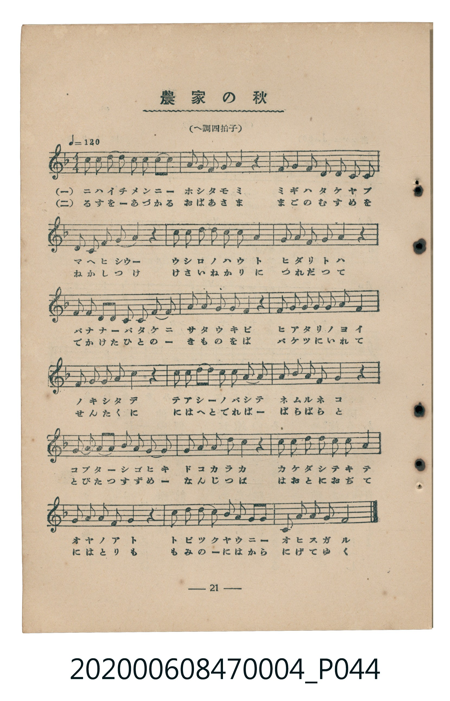
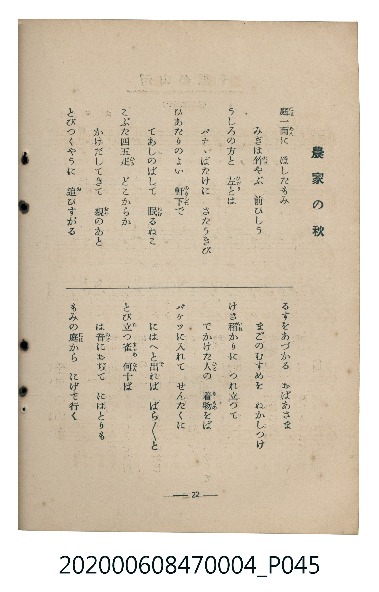

# 農家の秋

<audio controls src="noka_no_aki.mp3"></audio>

- 臺灣教育會公認《新定兒童唱歌》尋常科第四學年用（2020.006.0847.0004）

## 說明

原書資訊與歌詞全文（對應 P044.jpg–P045.jpg，書頁 pp. 21–22，第二學期第 9 首）：
調性與拍號：へ調四拍子（F 大調 4/4 拍）
速度指示：♩=120

## 歌詞

```text
一
庭一面（にはいちめん）に　ほしたもみ
みぎは竹（たけ）やぶ　前ひしう
うしろの方と　左（ひだり）とは
バナゝばたけに　さたうきび
ひあたりのよい　軒下（のきした）で
てあしのばして　眠（ねむ）るねこ
こぶた四五疋（ひき）　どこからか
かけだしてきて　親（おや）のあと
とびつくやうに　追（お）ひすがる

二
るすをあづかる　おばあさま
まごのむすめを　ねかしつけ
けさ稻（いね）かりに　つれ立つて
でかけた人（ひと）の　着物（きもの）をば
バケツに入れて　せんたくに
にはへと出（で）れば　ばらばらと
とび立（た）つ雀（すゞめ）　何（なん）十ぱ
は音（おと）におぢて　にはとりも
もみの庭（には）から　にげて行く
```

## ABC

```abc
X:1
T:農家の秋
C:TMD (Chen, Chih-Han / aguai)
M:4/4
L:1/16
Q:1/4=120
K:F
V:V1 name="Piano" snm="Pia"
[V:V1]
c2 c2 c2 d2 c2 c2 A2 c2 | G2 G2 F2 G2 A4 z4 | G2 G2 A2 G2 F2 F2 D2 C2 | D2 D2 F2 D2 G4 z4 |
c2 c2 c2 d2 c2 A2 c4 | G2 G2 A2 G2 F4 z4 | D2 D2 D2 D2 C2 C2 D2 F2 | G2 G2 F2 D2 F4 z4 |
G2 G2 G2 F2 G2 G2 A4 | G2 G2 F2 G2 A4 z4 | c2 c2 c2 d2 c2 c2 A2 c2 | G2 G2 A2 G2 F4 z4 |
G2 G2 G2 G2 A2 G2 F2 D2 | F2 F2 G2 A2 c4 z4 | c2 c2 d2 c2 c2 A2 c4 | G2 G2 A2 F2 G4 z4 |
A2 A2 c2 c2 G2 G2 A2 F2 | D2 F2 A2 G2 F8 |
```

## TMD 檔案連結

- [主旋律 TMD 檔案](noka_no_aki.tmd) [[在 TMD Studio 編輯](https://tmdlang.github.io/Tmd-TS/#tmd=s7IKdvYPcrWy4tLSUnixb9PTddseN657vrxbQUuLS9FWwdDIgMveVsGNy8ZE38SOq05B6UX7rueNi59NnfmiadOzOc1PW9e8WNX7uKHr2bQNT9fNeto66fnqpU-nbHy2tudxQ_fTDd1Pd-x4vnzi8zVrns6e_XTtjqc7tzyfsuL9ng4jAyMDPQMDMz0DCxNzIMPA5P2eTiUuLn0tBVtqAS4FBYWnffOfzd7xYnP7ixVdLzrage56sXLe09YVz6a1A13xdEPvs_ZOhQADExO9rIL0Rw2TgUxTEPP9nh6gvpcLGhUKCvQUjAyBUkZGQEGgT57s6gH65Nmc-UC2gqXCy2XTgE5_v2cWyLoXq_Y_a1gOsqi798XM-UDRx407gIJA3wNFnq6dALTUTeHpkuVAMQVgmCoARYG6QVpfNsx_umvZs57250t2AfU9mrnSFhT8IKknOxrAftm1Fsh6OXcR0JDHjasfN65_3NjyuHHh46bGx02TgcaABBsaHjfuftw4_XHj_MdNTY8b94N0AqnHjX1ADc9X7wRrnv-4cSJIQxNQ_zagnqedvY8bN4G1tUE0tIE4TUDRdc-m7XzcuAKkaPsysGagugWPm7rAFq4AGgrW0DzhcXPX46a5jxs3QIyHOWYqmAs0DmjWZojZQAOALgO6rwto_OMmoJEtQKUvdk96sqMbbMM6sGqQH8CWLIdoWwbWBhQFSgMtATKWAbU9n7MArGft46YGsJe6QezGyRA9k0H-a5wPDP8nu6Y8nwYxHmg_KNTBzlsJVtP9uAloTzdED9AAoOsXQG0AuQRkz4tlq8CagZ5sAbsK6Aqgc1ZA9ADDYfPjxiWPG_vBYQr0Lsj3L_bvhegBawBaO_NxYw_QhZBY3dUD1gty8MzHTZPAxi0Fu6Ub7DRg6AC9CRQEBuE-iDX7HjdOAYcZUBqoBxjvk8BKgR4GmgJ0L9AFEyFKgV6Y-nzFbrD9QBetBTsBaDbQVEjELHnc1PN8NVAbUM8yiJ7lMM_Pf7ILmAghQQXMrmDfAoN6bsPzzpVg8V5w4loHDnCgyzfA0kDTxsfNQNtWP21dCjQeEnKPG2cD0yc4GfQDpSBWQZLvDqDxT9shVi0HGwbUswGsZwM4SiAkUiADXQxJwWBXLXk5GxjpQC4wMOYBwwMSq0_2TgULroJki6e9jY8bN0KMWP9y_mZoNEI9BnQIkL0I5lSIu1aAwqmpCRI_oFwE9Csw-8EzHiwwIWkIKAIMg2UvFgId3w_SQ3nZBQUKWvpcXH752Yl--Y7ZmVYBmYl5-Q41BjUK1SBrFGwstOzADGzFpgKorNrRAHSVgoaxwtMN_c_XN-jAyzpNLBqAlkEN0wBq1LQCxmg3EPcDw2AJkG4E4oVAvBkqvkehBkjOBspuB-L9QPYiIJ4PMgIIQHLzgeLroCYA5Zs2Atkgk6aBdSNbt6sHZF0T0NjGmUB6ElgBMPED8VJQlgTLAY1s7ALiDVCZqaAcgbAOyAZmDyAGWtnUADUJ6GioaVDrahRMwdAMTBoDcY2CERAaArGxgq6CARBDRIzBooYKZvEKpvEKNeBMizukd_VQFtLzgHgGEAMdCw7PZQiPAdlgsea1QNwHDU-gWHMHNJxBHgR6uHkVWAwkDwGYIdwINAIUmo3TgRgYFY0TkcJvIjRMWxDqmkDhvRoqD1Tf1AOkFwDxYlCBjGpNDSikgAgcYkbwoEQENyiwUQMXqoZA0O7opCxoJwAx0B9gDExVID48OYJTVdNWqAgooEGBPBkpEYMiBJiwwQkcFMCgCFgBzhJYA3g5NIBBgQlM_42bQAUXJFFCckxjL6hMgSZToOHA5IywDOQ0kLNAUbAaEhXgIAcFNVowQxAwZQIRONRh6RjMQU7IkMQNSd4EwhpYUVIW1sDQAYUgvEhoR_JcGzQkQUkZFA-gkAR5GMRvA6sABk0zMHU1A70OYjdtxp2QQeXOZGgYA_MDOJHCEjIo5NYD8Q5o2APjBByKwIIDGgdAVlMnEr0CPSljFgnYiw1S0vGuKRSFLTA0wEUnOFyB4QcO4y3QFLoWHH5Ar4BUNYHCbyWYhgcKSAyctIAFBTTEIWm9DXv4gsINaBQ4fEEFBbAwbZwFKVChYQjMDOAYAJZa4OJgI1IMgEIfVHSATAHFBogNjHrUdAxJm7AwBCbbGnB5CxIAFRSIYEcEOuEE3LqWskAGZXFQHQVKyKD6DFTGwhIwqGwF-hiUO5uAPgSpA5fD8NoQrBsUHTuBeA04IeNMwLBECipLgMEDLBIQcQUqHoCxDC00EGpBJXInPImDCg9QiQWMSWAWwJKAjcGhCQtJY3AImsJlwAWJITwFg2ANVy0Xl66dArzJoQDkKHNxAQA)]
- [鋼琴伴奏 TMD 檔案](noka_no_aki_piano.tmd) [[在 TMD Studio 編輯](https://tmdlang.github.io/Tmd-TS/#tmd=s7IKdvYPcrWy4tLSUnixb9PTddseN657vrz7_Z6Ol917nk_Y8mTPlqdL-593drzf06mgpcWlaKtgaGTAZW-r4MZlY6JvYsdVp6D0on3X88bFz6bOfNG06dmc5qeta16s6n3c0PVs2oan62Y9bZ30fPXSp1M2Plvb87ih--mG7qc7djxfPvH5mjVPZ89-unbH051bnk9ZAbTSyMDIQM_AwEzPwMLEHMgwMAHaqsTF5ZefneiX75idaRWQmZiXH-ThUGNQo1DNpQAENhZadmCGvpaCLTpQANrxZEfDi4U9ChrGCk839D9f36CjEGBgYqKXVZCuiUWDlj7YsBoFUzA0A5PGQFyjYASEhkBsrKCrYADEEBFjsKihglm8gmm8Qg0Xfrfs6iHHLUCzgQhshxHccoQDQc5DdQ5UDQHH7Ogk3zEQBPQxEIHdBgsfMAc5gCCBBgk2Ai4CJgdyXIQZMdgjj5Sw2TWFXJcgbAIGRQ04bYAEQFGEcBzCaYQDpXUtuU4xBtsNs9cYbJ8pXAYclYbwUAHBGq5ajNzmg5LbTKC5DeixeIVow1gYBfRWPJBlGg8WMUDjg1XA0w-QbxafGwtWAVJJwCQMfYStBDOQ7ERXSJyNKD4A24ysE4s56PrQPAgXx-YZUMjr2inAA18BnaPMxQUA)]

## 分析

```text
================================================================================
📊 TMD Song Profile: [ 農家の秋 ]
================================================================================
⏱  Duration:       0:36 (36.0s), 18 measures total
🎼 Key & Tempo:    首調基準 F, != 120.0 BPM, <4/4>
   - 分析範圍：      由實際發聲的音符與和弦推測調性；播放脈絡另行呈現
🎤 人聲音域:    C4 (MIDI 60) – D5 (MIDI 74) [跨度: 14 個半音 / 1.2 個八度, 難度: moderate]
   - 最低音:  C4 in [NokaNoAki #1 @ m.3, 0:05]
   - 最高音: D5 in [NokaNoAki #1 @ m.1, 0:00]
   - 適合: soprano, mezzo-soprano, contralto, tenor, baritone, bass
🏛  結構:      NokaNoAki (36.0s)
⚡ 編曲密度:        Peak 1 軌道同時演奏
🗝  調性診斷：       C 大調（純淨自然大調，未偵測到可信轉調）
   - 風格氣質:    純淨自然大調（陽光明朗、易唱易記，無明顯調外色彩）
   - 轉調歷程:    全曲維持單一推測調性（未偵測到可信轉調）
   - 核心骨幹音:  G, C, F, A, D
   - 調性數值:    C 大調 [相關度: 0.83, 穩定度: High, 自然音純度: 100.0%]
   - 候選調性 (K-S): C 大調 (0.83), F 大調 (0.69), G 大調 (0.60)
   - 五度圈歷程:   +0
   - 各段落調性細節:
     • [NokaNoAki #1]: C 大調 (r: 0.83, 自然音純度: 100.0%)

  [ 五度圈游移軌跡 ]
              [C ]*
         F            G  
      Bb               D  
      Eb               A  
         Ab           E  
            Db       B  
               F# 
     (* = active key center)

  [ 十二半音累積音高分佈 ]
     C  : ████████████████████      24.2%
     C# :                            0.0%
     D  : ██████████                12.5%
     D# :                            0.0%
     E  :                            0.0%
     F  : ████████████████          18.7%
     F# :                            0.0%
     G  : ████████████████████████  28.9%
     G# :                            0.0%
     A  : █████████████             15.6%
     A# :                            0.0%
     B  :                            0.0%
--------------------------------------------------------------------------------
Assignment 軌道音域：
  - Piano         : C4 – D5 (14 個半音 / 1.2 個八度, 114 個音符)
================================================================================
```


## 原書掃描頁






