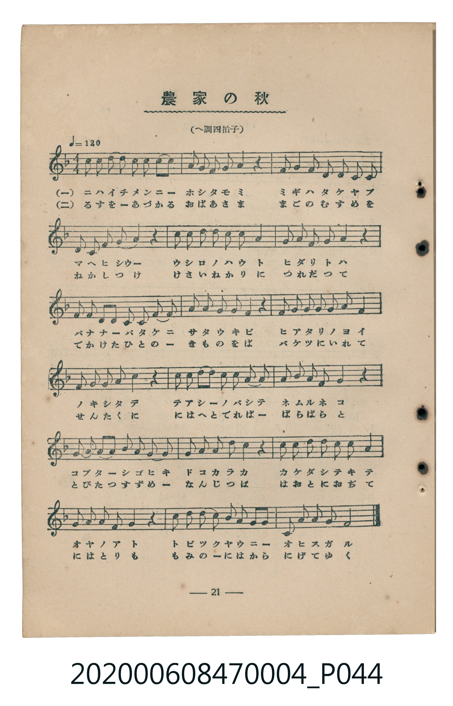
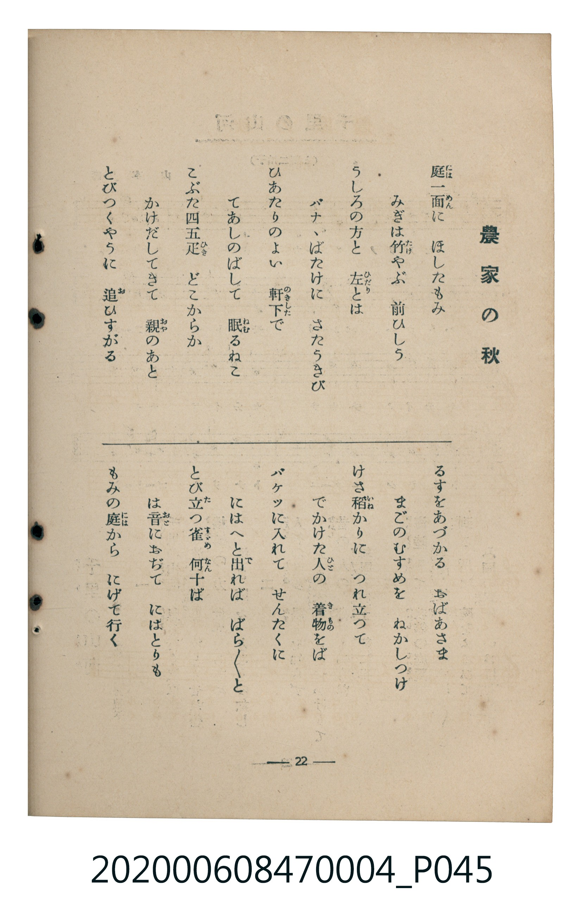

# 農家の秋

> Re:Shōka 使用 AI 協助辨識與重建樂譜，可能會有錯誤。歡迎回報。

- **鋼琴伴奏版**：<br><audio controls src="noka_no_aki.mp3"></audio>
- **NEUTRINO 歌聲合成版**：<br><audio controls src="noka_no_aki_neutrino.mp3"></audio>

- 臺灣教育會公認《新定兒童唱歌》尋常科第四學年用（2020.006.0847.0004）

## 說明

原書資訊與歌詞全文（對應 P044.jpg–P045.jpg，書頁 pp. 21–22，第二學期第 9 首）：
調性與拍號：へ調四拍子（F 大調 4/4 拍）
速度指示：♩=120


## 歌詞

```text
一
庭一面（にはいちめん）に　ほしたもみ
みぎは竹（たけ）やぶ　前ひしう
うしろの方と　左（ひだり）とは
バナゝばたけに　さたうきび
ひあたりのよい　軒下（のきした）で
てあしのばして　眠（ねむ）るねこ
こぶた四五疋（ひき）　どこからか
かけだしてきて　親（おや）のあと
とびつくやうに　追（お）ひすがる

二
るすをあづかる　おばあさま
まごのむすめを　ねかしつけ
けさ稻（いね）かりに　つれ立つて
でかけた人（ひと）の　着物（きもの）をば
バケツに入れて　せんたくに
にはへと出（で）れば　ばらばらと
とび立（た）つ雀（すゞめ）　何（なん）十ぱ
は音（おと）におぢて　にはとりも
もみの庭（には）から　にげて行く
```

## ABC

<div class="abc-score" data-abc-src="noka_no_aki.abc" aria-label="五線譜載入中"></div>

[下載 ABC 原始檔](noka_no_aki.abc)

## TMD 檔案連結

- [主旋律 TMD 檔案](noka_no_aki.tmd) [[在 TMD Studio 編輯](https://tmdlang.github.io/Tmd-TS/#tmd=s7IKdvYPcrWy4qpTUCpJTLdSSM7PyUlNLsnMz7MqzsjMK0nNjM_KTMmPL87Iz05Ugisry88pzU21Si9KTEmNN4k3MjAyiDcwMIs3sDAxBzIMTBBKi_NLi5JTrYqTM_Lzc-JLUitKkvLzsxHyBUX5Zal5iXlANQVFIBtTwIoQClLLMlNSQdKpKZkl-UWZiTlI7kgtKga7FWxJfElRYl5xclFmAcgDCFUlGalAxxanJhbn5xUTKVyeX4TkSKC16Zl5ViWJmeWJefH5aWmZySjuyC8qycgHhkZBRqVVRmYxyJnJiTnx2Yl5SIEGdWRBYnqqVYCBiYkukDBV4tLSUnixb9PTddseN657vrxbQUuLS9FWwdDIgMveVsGNy8ZE38QOZMaL9l3PGxc_mzrzRdOmZ3Oan7auebGq93FD17NpG56um_W0ddLz1UufTtn4bG3P44bupxu6n-7Y8Xz5xOdr1jydPfvp2h1Pd255PmXF-z0doMjSA0aWHiiygAwDk_d7OpW4uPS1FGypBbgUFBSe9s1_NnvHi83tL1Z0vehoB7rrxcp5T1tXPJvWDnTF0w29z9o7FUDhoJdVkP6oYTIoNEDM93t6gPpeLmhUKCjQUzAyBEoZGQEFgT55sqsH6JNnc-YD2QqWCi-XTQM6_f2eWSDrXqza_6xhOcii7t4XM-cDRR837gAKAn0PFHm6dgLQUjeFp0uWA8UUgGGqABQF6gZpfdkw_-muZc962p8v2QXU92jmSltQ8IOknuxoAPtl11og6-XcRUBDHjeufty4_nFjy-PGhY-bGh83TQYaAxJsaHjcuPtx4_THjfMfNzU9btwP0gmkHjf2ATU8X70TrHn-48aJIA1NQP3bgHqedvY-btwE1tYG0dAG4jQBRdc9m7bzceMKkKLty8CageoWPG7qAlu4AmgoWEPzhMfNXY-b5j5u3AAxHuaYqWAu0DigWZshZgMNALoM6L4uoPGPm4BGtgCVvtg96cmObrAN68CqQX4AW7Icom0ZWBtQFCgNtATIWAbU9nzOArCetY-bGsBe6gaxGydD9EwG-a9xPjD8n-ya8nwaxHig_aBQBztvJVhN9-MmoD3dED1AA4CuXwC1AeQSkD0vlq0CawZ6sgXsKqArgM5ZAdEDDIfNjxuXPG7sB4cp0Lsg37_YvxeiB6wBaO3Mx409QBdCYnVXD1gvyMEzHzdNAhu3FOyWbrDTgKED9CZQEBiE-yDW7HvcOAUcZkBpoB5gvE8CKwV6GGgK0L1AF0yEKAV6YerzFbvB9gNdtBbsBKDZQFMhEbPkcVPP89VAbUA9yyB6lsM8P__JLmAihAQVMLuCfQsM6rkNzztXgsV7wYlrHTjAgS7fAEsDTRsfNwNtW_20dSnQeEjIPW6cDUyf4GTQD5SCWAVJvjuAxj9th1i1HGwYUM8GsJ4N4CiBkEiBDHQxJAWDXbXk5WxgpAO5wMCYBwwPSKw-2TsVLLgKki2e9jY-btwIMWL9y_mbodEI9RjQIUD2IphTIe5aAQqnpiZI_IByEdCvwOwHz3iwwISkIaAIMAyWvVgIdHw_SA_lZRcUKGjpc3H5AWs9v3zH7EyrgMzEvHyHGoOaapAtCjYWWnZgBrZSUwFUVO1oADpKQcNY4emG_ufrG3TgRZ0mFg1Au0CG1SiYAqEZEIJoEKxRMFYwUjAEYmMFXQUDIK4B83SBpFk8CJmCUQ1Yv49hDTApdANxPzDwlgDpRiBeCMSbweIg3Y-bZwPltgPxfiB7ERDPh5sMYj9uWgdkQ0wAqmjaCGSDTJoGs8MIqK4JaEfjTCA9CaS2sQmIl4KyL1gGKN_YBcQboDJTQbkHYQeQDcxKYH3rgOoboCYBXQo0rQacP3GH6q4eckIVEkyooYgc0iDRGrAsihqkMJ0HxDOAeBI07JYh_ANkg8Wa1wJxHzTkgGLNHdAwBeppBvqyeRVYDCSPYj4oPBuBekGh1zgdiIGh3TgRKbwmQsOwBaGuCRS-q6HyQPVNPUB6ARAvBhXWcPMJpNBOcsLSEC3lgfigVApKp6CUipxKIRAUqqihOQGIgT4AYlBKA_LgKQ2cepq2QkVAIQsK1clIKRQUA8BUC069oBAFhfgKcGpHDdHl0BAFhR4wVTduApVi4DQHCbVeUPECTYNAM4GpFWEHyEUg14BCfDUk5MEhDApZAqEKrO7IC1VQOJkA0yL29GkMDmMTaArFTJ_AUACFFDxftyP5pg0aYtvBoQ0KL5D_QCm2DSwPDIlmYNppBvoUxG7ajCV9gsqMydCQBKZvcNqDpU9QCK0H4h3QEAaGPDi0QCEKkgeWA02dSPQKItPnrinkhCQoHEGpzgSa-iAixuCQxJn3ESEJ9D2orAOFIjC0wOG5BZrq1oJDC-gDkJomUGitBNOIkgAoBk43wNwODV9I-m1DC01QKAHNAIcmKLcDy7_GWeAyEBJiwHQNDm1giQPO0RuRQhsU0qDcDzIDFPIgNjB2iUqbrWvJDVGUdAcPPVB6hIQxsCCAFAGgrA6CyEEKyqagKgSUSEEVDqhghCVOUIEI9CooqzUBvQZSBy48oZUVWC8o8HcC8RpwIkUxHxycsAQIKgaAwQHM1ogoAWVxYIYAZ3uESlAR2glPvKDsDypqgNEFTNww82u5uHTtFOAtAAUgR5kLAA)]
- [鋼琴伴奏 TMD 檔案](noka_no_aki_piano.tmd) [[在 TMD Studio 編輯](https://tmdlang.github.io/Tmd-TS/#tmd=s7IKdvYPcrWy4qpTUCpJTLdSyC8qychPL0osyKi0ysgsLskvykxOzInPTsxLVIIrKs4vLUpOjS9ITE-1CjAwMdEFEqZKXFpaCi_2bXq6btvjxnXPl3e_39PxsnvP8wlbnuzZ8nRp__POjvd7OhW0tLgUbRUMjQy47G0V3LhsTPRN7EAGv2jf9bxx8bOpM180bXo2p_lp65oXq3ofN3Q9m7bh6bpZT1snPV-99OmUjc_W9jxu6H66ofvpjh3Pl098vmbN09mzn67d8XTnludTVgCtNDIwMtAzMDDTM7AwMQcyDEyAtipxcfnlZyf65TtmZ1oFZCbm5Qd5ONQY1FRzKQCBjYWWHZihr6Vgiw4UgFY82dHwYmGPgoaxwtMN_c_XN-gogHytl1WQrolFg5Y-2LAaBVMgNANCEA2CNQrGCkYKhkBsrKCrYADENWCeLpA0iwchUzCqAev3MaxReNzcDcT9Co-blgDpRiBeCMSbweIg3Y-bZwPltgPxfiB7ERDPh5sMYj9uWgdkQ0wAqmjaCGSDTJoGs8MIqK4JaEfjTCA9CaS2sQmIZwExUBQoA5Rv7ALiDVCZqUC8D2EHkP24cQpY3zqg-gaoSUCXAk2r4cIfqrt6yAlVSDChhiJySINEa8CyKGqQwnQeEM8A4knQsFuG8A-QDRZrXgvEfdCQA4o1d0DDFKinGejL5lVgMZA8ivmg8GwE6gWFXuN0IAaGduNEpPCaCA3DFoS6JlD4robKA9U39QDpBUC8GIjhbiMQljs6yQlLQ7SUB-KDUikonYJSKnIqhUBQqKKG5gQgBvoAjPdA-PC0Bk4_TVuhIqCwBYXrZKQ0CooDYLoFp19QmILCfAU4vaOG6XJomILCD5iuGzcBMVAdKNUBbQWp6AXqAqVQUDoEmgpMsQhbQG4CuQcU6qshoQ8OZVDoEghZYPFCXsiCwsoEmB6xp1FjcDibQFMpZhoFhgMorOB5ux3JN23QMAOlU1CIg8IM5EMQvw2sAhgWzcAU1Az0K4jdtBlLKgWVHJOhoQlM5eAUCEuloDBaD8Q7oKEMDH1weAFLAWhoA1lNnUj0CiLT6a4p5IQmKCxBqc8EmgohIsbg0MRZBiBCE-h_UJkHCUlgiIFDdQs09a0FhxjQDyBVTaAQWwmmEWUCUAyceoD5HhrGkHTchhaioJACmgEOUVC-B5aEoJIUVBpCQw2YwsFhDix9wLl7I1KYg8IbVBKATAGFP4gNUkdMGm1dS26ooqQ_eAiC0iUknIGFAqQ4AGV7EEQOVlCGBVUnoMQKqnxAhSQskYIKR6BXQVmuCeg1kDpwQQqq0MCBAdYNioCdQLwGnFhRbAAHKSwhgooEYIAAMzgiWkCZHRih0CIAoRZUpHbCkzGoKAAVPMBIAyZzmA21GA0CH-QGgQm0QQDMx_EK0YaxMAoUHkCWaTxYxACND1YBr6WAfLP43FiwCpBKAiZh6CNsJZiBZCe6QuJsRPEB2GZknVjMQdeH5kG4ODbPgAJe104BHvbRPkBRVAEjsIAyFwA)]

## 分析

```text
================================================================================
📊 TMD Song Profile: [ 農家の秋 ]
================================================================================
⏱  Duration:       0:36 (36.0s), 18 measures total
🎼 Key & Tempo:    首調基準 F, != 120.0 BPM, <4/4>
   - 分析範圍：      由實際發聲的音符與和弦推測調性；播放脈絡另行呈現
🎤 人聲音域:    C4 (MIDI 60) – D5 (MIDI 74) [跨度: 14 個半音 / 1.2 個八度, 難度: moderate]
   - 最低音:  C4 in [NokaNoAki #1 @ m.3, 0:05]
   - 最高音: D5 in [NokaNoAki #1 @ m.1, 0:00]
   - 適合: soprano, mezzo-soprano, contralto, tenor, baritone, bass
🏛  結構:      NokaNoAki (36.0s)
⚡ 編曲密度:        Peak 1 軌道同時演奏
🗝  調性診斷：       C 大調（純淨自然大調，未偵測到可信轉調）
   - 風格氣質:    純淨自然大調（陽光明朗、易唱易記，無明顯調外色彩）
   - 轉調歷程:    全曲維持單一推測調性（未偵測到可信轉調）
   - 核心骨幹音:  C, G, A, F, D
   - 調性數值:    C 大調 [相關度: 0.78, 穩定度: Moderate, 自然音純度: 96.9%]
   - 候選調性 (K-S): C 大調 (0.78), F 大調 (0.75), A 小調 (0.64)
   - 五度圈歷程:   +0
   - 各段落調性細節:
     • [NokaNoAki #1]: C 大調 (r: 0.78, 自然音純度: 96.9%, 調外音: A#)

  [ 五度圈游移軌跡 ]
              [C ]*
         F            G  
      Bb               D  
      Eb               A  
         Ab           E  
            Db       B  
               F# 
     (* = active key center)

  [ 十二半音累積音高分佈 ]
     C  : ████████████████████████  23.4%
     C# :                            0.0%
     D  : █████████████             12.5%
     D# :                            0.0%
     E  :                            0.0%
     F  : █████████████████         16.4%
     F# :                            0.0%
     G  : ███████████████████████   22.7%
     G# :                            0.0%
     A  : ██████████████████████    21.9%
     A# : ███                        3.1%
     B  :                            0.0%
--------------------------------------------------------------------------------
Assignment 軌道音域：
  - Piano         : C4 – D5 (14 個半音 / 1.2 個八度, 113 個音符)
================================================================================
```


## 原書掃描頁






