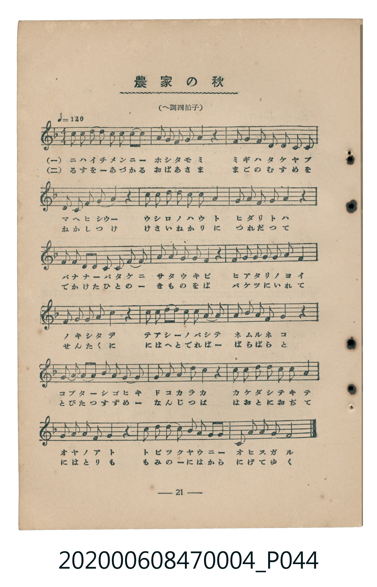
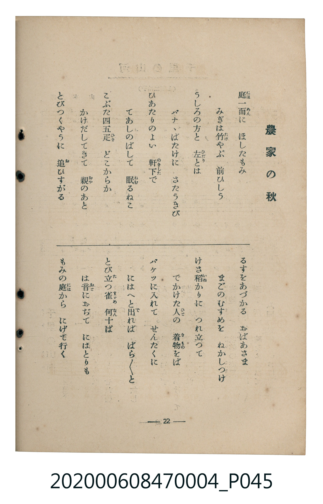

# 農家の秋

> Re:Shōka 使用 AI 協助辨識與重建樂譜，可能會有錯誤。歡迎回報。

- **鋼琴伴奏版**：<br><audio controls src="noka_no_aki.mp3"></audio>
- **NEUTRINO 歌聲合成版**：<br><audio controls src="noka_no_aki_neutrino.mp3"></audio>

- 臺灣教育會公認《新定兒童唱歌》尋常科第四學年用（2020.006.0847.0004）

## 說明

原書資訊與歌詞全文（對應 P044.jpg–P045.jpg，書頁 pp. 21–22，第二學期第 9 首）：
調性與拍號：へ調四拍子（F 大調 4/4 拍）
速度指示：♩=120


## 歌詞

```text
一
庭一面（にはいちめん）に　ほしたもみ
みぎは竹（たけ）やぶ　前ひしう
うしろの方と　左（ひだり）とは
バナゝばたけに　さたうきび
ひあたりのよい　軒下（のきした）で
てあしのばして　眠（ねむ）るねこ
こぶた四五疋（ひき）　どこからか
かけだしてきて　親（おや）のあと
とびつくやうに　追（お）ひすがる

二
るすをあづかる　おばあさま
まごのむすめを　ねかしつけ
けさ稻（いね）かりに　つれ立つて
でかけた人（ひと）の　着物（きもの）をば
バケツに入れて　せんたくに
にはへと出（で）れば　ばらばらと
とび立（た）つ雀（すゞめ）　何（なん）十ぱ
は音（おと）におぢて　にはとりも
もみの庭（には）から　にげて行く
```

## ABC

```abc
X:1
T:農家の秋
M:4/4
L:1/16
Q:1/4=120
K:F
V:V1 name="Piano" snm="Pia"
[V:V1]
c2 c2 d2 d2 c2 c2 c2 c2 | A2 G2 F2 G2 A4 z4 | F2 G4 F2 D2 D2 C2 C2 | D2 C2 F2 G2 A4 z4 |
w: 1.~ニ ハ イ チ メ ン ニ _ | ホ シ タ モ ミ | ミ ギ ハ タ ケ ヤ ブ | マ ヘ ヒ シ ウ
w: 2.~る す を _ あ づ か る | お ば あ さ ま | ま ご の む す め を | ね か し つ け
c2 c2 d2 d2 c2 c2 A4 | G2 A2 F2 G2 A4 z4 | F2 F2 D2 D2 C2 C2 F2 F2 | A2 A2 G2 G2 F4 z4 |
w: 1.~ウ シ ロ ノ ハ ウ ト | ヒ ダ リ ト ハ | バ ナ ナ _ バ タ ケ ニ | サ タ ウ キ ビ
w: 2.~け さ い ね か り に | つ れ だ っ て | で か け た ひ と の _ | き も の を ば
F2 G2 G2 G2 G2 A2 F4 | F2 G2 A2 B2 c4 z4 | c2 c2 d2 d2 c2 c2 A2 A2 | A2 B2 A2 F2 G4 z4 |
w: 1.~ヒ ア タ リ ノ ヨ イ | ノ キ シ タ デ | テ ア シ _ ノ バ シ テ | ネ ム ル ネ コ
w: 2.~バ ケ ツ に い れ て | せ ん た く に | に は へ と で れ ば _ | ば ら ば ら と
G2 A2 G2 G2 B2 G2 G2 G2 | G2 A2 A2 d2 c4 z4 | c2 c2 d2 d2 c2 c2 A4 | G2 A2 A2 F2 G4 z4 |
w: 1.~コ ブ タ _ シ ゴ ヒ キ | ド コ カ ラ カ | カ ケ ダ シ テ キ テ | オ ヤ ノ ア ト
w: 2.~と び た つ す ず め _ | な ん じ っ ぱ | は お と に お ぢ て | に は と り も
c2 d2 d2 c2 B2 A2 G2 G2 | C2 A2 A2 G2 F8 |
w: 1.~ト ビ ツ ク ヤ ウ ニ _ | オ ヒ ス ガ ル
w: 2.~も み の _ に は か ら | に げ て ゆ く
```

## TMD 檔案連結

- [主旋律 TMD 檔案](noka_no_aki.tmd) [[在 TMD Studio 編輯](https://tmdlang.github.io/Tmd-TS/#tmd=s7IKdvYPcrWy4qpTUCpJTLdSSM7PyUlNLsnMz7MqzsjMK0nNjM_KTMmPL87Iz05Ugisry88pzU21Si9KTEmNN4k3MjAyiDcwMIs3sDAxBzIMTBBKi_NLi5JTrYqTM_Lzc-JLUitKkvLzsxHyBUX5Zal5iXlANQVFIBtTwIoQClLLMlNSQdKpKZkl-UWZiTlI7kgtKga7FWxJfElRYl5xclFmAcgDCFUlGalAxxanJhbn5xUTKVyeX4TkSKC16Zl5ViWJmeWJefH5aWmZyWB3aGkpvNi36em6bY8b1z1f3q2gpcWlaKtgaGTAZW-r4MZlY6JvYgcy5EX7rueNi59NnfmiadOzOc1PW9e8WNX7uKHr2bQNT9fNeto66fnqpU-nbHy2tudxQ_fTDd1Pd-x4vnzi8zVrns6e_XTtjqc7tzyfsuL9ng5QQOsBA1oPFNBAhoHJ-z2dSlxc-loKttQCXAoKCk_75j-bvePF5vYXK7pedLQD3fVi5bynrSueTWsHuuLpht5n7Z0KAQYmJnpZBemPGiYDmaYg5vs9PUB9Lxc0KhQU6CkYGQKljIyAgkCfPNnVA_TJsznzgWwFS4WXy6YBnf5-zyyQdS9W7X_WsBxkUXfvi5nzgaKPG3cABYG-B4o8XTsBaKmbwtMly4FiCsAwVQCKAnWDtL5smP9017JnPe3Pl-wC6ns0c6UtKPhBUk92NID9smstkPVy7iKgIY8bVz9uXP-4seVx48LHTY2PmyYDjQEJNjQ8btz9uHH648b5j5uaHjfuB-kEUo8b-4Aanq_eCdY8_3HjRJCGJqD-bUA9Tzt7HzduAmtrg2hoA3GagKLrnk3b-bhxBUjR9mVgzUB1Cx43dYEtXAE0FKyhecLj5q7HTXMfN26AGA9zzFQwF2gc0KzNELOBBgBdBnRfF9D4x01AI1uASl_snvRkRzfYhnVg1SA_gC1ZDtG2DKwNKAqUBloCZCwDans-ZwFYz9rHTQ1gL3WD2I2TIXomg_zXOB8Y_k92TXk-DWI80H5QqIOdtxKspvtxE9CebogeoAFA1y-A2gByCcieF8tWgTUDPdkCdhXQFUDnrIDoAYbD5seNSx439oPDFOhdkO9f7N8L0QPWALR25uPGHqALIbG6qwesF-TgmY-bJoGNWwp2SzfYacDQAXoTKAgMwn0Qa_Y9bpwCDjOgNFAPMN4ngZUCPQw0BeheoAsmQpQCvTD1-YrdYPuBLloLdgLQbKCpkIhZ8rip5_lqoDagnmUQPcthnp__ZBcwEUKCCphdwb4FBvXchuedK8HiveDEtQ4c4ECXb4ClgaaNj5uBtq1-2roUaDwk5B43zgamT3Ay6AdKQayCJN8dQOOftkOsWg42DKhnA1jPBnCUQEikQAa6GJKCwa5a8nI2MNKBXGBgzAOGByRWn-ydChZcBckWT3sbHzduhBix_uX8zdBohHoM6BAgexHMqRB3rQCFU1MTJH5AuQjoV2D2g2c8WGBC0hBQBBgGy14sBDq-H6SH8rILChS09Lm4_IA1ll--Y3amVUBmYl6-Q41BTTXIFgUbCy07MANbqakAKqp2NAAdpaBhrPB0Q__z9Q068KJOE4sGoF0gw2oUTIHQDAhBNAjWKBgrGCkYArGxgq6CARDXgHm6QNIsHoRMwagGrN_HsAaYFLqBuB8YeEuAdCMQLwTizWBxkO7HzbOBctuBeD-QvQiI58NNBrEfN60DsiEmAFU0bQSyQSZNg9lhBFTXBLSjcSaQngRS29gExEtB2RcsA5Rv7ALiDVCZqaDcg7ADyAZmJbC-dUD1DVCTgC4FmlYDzp-4Q3VXDzmhCgkm1FBEDmmQaA1YFkUNUpjOA-IZQDwJGnbLEP4BssFizWuBuA8ackCx5g5omAL1NAN92bwKLAaSRzEfFJ6NQL2g0GucDsTA0G6ciBReE6Fh2IJQ1wQK39VQeaD6ph4gvQCIF4MKa7j5BFJoJzlhaYiW8kB8UCoFpVNQSkVOpRAIClXU0JwAxEAfADEopQF58JQGTj1NW6EioJAFhepkpBQKigFgqgWnXlCIgkJ8BTi1o4bocmiIgkIPmKobN4FKMXCag4RaL6h4gaZBoJnA1IqwA-QikGtAIb4aEvLgEAaFLIFQBVZ35IUqKJxMgGkRe_o0BoexCTSFYqZPYCiAQgqer9uRfNMGDbHt4NAGhRfIf6AU2waWB4ZEMzDtNAN9CmI3bcaSPkFlxmRoSALTNzjtwdInKITWA_EOaAgDQx4cWqAQBckDy4GmTiR6BZHpc9cUckISFI6gVGcCTX0QEWNwSOLM-4iQBPoeVNaBQhEYWuDw3AJNdWvBoQX0AUhNEyi0VoJpREkAFAOnG2Buh4YvJP22oYUmKJSAZoBDE5TbgeVf4yxwGQgJMWC6Boc2sMQB5-iNSKENCmlQ7geZAQp5EBsYu0Slzda15IYoSrqDhx4oPULCGFgQQIoAUFYHQeQgBWVTUBUCSqSgCgdUMMISJ6hABHoVlNWagF4DqQMXntDKCqwXFPg7gXgNOJGimA8OTlgCBBUDwOAAZmtElICyODBDgLM9QiWoCO2EJ15Q9gcVNcDoAiZumPm1XFy6dgrwFoACkKPMBQA)]
- [鋼琴伴奏 TMD 檔案](noka_no_aki_piano.tmd) [[在 TMD Studio 編輯](https://tmdlang.github.io/Tmd-TS/#tmd=s7IKdvYPcrWy4tLSUnixb9PTddseN657vrz7_Z6Ol917nk_Y8mTPlqdL-593drzf06mgpcWlaKtgaGTAZW-r4MZlY6JvYsdVp6D0on3X88bFz6bOfNG06dmc5qeta16s6n3c0PVs2oan62Y9bZ30fPXSp1M2Plvb87ih--mG7qc7djxfPvH5mjVPZ89-unbH051bnk9ZAbTSyMDIQM_AwEzPwMLEHMgwMAHaqsTF5ZefneiX75idaRWQmZiXH-ThUGNQU82lAAQ2Flp2YIa-loItOlAAWvFkR8OLhT0KGsYKTzf0P1_foKMQYGBiopdVkK6JRYOWPtiwGgVTIDQDQhANgjUKxgpGCoZAbKygq2AAxDVgni6QNIsHIVMwqgHr9zGsUXjc3A3E_QqPm5YA6UYgXgjEm8HiIN2Pm2cD5bYD8X4gexEQz4ebDGI_bloHZENMAKpo2ghkg0yaBrPDCKiuCWhH40wgPQmktrEJiJcCMVAUKAOUb-wC4g1QmalAvA9hB5D9uHEKWN86oPoGqElAlwJNq-HCH6q7esgJVUgwoYYickiDRGvAsihqkMJ0HhDPAOJJ0LBbhvAPkA0Wa14LxH3QkAOKNXdAwxSopxnoy-ZVYDGQPIr5oPBsBOoFhV7jdCAGhnbjRKTwmggNwxaEuiZQ-K6GygPVN_UA6QVAvBiI4W4jEJY7OskJS0O0lAfig1IpKJ2CUipyKoVAUKiihuYEIAb6AIz3QPjwtAZOP01boSKgsAWF62SkNAqKA2C6BadfUJiCwnwFOL2jhulyaJiCwg-Yrhs3ATFQHSjVAW0FqegF6gKlUFA6BJoKTLEIW0BuArkHFOqrIaEPDmVQ6BIIWWDxQl7IgsLKBJgesadRY3A4m0BTKWYaBYYDKKzgebsdyTdt0DADpVNQiIPCDORDEL8NrAIYFs3AFNQM9CuI3bQZSyoFlRyToaEJTOXgFAhLpaAwWg_EO6ChDAx9cHgBSwFoaANZTZ1I9Aoi0-muKeSEJigsQanPBJoKISLG4NDEWQYgQhPof1CZBwlJYIiBQ3ULNPWtBYcY0A8gVU2gEFsJphFlAlAMnHqA-R4axpB03IYWoqCQApoBDlFQvgeWhI2zIKUhNNSAKRwc5sDSB5y7NyKFOSi8QSUByBRQ-IPYwFgmKo22riU3VFHSHzwEQekSEs7AQgFSHICyPQgiBysow4KqE1BiBVU-oEISlkhBhSPQq6As1wT0GkgduCAFVWjgwADrBkXATiBeA06sKDaAgxSWEEFFAjBAgBkcES2gzA6MUGgRgFALKlI74ckYVBSACh5gpAGTOcyGWowGgQ9yg8AE2iAA5uN4hWjDWBgFCg8gyzQeLGKAxgergNdSQL5ZfG4sWAVIJQGTMPQRthLMQLITXSFxNqL4AGwzsk4s5qDrQ_MgXBybZ0ABr2unAA_7aB-gKKqAEVhAmQsA)]

## 分析

```text
================================================================================
📊 TMD Song Profile: [ 農家の秋 ]
================================================================================
⏱  Duration:       0:36 (36.0s), 18 measures total
🎼 Key & Tempo:    首調基準 F, != 120.0 BPM, <4/4>
   - 分析範圍：      由實際發聲的音符與和弦推測調性；播放脈絡另行呈現
🎤 人聲音域:    C4 (MIDI 60) – D5 (MIDI 74) [跨度: 14 個半音 / 1.2 個八度, 難度: moderate]
   - 最低音:  C4 in [NokaNoAki #1 @ m.3, 0:05]
   - 最高音: D5 in [NokaNoAki #1 @ m.1, 0:00]
   - 適合: soprano, mezzo-soprano, contralto, tenor, baritone, bass
🏛  結構:      NokaNoAki (36.0s)
⚡ 編曲密度:        Peak 1 軌道同時演奏
🗝  調性診斷：       C 大調（純淨自然大調，未偵測到可信轉調）
   - 風格氣質:    純淨自然大調（陽光明朗、易唱易記，無明顯調外色彩）
   - 轉調歷程:    全曲維持單一推測調性（未偵測到可信轉調）
   - 核心骨幹音:  C, G, A, F, D
   - 調性數值:    C 大調 [相關度: 0.78, 穩定度: Moderate, 自然音純度: 96.9%]
   - 候選調性 (K-S): C 大調 (0.78), F 大調 (0.75), A 小調 (0.64)
   - 五度圈歷程:   +0
   - 各段落調性細節:
     • [NokaNoAki #1]: C 大調 (r: 0.78, 自然音純度: 96.9%, 調外音: A#)

  [ 五度圈游移軌跡 ]
              [C ]*
         F            G  
      Bb               D  
      Eb               A  
         Ab           E  
            Db       B  
               F# 
     (* = active key center)

  [ 十二半音累積音高分佈 ]
     C  : ████████████████████████  23.4%
     C# :                            0.0%
     D  : █████████████             12.5%
     D# :                            0.0%
     E  :                            0.0%
     F  : █████████████████         16.4%
     F# :                            0.0%
     G  : ███████████████████████   22.7%
     G# :                            0.0%
     A  : ██████████████████████    21.9%
     A# : ███                        3.1%
     B  :                            0.0%
--------------------------------------------------------------------------------
Assignment 軌道音域：
  - Piano         : C4 – D5 (14 個半音 / 1.2 個八度, 113 個音符)
================================================================================
```


## 原書掃描頁






