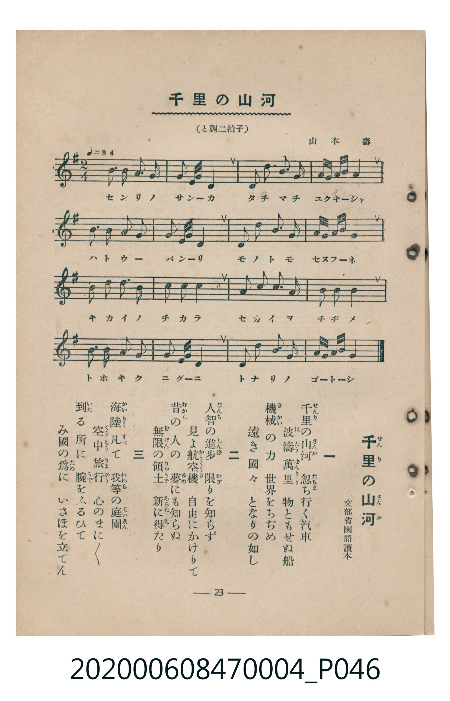

# 千里の山河

<audio controls src="senri_no_sanga.mp3"></audio>

- 詞：文部省國語讀本
- 曲：山本壽
- 臺灣教育會公認《新定兒童唱歌》尋常科第四學年用（2020.006.0847.0004）

## 說明

原書資訊與歌詞全文（對應 P046.jpg，書頁 p. 23，第二學期第 10 首）：
調性與拍號：と調二拍子（G 大調 2/4 拍）
速度指示：♩=84

## 歌詞

```text
一
千里（せんり）の山河（さんか）　忽（たちま）ち行く汽車
波濤萬里（はたうばんり）　物ともせぬ船
機械（きかい）の力　世界をちゞめ
遠き國々　となりの如し

二
人智（じんち）の進歩（しんぽ）　限（かぎ）りを知らず
見よ航空機（かうくうき）　自由にかけりて
昔（むかし）の人の　夢（ゆめ）にも知らぬ
無限（むげん）の領土（りゃうど）　新（あらた）に得（え）たり

三
海陸（かいりく）凡（すべ）て　我等（われら）の庭園（ていゑん）
空中旅行（くうちゅうりょかう）　心のまにまに
到（いた）る所に　腕（うで）をふるひて
み國の爲（ため）に　いさほを立てん
```

## 原書掃描頁



## 分析

```text
================================================================================
📊 TMD Song Profile: [ 千里の山河 ]
================================================================================
⏱  Duration:       0:22 (22.9s), 16 measures total
🎼 Key & Tempo:    首調基準 G, != 84.0 BPM, <2/4>
   - 分析範圍：      由實際發聲的音符與和弦推測調性；播放脈絡另行呈現
🎤 人聲音域:    D4 (MIDI 62) – E5 (MIDI 76) [跨度: 14 個半音 / 1.2 個八度, 難度: moderate]
   - 最低音:  D4 in [SenriNoSanga #1 @ m.2, 0:02]
   - 最高音: E5 in [SenriNoSanga #1 @ m.5, 0:06]
   - 適合: soprano, mezzo-soprano, contralto, tenor, baritone, bass
🏛  結構:      SenriNoSanga (22.9s)
⚡ 編曲密度:        Peak 1 軌道同時演奏
🗝  調性診斷：       G 大調（純淨自然大調，未偵測到可信轉調）
   - 風格氣質:    純淨自然大調（陽光明朗、易唱易記，無明顯調外色彩）
   - 轉調歷程:    全曲維持單一推測調性（未偵測到可信轉調）
   - 核心骨幹音:  G, D, A, B, E
   - 調性數值:    G 大調 [相關度: 0.84, 穩定度: Moderate, 自然音純度: 100.0%]
   - 候選調性 (K-S): G 大調 (0.84), D 大調 (0.72), E 小調 (0.66)
   - 五度圈歷程:   +1
   - 各段落調性細節:
     • [SenriNoSanga #1]: G 大調 (r: 0.84, 自然音純度: 100.0%)

  [ 五度圈游移軌跡 ]
               C  
         F           [G ]*
      Bb               D  
      Eb               A  
         Ab           E  
            Db       B  
               F# 
     (* = active key center)

  [ 十二半音累積音高分佈 ]
     C  :                            0.0%
     C# :                            0.0%
     D  : ██████████████████        19.5%
     D# :                            0.0%
     E  : ██████████████            14.8%
     F  :                            0.0%
     F# : █                          0.8%
     G  : ████████████████████████  25.8%
     G# :                            0.0%
     A  : ██████████████████        19.5%
     A# :                            0.0%
     B  : ██████████████████        19.5%
--------------------------------------------------------------------------------
Assignment 軌道音域：
  - Piano         : D4 – E5 (14 個半音 / 1.2 個八度, 65 個音符)
================================================================================
```

## ABC

```abc
X:1
T:千里の山河
C:曲：山本壽
M:2/4
L:1/16
Q:1/4=84
K:G

V:V1 name="Piano" snm="Pia"

[V:V1]
g3 g g2 a2 | b2 g a d4 | e3 b a2 g2 | a g a b d4 |
d3 e d2 b2 | b2 g a b4 | e3 e g2 b2 | a g f a g4 |
a3 a b2 d2 | e2 e2 d4 | e3 g a2 d2 | b2 b2 a4 |
g3 g g2 a2 | b2 g a d4 | e3 e g2 b2 | a g a b g4 |
```

- [主旋律 TMD 檔案](senri_no_sanga.tmd)
- [鋼琴伴奏 TMD 檔案](senri_no_sanga_piano.tmd)
