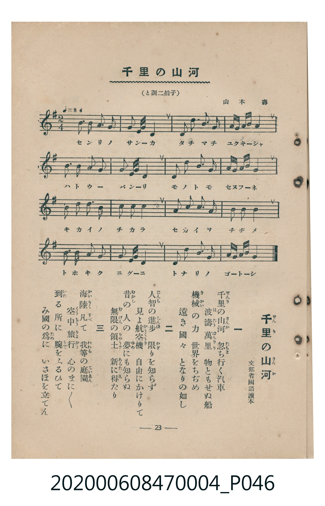

# 千里の山河

> Re:Shōka 使用 AI 協助辨識與重建樂譜，可能會有錯誤。歡迎回報。

- **NEUTRINO 歌聲合成版**：<br><audio controls src="senri_no_sanga_neutrino.mp3"></audio>
- **鋼琴伴奏版**：<br><audio controls src="senri_no_sanga.mp3"></audio>


- 詞：文部省國語讀本
- 曲：山本壽
- 臺灣教育會公認《新定兒童唱歌》尋常科第四學年用（2020.006.0847.0004）

## 說明

原書資訊與歌詞全文（對應 P046.jpg，書頁 p. 23，第二學期第 10 首）：
調性與拍號：と調二拍子（G 大調 2/4 拍）
速度指示：♩=84


## 歌詞

```text
一
千里（せんり）の山河（さんか）　忽（たちま）ち行く汽車
波濤萬里（はたうばんり）　物ともせぬ船
機械（きかい）の力　世界をちゞめ
遠き國々　となりの如し

二
人智（じんち）の進歩（しんぽ）　限（かぎ）りを知らず
見よ航空機（かうくうき）　自由にかけりて
昔（むかし）の人の　夢（ゆめ）にも知らぬ
無限（むげん）の領土（りゃうど）　新（あらた）に得（え）たり

三
海陸（かいりく）凡（すべ）て　我等（われら）の庭園（ていゑん）
空中旅行（くうちゅうりょかう）　心のまにまに
到（いた）る所に　腕（うで）をふるひて
み國の爲（ため）に　いさほを立てん
```

## ABC

```abc
X:1
T:千里の山河
C:曲：山本壽
M:2/4
L:1/16
Q:1/4=84
K:G
V:V1 name="Piano" snm="Pia"
[V:V1]
B3 B A2 G2 | G2 E G D4 | D3 d B2 G2 | A G A B A4 |
w: セ ン リ ノ | サ ン _ カ | タ チ マ チ | ユ ク キ _ シャ
B3 B A2 G2 | G2 E G D4 | D3 d B2 G2 | A G A B G4 |
w: ハ ト ウ _ | バ ン _ リ | モ ノ ト モ | セ ヌ フ _ ネ
B3 d d2 B2 | c2 c2 c4 | A3 c c2 A2 | B2 B2 B4 |
w: キ カ イ ノ | チ カ ラ | セ カ イ ヲ | チ ヂ メ
G3 G G2 A2 | B2 G A D4 | D3 d G2 B2 | A G A B G4 |
w: ト ホ キ ク | ニ グ _ ニ | ト ナ リ ノ | ゴ _ ト _ シ
```

## TMD 檔案連結

- [主旋律 TMD 檔案](senri_no_sanga.tmd) [[在 TMD Studio 編輯](https://tmdlang.github.io/Tmd-TS/#tmd=s7IKdvYPcrWy4qpTUCpJTLdSSM7PyUlNLsnMz7MqzsjMK0nNjM_KTMmPL87Iz05Ugisry88pzU21Si9KTEmNN4k3MjAyiDcwMIs3sDAxBzIMTBBKi_NLi5JTrYqTM_Lzc-JLUitKkvLzsxHyBUX5Zal5iXlANQVFIBtTwIoQClLLMlNSQdKpKZkl-UWZiTlI7kgtKga7FWxJfElRYl5xclFmAcgDCFUlGalAx-YllpQWpSJEgUalZ-ZZ5ebnJZUCvYchUZKYCRQG-bw8MT43MTMvJzEvRYlLS0vhaW_zy_aex43rnm7c-GzTZgUtLS5FWwULEy57WwV3LhsjfRM7kGEvVs57v2fWs2ntL5tXPJ_T-HRO94tV816sa3g2Zw3YsmezNwHlQWbMWfN08V6w2Iv2Xc8bFz-bOvNF06Znc5qftq55sar3cUPXs2kbnq6b9bR10vPVS59O2fhsbc_jhu6nG7qf7tjxfPnE52vWPJ09--naHU93bnk-ZcX7PR2gGNEDxogeKEaADAOT93s6lbi49LUUbKkFuBQUFJ72zX82e8eLze0vVnS96GgHugvo66etK4C-Brri6YbeZ-2dCgEGJmZ6WQXp7_f0ABW_XNCoUKCnYGQM5AId_mRXD9Dhz-bMB7IVDA0UXi6bBnQqMGBAxr9Ytf9Zw3KQwd29L2bOB4o-blwBFARqAoo8XTsBaIm7wtMly4FiCsBwVwCKAnWDtL5smP9017JnPe3Pl-wC6ns0c6UtMIZAMk92NICdDo5FoAGPG2c_bpr8uKkLqBMeqWDxqSDxxm6QeEPD0_17wYLzHzcufNy4D6x44YuFwHTQ_2zj3he7u0CGPtu86Nn-JS8mrIEZvR6soe1x4waEHQ0NzztXAj3yuKkJZHfjmhcdO8GaV85_tmgDWFsv0NrHjS1QF3XNBup5smPa86k9j5smgexvmve4qRHszcYFQNXAtPW4oRWoCGRq4yqgPSBty4DGT4d4eVcPhNr1bCYwNIAWzAB7bSHEgpcNm56tXQkWnw4WB_oU5MyXM0EBDHZKH0gEaGzTpOfzlz5uAuqCRNCy7sdNHS86Vj1fuQvofJhqoH_7wSQoNoAGvWhf9XzKxseNq8GyE8HuWwb28owpID1NQIcDJaZDnAN0JpAEBfmSRWDZNqBnwVKrgUEGs38NSP_zloVQR4KMmAR0PNRHC2Y8nQN2DsjNzWC3AD0IcgswK4Gd2QQ2BagGZO7TfUC7gYIdYO58oC5oUgGnpWdbt7-cuQPmuRaw8_uBKp-2AwMQKDjzceNOsMZlIPM7Jj5fC0zAQKv7HzcBIwzIBsfirrVP50wCq18GNgQYDCDXgr2xcteTHWufTW8FpiewCkjoAeO5FcQA-aEdErCwtAj00jpgKgQHKYgEp-gOiM9aoN5q6n7WCQyV1aAIaJ0KlgIauhwsBUxFW4EKHjdugsbE48b9oFTUuO55B7BYAqdzeKCD0hXQ0KmPG3eDEsBqoLJlQMeDtFFejECBgpY-F1dwal5Rpl9-cGJeeqJVQGZiXr5DjUFNNcgiBRtDMy07MAtbIaYAKkp2NADDT0HDROHphv7n6xt04CWPJhYNIPtAptUoGCvoAqGxghGQNATiGjBpFg-kTOPBciAxKNMUrByizAhIG0E1ghWBDfSpUXjctBss8Lh5MxCvArP6wFoeN22FigPJptVw0x837YfqaATieVAWWKZ5GVB2PRCvBevZ_rh5Mdw-_OGxq4e08KBScIB4qMHR3A_1XAfQA8sQnm6egAgMcDDBxBdB1feB9YBYIBFIwD5u7gHiqWDRXiJDYkcn-SFhCoSg8ADZbwIkYRjiVkjcm4BFQGyILhhGSxWgGITE--OmJVAPQjwMimtIenjcvBIRELB0hKRjE7KO5iYwuZC4YAA2EsgJBkh8GoJphBdBcY0tPYBUQQILR3owBLkeFKkgl8-Gp-v1UH91g3kbwLIgNixJwHR0YeSoLWAeOJk0bYfbVcvFpWungFyiKAD5ylwA)]
- [鋼琴伴奏 TMD 檔案](senri_no_sanga_piano.tmd) [[在 TMD Studio 編輯](https://tmdlang.github.io/Tmd-TS/#tmd=s7IKdvYPcrWy4tLSUnja2_yyvedx47qnGzc-27T5_Z6Ol917nk_Y8mTPlqdL-593drzf06mgpcWlaKtgYcJlb6vgzmVjpG9ix1WnoPRi5bz3e2Y9m9b-snnF8zmNT-d0v1g178W6hmdz1iiB5J_N3gSUBxk8Z83TxXvBYi_adz1vXPxs6swXTZuezWl-2rrmxarexw1dz6ZteLpu1tPWSc9XL306ZeOztT2PG7qfbuh-umPH8-UTn69Z83T27KdrdzzdueX5lBVAVxoZGBnoGRiY6RlYmJgDGQYmQIcqcXEFp-YVZfrlByfmpSdaBWQm5uUHeTjUGNRUcykAgY2hmZYdmFWjYKygC4TGCkZA0hCIa8CkWTyQMo0Hy4HEoExTsHKIMiMgbQTVCFYENtCnRuFx026wwOPmzUC8CszqA2t53LQVKg4km1bDTX_ctB-qoxGI50FZYJnmZUDZ9UC8Fqxn--PmxXD7wBbqaynYogMFYEA92dXzYmGPgoaJwtMN_c_XN-goBBiYmOllFaRrYtGgpU-t4ADxUIOjuR_quQ6gB5YhPN08AREY4GCCiS-Cqu8D6wGxQCKQgH3c3APEU8GivUSGxI5O8kPCFAhB4QGy3wRIwjDErZC4NwGLgNgQXTCMlipAMQiJ98dNS6AehHgYFNeQ9PC4eSUiIGDpCEnHJmQdzU1gciFxwQDMOeQEAyQ-DcE0wouguMaWHkCqIIGFJz2A4hTk8NnwZL0e6q1uMG8DWBbEhqUImI4ujAy1BcwDp5Km7XCrarGVAD7IJYAFvAAwjFeINoyFUXC-aTyQNo0HiZiBmGbxubEKRkCGEZAG-RgqDdOH3zQ4H2EWXAiXURjiCiZAhglWwxAOw3A-Gd5Ed5o5ktuAQatrp4AcugpY-MpcAA)]

## 分析

```text
================================================================================
📊 TMD Song Profile: [ 千里の山河 ]
================================================================================
⏱  Duration:       0:22 (22.9s), 16 measures total
🎼 Key & Tempo:    首調基準 G, != 84.0 BPM, <2/4>
   - 分析範圍：      由實際發聲的音符與和弦推測調性；播放脈絡另行呈現
🎤 人聲音域:    D4 (MIDI 62) – D5 (MIDI 74) [跨度: 12 個半音 / 1.0 個八度, 難度: easy]
   - 最低音:  D4 in [SenriNoSanga #1 @ m.2, 0:02]
   - 最高音: D5 in [SenriNoSanga #1 @ m.3, 0:03]
   - 適合: soprano, mezzo-soprano, contralto, tenor, baritone, bass
🏛  結構:      SenriNoSanga (22.9s)
⚡ 編曲密度:        Peak 1 軌道同時演奏
🗝  調性診斷：       G 大調（純淨自然大調，未偵測到可信轉調）
   - 風格氣質:    純淨自然大調（陽光明朗、易唱易記，無明顯調外色彩）
   - 轉調歷程:    全曲維持單一推測調性（未偵測到可信轉調）
   - 核心骨幹音:  G, B, D, A, C
   - 調性數值:    G 大調 [相關度: 0.88, 穩定度: High, 自然音純度: 100.0%]
   - 候選調性 (K-S): G 大調 (0.88), B 小調 (0.64), D 大調 (0.63)
   - 五度圈歷程:   +1
   - 各段落調性細節:
     • [SenriNoSanga #1]: G 大調 (r: 0.88, 自然音純度: 100.0%)

  [ 五度圈游移軌跡 ]
               C  
         F           [G ]*
      Bb               D  
      Eb               A  
         Ab           E  
            Db       B  
               F# 
     (* = active key center)

  [ 十二半音累積音高分佈 ]
     C  : ████████                   8.6%
     C# :                            0.0%
     D  : ███████████████████       21.1%
     D# :                            0.0%
     E  : █                          1.6%
     F  :                            0.0%
     F# :                            0.0%
     G  : ████████████████████████  26.6%
     G# :                            0.0%
     A  : ████████████████          17.2%
     A# :                            0.0%
     B  : ███████████████████████   25.0%
--------------------------------------------------------------------------------
Assignment 軌道音域：
  - Piano         : D4 – D5 (12 個半音 / 1.0 個八度, 65 個音符)
================================================================================
```


## 原書掃描頁




