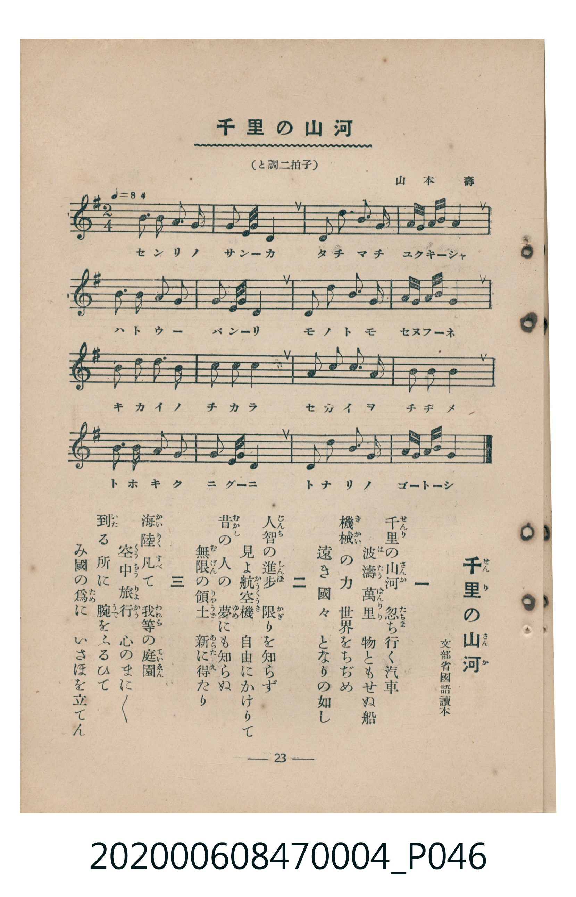

# 千里の山河

> Re:Shōka 使用 AI 協助辨識與重建樂譜，可能會有錯誤。歡迎回報。

- **鋼琴伴奏版**：<br><audio controls src="senri_no_sanga.mp3"></audio>
- **NEUTRINO 歌聲合成版**：<br><audio controls src="senri_no_sanga_neutrino.mp3"></audio>

- 詞：文部省國語讀本
- 曲：山本壽
- 臺灣教育會公認《新定兒童唱歌》尋常科第四學年用（2020.006.0847.0004）

## 說明

原書資訊與歌詞全文（對應 P046.jpg，書頁 p. 23，第二學期第 10 首）：
調性與拍號：と調二拍子（G 大調 2/4 拍）
速度指示：♩=84


## 歌詞

```text
一
千里（せんり）の山河（さんか）　忽（たちま）ち行く汽車
波濤萬里（はたうばんり）　物ともせぬ船
機械（きかい）の力　世界をちゞめ
遠き國々　となりの如し

二
人智（じんち）の進歩（しんぽ）　限（かぎ）りを知らず
見よ航空機（かうくうき）　自由にかけりて
昔（むかし）の人の　夢（ゆめ）にも知らぬ
無限（むげん）の領土（りゃうど）　新（あらた）に得（え）たり

三
海陸（かいりく）凡（すべ）て　我等（われら）の庭園（ていゑん）
空中旅行（くうちゅうりょかう）　心のまにまに
到（いた）る所に　腕（うで）をふるひて
み國の爲（ため）に　いさほを立てん
```

## ABC

<div class="abc-score" data-abc-src="senri_no_sanga.abc" aria-label="五線譜載入中"></div>

[下載 ABC 原始檔](senri_no_sanga.abc)

## TMD 檔案連結

- [主旋律 TMD 檔案](senri_no_sanga.tmd) [[在 TMD Studio 編輯](https://tmdlang.github.io/Tmd-TS/#tmd=s7IKdvYPcrWy4qpTUCpJTLdSSM7PyUlNLsnMz7MqzsjMK0nNjM_KTMmPL87Iz05Ugisry88pzU21Si9KTEmNN4k3MjAyiDcwMIs3sDAxBzIMTBBKi_NLi5JTrYqTM_Lzc-JLUitKkvLzsxHyBUX5Zal5iXlANQVFIBtTwIoQClLLMlNSQdKpKZkl-UWZiTlI7kgtKga7FWxJfElRYl5xclFmAcgDCFUlGalAx-YllpQWpSJEgUalZ-ZZ5ebnJZUCvYchUZKYCRQG-bw8MT43MTMvJzEvBVlVSUY-MAAKMiqtMjKLQS5LTsyJz07MQwonqLsKEtNTrQIMTMyUuLS0FJ72Nr9s73ncuO7pxo3PNm1W0NLiUrRVsDDhsrdVcOeyMdI3sQMZ8GLlvPd7Zj2b1v6yecXzOY1P53S_WDXvxbqGZ3PWgC14NnsTUB5kxpw1TxfvBYu9aN_1vHHxs6kzXzRtejan-Wnrmhereh83dD2btuHpullPWyc9X7306ZSNz9b2PG7ofrqh--mOHc-XT3y-Zs3T2bOfrt3xdOeW51NWvN_TAYpQPWCE6oEiFMgwMHm_p1OJi0tfS8GWWoBLQUHhad_8Z7N3vNjc_mJF14uOdqC7gL5-2roC6GugK55u6H3W3qkACji9rIL093t6gIpfLmhUKNBTMDIGcoEOf7KrB-jwZ3PmA9kKhgYKL5dNAzoVGDAg41-s2v-sYTnI4O7eFzPnA0UfN64ACgI1AUWerp0AtMRd4emS5UAxBWC4KwBFgbpBWl82zH-6a9mznvbnS3YB9T2audIWGEMgmSc7GsBOB8ci0IDHjbMfN01-3NQF1AmPVLD4VJB4YzdIvKHh6f69YMH5jxsXPm7cB1a88MVCYDrof7Zx74vdXSBDn21e9Gz_khcT1sCMXg_W0Pa4cQPCjoaG550rgR553NQEsrtxzYuOnWDNK-c_W7QBrK0XaO3jxhaoi7pmA_U82THt-dSex02TQPY3zXvc1Aj2ZuMCoGpg2nrc0ApUBDK1cRXQHpC2ZUDjp0O8vKsHQu16NhMYGkALZoC9thBiwcuGTc_WrgSLTweLA30KcubLmaAABjulDyQCNLZp0vP5Sx83AXVBImhZ9-Omjhcdq56v3AV0Pkw10L_9YBIUG0CDXrSvej5l4-PG1WDZiWD3LQN7ecYUkJ4moMOBEtMhzgE6E0iCgnzJIrBsG9CzYKnVwCCD2b8GpP95y0KoI0FGTAI6HuqjBTOezgE7B-TmZrBbgB4EuQWYlcDObAKbAlQDMvfpPqDdQMEOMHc-UBc0qYDT0rOt21_O3AHzXAvY-f1AlU_bgQEIFJz5uHEnWOMykPkdE5-vBSZgoNX9j5uAEQZkg2Nx19qncyaB1S8DGwIMBpBrwd5YuevJjrXPprcC0xNYBST0gPHcCmKA_NAOCVhYWgR6aR0wFYKDFESCU3QHxGctUG81dT_rBIbKalAEtE4FSwENXQ6WAqairUAFjxs3QWPiceN-UCpqXPe8A1gsgdM5PNBB6Qpo6NTHjbtBCWA1UNkyoONB2igvRqBAQUufiys4Na8o0y8_ODEvPdEqIDMxL9-hxqCmGmSRgo2hmZYdmIWtEFMAFSU7GoDhp6BhovB0Q__z9Q068JJHE4sGkH0g02oUjBV0gdBYwQhIGgJxDZg0iwdSpvFgOZAYlGkKVg5RZgSkjaAawYrABvrUKDxu2g0WeNy8GYhXgVl9YC2Pm7ZCxYFk02q46Y-b9kN1NALxPCgLLNO8DCi7HojXgvVsf9y8GG4f_vDY1UNaeFApOEA81OBo7od6rgPogWUITzdPQAQGOJhg4oug6vvAekAskAgkYB839wDxVLBoL5EhsaOT_JAwBUJQeIDsNwGSMAxxKyTuTcAiIDZEFwyjpQpQDELi_XHTEqgHIR4GxTUkPTxuXokICFg6QtKxCVlHcxOYXEhcMAAbCeQEAyQ-DcE0wouguMaWHkCqIIGFIz0YglwPilSQy2fD0_V6qL-6wbwNYFkQG5YkYDq6MHLUFjAPnEyatsPtquXi0rVTQC5RFIB8ZS4A)]
- [鋼琴伴奏 TMD 檔案](senri_no_sanga_piano.tmd) [[在 TMD Studio 編輯](https://tmdlang.github.io/Tmd-TS/#tmd=s7IKdvYPcrWy4qpTUCpJTLdSyC8qychPL0osyKi0ysgsLskvykxOzInPTsxLVIIrKs4vLUpOjS9ITE-1CjAwMVPi0tJSeNrb_LK953HjuqcbNz7btPn9no6X3XueT9jyZM-Wp0v7n3d2vN_TqaClxaVoq2BhwmVvq-DOZWOkb2IHMvXFynnv98x6Nq39ZfOK53Man87pfrFq3ot1Dc_mrAHb-mz2JqA8yOA5a54u3gsWe9G-63nj4mdTZ75o2vRsTvPT1jUvVvU-buh6Nm3D03WznrZOer566dMpG5-t7Xnc0P10Q_fTHTueL5_4fM2ap7NnP1274-nOLc-nrAC60sjAyEDPwMBMz8DCxBzIMDABOlSJiys4Na8o0y8_ODEvPdEqIDMxLz_Iw6HGoKaaSwEIbAzNtOzArBoFYwVdIDRWMAKShkBcAybN4oGUaTxYDiQGZZqClUOUGQFpI6hGsCKwgT41Co-bdoMFHjdvBuJVYFYfWMvjpq1QcSDZtBpu-uOm_VAdjUA8D8oCyzQvA8quB-K1YD3bHzcvhtsHtlBfS8EWHSgAA-rJrp4XC3sUNEwUnm7of76-QUcBFNl6WQXpmlg0aOlTKzhAPNTgaO6Heq4D6IFlCE83T0AEBjiYYOKLoOr7wHpALJAIJGAfN_cA8VSwaC-RIbGjk_yQMAVCUHiA7DcBkjAMcSsk7k3AIiA2RBcMo6UKUAxC4v1x0xKoByEeBsU1JD08bl6JCAhYOkLSsQlZR3MTmFxIXDAAcw45wQCJT0MwjfAiKK6xpQeQKkhg4UkPoDgFOXw2PFmvh3qrG8zbAJYFsWEpAqajCyNDbQHzwKmkaTvcqlpsJYAPcglgAS8ADOMVog1jYRScbxoPpE3jQSJmIKZZfG6sghGQYQSkQT6GSsP04TcNzkeYBRfCZRSGuIIJkGGC1TCEwzCcT4Y30Z1mjuQ2YNDq2ikgh64CFr4yFwA)]

## 分析

```text
================================================================================
📊 TMD Song Profile: [ 千里の山河 ]
================================================================================
⏱  Duration:       0:22 (22.9s), 16 measures total
🎼 Key & Tempo:    首調基準 G, != 84.0 BPM, <2/4>
   - 分析範圍：      由實際發聲的音符與和弦推測調性；播放脈絡另行呈現
🎤 人聲音域:    D4 (MIDI 62) – D5 (MIDI 74) [跨度: 12 個半音 / 1.0 個八度, 難度: easy]
   - 最低音:  D4 in [SenriNoSanga #1 @ m.2, 0:02]
   - 最高音: D5 in [SenriNoSanga #1 @ m.3, 0:03]
   - 適合: soprano, mezzo-soprano, contralto, tenor, baritone, bass
🏛  結構:      SenriNoSanga (22.9s)
⚡ 編曲密度:        Peak 1 軌道同時演奏
🗝  調性診斷：       G 大調（純淨自然大調，未偵測到可信轉調）
   - 風格氣質:    純淨自然大調（陽光明朗、易唱易記，無明顯調外色彩）
   - 轉調歷程:    全曲維持單一推測調性（未偵測到可信轉調）
   - 核心骨幹音:  G, B, D, A, C
   - 調性數值:    G 大調 [相關度: 0.88, 穩定度: High, 自然音純度: 100.0%]
   - 候選調性 (K-S): G 大調 (0.88), B 小調 (0.64), D 大調 (0.63)
   - 五度圈歷程:   +1
   - 各段落調性細節:
     • [SenriNoSanga #1]: G 大調 (r: 0.88, 自然音純度: 100.0%)

  [ 五度圈游移軌跡 ]
               C  
         F           [G ]*
      Bb               D  
      Eb               A  
         Ab           E  
            Db       B  
               F# 
     (* = active key center)

  [ 十二半音累積音高分佈 ]
     C  : ████████                   8.6%
     C# :                            0.0%
     D  : ███████████████████       21.1%
     D# :                            0.0%
     E  : █                          1.6%
     F  :                            0.0%
     F# :                            0.0%
     G  : ████████████████████████  26.6%
     G# :                            0.0%
     A  : ████████████████          17.2%
     A# :                            0.0%
     B  : ███████████████████████   25.0%
--------------------------------------------------------------------------------
Assignment 軌道音域：
  - Piano         : D4 – D5 (12 個半音 / 1.0 個八度, 65 個音符)
================================================================================
```


## 原書掃描頁




