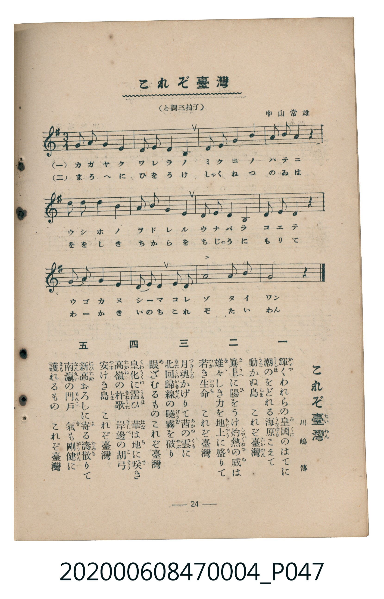

# これぞ臺灣

> Re:Shōka 使用 AI 協助辨識與重建樂譜，可能會有錯誤。歡迎回報。

- **NEUTRINO 歌聲合成版**：<br><audio controls src="korezo_taiwan_neutrino.mp3"></audio>
- **鋼琴伴奏版**：<br><audio controls src="korezo_taiwan.mp3"></audio>


- 詞：川嶋傳
- 曲：中山常雄
- 臺灣教育會公認《新定兒童唱歌》尋常科第四學年用（2020.006.0847.0004）

## 說明

原書資訊與歌詞全文（對應 P047.jpg，書頁 p. 24，第二學期第 11 首）：
調性與拍號：と調三拍子（G 大調 3/4 拍）


## 跨冊／重複收錄參照

> 同曲（《新定兒童唱歌》、《臺灣の歌》共同收錄教材）

- **[同曲]** 《臺灣の歌》（昭和4年／1929，國臺圖 0786 8）：[**〈これぞ臺灣〉**](../../../taiwan_no_uta/4_korezo_taiwan/index.md)（`G` / `3/4` — [原始 TMD](../../../taiwan_no_uta/4_korezo_taiwan/korezo_taiwan.tmd)）
- 總表：[跨冊重複與同名歌曲總索引](../../../duplicate_songs.md)

## 歌詞

```text
一
輝（かゞや）くわれらの皇國（みくに）のはてに
潮（うしほ）のをどれる海原（うなばら）こえて
動（うご）かぬ島（しま）　これぞ臺灣（たいわん）

二
眞上（まうへ）に陽（ひ）をうけ灼熱（しゃくねつ）の威（ゐ）は
雄々（をを）しき力（ちから）を地上（ちじゃう）に盛（も）りて
若（わか）き生命（いのち）　これぞ臺灣

三
月魂（つきしろ）かげりて茜（あかね）の雲（くも）に
北回歸線（きたくゎいきせん）の曉霧（げうむ）を破（やぶ）り
眼（め）ざむるものこれぞ臺灣

四
皇化（くゎうくゎ）に霑（うるほ）ひ　華（はな）は地（ち）に咲（さ）き
高嶺（たかね）の杵歌（きねうた）　岸邊（きしべ）の胡弓（こきゅう）
安（やす）けき島（しま）　これぞ臺灣

五
新高（にひたか）おろしに寄（よ）る濤散（なみち）りて
南瀛（なんえい）の門戶（もんこ）　氣（き）も剛健（がうけん）に
護（まも）れるもの　これぞ臺灣
```

## ABC

```abc
X:1
T:これぞ臺灣
C:曲：中山常雄
M:3/4
L:1/16
Q:1/4=100
K:G
V:V1 name="Piano" snm="Pia"
[V:V1]
G2 A2 G4 E4 | D2 E2 D4 B4 | D2 E2 G4 B4 | A2 B2 A4 z4 |
w: 1.~カ ガ ヤ ク | ワ レ ラ ノ | ミ ク ニ ノ | ハ テ ニ
w: 2.~ま う へ に | ひ を う け | しゃ く ね つ | の ゐ は
d2 d2 d4 B4 | A2 B2 G4 E4 | D2 E2 D4 B,4 | D2 E2 D4 z4 |
w: 1.~ウ シ ホ ノ | ヲ ド レ ル | ウ ナ バ ラ | コ エ テ
w: 2.~を を し き | ち か ら を | ち じゃ う に | も り て
G2 A2 G4 E4 | D2 E2 D4 E2 D2 | A8 A2 B2 | G8 z4 |
w: 1.~ウ ゴ カ ヌ | シ _ マ コ レ | ゾ タ イ | ワン
w: 2.~わ _ か き | い の ち こ れ | ぞ た い | わん
```

## TMD 檔案連結

- [主旋律 TMD 檔案](korezo_taiwan.tmd) [[在 TMD Studio 編輯](https://tmdlang.github.io/Tmd-TS/#tmd=s7IKdvYPcrWy4qpTUCpJTLdSSM7PyUlNLsnMz7MqzsjMK0nNjM_KTMmPL87Iz05Ugisry88pzU21Si9KTEmNN4k3MjAyiDcwMIs3sDAxBzIMTBBKi_NLi5JTrYqTM_Lzc-JLUitKkvLzsxHyBUX5Zal5iXlANQVFIBtTwIoQClLLMlNSQdKpKZkl-UWZiTlI7kgtKga7FWxJfElRYl5xclFmAcgDCFUlGalAxxbkJCanKnFpaSk8bpz8uKnnceO8F-27njcuVtDS4lK0VTA0MOCyt1Vw57Ix1jexA2l-sXLe-z2znm6f-3Rb99OmzWADn83eBBR7smPt040bn-7Y8XJ2C1gYYtKzqTNfNG16Nqf5aeuaF6t6Hzd0PZu24em6WU9bJz1fvfTplI3P1vY8buh-uqEbqPX58onP16x5Onv207U7nu7c8nzKivd7OkAhqQcMST1QSAIZBibv93QqcXHpaynYUgtwKSgoPO2b_2z2jheb21-s6HrR0Q50F9CzT1tXPJvWDnTF0w29z9o7FQIMgG7IKkh_v6cHqPjlgkaFAj0FI6CLeoAOf7KrB-jwZ3PmA9kKhoYKL5dNAzoVGDYg41-s2v-sYTnI4O7eFzPnA0UfN64ACj7Z0QkUebp2AtASd4WnS5YDxRSAwa0AFAXq5gLpfbKjAWzEnrlARY8bux83zXvc1AKUfdzY_7gJiHoeNwHZ657Pan86pxusZj9IqnE1WM26x43rHzcuA3JBpjzbuw6sou1x4_THjbuhKpomPW5cCTao-9nW7cCwgKlZ9bhxA9B0sLLJjxuBgsvAodU9FaZiCliu-3Hjmqebt4EFgebuAwk2NKClK7Ds_MeNLWBXT4b7b1cPiHo-Z96THV1gNfvAJu8Am7z65cy9YEFgMusEOxQoNfF5457nbRuh1jU1g7279nHjEoh_nq5oBEk1AUMVyF0PMh2YLh83tIJFJwERWALo0N6nXbPBpiwEByzYo02Tns7ZAHMKUHwG2II2iGuezwarb2oCq-yChseL7qVgUaArgBEAVNf7fMr8pxMhDm8Bx8FCrEECjeBOcNTM6Xi5FmguUMsSoAlgn4ESATh0gY4GWfaiZw5YQRNYcC3Euy9BWRAoCAxUsLMgMf20Z_rT2fOerd3xfPsssDTQRGDgAxX1gd0E5M6GxALQiGezO1_OWQ5WBg7hpgZISDxfsAXsMaB6YOSCfAyJqj1gUWAoAzVPA6oGJhyg5WCPYvoPmKXBuoDpsweYJyAuBToCGJEgBjSa50yEJimgUdCEuQkYYC_614PFgWl4FSQ6gbEDiRqIxqeTIL4HpkhQwIMje_WMp9t2wZIbIqCezd0KzNiwwACmF6ALgEkdFC9PN-142QSJcnDIN-6EaHnRvPDpHmAgAcWB6b_3cVMrJCmA_bUOmF4ggTMTrHoiKEERygXQND8FHOXTNgDdCla_GuRdsHPBRnUB4x5syOqn64F5HWhLBzj8u5_tX_JsKiQrATMnMKODgwGeEp_2Tn_eAEnSq4CxC86ykLJi3ctpDc86wI4DxhRIChz3DQ3PNkCMA6e1pqannbOfNoKTcyPQ0aDMBksl4GT1Yu12aB6F5gFQoQGNe0y_AjVQXj5DgYKWPheXd35RalV-SGJmeWKeVUBmYl6-Q41BTTXIIgUbCy07MANb5aAAKqJ3NLxY2KOgYaLwdEP_8_UNOvASXROLBqB1IMNqFAwVjIBYV8EsHkjUKJjGg1hAUlfBGEkApALCNwLSRkCWAYgHNsPHsEbhcdNqIF6j8Lh5CVD8cdN6sNrHzeuBGCS6EiTa3AcVnQ9W8bi5G0W0H4jboKJgx0BMNwLKNe4DYqBc4w6QjsbVEB2Nm4DmTALLgEQnQkVBZSaQAhrXuBYsAXISSGIdUPkEIA1yHMQC_AG6q4ecADUFQ-TgwhG8GCLoQboMiLcDA2Q2SjABPd3cCQ5WkCg0KEBqm7uAeAJYFBTcINHNQLwCHKwYQQoKOHDgTQeHUS80jBYCcTdQphMcjZOQREE1BTysYdY2ATHQ2sZlRAbpjk7qplEIDQpmXTAEBTdIPYSHLUC3gNMqKJB6oH7YDubNA3sYGGDAgAWJ7oOa8bhpPxAvgaTmx82bocLoodkPDhZwgoaHZQskzQFDDyQ6GaiqBywOsgpsdCMwIwBVgfUDyyEUo2u5uHTtFJBLBAUgX5kLAA)]
- [鋼琴伴奏 TMD 檔案](korezo_taiwan_piano.tmd) [[在 TMD Studio 編輯](https://tmdlang.github.io/Tmd-TS/#tmd=s7IKdvYPcrWy4tLSUnjcOPlxU8_jxnkv2nc9b1z8fk_Hy-49zydsebJny9Ol_c87O97v6VTQ0uJStFUwNDDgsrdVcOeyMdY3seOqU1B6sXLe-z2znm6f-3Rb99OmzUogsWezNwHFnuxY-3Tjxqc7dryc3QIWhhj_bOrMF02bns1pftq65sWq3scNXc-mbXi6btbT1knPVy99OmXjs7U9jxu6n27oBmp9vnzi8zVrns6e_XTtjqc7tzyfsgLoOiMDIwM9AwMzPQMLE3Mgw8AE6EAlLi7v_KLUqvyQxMzyxDyrgMzEvPwgD4cag5pqLgUgsLHQsgMz9LUUbNGBAtCWJzsaXizsUdAwUXi6of_5-gYdhQADoPlZBemaWDRo6YMNq1EwVDACYl0Fs3ggUaNgGg9iAUldBWMkAZAKCN8ISBsBWQYgHtgMH8MahcdNq4F4jcLj5iVA8cdN68FqHzevB2KQ6EqQaHMfVHQ-WMXj5m4U0X4gboOKgh0DMd0IKNe4D4iBco07QDoaV0N0NG4CmjMJLAMSnQgVnf64qRlIAY1rXAuWADkJJLEOqHwCkAY5DmIB_gDd1UNOgJqCIXJw4QheDBH0IF0GxNuBATIbJZiAnm7uBAcrSBQaFCC1zV1APAEsCgpukOhmIF4BDlaMIAUFHDjwpoPDqBcaRguBuBso0wmOxklIojMgwQoJa5i1TUAMtLZxGZFBuqOTumkUQoOCWRcMQcENUg_hYQvQLeC0CgqkHqgftoN588AeBgYYMGBBovugZjxu2g_ESyCp-XHzZqgwemj2g4MFnKDhYdkCSXPA0AOJTgaq6gGLg6wCG90IzAhAVWD9j5smoxhdi61A8EEuEEyIKhCAJZm7gq6dAoJwUdB42tv1fGvTs7WL8Ad7vEK0YaxCtFl8biwSF4jhHGAiBsUHkGMaHwsMb6KyFMxJrrn6zuS7CuwMM5DVYPdFm2C4kQR3gdMlyF0oLgKzNJ6tXfxswR4SXIbHJWACLglyFzCegdYgR3W0D1AKQ8wILKbMBQA)]

## 分析

```text
================================================================================
📊 TMD Song Profile: [ これぞ臺灣 ]
================================================================================
⏱  Duration:       0:21 (21.6s), 12 measures total
🎼 Key & Tempo:    首調基準 G, != 100.0 BPM, <3/4>
   - 分析範圍：      由實際發聲的音符與和弦推測調性；播放脈絡另行呈現
🎤 人聲音域:    B3 (MIDI 59) – D5 (MIDI 74) [跨度: 15 個半音 / 1.2 個八度, 難度: moderate]
   - 最低音:  B3 in [KorezoTaiwan #1 @ m.7, 0:12]
   - 最高音: D5 in [KorezoTaiwan #1 @ m.5, 0:07]
   - 適合: soprano, mezzo-soprano, contralto, tenor, baritone, bass
🏛  結構:      KorezoTaiwan (21.6s)
⚡ 編曲密度:        Peak 1 軌道同時演奏
🗝  調性診斷：       G 調性不明確（純淨自然大調，未偵測到可信轉調）
   - 風格氣質:    純淨自然大調（陽光明朗、易唱易記，無明顯調外色彩）
   - 轉調歷程:    全曲維持單一推測調性（未偵測到可信轉調）
   - 核心骨幹音:  D, G, E, A, B
   - 調性數值:    G 調性不明確 [相關度: 0.81, 穩定度: Ambiguous, 自然音純度: 100.0%]
   - 候選調性 (K-S): G 大調 (0.81), D 大調 (0.79), E 小調 (0.62)
   - 五度圈歷程:   +1
   - 各段落調性細節:
     • [KorezoTaiwan #1]: G 調性不明確 (r: 0.81, 自然音純度: 100.0%)

  [ 五度圈游移軌跡 ]
               C  
         F           [G ]*
      Bb               D  
      Eb               A  
         Ab           E  
            Db       B  
               F# 
     (* = active key center)

  [ 十二半音累積音高分佈 ]
     C  :                            0.0%
     C# :                            0.0%
     D  : ████████████████████████  27.3%
     D# :                            0.0%
     E  : ████████████████          18.2%
     F  :                            0.0%
     F# :                            0.0%
     G  : ███████████████████       21.2%
     G# :                            0.0%
     A  : ███████████████           16.7%
     A# :                            0.0%
     B  : ███████████████           16.7%
--------------------------------------------------------------------------------
Assignment 軌道音域：
  - Piano         : B3 – D5 (15 個半音 / 1.2 個八度, 43 個音符)
================================================================================
```


## 原書掃描頁




