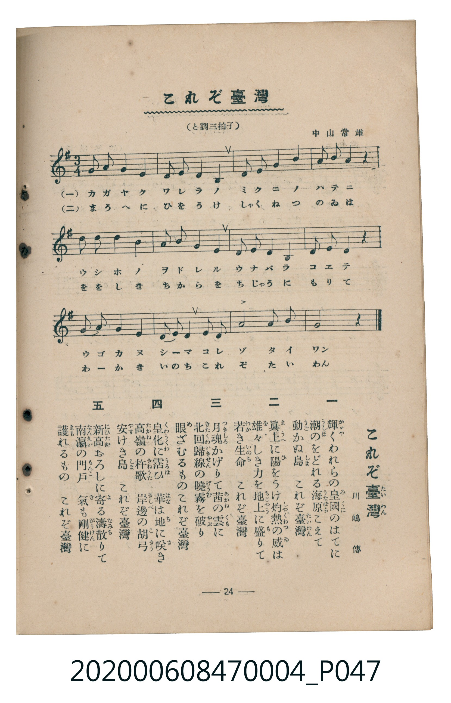

# これぞ臺灣

<audio controls src="korezo_taiwan.mp3"></audio>

- 詞：川嶋傳
- 曲：中山常雄
- 臺灣教育會公認《新定兒童唱歌》尋常科第四學年用（2020.006.0847.0004）

## 說明

原書資訊與歌詞全文（對應 P047.jpg，書頁 p. 24，第二學期第 11 首）：
調性與拍號：と調三拍子（G 大調 3/4 拍）

## 歌詞

```text
一
輝（かゞや）くわれらの皇國（みくに）のはてに
潮（うしほ）のをどれる海原（うなばら）こえて
動（うご）かぬ島（しま）　これぞ臺灣（たいわん）

二
眞上（まうへ）に陽（ひ）をうけ灼熱（しゃくねつ）の威（ゐ）は
雄々（をを）しき力（ちから）を地上（ちじゃう）に盛（も）りて
若（わか）き生命（いのち）　これぞ臺灣

三
月魂（つきしろ）かげりて茜（あかね）の雲（くも）に
北回歸線（きたくゎいきせん）の曉霧（げうむ）を破（やぶ）り
眼（め）ざむるものこれぞ臺灣

四
皇化（くゎうくゎ）に霑（うるほ）ひ　華（はな）は地（ち）に咲（さ）き
高嶺（たかね）の杵歌（きねうた）　岸邊（きしべ）の胡弓（こきゅう）
安（やす）けき島（しま）　これぞ臺灣

五
新高（にひたか）おろしに寄（よ）る濤散（なみち）りて
南瀛（なんえい）の門戶（もんこ）　氣（き）も剛健（がうけん）に
護（まも）れるもの　これぞ臺灣
```

## ABC

```abc
X:1
T:これぞ臺灣
C:曲：中山常雄
M:3/4
L:1/16
Q:1/4=100
K:G
V:V1 name="Piano" snm="Pia"
[V:V1]
d3 e g4 g4 | a3 g e4 g4 | e3 g a4 b4 | d3 e d4 z4 |
b3 c d4 b4 | a3 b d4 e4 | g3 a g4 d4 | g3 b a4 z4 |
b3 a g4 a4 | e3 a g8 | g3 a b4 d2 b2 | g8 z4 |
```

## TMD 檔案連結

- [主旋律 TMD 檔案](korezo_taiwan.tmd)
- [鋼琴伴奏 TMD 檔案](korezo_taiwan_piano.tmd)

## 分析

```text
================================================================================
📊 TMD Song Profile: [ これぞ臺灣 ]
================================================================================
⏱  Duration:       0:21 (21.6s), 12 measures total
🎼 Key & Tempo:    首調基準 G, != 100.0 BPM, <3/4>
   - 分析範圍：      由實際發聲的音符與和弦推測調性；播放脈絡另行呈現
🎤 人聲音域:    D4 (MIDI 62) – E5 (MIDI 76) [跨度: 14 個半音 / 1.2 個八度, 難度: moderate]
   - 最低音:  D4 in [KorezoTaiwan #1 @ m.1, 0:00]
   - 最高音: E5 in [KorezoTaiwan #1 @ m.4, 0:05]
   - 適合: soprano, mezzo-soprano, contralto, tenor, baritone, bass
🏛  結構:      KorezoTaiwan (21.6s)
⚡ 編曲密度:        Peak 1 軌道同時演奏
🗝  調性診斷：       G 大調（純淨自然大調，未偵測到可信轉調）
   - 風格氣質:    純淨自然大調（陽光明朗、易唱易記，無明顯調外色彩）
   - 轉調歷程:    全曲維持單一推測調性（未偵測到可信轉調）
   - 核心骨幹音:  G, D, A, B, E
   - 調性數值:    G 大調 [相關度: 0.90, 穩定度: High, 自然音純度: 100.0%]
   - 候選調性 (K-S): G 大調 (0.90), E 小調 (0.65), D 大調 (0.62)
   - 五度圈歷程:   +1
   - 各段落調性細節:
     • [KorezoTaiwan #1]: G 大調 (r: 0.90, 自然音純度: 100.0%)

  [ 五度圈游移軌跡 ]
               C  
         F           [G ]*
      Bb               D  
      Eb               A  
         Ab           E  
            Db       B  
               F# 
     (* = active key center)

  [ 十二半音累積音高分佈 ]
     C  : █                          0.8%
     C# :                            0.0%
     D  : ████████████              18.2%
     D# :                            0.0%
     E  : ████████                  12.1%
     F  :                            0.0%
     F# :                            0.0%
     G  : ████████████████████████  35.6%
     G# :                            0.0%
     A  : ███████████               16.7%
     A# :                            0.0%
     B  : ███████████               16.7%
--------------------------------------------------------------------------------
Assignment 軌道音域：
  - Piano         : D4 – E5 (14 個半音 / 1.2 個八度, 43 個音符)
================================================================================
```


## 原書掃描頁




