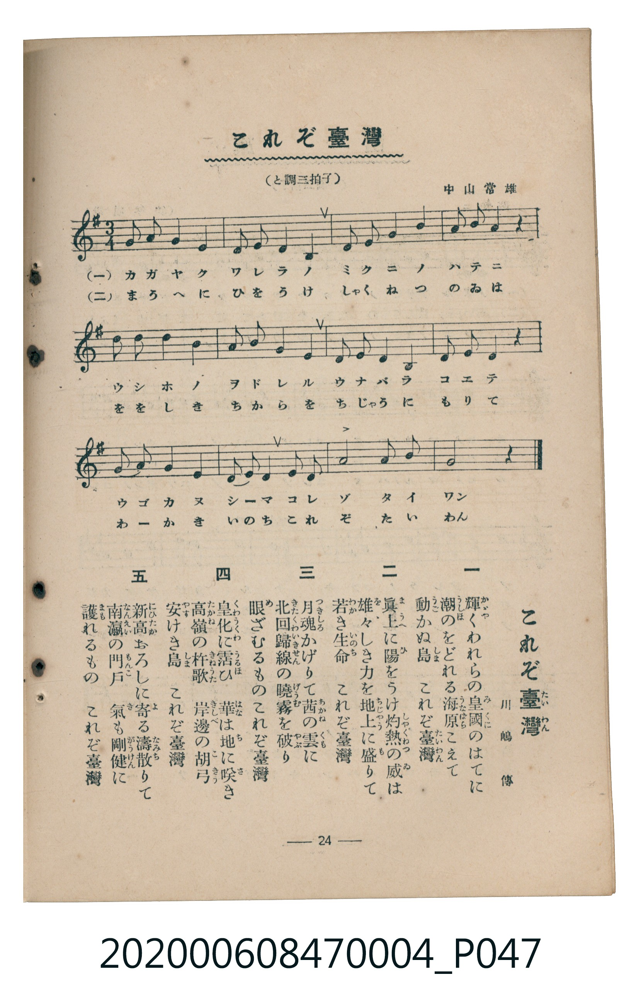

# これぞ臺灣

> Re:Shōka 使用 AI 協助辨識與重建樂譜，可能會有錯誤。歡迎回報。

- **鋼琴伴奏版**：<br><audio controls src="korezo_taiwan.mp3"></audio>
- **NEUTRINO 歌聲合成版**：<br><audio controls src="korezo_taiwan_neutrino.mp3"></audio>

- 詞：川嶋傳
- 曲：中山常雄
- 臺灣教育會公認《新定兒童唱歌》尋常科第四學年用（2020.006.0847.0004）

## 說明

原書資訊與歌詞全文（對應 P047.jpg，書頁 p. 24，第二學期第 11 首）：
調性與拍號：と調三拍子（G 大調 3/4 拍）


## 歌詞

```text
一
輝（かゞや）くわれらの皇國（みくに）のはてに
潮（うしほ）のをどれる海原（うなばら）こえて
動（うご）かぬ島（しま）　これぞ臺灣（たいわん）

二
眞上（まうへ）に陽（ひ）をうけ灼熱（しゃくねつ）の威（ゐ）は
雄々（をを）しき力（ちから）を地上（ちじゃう）に盛（も）りて
若（わか）き生命（いのち）　これぞ臺灣

三
月魂（つきしろ）かげりて茜（あかね）の雲（くも）に
北回歸線（きたくゎいきせん）の曉霧（げうむ）を破（やぶ）り
眼（め）ざむるものこれぞ臺灣

四
皇化（くゎうくゎ）に霑（うるほ）ひ　華（はな）は地（ち）に咲（さ）き
高嶺（たかね）の杵歌（きねうた）　岸邊（きしべ）の胡弓（こきゅう）
安（やす）けき島（しま）　これぞ臺灣

五
新高（にひたか）おろしに寄（よ）る濤散（なみち）りて
南瀛（なんえい）の門戶（もんこ）　氣（き）も剛健（がうけん）に
護（まも）れるもの　これぞ臺灣
```

## ABC

<div class="abc-score" data-abc-src="korezo_taiwan.abc" aria-label="五線譜載入中"></div>

[下載 ABC 原始檔](korezo_taiwan.abc)

## TMD 檔案連結

- [主旋律 TMD 檔案](korezo_taiwan.tmd) [[在 TMD Studio 編輯](https://tmdlang.github.io/Tmd-TS/#tmd=s7IKdvYPcrWy4qpTUCpJTLdSSM7PyUlNLsnMz7MqzsjMK0nNjM_KTMmPL87Iz05Ugisry88pzU21Si9KTEmNN4k3MjAyiDcwMIs3sDAxBzIMTBBKi_NLi5JTrYqTM_Lzc-JLUitKkvLzsxHyBUX5Zal5iXlANQVFIBtTwIoQClLLMlNSQdKpKZkl-UWZiTlI7kgtKga7FWxJfElRYl5xclFmAcgDCFUlGalAxxbkJCanIgSBJqVn5lmVJGaWJ-bF56elZSajGJ1fVJKRD_RgQUalVUZmMcjm5MSc-OzEPKRwgNpbkJieahVgYGKuxKWlpfC4cfLjpp7HjfNetO963rhYQUuLS9FWwdDAgMveVsGdy8ZY38QOZMKLlfPe75n1dPvcp9u6nzZtBpv6bPYmoNiTHWufbtz4dMeOl7NbwMIQk55NnfmiadOzOc1PW9e8WNX7uKHr2bQNT9fNeto66fnqpU-nbHy2tudxQ_fTDd1Arc-XT3y-Zs3T2bOfrt3xdOeW51NWvN_TAYooPWBE6YEiCsgwMHm_p1OJi0tfS8GWWoBLQUHhad_8Z7N3vNjc_mJF14uOdqC7gJ592rri2bR2oCuebuh91t6pAAowvayC9Pd7eoCKXy5oVCjQUzACuqgH6PAnu3qADn82Zz6QrWBoqPBy2TSgU4FhAzL-xar9zxqWgwzu7n0xcz5Q9HHjCqDgkx2dQJGnaycALXFXeLpkOVBMARjcCkBRoG4ukN4nOxrARuyZC1T0uLH7cdO8x00tQNnHjf2Pm4Co53ETkL3u-az2p3O6wWr2g6QaV4PVrHvcuP5x4zIgF2TKs73rwCraHjdOf9y4G6qiadLjxpVgg7qfbd0ODAuYmlWPGzcATQcrm_y4ESi4DBxa3VNhKqaA5bofN655unkbWBBo7j6QYEMDWroCy85_3NgCdvVkuP929YCo53PmPdnRBVazD2zyDrDJq1_O3AsWBCazTrBDgVITnzfued62EWpdUzPYu2sfNy6B-OfpikaQVBMwVIHc9SDTgenycUMrWHQSEIElgA7tfdo1G2zKQnDAgj3aNOnpnA0wpwDFZ4AtaIO45vlssPqmJrDKLmh4vOheChYFugIYAUB1vc-nzH86EeLwFnAcLMQaJNAI7gRHzZyOl2uB5gK1LAGaAPYZKBGAQxfoaJBlL3rmgBU0gQXXQrz7EpQFgYLAQAU7CxLTT3umP50979naHc-3zwJLA00EBj5QUR_YTUDubEgsAI14Nrvz5ZzlYGXgEG5qgITE8wVbwB4DqgdGLsjHkKjaAxYFhjJQ8zSgamDCAVoO9iim_4BZGqwLmD57gHkC4lKgI4ARCWJAo3nORGiSAhoFTZibgAH2on89WByYhldBohMYO5CogWh8Ognie2CKBAU8OLJXz3i6bRcsuSEC6tncrcCMDQsMYHoBugCY1EHx8nTTjpdNkCgHh3zjToiWF80Ln-4BBhJQHJj-ex83tUKSAthf64DpBRI4M8GqJ4ISFKFcAE3zU8BRPm0D0K1g9atB3gU7F2xUFzDuwYasfroemNeBtnSAw7_72f4lz6ZCshIwcwIzOjgY4Cnxae_05w2QJL0KGLvgLAspK9a9nNbwrAPsOGBMgaTAcd_Q8GwDxDhwWmtqeto5-2kjODk3Ah0NymywVAJOVi_WbofmUWgeABUa0LjH9CtQA-XlMxQoaOlzcXnnF6VW5YeA60CrgMzEvHyHGoOaapBFCjYWWnZgBrbKQQFURO9oeLGwR0HDROHphv7n6xt04CW6JhYNQOtAhtUoGCoYAbGuglk8kKhRMI0HsYCkroIxkgBIBYRvBKSNgCwDEA9sho9hjcLjptVAvEbhcfMSoPjjpvVgtY-b1wMxSHQlSLS5Dyo6H6zicXM3img_ELdBRcGOgZhuBJRr3AfEQLnGHSAdjashOho3Ac2ZBJYBiU6EioLKTCAFNK5xLVgC5CSQxDqg8glAGuQ4iAX4A3RXDzkBagqGyMGFI3gxRNCDdBkQbwcGyGyUYAJ6urkTHKwgUWhQgNQ2dwHxBLAoKLhBopuBeAU4WDGCFBRw4MCbDg6jXmgYLQTibqBMJzgaJyGJgmoKeFjDrG0CYqC1jcuIDNIdndRNoxAaFMy6YAgKbpB6CA9bgG4Bp1VQIPVA_bAdzJsH9jAwwIABCxLdBzXjcdN-IF4CSc2PmzdDhdFDsx8cLOAEDQ_LFkiaA4YeSHQyUFUPWBxkFdjoRmBGAKoC6weWQyhG13Jx6dopIJcICkC-MhcA)]
- [鋼琴伴奏 TMD 檔案](korezo_taiwan_piano.tmd) [[在 TMD Studio 編輯](https://tmdlang.github.io/Tmd-TS/#tmd=s7IKdvYPcrWy4qpTUCpJTLdSyC8qychPL0osyKi0ysgsLskvykxOzInPTsxLVIIrKs4vLUpOjS9ITE-1CjAwMVfi0tJSeNw4-XFTz-PGeS_adz1vXPx-T8fL7j3PJ2x5smfL06X9zzs73u_pVNDS4lK0VTA0MOCyt1Vw57Ix1jexAxn7YuW893tmPd0-9-m27qdNm8FWPZu9CSj2ZMfapxs3Pt2x4-XsFrAwxPhnU2e-aNr0bE7z09Y1L1b1Pm7oejZtw9N1s562Tnq-eunTKRufre153ND9dEM3UOvz5ROfr1nzdPbsp2t3PN255fmUFUDXGRkYGegZGJjpGViYmAMZBiZABypxcXnnF6VW5YckZpYn5lkFZCbm5Qd5ONQY1FRzKQCBjYWWHZihr6Vgiw4UgLY82dHwYmGPgoaJwtMN_c_XN-gogEJIL6sgXROLBi19sGE1CoYKRkCsq2AWDyRqFEzjQSwgqatgjCQAUgHhGwFpIyDLAMQDm-FjWKPwuGk1EK9ReNy8BCj-uGk9WO3j5vVADBJdCRJt7oOKzgereNzcjSLaD8RtUFGwYyCmGwHlGvcBMVCucQdIR-NqiI7GTUBzJoFlQKIToaLTHzc1AymgcY1rwRIgJ4Ek1gGVTwDSIMdBLMAfoLt6yAlQUzBEDi4cwYshgh6ky4B4OzBAZqMEE9DTzZ3gYAWJQoMCpLa5C4gngEVBwQ0S3QzEK8DBihGkoIADB950cBj1QsNoIRB3A2U6wdE4CUl0BiRYIWENs7YJiIHWNi4jMkh3dFI3jUJoUDDrgiEouEHqITxsAboFnFZBgdQD9cN2MG8e2MPAAAMGLEh0H9SMx037gXgJJDU_bt4MFUYPzX5wsIATNDwsWyBpDhh6INHJQFU9YHGQVWCjG4EZAagKrP9x02QUo2uxFQg-yAWCCVEFArAkc1fQtVNAEC4KGk97u55vbXq2dhH-YI9XiDaMVYg2i8-NReICMZwDTMSg-AByTONjgeFNVJaCOck1V9-ZfFeBnWEGshrsvmgTDDeS4C5wugS5C8VFYJbGs7WLny3YQ4LL8LgETMAlQe4CxjPQGuSojvYBSmGIGYHFlLkA)]

## 分析

```text
================================================================================
📊 TMD Song Profile: [ これぞ臺灣 ]
================================================================================
⏱  Duration:       0:21 (21.6s), 12 measures total
🎼 Key & Tempo:    首調基準 G, != 100.0 BPM, <3/4>
   - 分析範圍：      由實際發聲的音符與和弦推測調性；播放脈絡另行呈現
🎤 人聲音域:    B3 (MIDI 59) – D5 (MIDI 74) [跨度: 15 個半音 / 1.2 個八度, 難度: moderate]
   - 最低音:  B3 in [KorezoTaiwan #1 @ m.7, 0:12]
   - 最高音: D5 in [KorezoTaiwan #1 @ m.5, 0:07]
   - 適合: soprano, mezzo-soprano, contralto, tenor, baritone, bass
🏛  結構:      KorezoTaiwan (21.6s)
⚡ 編曲密度:        Peak 1 軌道同時演奏
🗝  調性診斷：       G 調性不明確（純淨自然大調，未偵測到可信轉調）
   - 風格氣質:    純淨自然大調（陽光明朗、易唱易記，無明顯調外色彩）
   - 轉調歷程:    全曲維持單一推測調性（未偵測到可信轉調）
   - 核心骨幹音:  D, G, E, A, B
   - 調性數值:    G 調性不明確 [相關度: 0.81, 穩定度: Ambiguous, 自然音純度: 100.0%]
   - 候選調性 (K-S): G 大調 (0.81), D 大調 (0.79), E 小調 (0.62)
   - 五度圈歷程:   +1
   - 各段落調性細節:
     • [KorezoTaiwan #1]: G 調性不明確 (r: 0.81, 自然音純度: 100.0%)

  [ 五度圈游移軌跡 ]
               C  
         F           [G ]*
      Bb               D  
      Eb               A  
         Ab           E  
            Db       B  
               F# 
     (* = active key center)

  [ 十二半音累積音高分佈 ]
     C  :                            0.0%
     C# :                            0.0%
     D  : ████████████████████████  27.3%
     D# :                            0.0%
     E  : ████████████████          18.2%
     F  :                            0.0%
     F# :                            0.0%
     G  : ███████████████████       21.2%
     G# :                            0.0%
     A  : ███████████████           16.7%
     A# :                            0.0%
     B  : ███████████████           16.7%
--------------------------------------------------------------------------------
Assignment 軌道音域：
  - Piano         : B3 – D5 (15 個半音 / 1.2 個八度, 43 個音符)
================================================================================
```


## 原書掃描頁




