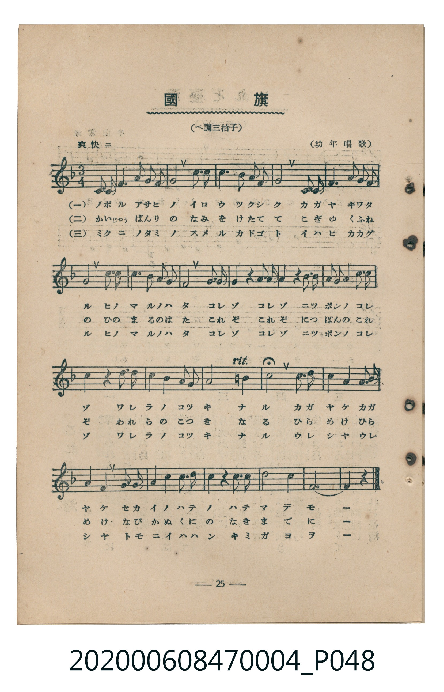
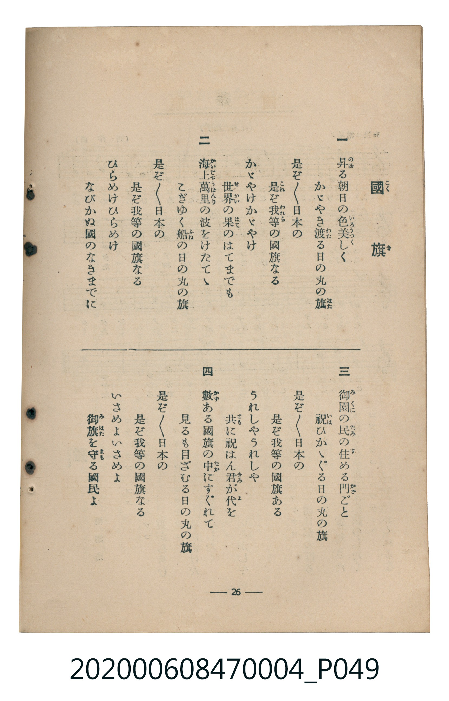

# 國旗

<audio controls src="kokki.mp3"></audio>

- 詞：幼年唱歌（石原和三郎）
- 曲：幼年唱歌（田村虎藏）
- 臺灣教育會公認《新定兒童唱歌》尋常科第四學年用（2020.006.0847.0004）

- note

原書資訊與歌詞全文（對應 P048.jpg–P049.jpg，書頁 pp. 25–26，第三學期第 1 首）：
調性與拍號：へ調三拍子（F 大調 3/4 拍，弱起一拍）
速度指示：爽快ニ
出處註記：（幼年唱歌）

## 歌詞

```text
一
昇（のぼ）る朝日の色美しく
かゞやき渡（わた）る日の丸の旗（はた）
是（これ）ぞ是ぞ日本の
是ぞ我等（われら）の國旗なる
かゞやけかゞやけ
世界（せかい）の果（はて）のはてまでも

二
海上萬里（かいじゃうばんり）の波をけたてゝ
こぎゆく船（ふね）の日の丸の旗
是ぞ是ぞ日本の
是ぞ我等の國旗なる
ひらめけひらめけ
なびかぬ國のなきまでに

三
御國（みくに）の民（たみ）の住（す）める門（かど）ごと
祝（いは）ひかゝぐる日の丸の旗
是ぞ是ぞ日本の
是ぞ我等の國旗なる
うれしやうれしや
共（とも）に祝はん君（きみ）が代（よ）を

四
數（かず）ある國旗の中（なか）にすぐれて
見るも目ざむる日の丸の旗
是ぞ是ぞ日本の
是ぞ我等の國旗なる
いさめよいさめよ
御旗（みはた）を守（まも）る國民よ
```

## 原書掃描頁





## 調性分析

```text
================================================================================
📊 TMD Song Profile: [ 國旗 ]
================================================================================
⏱  Duration:       0:38 (38.3s), 23 measures total
🎼 Key & Tempo:    首調基準 F, != 108.0 BPM, <3/4>
   - 分析範圍：      由實際發聲的音符與和弦推測調性；播放脈絡另行呈現
🎤 人聲音域:    C4 (MIDI 60) – D5 (MIDI 74) [跨度: 14 個半音 / 1.2 個八度, 難度: moderate]
   - 最低音:  C4 in [Kokki #1 @ m.1, 0:01]
   - 最高音: D5 in [Kokki #1 @ m.3, 0:04]
   - 適合: soprano, mezzo-soprano, contralto, tenor, baritone, bass
🏛  結構:      Kokki (38.3s)
⚡ 編曲密度:        Peak 1 軌道同時演奏
🗝  調性診斷：       F 大調（純淨自然大調，未偵測到可信轉調）
   - 風格氣質:    純淨自然大調（陽光明朗、易唱易記，無明顯調外色彩）
   - 轉調歷程:    全曲維持單一推測調性（未偵測到可信轉調）
   - 核心骨幹音:  C, F, G, A, D
   - 調性數值:    F 大調 [相關度: 0.89, 穩定度: Moderate, 自然音純度: 98.4%]
   - 候選調性 (K-S): F 大調 (0.89), C 大調 (0.81), A 小調 (0.59)
   - 五度圈歷程:   -1
   - 各段落調性細節:
     • [Kokki #1]: F 大調 (r: 0.89, 自然音純度: 98.4%, 調外音: B)

  [ 五度圈游移軌跡 ]
               C  
        [F ]*          G  
      Bb               D  
      Eb               A  
         Ab           E  
            Db       B  
               F# 
     (* = active key center)

  [ 十二半音累積音高分佈 ]
     C  : ████████████████████████  27.9%
     C# :                            0.0%
     D  : ████████                   9.8%
     D# :                            0.0%
     E  :                            0.0%
     F  : █████████████████████     24.6%
     F# :                            0.0%
     G  : ███████████████           17.2%
     G# :                            0.0%
     A  : █████████████             15.6%
     A# : ███                        3.3%
     B  : █                          1.6%
--------------------------------------------------------------------------------
Assignment 軌道音域：
  - Piano         : C4 – D5 (14 個半音 / 1.2 個八度, 71 個音符)
================================================================================
```

## ABC

```abc
X:1
T:國旗
C:曲：幼年唱歌（田村虎藏）
M:3/4
L:1/16
Q:1/4=108
K:F

V:V1 name="Piano" snm="Pia"

[V:V1]
z4 z4 c2 c2 | f6 g2 f2 g2 | a4 c4 d4 | c6 a2 g2 f2 |
g8 c2 c2 | f6 g2 f2 g2 | a4 c4 d4 | c6 a2 f2 g2 |
f8 g3 g | g4 z4 a3 a | a4 z4 b2 b2 | a2 g2 f4 c2 c2 |
c4 z4 d2 d2 | c4 a4 f2 f2 | g8 =b4 | c8 c3 c |
d4 c4 a3 a | g4 f4 c2 c2 | f4 a4 b2 b2 | a4 z4 c2 c2 |
d8 c4 | f12- | f4 z4 z4 |
```

- [主旋律 TMD 檔案](kokki.tmd)
- [鋼琴伴奏 TMD 檔案](kokki_piano.tmd)
