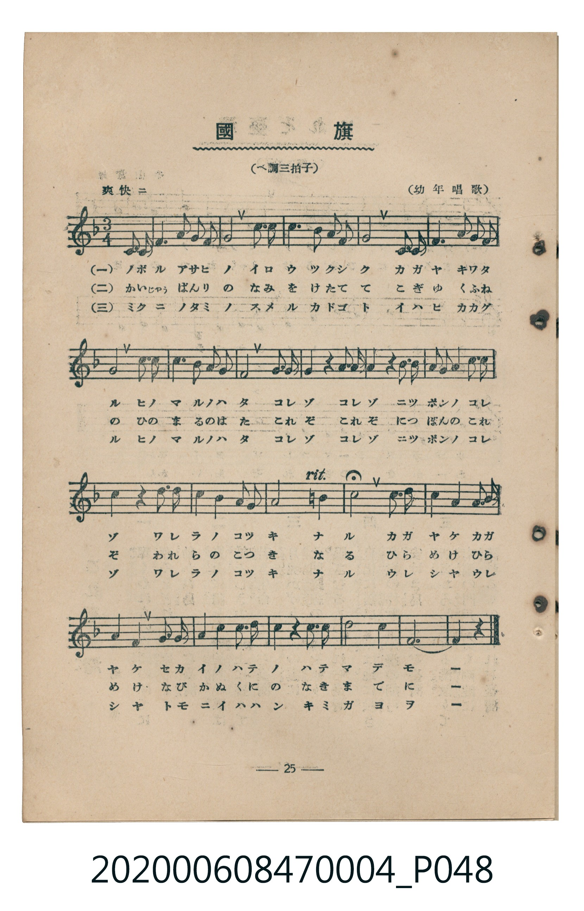
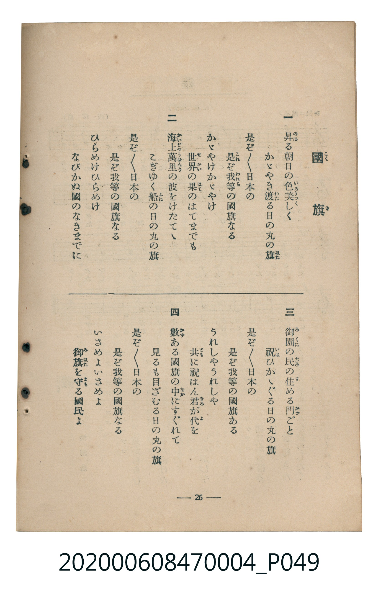

# 國旗

> Re:Shōka 使用 AI 協助辨識與重建樂譜，可能會有錯誤。歡迎回報。

- **鋼琴伴奏版**：<br><audio controls src="kokki.mp3"></audio>
- **NEUTRINO 歌聲合成版**：<br><audio controls src="kokki_neutrino.mp3"></audio>

- 詞：幼年唱歌（石原和三郎）
- 曲：幼年唱歌（田村虎藏）
- 臺灣教育會公認《新定兒童唱歌》尋常科第四學年用（2020.006.0847.0004）

## 說明

原書資訊與歌詞全文（對應 P048.jpg–P049.jpg，書頁 pp. 25–26，第三學期第 1 首）：
調性與拍號：へ調三拍子（F 大調 3/4 拍，弱起一拍）
速度指示：爽快ニ
出處註記：（幼年唱歌）

## 歌詞

```text
一
昇（のぼ）る朝日の色美しく
かゞやき渡（わた）る日の丸の旗（はた）
是（これ）ぞ是ぞ日本の
是ぞ我等（われら）の國旗なる
かゞやけかゞやけ
世界（せかい）の果（はて）のはてまでも

二
海上萬里（かいじゃうばんり）の波をけたてゝ
こぎゆく船（ふね）の日の丸の旗
是ぞ是ぞ日本の
是ぞ我等の國旗なる
ひらめけひらめけ
なびかぬ國のなきまでに

三
御國（みくに）の民（たみ）の住（す）める門（かど）ごと
祝（いは）ひかゝぐる日の丸の旗
是ぞ是ぞ日本の
是ぞ我等の國旗なる
うれしやうれしや
共（とも）に祝はん君（きみ）が代（よ）を

四
數（かず）ある國旗の中（なか）にすぐれて
見るも目ざむる日の丸の旗
是ぞ是ぞ日本の
是ぞ我等の國旗なる
いさめよいさめよ
御旗（みはた）を守（まも）る國民よ
```

## ABC

```abc
X:1
T:國旗
C:曲：幼年唱歌（田村虎藏）
M:3/4
L:1/16
Q:1/4=108
K:F
V:V1 name="Piano" snm="Pia"
[V:V1]
z4 z4 C3 C | F6 A2 G2 F2 | G8 c3 c | c6 B2 A2 F2 |
w: 1.~ノ ボ | ル ア サ ヒ | ノ イ ロ | ウ ツ ク シ
w: 2.~か い | じゃう ば ん り | の な み | を け た て
w: 3.~ミ ク | ニ ノ タ ミ | ノ ス メ | ル カ ド ゴ
G8 C3 C | F6 A2 G2 F2 | G8 c3 c | c6 B2 A2 G2 |
w: 1.~ク カ ガ | ヤ キ ワ タ | ル ヒ ノ | マ ル ノ ハ
w: 2.~て こ ぎ | ゆ く ふ ね | の ひ の | ま る の は
w: 3.~ト イ ハ | ヒ カ カ グ | ル ヒ ノ | マ ル ノ ハ
F8 G3 G | G4 z4 A3 A | A4 z4 B3 B | A3 G A4 c3 c |
w: 1.~タ コ レ | ゾ コ レ | ゾ ニ ッ | ポ ン ノ コ レ
w: 2.~た こ れ | ぞ こ れ | ぞ に っ | ぽ ん の こ れ
w: 3.~タ コ レ | ゾ コ レ | ゾ ニ ッ | ポ ン ノ コ レ
c4 z4 d3 d | c4 B4 A3 G | A8 =B4 | c8 c3 d |
w: 1.~ゾ ワ レ | ラ ノ コ ッ | キ ナ | ル カ ガ
w: 2.~ぞ わ れ | ら の こ っ | き な | る ひ ら
w: 3.~ゾ ワ レ | ラ ノ コ ッ | キ ナ | ル ウ レ
c4 A4 A3 B | A4 F4 G3 G | A4 c4 c3 d | c4 z4 c3 c |
w: 1.~ヤ ケ カ ガ | ヤ ケ セ カ | イ ノ ハ テ | ノ ハ テ
w: 2.~め け ひ ら | め け な び | か ぬ く に | の な き
w: 3.~シ ヤ ウ レ | シ ヤ ト モ | ニ イ ハ ハ | ン キ ミ
d8 c4 | F12- | F4 z4 z4 |
w: 1.~マ デ | モ | _
w: 2.~ま で | に | _
w: 3.~ガ ヨ | ヲ | _
```

## TMD 檔案連結

- [主旋律 TMD 檔案](kokki.tmd) [[在 TMD Studio 編輯](https://tmdlang.github.io/Tmd-TS/#tmd=s7IKdvYPcrWy4qpTUCpJTLdSSM7PyUlNLsnMz7MqzsjMK0nNjM_KTMmPL87Iz05Ugisry88pzU21Si9KTEmNN4k3MjAyiDcwMIs3sDAxBzIMTBBKi_NLi5JTrYqTM_Lzc-JLUitKkvLzsxHyBUX5Zal5iXlANQVFIBtTwIoQClLLMlNSQdKpKZkl-UWZiTlI7kgtKga7FWxJfElRYl5xclFmAcgDCFUlGalAx2bmFqRCdGtpKTyd0_1s-nQFLS0uRVsFQwMLLntbBTcuG2N9EzuQthcr573fM-vpzj1Pd255OmXjs7U97_d0PJ-_-Wnf_KeTep7s6HzZ3Pd-TyfYimezN2FRO2XDs7kTX8zsezG9H6bwRfuu542Ln02d-aJp07M5zU9b17xY1fu4oevZtA1P18162jrp-eqlEAMeN3Q_3dD9dMeO58snPl-z5uns2U_X7gAa_3zKCqDZoNDWA4a2Hii0gQwDE7ANXPpaCrbUAlwKCgpAzz6bvePF5vYXK7pedLQD3QUMlqetK55Nawe64umG3mftnQoBBiYWelkF6Y8aJgOZliDm-z09QH0vFzQqFBToKRiZAqWMzICCQJ8AQw7ok2dz5gPZCoYKL5dNAzodGHog616s2v-sYTnIou7eFzPnA0UfN-4ACgL1AEWerp0AtNRN4emS5UAxBWBEKQBFgaY-3bPxxdbtT3Y0gLmdIJNeNsx_umvZs57250t2AY153rH36f7Vj5u7wZ5q3_Vi5tQXK3a_WDEDKAfyCErMdXKBVAGNA1HPZoB8-rhx3ePGPUCpx03dz-bMfTZ9KVDkReem5_v6HjdOf9zYD1L6uLH7cdO8x00tjxt7n-1YCNLW1P-4EegNsDawnic7dgBJYLoDG7oeIguxZz1YaPLjJpATHjfOA4qAyOlLn81ZA9QDVQQS6pj4fC0wyMDGN_U8bgKygRrWQRL048ZVQNvQ3DMRmQ3x3bTnU0Gp9HHjbJBcYwvEjGfz5sBctgwiAmE_btz3uHH546YmSNjs6gE7BxToXS8mrHnZDjEKZM7jxhmPm5ofN7Y9btzwuAnonS6oyZsXPW6aBHbKfJCBTXMhbpz8uLHvcRNQdf-Ljp1gU7Y-blwL1YMaZkhBgD9ssAbGJmBAPW5qBLsAwYbIrXrcuBns_DVAfWBPA0V6oZ5uXA1NEOCIerpvIVAN2KH7gY4GykLdumEiWBDouf0QkSd7gfkeKDITnAAagQ55Oa0BFk4rwWqmPG5cATL0-dK5YAlg6AGTAVBiEzjC5j5unICZdCgLhjZQkgGmWVBSQLDBPmvdCHbECmA0gx2xGugsUPQ3TX46YTZYChgkEM_1PNm9GJwCO8CemwQOIWAhBXbC1B0wXwIzF1BxE9BymEOA3gBGLlAWGMDAUATZAgwhsD-BTlkGLgWWAb0ORE3PZwMjYtrjpgZqhwHQ61PBMQIJcigbGruwzAmMXWj-BPrv6TqgR4GC-6BhA_HQholQbZSXtlCgoKXPxeWdn52daRWQmZiX71Cja1hTDbJCwcbQTMsOzMJWyiuAi9aGFwt7FDQg5aGCtoKpwtMN_c_XN-jAy2hNLDqBVoJMrVEwUNAFQxhtGg-jaoAlNUQMBI2B2AiIQWI1YBYyNIWSNVAWBJpA9eHQQ4xNYFf6GNYoQBTrwunHzX1Qeg5Q_-Pm1UgmPG5aBCa3guUngW2HqUdWtQRqwlqQfNMyZLnmFrCK9WByO8QEMA_VBIitj5vWgG2AmAeTWws2B2LCfoRfjLD4pbEbSreAzIEVpsimNW4AmzMZTHZB3NO4Dt09jaug9H6we0E-R8hNBJPzwSTIryATkP0MUQWyAUT3gU1AdUM_mASHaiPId1AfGWOLHZA9kBAEhQzEfzA5UExAwgSiDnvs7ISqXoglfkG8x82dYPYWqAkdGCbA4rcfLI8SGhAToCQobGvApRnubLarB5zNzEjLXaTlE5Bq1LwAghAzjJBMg-VVkB4QWQNlIWRAJoJImIwRXAXcBfCchRq2kBCDhBUoVkDy81DkIGEPjkNgyEJyBiguUcN-M1Q1OGc07YOKw9MHIXloinnc3Ax2wVwobzNSSkExA563sOWKTVB6HTjNw-yCmAGyB6IHWPRDfAPOI6gmQHNFUw9YHhYeiPxLSB5aTjQuBsvvhaqejORaFDPg-Wp4xA2BCqwTnLNIrLdg-QeW4s2gJEIGkgdguQSUf2B5AAZN1KEM1OwIghA-snEwzRAamLUQGQhLEEGqCmgQNq-Ei2MGEDgQwZUFSiQ1gwp5iNuwJAIcFc_jpo3YVCBlDoyk2QRKJvCk2wQqUsF8zIQJTby96G6BVjqQxIZc0ENkoZkPaDJIvhEuDqqOMFQgEv4AhCmkMoQle1ClD-EjQhdJBf5EDWwVk1NdwNIYrApAFP2oxTe29AlvwEHJGmiWQECYSswqBgZr4Cz0ZiFydYEtte2G0qvBYQdXgYgbcHEEottQqntE7KLKIxdrEPF2uBsfN4Oad_jdj94gQcoDWNMgrOG0GZzGYakY2DeEs6DuAxblyJUMooiHmdCLUclAxJcj3A-tDshwPzhnYEmZ0MYPKGSQm1vIMQELX0hjCJJTkMuBtVD5-eAYhPkb7v7mFQj3N0NyLGnur-Xi0rVTAHdzFIAMZS4A)]
- [鋼琴伴奏 TMD 檔案](kokki_piano.tmd) [[在 TMD Studio 編輯](https://tmdlang.github.io/Tmd-TS/#tmd=s7IKdvYPcrWy4tLSUng6p_vZ9Onv93S87N7zfMKWJ3u2PF3a_7yz4_2eTgUtLS5FWwVDAwsue1sFNy4bY30TO646BaUXK-e93zPr6c49T3dueTpl47O1PUD9z-dvfto3_-mknic7Ol829wH1K4HUPpu9CYvaKRuezZ34Ymbfi-n9MIUv2nc9b1z8bOrMF02bns1pftq65sWq3scNXc-mbXi6btbT1knPVy-FGPC4ofvphu6nO3Y8Xz7x-Zo1T2fPfrp2B9D451NWAM02MjAy0DMwMNMzsDAxBzIMTMA2cHnnZ2dnWgVkJublB3k41Oga1lRzKQCBjaGZlh2Ypa-lYIsOFIAWPNnR8GJhj4LG0z0bX2zdrqCtYKrwdEP_8_UNOgoBBiYWelkF6ZpYdGrpg02tUTBQ0AVDGG0aD6NqFAyhYiBoDMRGQAwSqwGzkKEplKyBsiDQBKoPhx5ibAK70sewRgGiWBdOP27ug9JzgPofN69GMuFx0yIwuRUsPwlsO0w9sqolUBPWguSbliHLNbeAVawHk9shJoB5qCZAbH3ctAZsA8Q8mNxasDkQE_Yj_GKExS-N3VC6BWRO44zHTc2PG9uQTWvcADZnMpjsgrincR26expXQen9YPeCfI6Qmwgm54NJkF9BJiD7GaIKZAOI7gObgOqGfjAJDtVGkO-gPjLGFjsgeyAhCAoZiP9gcqCYgIQJRB322NkJVb0QS_yCeI-bO8HsLVATOjBMgMVvP1geJTQgJkBJUNjWcOHPZrt6wNnMjLTcRVo-AalGzQsgCDHDCMk0WF4F6QGRNVAWQgZkIoiEyRjBVcBdAM9ZqGELCTFIWIFiBSQ_D0UOEvbgOASGLCRngOISNew3Q1WDc0bTPqg4PH0QkoemmMfNzWAXzIXyNiOlFBQz4HkLW67YBKXXgdM8zC6IGSB7IHoeN4LyKkgFJO0imwDNFU09YHlYeCDyLyF5aDnRuBgsvxeqejKSa1HMgOer4RE3BCqwTnDOIrHeguUfWIo3g5IIGUgegOUSUP6B5QEYNFGHMlCzIwhC-MjGwTRDaGDWQmQgLEEEqSqgQdi8Ei6OGUDgQARXFiiR1Awq5CFuw5IIcFQ8j5s2YlOBlDkwkmYTKJnAk24TqEgF8zETJjTx9qK7BVrpQBIbckEPkYVmPqDJIPlGuDioOsJQgUj4AxCmkMoQluxBlT6EjwhdJBX4EzWw2UdOdQFLY7AqAFH0oxbf2NInvAEHJWugWQIBYSoxqxgYrIGz0JuFyNUFttS2G0qvBocdXAUibsDFEYhuQ6nuEbGLKo9crEHE2-FufNwMat7hdz96gwQpD2BNg7CG02ZwGoel4seNa-AsqPuARTlyJYMo4mEm9GJUMhDx5Qj3Q6sDMtwPzhlYUia08QMKGeTmFnJMwMIX0hiC5BTkcmAtVH4-OAZh_oa7v3kFwv3NkBxLmvtrUXo5Pii9HBNyOzkEujYgCEzt8QrRhrFgDMwu8UCeaTyQCyLgfHMMeXSdpLUP8dddaG4AWWOCwgNaCLIfq2OAKklyGVr9itdlGHYAGUAKIWEEDCjs7gIpI61QJMolKGECdgqK5SbYgg4Sk0AOOP5BKU_XTgGc-KJ9gFIIjhGYo8wFAA)]

## 分析

```text
================================================================================
📊 TMD Song Profile: [ 國旗 ]
================================================================================
⏱  Duration:       0:36 (36.7s), 22 measures total
🎼 Key & Tempo:    首調基準 F, != 108.0 BPM, <3/4>
   - 分析範圍：      由實際發聲的音符與和弦推測調性；播放脈絡另行呈現
🎤 人聲音域:    C4 (MIDI 60) – D5 (MIDI 74) [跨度: 14 個半音 / 1.2 個八度, 難度: moderate]
   - 最低音:  C4 in [Kokki #1 @ m.1, 0:01]
   - 最高音: D5 in [Kokki #1 @ m.13, 0:21]
   - 適合: soprano, mezzo-soprano, contralto, tenor, baritone, bass
🏛  結構:      Kokki (36.7s)
⚡ 編曲密度:        Peak 1 軌道同時演奏
🗝  調性診斷：       F 調性不明確（純淨自然大調，未偵測到可信轉調）
   - 風格氣質:    純淨自然大調（陽光明朗、易唱易記，無明顯調外色彩）
   - 轉調歷程:    全曲維持單一推測調性（未偵測到可信轉調）
   - 核心骨幹音:  C, A, F, G, D
   - 調性數值:    F 調性不明確 [相關度: 0.82, 穩定度: Ambiguous, 自然音純度: 98.4%]
   - 候選調性 (K-S): F 大調 (0.82), C 大調 (0.82), A 小調 (0.68)
   - 五度圈歷程:   +0
   - 各段落調性細節:
     • [Kokki #1]: C 調性不明確 (r: 0.82, 自然音純度: 94.6%, 調外音: A#)

  [ 五度圈游移軌跡 ]
              [C ]*
         F            G  
      Bb               D  
      Eb               A  
         Ab           E  
            Db       B  
               F# 
     (* = active key center)

  [ 十二半音累積音高分佈 ]
     C  : ████████████████████████  30.3%
     C# :                            0.0%
     D  : █████                      5.7%
     D# :                            0.0%
     E  :                            0.0%
     F  : ███████████████           18.9%
     F# :                            0.0%
     G  : ██████████████            18.0%
     G# :                            0.0%
     A  : ████████████████          20.1%
     A# : ████                       5.3%
     B  : █                          1.6%
--------------------------------------------------------------------------------
Assignment 軌道音域：
  - Piano         : C4 – D5 (14 個半音 / 1.2 個八度, 71 個音符)
================================================================================
```


## 原書掃描頁






