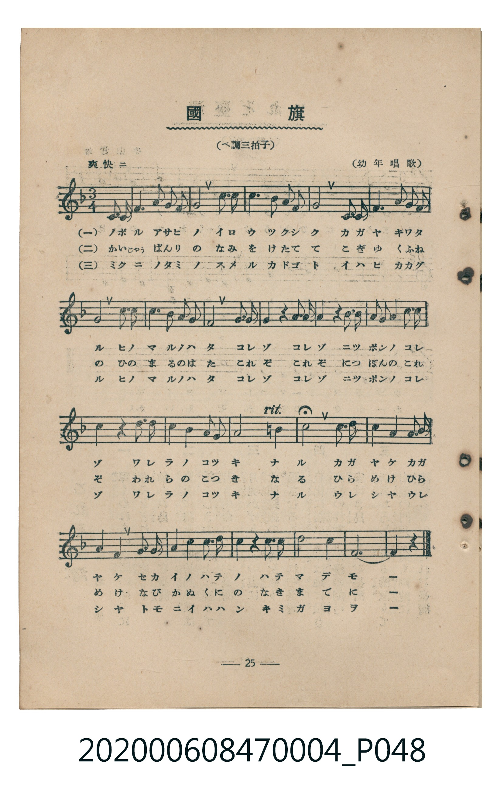
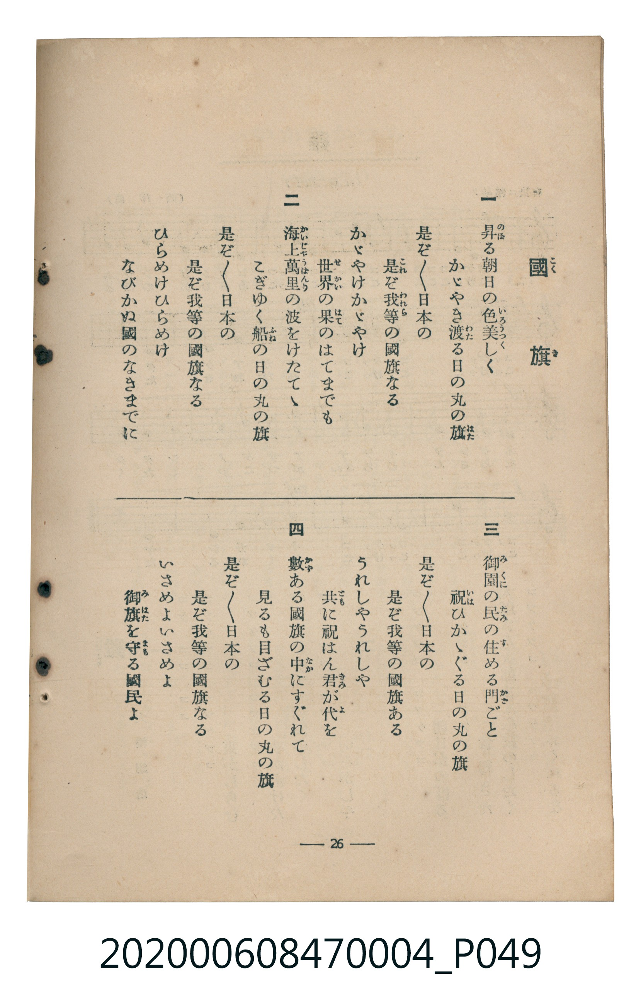

# 國旗

> Re:Shōka 使用 AI 協助辨識與重建樂譜，可能會有錯誤。歡迎[回報](https://github.com/TMDLang/reshoka/issues)。

- **鋼琴伴奏版**：<br><audio controls src="kokki.mp3"></audio>
- **NEUTRINO 歌聲合成版**：<br><audio controls src="kokki_neutrino.mp3"></audio>

- 詞：幼年唱歌（石原和三郎）
- 曲：幼年唱歌（田村虎藏）
- 臺灣教育會公認《新定兒童唱歌》尋常科第四學年用（2020.006.0847.0004）

## 說明

原書資訊與歌詞全文（對應 P048.jpg–P049.jpg，書頁 pp. 25–26，第三學期第 1 首）：
調性與拍號：へ調三拍子（F 大調 3/4 拍，弱起一拍）
速度指示：爽快ニ
出處註記：（幼年唱歌）


## 歌詞

```text
一
昇（のぼ）る朝日の色美しく
かゞやき渡（わた）る日の丸の旗（はた）
是（これ）ぞ是ぞ日本の
是ぞ我等（われら）の國旗なる
かゞやけかゞやけ
世界（せかい）の果（はて）のはてまでも

二
海上萬里（かいじゃうばんり）の波をけたてゝ
こぎゆく船（ふね）の日の丸の旗
是ぞ是ぞ日本の
是ぞ我等の國旗なる
ひらめけひらめけ
なびかぬ國のなきまでに

三
御國（みくに）の民（たみ）の住（す）める門（かど）ごと
祝（いは）ひかゝぐる日の丸の旗
是ぞ是ぞ日本の
是ぞ我等の國旗なる
うれしやうれしや
共（とも）に祝はん君（きみ）が代（よ）を

四
數（かず）ある國旗の中（なか）にすぐれて
見るも目ざむる日の丸の旗
是ぞ是ぞ日本の
是ぞ我等の國旗なる
いさめよいさめよ
御旗（みはた）を守（まも）る國民よ
```

## ABC

<div class="abc-score" data-abc-src="kokki.abc" aria-label="五線譜載入中"></div>

[下載 ABC 原始檔](kokki.abc)

## TMD 檔案連結

- [主旋律 TMD 檔案](kokki.tmd) [[在 TMD Studio 編輯](https://tmdlang.github.io/Tmd-TS/#tmd=s7IKdvYPcrWy4qpTUCpJTLdSSM7PyUlNLsnMz7MqzsjMK0nNjM_KTMmPL87Iz05Ugisry88pzU21Si9KTEmNN4k3MjAyiDcwMIs3sDAxBzIMTBBKi_NLi5JTrYqTM_Lzc-JLUitKkvLzsxHyBUX5Zal5iXlANQVFIBtTwIoQClLLMlNSQdKpKZkl-UWZiTlI7kgtKga7FWxJfElRYl5xclFmAcgDCFUlGalAx2bmFqSi6gYalp6ZZ5WbmpmVicVl-UUlGflALxZkVFplZBaD7E5OzInPTsxDCgmozQWJ6alWAQYmFrpAwlKJS0tL4emc7mfTpytoaXEp2ioYGlhw2dsquHHZGOub2IF0v1g57_2eWU937nm6c8vTKRufre15v6fj-fzNT_vmP53U82RH58vmvvd7OsE2PZu9CYvaKRuezZ34Ymbfi-n9MIUv2nc9b1z8bOrMF02bns1pftq65sWq3scNXc-mbXi6btbT1knPVy-FGPC4ofvphu6nO3Y8Xz7x-Zo1T2fPfrp2B9D451NWAM0GRageMEL1QBEKZBiYgG3g0tdSsKUW4FJQUAB69tnsHS82t79Y0fWiox3oLmCwPG1d8WxaO9AVTzf0PmvvVAAFq15WQfqjhsmgwAUx3-_pAep7uaBRoaBAT8HIFChlZAYUBPoEGHJAnzybMx_IVjBUeLlsGtDpwNADWfdi1f5nDctBFnX3vpg5Hyj6uHEHUBCoByjydO0EoKVuCk-XLAeKKQAjSgEoCjT16Z6NL7Zuf7KjAcztBJn0smH-013LnvW0P1-yC2jM8469T_evftzcDfZU-64XM6e-WLH7xYoZQDmQR1BirpMLpApoHIh6NgPk08eN6x437gFKPW7qfjZn7rPpS4EiLzo3Pd_X97hx-uPGfpDSx43dj5vmPW5qedzY-2zHQpC2pv7HjUBvgLWB9TzZsQNIAtMd2ND1EFmIPevBQpMfN4Gc8LhxHlAERE5f-mzOGqAeqCKQUMfE52uBQQY2vqnncROQDdSwDpKgHzeuAtqG5p6JyGyI76Y9nwpKpY8bZ4PkGlsgZjybNwfmsmUQEQj7ceO-x43LHzc1QcJmVw_YOaBA73oxYc3LdohRIHMeN8543NT8uLHtceOGx01A73RBTd686HHTJLBT5oMMbJoLcePkx419j5uAqvtfdOwEm7L1ceNaqB7UMEMKAvxhgzUwNgED6nFTI9gFCDZEbtXjxs1g568B6gN7GijSC_V042poggBH1NN9C4FqwA7dD3Q0UBbq1g0TwYJAz-2HiDzZC8z3QJGZ4ATQCHTIy2kNsHBaCVYz5XHjCpChz5fOBUsAQw-YDIASm8ARNvdx4wTMpENZMLSBkgwwzYKSAoIN9lnrRrAjVgCjGeyI1UBngaK_afLTCbPBUsAggXiu58nuxeAU2AH23CRwCAELKbATpu6A-RKYuYCKm4CWwxwC9AYwcoGywAAGhiLIFmAIgf0JdMoycCmwDOh1IGp6PhsYEdMeNzVQOwyAXp8KjhFIkEPZ0NiFZU5g7ELzJ9B_T9cBPQoU3AcNG4iHNkyEaqO8tIUCBS19Li7v_OzsTKuAzMS8fIcaXcOaapAVCjaGZlp2YBa2Ul4BXLQ2vFjYo6ABKQ8VtBVMFZ5u6H--vkEHXkZrYtEJtBJkao2CgYIuGMJo03gYVQMsqSFiIGgMxEZADBKrAbOQoSmUrIGyINAEqg-HHmJsArvSx7BGAaJYF04_bu6D0nOA-h83r0Yy4XHTIjC5FSw_CWw7TD2yqiVQE9aC5JuWIcs1t4BVrAeT2yEmgHmoJkBsfdy0BmwDxDyY3FqwORAT9iP8YoTFL43dULoFZA6sMEU2rXED2JzJYLIL4p7GdejuaVwFpfeD3QvyOUJuIpicDyZBfgWZgOxniCqQDSC6D2wCqhv6wSQ4VBtBvoP6yBhb7IDsgYQgKGQg_oPJgWICEiYQddhjZydU9UIs8QviPW7uBLO3QE3owDABFr_9YHmU0ICYACVBYVsDLs1wZ7NdPeBsZkZa7iItn4BUo-YFEISYYYRkGiyvgvSAyBooCyEDMhFEwmSM4CrgLoDnLNSwhYQYJKxAsQKSn4ciBwl7cBwCQxaSM0BxiRr2m6GqwTmjaR9UHJ4-CMlDU8zj5mawC-ZCeZuRUgqKGfC8hS1XbILS68BpHmYXxAyQPRA9wKIf4htwHkE1AZormnrA8rDwQORfQvLQcqJxMVh-L1T1ZCTXopgBz1fDI24IVGCd4JxFYr0Fyz-wFG8GJREykDwAyyWg_APLAzBoog5loGZHEITwkY2DaYbQwKyFyEBYgghSVUCDsHklXBwzgMCBCK4sUCKpGVTIQ9yGJRHgqHgeN23EpgIpc2AkzSZQMoEn3SZQkQrmYyZMaOLtRXcLtNKBJDbkgh4iC818QJNB8o1wcVB1hKECkfAHIEwhlSEs2YMqfQgfEbpIKvAnamCrmJzqApbGYFUAouhHLb6xpU94Aw5K1kCzBALCVGJWMTBYA2ehNwuRqwtsqW03lF4NDju4CkTcgIsjEN2GUt0jYhdVHrlYg4i3w934uBnUvMPvfvQGCVIewJoGYQ2nzeA0DkvFwL4hnAV1H7AoR65kEEU8zIRejEoGIr4c4X5odUCG-8E5A0vKhDZ-QCGD3NxCjglY-EIaQ5CcglwOrIXKzwfHIMzfcPc3r0C4vxmSY0lzfy0Xl66dAribowBkKHMBAA)]
- [鋼琴伴奏 TMD 檔案](kokki_piano.tmd) [[在 TMD Studio 編輯](https://tmdlang.github.io/Tmd-TS/#tmd=s7IKdvYPcrWy4qpTUCpJTLdSyC8qychPL0osyKi0ysgsLskvykxOzInPTsxLVIIrKs4vLUpOjS9ITE-1CjAwsdAFEpZKXFpaCk_ndD-bPv39no6X3XueT9jyZM-Wp0v7n3d2vN_TqaClxaVoq2BoYMFlb6vgxmVjrG9iBzLyxcp57_fMerpzz9OdW55O2fhsbQ9Q__P5m5_2zX86qefJjs6XzX1A_WDrn83ehEXtlA3P5k58MbPvxfR-mMIX7bueNy5-NnXmi6ZNz-Y0P21d82JV7-OGrmfTNjxdN-tp66Tnq5dCDHjc0P10Q_fTHTueL5_4fM2ap7NnP127A2j88ykrgGYbGRgZ6BkYmOkZWJiYAxkGJmAbuLzzs7MzrQIyE_PygzwcanQNa6q5FIDAxtBMyw7M0tdSsEUHCkALnuxoeLGwR0Hj6Z6NL7ZuV9BWMFV4uqH_-foGHQVQWOplFaRrYtGppQ82tUbBQEEXDGG0aTyMqlEwhIqBoDEQGwExSKwGzEKGplCyBsqCQBOoPhx6iLEJ7EofwxoFiGJdOP24uQ9KzwHqf9y8GsmEx02LwORWsPwksO0w9ciqlkBNWAuSb1qGLNfcAlaxHkxuh5gA5qGaALH1cdMasA0Q82Bya8HmQEzYj_CLERa_NHZD6RaQOY0zHjc1P25sQzatcQPYnMlgsgvinsZ16O5pXAWl94PdC_I5Qm4imJwPJkF-BZmA7GeIKpANILoPbAKqG_rBJDhUG0G-g_rIGFvsgOyBhCAoZCD-g8mBYgISJhB12GNnJ1T1QizxC-I9bu4Es7dATejAMAEWv_1geZTQgJgAJUFhW8OFP5vt6gFnMzPSchdp-QSkGjUvgCDEDCMk02B5FaQHRNZAWQgZkIkgEiZjBFcBdwE8Z6GGLSTEIGEFihWQ_DwUOUjYg-MQGLKQnAGKS9Sw3wxVDc4ZTfug4vD0QUgemmIeNzeDXTAXytuMlFJQzIDnLWy5YhOUXgdO8zC7IGaA7IHoedwIyqsgFZC0i2wCNFc09YDlYeGByL-E5KHlRONisPxeqOrJSK5FMQOer4ZH3BCowDrBOYvEeguWf2Ap3gxKImQgeQCWS0D5B5YHYNBEHcpAzY4gCOEjGwfTDKGBWQuRgbAEEaSqgAZh80q4OGYAgQMRXFmgRFIzqJCHuA1LIsBR8Txu2ohNBVLmwEiaTaBkAk-6TaAiFczHTJjQxNuL7hZopQNJbMgFPUQWmvmAJoPkG-HioOoIQwUi4Q9AmEIqQ1iyB1X6ED4idJFU4E_UwGYfOdUFLI3BqgBE0Y9afGNLn_AGHJSsgWYJBISpxKxiYLAGzkJvFiJXF9hS224ovRocdnAViLgBF0cgug2lukfELqo8crEGEW-Hu_FxM6h5h9_96A0SpDyANQ3CGk6bwWkcloofN66Bs6DuAxblyJUMooiHmdCLUclAxJcj3A-tDshwPzhnYEmZ0MYPKGSQm1vIMQELX0hjCJJTkMuBtVD5-eAYhPkb7v7mFQj3N0NyLGnur0Xp5fig9HJMyO3kEOjagCAwtccrRBvGgjEwu8QDeabxQC6IgPPNMeTRdZLWPsRfd6G5AWSNCQoPaCHIfqyOAaokyWVo9Stel2HYAWQAKYSEETCgsLsLpIy0QpEol6CECdgpKJabYAs6SEwCOeD4B6U8XTsFcOKL9gFKIThGYI4yFwA)]

## 分析

```text
================================================================================
📊 TMD Song Profile: [ 國旗 ]
================================================================================
⏱  Duration:       0:36 (36.7s), 22 measures total
🎼 Key & Tempo:    首調基準 F, != 108.0 BPM, <3/4>
   - 分析範圍：      由實際發聲的音符與和弦推測調性；播放脈絡另行呈現
🎤 人聲音域:    C4 (MIDI 60) – D5 (MIDI 74) [跨度: 14 個半音 / 1.2 個八度, 難度: moderate]
   - 最低音:  C4 in [Kokki #1 @ m.1, 0:01]
   - 最高音: D5 in [Kokki #1 @ m.13, 0:21]
   - 適合: soprano, mezzo-soprano, contralto, tenor, baritone, bass
🏛  結構:      Kokki (36.7s)
⚡ 編曲密度:        Peak 1 軌道同時演奏
🗝  調性診斷：       F 調性不明確（純淨自然大調，未偵測到可信轉調）
   - 風格氣質:    純淨自然大調（陽光明朗、易唱易記，無明顯調外色彩）
   - 轉調歷程:    全曲維持單一推測調性（未偵測到可信轉調）
   - 核心骨幹音:  C, A, F, G, D
   - 調性數值:    F 調性不明確 [相關度: 0.82, 穩定度: Ambiguous, 自然音純度: 98.4%]
   - 候選調性 (K-S): F 大調 (0.82), C 大調 (0.82), A 小調 (0.68)
   - 五度圈歷程:   +0
   - 各段落調性細節:
     • [Kokki #1]: C 調性不明確 (r: 0.82, 自然音純度: 94.6%, 調外音: A#)

  [ 五度圈游移軌跡 ]
              [C ]*
         F            G  
      Bb               D  
      Eb               A  
         Ab           E  
            Db       B  
               F# 
     (* = active key center)

  [ 十二半音累積音高分佈 ]
     C  : ████████████████████████  30.3%
     C# :                            0.0%
     D  : █████                      5.7%
     D# :                            0.0%
     E  :                            0.0%
     F  : ███████████████           18.9%
     F# :                            0.0%
     G  : ██████████████            18.0%
     G# :                            0.0%
     A  : ████████████████          20.1%
     A# : ████                       5.3%
     B  : █                          1.6%
--------------------------------------------------------------------------------
Assignment 軌道音域：
  - Piano         : C4 – D5 (14 個半音 / 1.2 個八度, 71 個音符)
================================================================================
```


## 原書掃描頁






