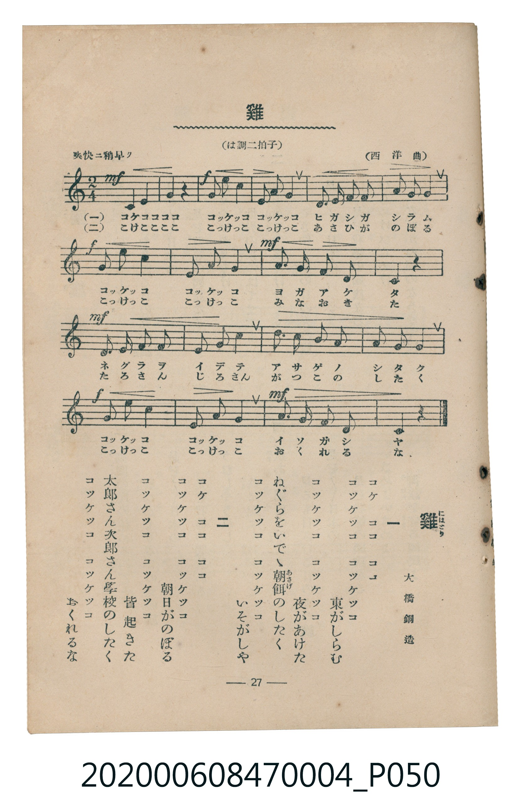

# 雞

<audio controls src="hina.mp3"></audio>

- 詞：大橋銅造
- 曲：西洋曲
- 臺灣教育會公認《新定兒童唱歌》尋常科第四學年用（2020.006.0847.0004）

## 說明

原書資訊與歌詞全文（對應 P050.jpg，書頁 p. 27，第三學期第 2 首）：
調性與拍號：は調二拍子（C 大調 2/4 拍）
速度指示：爽快ニ稍早ク
出處註記：（西洋曲）

## 歌詞

```text
一
コケ　ココ　ココ
コッケッコ　コッケッコ　東がしらむ
コッケッコ　コッケッコ　夜があけた
ねぐらをいでゝ朝餌（あさげ）のしたく
コッケッコ　コッケッコ　いそがしや

二
コケ　ココ　ココ
コッケッコ　コッケッコ　朝日がのぼる
コッケッコ　コッケッコ　皆起きた
太郎さん次郎さん學校のしたく
コッケッコ　コッケッコ　おくれるな
```

## ABC

```abc
X:1
T:雞
C:曲：西洋曲
M:2/4
L:1/16
Q:1/4=112
K:C
V:V1 name="Piano" snm="Pia"
[V:V1]
!mf! g2 g g z4 | !f! c2 e4 c2 | g2 c4 g2 | f2 f2 e2 e2 |
d2 d2 g4 | !f! a2 c4 a2 | g2 c4 g2 | !mf! f2 e2 d2 g2 |
c4 z4 | !mf! f2 f2 e2 e2 | d2 d2 g4 | c2 b2 a2 g2 |
f2 d2 g4 | !f! a2 c4 a2 | g2 e4 g2 | !mf! f2 e2 d2 g2 |
c4 z4 |
```

## TMD 檔案連結

- [主旋律 TMD 檔案](hina.tmd)
- [鋼琴伴奏 TMD 檔案](hina_piano.tmd)

## 分析

```text
================================================================================
📊 TMD Song Profile: [ 雞 ]
================================================================================
⏱  Duration:       0:18 (18.2s), 17 measures total
🎼 Key & Tempo:    首調基準 C, != 112.0 BPM, <2/4>
   - 分析範圍：      由實際發聲的音符與和弦推測調性；播放脈絡另行呈現
🎤 人聲音域:    C4 (MIDI 60) – E5 (MIDI 76) [跨度: 16 個半音 / 1.3 個八度, 難度: moderate]
   - 最低音:  C4 in [Hina #1 @ m.9, 0:08]
   - 最高音: E5 in [Hina #1 @ m.2, 0:01]
   - 適合: soprano, mezzo-soprano, contralto, tenor, baritone, bass
🏛  結構:      Hina (18.2s)
⚡ 編曲密度:        Peak 1 軌道同時演奏
🗝  調性診斷：       C 大調（純淨自然大調，未偵測到可信轉調）
   - 風格氣質:    純淨自然大調（陽光明朗、易唱易記，無明顯調外色彩）
   - 轉調歷程:    全曲維持單一推測調性（未偵測到可信轉調）
   - 核心骨幹音:  G, C, E, D, F
   - 調性數值:    C 大調 [相關度: 0.96, 穩定度: High, 自然音純度: 100.0%]
   - 候選調性 (K-S): C 大調 (0.96), G 大調 (0.72), E 小調 (0.60)
   - 五度圈歷程:   +0
   - 各段落調性細節:
     • [Hina #1]: C 大調 (r: 0.96, 自然音純度: 100.0%)

  [ 五度圈游移軌跡 ]
              [C ]*
         F            G  
      Bb               D  
      Eb               A  
         Ab           E  
            Db       B  
               F# 
     (* = active key center)

  [ 十二半音累積音高分佈 ]
     C  : █████████████████████     24.2%
     C# :                            0.0%
     D  : ██████████                11.3%
     D# :                            0.0%
     E  : ██████████████            16.1%
     F  : ██████████                11.3%
     F# :                            0.0%
     G  : ████████████████████████  27.4%
     G# :                            0.0%
     A  : ███████                    8.1%
     A# :                            0.0%
     B  : █                          1.6%
--------------------------------------------------------------------------------
Assignment 軌道音域：
  - Piano         : C4 – E5 (16 個半音 / 1.3 個八度, 52 個音符)
================================================================================
```


## 原書掃描頁




