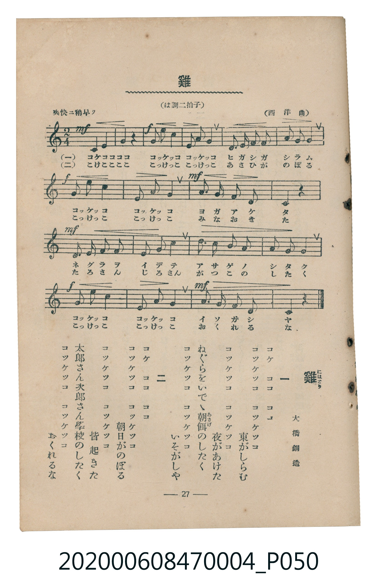

# 雞

> Re:Shōka 使用 AI 協助辨識與重建樂譜，可能會有錯誤。歡迎回報。

- **鋼琴伴奏版**：<br><audio controls src="niwatori.mp3"></audio>
- **NEUTRINO 歌聲合成版**：<br><audio controls src="niwatori_neutrino.mp3"></audio>

- 詞：大橋銅造
- 曲：西洋曲
- 臺灣教育會公認《新定兒童唱歌》尋常科第四學年用（2020.006.0847.0004）

## 說明

原書資訊與歌詞全文（對應 P050.jpg，書頁 p. 27，第三學期第 2 首）：
調性與拍號：は調二拍子（C 大調 2/4 拍）
速度指示：爽快ニ稍早ク
出處註記：（西洋曲）


## 歌詞

```text
一
コケ　ココ　ココ
コッケッコ　コッケッコ　東がしらむ
コッケッコ　コッケッコ　夜があけた
ねぐらをいでゝ朝餌（あさげ）のしたく
コッケッコ　コッケッコ　いそがしや

二
コケ　ココ　ココ
コッケッコ　コッケッコ　朝日がのぼる
コッケッコ　コッケッコ　皆起きた
太郎さん次郎さん學校のしたく
コッケッコ　コッケッコ　おくれるな
```

## ABC

```abc
X:1
T:雞
C:曲：西洋曲
M:2/4
L:1/16
Q:1/4=112
K:C
V:V1 name="Piano" snm="Pia"
[V:V1]
!mf! C4 E4 | G4 z4 | !f! G2 e2 c4 | E2 A2 G4 |
w: 1.~コケ ココ | ココ | コッ ケッ コ | コッ ケッ コ
w: 2.~こけ ここ | ここ | こっ けっ こ | こっ けっ こ
D3 E F2 F2 | A2 G2 G4 | !f! G2 e2 c4 | E2 A2 G4 |
w: 1.~ヒ ガ シ ガ | シ ラ ム | コッ ケッ コ | コッ ケッ コ
w: 2.~あ さ ひ が | の ぼ る | こっ けっ こ | こっ けっ こ
!mf! A3 G F2 D2 | C4 z4 | !mf! D3 E F2 F2 | E2 G2 c4 |
w: 1.~ヨ ガ ア ケ | タ | ネ グ ラ ヲ | イ デ テ
w: 2.~み な お き | た | た ろ さ ん | じ ろ さん
d3 c B2 A2 | A2 G2 G4 | !f! G2 e2 c4 | E2 A2 G4 |
w: 1.~ア サ ゲ ノ | シ タ ク | コッ ケッ コ | コッ ケッ コ
w: 2.~が つ こ の | し た く | こっ けっ こ | こっ けっ こ
!mf! A3 G F2 D2 | C4 z4 |
w: 1.~イ ソ ガ シ | ヤ
w: 2.~お く れ る | な
```

## TMD 檔案連結

- [主旋律 TMD 檔案](niwatori.tmd) [[在 TMD Studio 編輯](https://tmdlang.github.io/Tmd-TS/#tmd=s7IKdvYPcrWy4qpTUCpJTLdSSM7PyUlNLsnMz7MqzsjMK0nNjM_KTMmPL87Iz05Ugisry88pzU21Si9KTEmNN4k3MjAyiDcwMIs3sDAxBzIMTBBKi_NLi5JTrYqTM_Lzc-JLUitKkvLzsxHyBUX5Zal5iXlANQVFIBtTwIoQClLLMlNSQdKpKZkl-UWZiTlI7kgtKga7FWxJfElRYl5xclFmAcgDCFX5RSUZ-UC3FmRUWmVkFoMMSU7Mic9OzEPyUklGKtBHiXmZucgWAJWmZ-ZZlacWl6QW5cXnpubkp1RiSJckZgIDCBRI5YnxuYmZeTmJeSlKXFpaCi9nz1PQ0uJStFUwNDTisrdVcOayMdI3sQOZ8GLlvPd7Zj1dsvzZyu6XXa0vGxaADX42exNQ-MXS_c-2dAPZYLEX7bueNy5-NnXmi6ZNz-Y0P21d82JV7-OGrmfTNjxdN-tp66Tnq5c-nbLx2dqexw3dTzd0P92x4_nyic_XrHk6e_bTtTue7tzyfMqK93s6QBGlB4woPVBEARkGJu_3dCpxcelrKdhSC3ApKCg87Zv_bPaOF5vbX6zoetHRDnQX0LNPW1c8m9YOdMXTDb3P2jsVAgxMDfSyCtLf7-kBKn65oFGhQE_ByBzIBTr8yY5OoMOfzZkPZCsYKbxcNg3oUmC4gEx_sWr_s4blIHO7e1_MnA8Ufdy4Hij4ZFcPUOTp2glAO5wVgAELFFMAhrYCUBSoG6T1ZcP8p7uWPetpf75kF1Df8469T_evftzc_XxF77PpKx83rQe7vn3Xi5lTX6zY_WLFDKAioGnw2AAZA1LyZEcDiHrctPlx08bHDQ1gxmY4AybX3AySBpEwOVSRZ3M3Pm7sedw4_XFT5-MmuJGEtD1dMgesrelx48THjfPB2hrXPm6cADZm0uPGlseNyx83zX02Z-7LJT1A94OVTn3cOAno_seN60AWNs5_3NhPrIVgE-fCnNoCCYJdPVQJgjlzn01fCjYa6K49j5u6idX5fFbbi63bHzf2QoPg6ZJVL5v7QP5smvxszUI4G5SOFiwkz9tdQNWPm3qArnrcuAqkjfL8AQUKWvpcXH6Z5Ymg4sgqIDMxL9-hxqCmGmSJgo2hmZYdmIUtZyqA80fDi4U9ChpmCk839D9f36ADz06aWDQA7QIZVqNQnZtWq2CooAuGxlC6RsEUyjKAi1QD1YFEjeOAhCGIgIiD9JgBMUxHDTBzQswyAZIgXAOXh6sBW-5jWANNLFBhSDqBm4PCRTgEEitg5aCIgegjVrZ5EtSmNUC8HcqC6APzmleCyQWoDjUCyjdOBuYtmENBnMkIU5G5SA4FCS8GKwdmSggDTRMe2SaoTVOBeBOY1QOVWQfm7QE7vhvuUPyJY1cPOHGYkJg4iI5zcDICCYEEQZEOSgQ18IQFDxSUiCc_FldAAgcci4sgyqD69mO3ERaDZEcHxFxgngfiLjCrFyozH8NGAvm0k6yoAAUwZs4CxQQoFpAixwjCBIqYAylQnODNgM0gf4BCcAM89YOSGygsl4B57WCyDSluQCEO0rEViMFJs7kPKgPJUaCwAtacWGIAElaPm3rBCRvEAoUxSGYGVByc5CHCsKAHpXuQ8BJolEByAEhmOpgHMhRYKhMX_MD2z3DKCeA4AonthZZkkDgAxStEhvo5AZT6IQEOrAfBNoIKIZDMKgwba7m4dO0UYJWaApCtzAUA)]
- [鋼琴伴奏 TMD 檔案](niwatori_piano.tmd) [[在 TMD Studio 編輯](https://tmdlang.github.io/Tmd-TS/#tmd=s7IKdvYPcrWy4tLSUng5e977PR0vu_c8n7DlyZ4tT5f2P-_seL-nU0FLi0vRVsHQ0IjL3lbBmcvGSN_EjqtOQenFSqCGWU-XLH-2svtlV-vLhgVKIOFnszcBhV8s3f9sSzeQDRZ70b7reePiZ1Nnvmja9GxO89PWNS9W9T5u6Ho2bcPTdbOetk56vnrp0ykbn63tedzQ_XRD99MdO54vn_h8zZqns2c_Xbvj6c4tz6esALrOyMDIQM_AwEzPwMLEHMgwMAE6UImLyy-zPLEkvyjTKiAzMS8_yMOhxqCmmksBCGwMzbTswCx9LQVbdKAAtOLJjoYXC3sUNMwUnm7of76-QUchwMDUQC-rIF0TiwYtfbBhNQrVuWm1CoYKumBoDKVrFEyhLAO4SDVQHUjUOA5IGIIIiDhIjxkQw3TUKBhBzTIBkiBcA5eHqwFb7mNYo_C4afPjpo1QYTBnM9wcFC7CISDh5maw8o0wBqomPLLNk6A2rQHi7VAWRB-Y17wSTC5AdagRUL5x8uPGiTCHgjiTEaYic5EcChJeDFY-EcZA04RHtglq01Qg3gRm9UBl1oF5e8CO74Y7FH_i2NUDThwmJCYOouMcnIxAQiBBUKSDEkENPGHBAwUl4smPxRWQwAHH4iKIMqi-_dhthMUg2dEBMfdx4yog7gKzeqEy8zFsJJBPO8mKClAAY-YsUEyAYgEpcowgTKCIOZACxQneDNgM8gcoBDfAUz8ouYHCcgmY1w4m25DiBhTiIB1bgRicNJv7oDKQHAUKq8dN67HEACSsHjf1ghM2iAUKY5DMDKg4OMlDhGFBD0r3IOEl0CiB5ACQzHQwD2To48Z-4oIfWBIPp5wAjiOQ2F5oSQaJA1C8QmSonxNAqR8S4I-bQFEDKYRAMqswbKxFr9N8kOs0C2iVBg20aMNYoCYIWQOlQUZBQt8wHiwEpYABisY3jQeyTONjEQwMNUhxScg0sINMgDwTbAaCXYXsdCIsB0oBZWJhhtLaccCQ17VTgAV-tA8oNJH5RmC-MhcA)]

## 分析

```text
================================================================================
📊 TMD Song Profile: [ 雞 ]
================================================================================
⏱  Duration:       0:19 (19.3s), 18 measures total
🎼 Key & Tempo:    首調基準 C, != 112.0 BPM, <2/4>
   - 分析範圍：      由實際發聲的音符與和弦推測調性；播放脈絡另行呈現
🎤 人聲音域:    C4 (MIDI 60) – E5 (MIDI 76) [跨度: 16 個半音 / 1.3 個八度, 難度: moderate]
   - 最低音:  C4 in [Niwatori #1 @ m.1, 0:00]
   - 最高音: E5 in [Niwatori #1 @ m.3, 0:02]
   - 適合: soprano, mezzo-soprano, contralto, tenor, baritone, bass
🏛  結構:      Niwatori (19.3s)
⚡ 編曲密度:        Peak 1 軌道同時演奏
🗝  調性診斷：       C 大調（純淨自然大調，未偵測到可信轉調）
   - 風格氣質:    純淨自然大調（陽光明朗、易唱易記，無明顯調外色彩）
   - 轉調歷程:    全曲維持單一推測調性（未偵測到可信轉調）
   - 核心骨幹音:  G, C, E, A, D
   - 調性數值:    C 大調 [相關度: 0.93, 穩定度: High, 自然音純度: 100.0%]
   - 候選調性 (K-S): C 大調 (0.93), G 大調 (0.74), E 小調 (0.61)
   - 五度圈歷程:   +0
   - 各段落調性細節:
     • [Niwatori #1]: C 大調 (r: 0.93, 自然音純度: 100.0%)

  [ 五度圈游移軌跡 ]
              [C ]*
         F            G  
      Bb               D  
      Eb               A  
         Ab           E  
            Db       B  
               F# 
     (* = active key center)

  [ 十二半音累積音高分佈 ]
     C  : ██████████████████        22.0%
     C# :                            0.0%
     D  : ████████                   9.8%
     D# :                            0.0%
     E  : █████████████             15.2%
     F  : ████████                   9.1%
     F# :                            0.0%
     G  : ████████████████████████  28.8%
     G# :                            0.0%
     A  : ███████████               13.6%
     A# :                            0.0%
     B  : █                          1.5%
--------------------------------------------------------------------------------
Assignment 軌道音域：
  - Piano         : C4 – E5 (16 個半音 / 1.3 個八度, 52 個音符)
================================================================================
```


## 原書掃描頁




