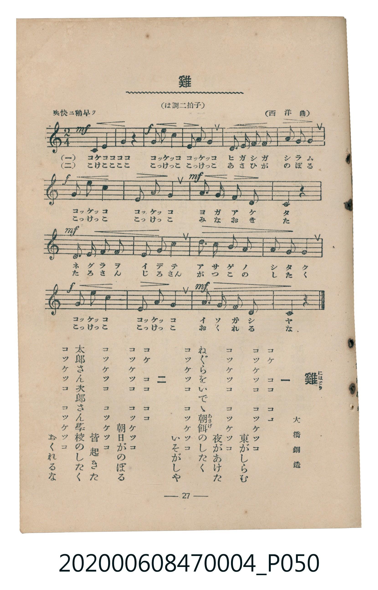

# 雞

> Re:Shōka 使用 AI 協助辨識與重建樂譜，可能會有錯誤。歡迎[回報](https://github.com/TMDLang/reshoka/issues)。

- **鋼琴伴奏版**：<br><audio controls src="niwatori.mp3"></audio>
- **NEUTRINO 歌聲合成版**：<br><audio controls src="niwatori_neutrino.mp3"></audio>

- 詞：大橋銅造
- 曲：西洋曲
- 臺灣教育會公認《新定兒童唱歌》尋常科第四學年用（2020.006.0847.0004）

## 說明

原書資訊與歌詞全文（對應 P050.jpg，書頁 p. 27，第三學期第 2 首）：
調性與拍號：は調二拍子（C 大調 2/4 拍）
速度指示：爽快ニ稍早ク
出處註記：（西洋曲）


## 歌詞

```text
一
コケ　ココ　ココ
コッケッコ　コッケッコ　東がしらむ
コッケッコ　コッケッコ　夜があけた
ねぐらをいでゝ朝餌（あさげ）のしたく
コッケッコ　コッケッコ　いそがしや

二
コケ　ココ　ココ
コッケッコ　コッケッコ　朝日がのぼる
コッケッコ　コッケッコ　皆起きた
太郎さん次郎さん學校のしたく
コッケッコ　コッケッコ　おくれるな
```

## ABC

<div class="abc-score" data-abc-src="niwatori.abc" aria-label="五線譜載入中"></div>

[下載 ABC 原始檔](niwatori.abc)

## TMD 檔案連結

- [主旋律 TMD 檔案](niwatori.tmd) [[在 TMD Studio 編輯](https://tmdlang.github.io/Tmd-TS/#tmd=s7IKdvYPcrWy4qpTUCpJTLdSSM7PyUlNLsnMz7MqzsjMK0nNjM_KTMmPL87Iz05Ugisry88pzU21Si9KTEmNN4k3MjAyiDcwMIs3sDAxBzIMTBBKi_NLi5JTrYqTM_Lzc-JLUitKkvLzsxHyBUX5Zal5iXlANQVFIBtTwIoQClLLMlNSQdKpKZkl-UWZiTlI7kgtKga7FWxJfElRYl5xclFmAcgDCFX5RSUZ-UC3FmRUWmVkFoMMSU7Mic9OzEPyUklGKtBHiXmZucgWAJWmZ-ZZlacWl6QW5cXnpubkp1RiSJckZgIDCBRI5YnxuYmZeTmJeSnoQRBfkJieahVgYGqgxKWlpfBy9jwFLS0uRVsFQ0MjLntbBWcuGyN9EzuQrhcr573fM-vpkuXPVna_7Gp92bAAbNiz2ZuAwi-W7n-2pRvIBou9aN_1vHHxs6kzXzRtejan-Wnrmhereh83dD2btuHpullPWyc9X7306ZSNz9b2PG7ofrqh--mOHc-XT3y-Zs3T2bOfrt3xdOeW51NWvN_TAYpCPWAU6oGiEMgwMHm_p1OJi0tfS8GWWoBLQUHhad_8Z7N3vNjc_mJF14uOdqC7gJ592rri2bR2oCuebuh91t6pAAokvayC9Pd7eoCKXy5oVCjQUzAyB3KBDn-yoxPo8Gdz5gPZCkYKL5dNA7oUGC4g01-s2v-sYTnI3O7eFzPnA0UfN64HCj7Z1QMUebp2AtAOZwVgwALFFIChrQAUBeoGaX3ZMP_prmXPetqfL9kF1Pe8Y-_T_asfN3c_X9H7bPrKx03rwa5v3_Vi5tQXK3a_WDEDqAhoGjw2QMaAlDzZ0QCiHjdtfty08XFDA5ixGc6AyTU3g6RBJEwOVeTZ3I2PG3seN05_3NT5uAluJCFtT5fMAWtretw48XHjfLC2xrWPGyeAjZn0uLHlcePyx01zn82Z-3JJD9D9YKVTHzdOArr_ceM6kIWN8x839hNrIdjEuTCntkCCYFcPVYJgztxn05eCjQa6a8_jpm5idT6f1fZi6_bHjb3QIHi6ZNXL5j6QP5smP1uzEM4GpaMFC8nzdhdQ9eOmHqCrHjeuAmmjPH9AgYKWPheXX2Z5IqigsgrITMzLd6gxqKkGWaJgY2imZQdmYcuZCuD80fBiYY-ChpnC0w39z9c36MCzkyYWDUC7QIbVKFTnptUqGCrogqExlK5RMIWyDOAi1UB1IFHjOCBhCCIg4iA9ZkAM01EDzJwQs0yAJAjXwOXhasCW-xjWQBMLVBiSTuDmoHARDoHEClg5KGIg-oiVbZ4EtWkNEG-HsiD6wLzmlWByAapDjYDyjZOBeQvmUBBnMsJUZC6SQ0HCi8HKgZkSwkDThEe2CWrTVCDeBGb1QGXWgXl7wI7vhjsUf-LY1QNOHCYkJg6i4xycjEBCIEFQpIMSQQ08YcEDBSXiyY_FFZDAAcfiIogyqL792G2ExSDZ0QExF5jngbgLzOqFyszHsJFAPu0kKypAAYyZs0AxAYoFpMgxgjCBIuZAChQneDNgM8gfoBDcAE_9oOQGCsslYF47mGxDihtQiIN0bAVicNJs7oPKQHIUKKyANSeWGICE1eOmXnDCBrFAYQySmQEVByd5iDAs6EHpHiS8BBolkBwAkpkO5oEMBZbKxAU_sP0znHICOI5AYnuhJRkkDkDxCpGhfk4ApX5IgAPrQbCNoEIIJLMKw8ZaLi5dOwVYpaYAZCtzAQA)]
- [鋼琴伴奏 TMD 檔案](niwatori_piano.tmd) [[在 TMD Studio 編輯](https://tmdlang.github.io/Tmd-TS/#tmd=s7IKdvYPcrWy4qpTUCpJTLdSyC8qychPL0osyKi0ysgsLskvykxOzInPTsxLVIIrKs4vLUpOjS9ITE-1CjAwNVDi0tJSeDl73vs9HS-79zyfsOXJni1Pl_Y_7-x4v6dTQUuLS9FWwdDQiMveVsGZy8ZI38QOZNSLlUANs54uWf5sZffLrtaXDQvANjybvQko_GLp_mdbuoFssNiL9l3PGxc_mzrzRdOmZ3Oan7auebGq93FD17NpG56um_W0ddLz1UufTtn4bG3P44bupxu6n-7Y8Xz5xOdr1jydPfvp2h1Pd255PmUF0HVGBkYGegYGZnoGFibmQIaBCdCBSlxcfpnliSCvWgVkJublB3k41BjUVHMpAIGNoZmWHZilr6Vgiw4UgFY82dHwYmGPgoaZwtMN_c_XN-gogIJEL6sgXROLBi19sGE1CtW5abUKhgq6YGgMpWsUTKEsA7hINVAdSNQ4DkgYggiIOEiPGRDDdNQoGEHNMgGSIFwDl4erAVvuY1ij8Lhp8-OmjVBhMGcz3BwULsIhIOHmZrDyjTAGqiY8ss2ToDatAeLtUBZEH5jXvBJMLkB1qBFQvnHy48aJMIeCOJMRpiJzkRwKEl4MVj4RxkDThEe2CWrTVCDeBGb1QGXWgXl7wI7vhjsUf-LY1QNOHCYkJg6i4xycjEBCIEFQpIMSQQ08YcEDBSXiyY_FFZDAAcfiIogyqL792G2ExSDZ0QEx93HjKiDuArN6oTLzMWwkkE87yYoKUABj5ixQTIBiASlyjCBMoIg5kALFCd4M2AzyBygEN8BTPyi5gcJyCZjXDibbkOIGFOIgHVuBGJw0m_ugMpAcBQqrx03rscQAJKweN_WCEzaIBQpjkMwMqDg4yUOEYUEPSvcg4SXQKIHkAJDMdDAPZOjjxn7igh9YEg-nnACOI5DYXmhJBokDULxCZKifE0CpHxLgj5tAUQMphEAyqzBsrEWv03yQ6zQLaJUGDbRow1igJghZA6VBRkFC3zAeLASlgAGKxjeNB7JM42MRDAw1SHFJyDSwg0yAPBNsBoJdhex0IiwHSgFlYmGG0tpxwJDXtVOABX60Dyg0kflGYL4yFwA)]

## 分析

```text
================================================================================
📊 TMD Song Profile: [ 雞 ]
================================================================================
⏱  Duration:       0:19 (19.3s), 18 measures total
🎼 Key & Tempo:    首調基準 C, != 112.0 BPM, <2/4>
   - 分析範圍：      由實際發聲的音符與和弦推測調性；播放脈絡另行呈現
🎤 人聲音域:    C4 (MIDI 60) – E5 (MIDI 76) [跨度: 16 個半音 / 1.3 個八度, 難度: moderate]
   - 最低音:  C4 in [Niwatori #1 @ m.1, 0:00]
   - 最高音: E5 in [Niwatori #1 @ m.3, 0:02]
   - 適合: soprano, mezzo-soprano, contralto, tenor, baritone, bass
🏛  結構:      Niwatori (19.3s)
⚡ 編曲密度:        Peak 1 軌道同時演奏
🗝  調性診斷：       C 大調（純淨自然大調，未偵測到可信轉調）
   - 風格氣質:    純淨自然大調（陽光明朗、易唱易記，無明顯調外色彩）
   - 轉調歷程:    全曲維持單一推測調性（未偵測到可信轉調）
   - 核心骨幹音:  G, C, E, A, D
   - 調性數值:    C 大調 [相關度: 0.93, 穩定度: High, 自然音純度: 100.0%]
   - 候選調性 (K-S): C 大調 (0.93), G 大調 (0.74), E 小調 (0.61)
   - 五度圈歷程:   +0
   - 各段落調性細節:
     • [Niwatori #1]: C 大調 (r: 0.93, 自然音純度: 100.0%)

  [ 五度圈游移軌跡 ]
              [C ]*
         F            G  
      Bb               D  
      Eb               A  
         Ab           E  
            Db       B  
               F# 
     (* = active key center)

  [ 十二半音累積音高分佈 ]
     C  : ██████████████████        22.0%
     C# :                            0.0%
     D  : ████████                   9.8%
     D# :                            0.0%
     E  : █████████████             15.2%
     F  : ████████                   9.1%
     F# :                            0.0%
     G  : ████████████████████████  28.8%
     G# :                            0.0%
     A  : ███████████               13.6%
     A# :                            0.0%
     B  : █                          1.5%
--------------------------------------------------------------------------------
Assignment 軌道音域：
  - Piano         : C4 – E5 (16 個半音 / 1.3 個八度, 52 個音符)
================================================================================
```


## 原書掃描頁




