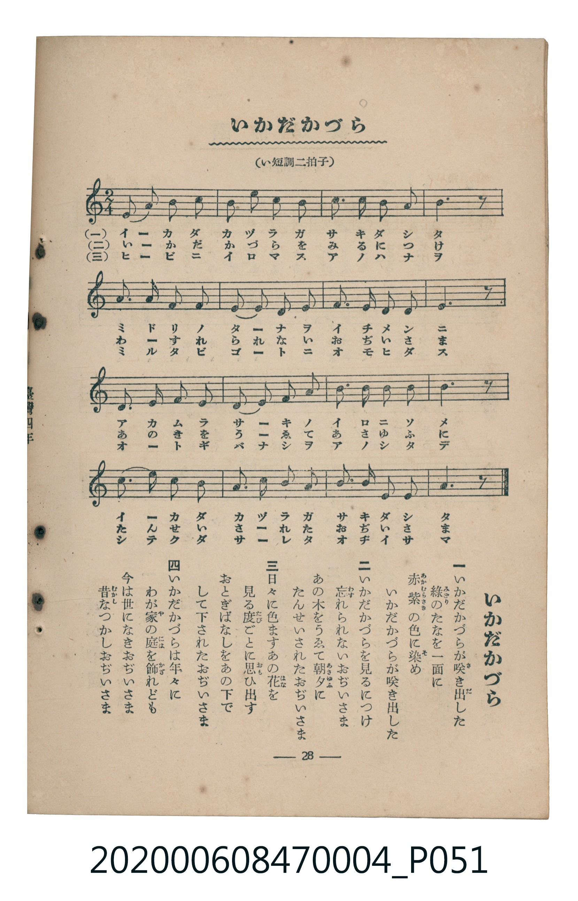

# いかだかづら

> Re:Shōka 使用 AI 協助辨識與重建樂譜，可能會有錯誤。歡迎回報。

- **鋼琴伴奏版**：<br><audio controls src="ikadakazura.mp3"></audio>
- **NEUTRINO 歌聲合成版**：<br><audio controls src="ikadakazura_neutrino.mp3"></audio>

- 臺灣教育會公認《新定兒童唱歌》尋常科第四學年用（2020.006.0847.0004）

## 說明

原書資訊與歌詞全文（對應 P051.jpg，書頁 p. 28，第三學期第 3 首）：
調性與拍號：い短調二拍子（a 小調 2/4 拍）


## 歌詞

```text
一
いかだかづらが咲（さ）き出（だ）した
綠（みどり）のたなを一面（いちめん）に
赤紫（あかむらさき）の色（いろ）に染（そ）め
いかだかづらが咲き出した

二
いかだかづらを見（み）るにつけ
忘（わす）れられないおぢいさま
あの木（き）をうゑて朝夕（あさゆふ）に
たんせいされたおぢいさま

三
日々（ひび）に色（いろ）ますあの花（はな）を
見る度（たび）ごとに思（おも）ひ出（だ）す
おとぎばなしをあの下（した）で
して下（くだ）されたおぢいさま

四
いかだかづらは年々（ねんねん）に
わが家（や）の庭（には）を飾（かざ）れども
今（いま）は世（よ）になきおぢいさま
昔（むかし）なつかしおぢいさま
```

## ABC

<div class="abc-score" data-abc-src="ikadakazura.abc" aria-label="五線譜載入中"></div>

[下載 ABC 原始檔](ikadakazura.abc)

## TMD 檔案連結

- [主旋律 TMD 檔案](ikadakazura.tmd) [[在 TMD Studio 編輯](https://tmdlang.github.io/Tmd-TS/#tmd=s7IKdvYPcrWy4qpTUCpJTLdSSM7PyUlNLsnMz7MqzsjMK0nNjM_KTMmPL87Iz05Ugisry88pzU21Si9KTEmNN4k3MjAyiDcwMIs3sDAxBzIMTBBKi_NLi5JTrYqTM_Lzc-JLUitKkvLzsxHyBUX5Zal5iXlANQVFIBtTwIoQClLLMlNSQdKpKZkl-UWZiTlI7kgtKga7FWxJfElRYl5xclFmAcgDCFUlGalAxxbkJOYhGQs0KT0zz6okMbM8MS8-Py0tMxnF6Pyikox8oAcLMiqtMjKLQTYnJ-bEZyfmIYUD1N6CxPRUqwADU0MlLi0thceNLY8bux83LgCTSx83dSpoaXEp2ipYWHDZ2yo4c2WnVtoqOOZy2Rjpm9iBzHrRvut54-JnU2e-aNr0bE7z09Y1L1b1Pm7oejZtw9N1s562Tnq-eunTKRufre153ND9dEP30x07ni-f-HzNmqezZz9du-Ppzi3Pp6x4v6cDFA96wHjQA8UDkGFg8n5PpxIXl76Wgi21AJeCgsLTvvnPZu94sbn9xYquFx3tQHe9WDnvaeuKZ9Paga54uqH3WXunAig89LIK0t_v6QEqfrmgUaFAT8HIAsgFOvzJjk6gw5_NmQ9kKxgrvFw2DejS93tmgUx_sWr_s4blIHO7e1_MnA8UBYbo8_lrgeJPdvUABZ-unQC0JlHh6YZ-oJgCMBQVgKJAA7hA2p_saABRmLHwuLHn6aRNQJ2PG6cCFT9u7H3avgvMXQDmTn_cOB-k8_k2IB8ouv9x48rHTV1guXVAuceNqx43TQIa_3LuIrACoAULHzc1Pm6aDFazGuz4rUueb1kNlm4C2dzUALZ5KtA2iEEvOiFOaHncBBFZ_Ww-UD9QZC6I29SIz_EQN0OdCvbsrh4c6psmvVjWDfEH2Fyg-OrHjUseN04Ex-D-GSC5pv7HjTPB0j1gPT0gP4LM6nrcuAjMADp8H8QGoHfWPZsDSmZQvzRNetzY9rhp4uPGZc_mzH26BBioEF9PfdzU9rhxKyJQQIHXNPlx42yokSB7gMGJagkk7jpB1LPpSx83tIKNA3p5M8QgjIDbB3Q7xFkvujaCpdYDnQ9xGTgqlgGDv_vprmVgOaB9EIOmPG5cAQr1BmB4A8W7Hjc1gcU3oaaGmRCHA90IVN33uHEDOGimg30NsvPJDkjogqICrGE5RAOQvwwmBwxdiGF4vAzMwrhifD0wY8PCYS04AEEkUrCCoq_n6bpt4KhsgaSvp7vWgjUAI3s9JCxeLt4HFgGaC8plYKcAE3YTOMB3A9M3JCkDFYHsfLIDqAhoXAfEHrCve7EkiGczpoDVNYANng5WDVQKTGAgLhYNlBc9UKCgpc_F5ZmdmJKYnVhVWpRoFZCZmJfvUGNQUw2yR8HG0EzLDszCVu4pgEufhhcLexQ0TEBFyPP1DTrwwkoTiwagdSDDaoDllC4QmimYA0nDOCBRA2Yag5hgPohXA2HC-WZwdTBoABIBG-ljWAOMxCVQ8cdNq0FkcwNYB4zXCiZXguXXQGW2gnlr4aofN22HyuxH2INikRFQsrEFZlFjN5hcANEE5S0FG9QJJidBZUDGAfMQWB7snEaQY0EyE3FYZAyUbAZpB1vUPBlMggyA-fRxM8Td88BG74TKLAKL9YHJfjDZBZFp3oRpEf643dVDTtyCogmETaAYEtsgbASla8DiIDZIBIRhKQJrtDbPB3sDHJ7Nq-DeQ44kiCchXkQkhMfNjUC8EMzaDA0EUABisQcUq02g4ILE6kxwkPZATYPEJIgHzJhgEhT_oLgD2QriL4KKAfMoVGYfdnvAkQrxDzgVgH0AiVyQTVvg_ukAk7DoBtkK4gPtAScJRNIGRTuqPQTyayc5cQqLOVC8QWIQWQQ5Y5qDaUj2xZdVwckUmjFBuQeSMWFZEpKJIckbFtewOF0LDZfHTXshMuAYxhGnjU3gWFkHJnvBumA5sg1uDygHAusaqDhIByQmgZUvmAVyEUgG5FoccQqOIWisNYFta54AdR0kjcCKFkQaBYUAxH9QGXBaAOlox7AHb5wC6z1y4hRcroLLXKQSFxSV4CIXvcA1R8qrEEXY4xVfEQzit2ItgiGxjacIxohXUDMIZlXjbDAJy5SgLAgxEpJlQdmN7MwKdgzI4eCk0LQe6imUhNoM8go8-uCZtQlWToNVgiIWVFKj2lPLxaVrp4BUBSsAucpcAA)]
- [鋼琴伴奏 TMD 檔案](ikadakazura_piano.tmd) [[在 TMD Studio 編輯](https://tmdlang.github.io/Tmd-TS/#tmd=s7IKdvYPcrWy4qpTUCpJTLdSyC8qychPL0osyKi0ysgsLskvykxOzInPTsxLVIIrKs4vLUpOjS9ITE-1CjAwNVTi0tJSeNzY8rix-3HjAjC59HFT5_s9HS-79zyfsOXJni1Pl_Y_7-x4v6dTQUuLS9FWwcKCy95WwZkrO7XSVsExl8vGSN_EDmTBi_ZdzxsXP5s680XTpmdzmp-2rnmxqvdxQ9ezaRuerpv1tHXS89VLn07Z-Gxtz-OG7qcbup_u2PF8-cTna9Y8nT376dodT3dueT5lBdBmIwMjAz0DAzM9AwsTcyDDwARouRIXl2d2YkpidmJVaVGiVUBmYl5-kIdDjUFNNZcCENgYmmnZgVn6Wgq26EABaMuTHQ0vFvYoaJgoPN3Q_3x9g44CKAD0sgrSNbFo0NIHG1ajYKygC4RmCuZA0jAOSNSAmcYgJpgP4tVAmHC-GVwdDBqARMBG-hjWKDxuWgIVf9y0GkQ2N4B1wHitYHIlWH4NVGYrmLcWrvpx03aozH6EPSgWGQElG1tgFjV2g8kFEE1Q3lKwQZ1gchJUBmTc4yaIPNg5jSDHgmQm4rDIGCjZDNIOtqh5MpgEGQDz6eNmiLvngY3eCZVZBBbrA5P9YLILItO8CdMi_HG7q4ecuAVFEwibQDEktkHYCErXgMVBbJAICMNSBNZobZ4P9gY4PJtXwb2HHEkQT0K8iEgIj5sbgXghmLUZGgigAMRiDyhWm0DBBYnVmeAg7YGaBolJEO9xI9h-cPyD4g5kK4i_CCr2uHEqVGYfdnvAkQrxDzgVgH0AiVyQTVvg_ukAk7DoBtkK4gPtAScJRNIGRTuqPQTyayc5cQqLOVC8QWIQWQQ5Y5qDaUj2xZdVwckUmjFBuQeSMWFZEpKJIckbFtewOF0LDZfHTXshMuAYxhGnjU3gWFkHJnvBumA5sg1uDygHPm5cBhUH6YDE5OMmkJrHjSAXgWRArsURp-AYgsZaE9i25glQ10HSCKxoQaRRUAhA_AeVAacFkI52DHvwximwpCcnTsHlKrjMRSpxQVEJLnLRC1xzpLwKUYQ9XvEVwSB-K9YiGBLbeIpgjHid_7gJlGkgUTUbTMIyJSgLQoyEZFlQdiM7s4IdA3I4OCk0rYd6CiWhNoO8Ao8-eGZtgpXTYJWgiAWV1Kj21GKpgX2Qa2ALaAUMDPX4eAXjeBgF5xuBhBBcYzRpEGUA9RBOM-B8qG64ISCGOYRD0BCYQwzjFUwRPKAELgPQnYrQgtcnwCDTtVNACrVoH8NYBXQhI0whY7CQMhcA)]

## 分析

```text
================================================================================
📊 TMD Song Profile: [ いかだかづら ]
================================================================================
⏱  Duration:       0:21 (21.8s), 16 measures total
🎼 Key & Tempo:    首調基準 C, != 88.0 BPM, <2/4>
   - 分析範圍：      由實際發聲的音符與和弦推測調性；播放脈絡另行呈現
🎤 人聲音域:    D4 (MIDI 62) – E5 (MIDI 76) [跨度: 14 個半音 / 1.2 個八度, 難度: moderate]
   - 最低音:  D4 in [Ikadakazura #1 @ m.6, 0:07]
   - 最高音: E5 in [Ikadakazura #1 @ m.2, 0:01]
   - 適合: soprano, mezzo-soprano, contralto, tenor, baritone, bass
🏛  結構:      Ikadakazura (21.8s)
⚡ 編曲密度:        Peak 1 軌道同時演奏
🗝  調性診斷：       A 調性不明確（純淨自然大調，未偵測到可信轉調）
   - 風格氣質:    純淨自然大調（陽光明朗、易唱易記，無明顯調外色彩）
   - 轉調歷程:    全曲維持單一推測調性（未偵測到可信轉調）
   - 核心骨幹音:  B, E, A, C, D
   - 調性數值:    A 調性不明確 [相關度: 0.59, 穩定度: Ambiguous, 自然音純度: 100.0%]
   - 候選調性 (K-S): A 小調 (0.59), E 大調 (0.56), E 小調 (0.54)
   - 五度圈歷程:   +3
   - 各段落調性細節:
     • [Ikadakazura #1]: A 調性不明確 (r: 0.59, 自然音純度: 100.0%)

  [ 五度圈游移軌跡 ]
               C  
         F            G  
      Bb               D  
      Eb              [A ]*
         Ab           E  
            Db       B  
               F# 
     (* = active key center)

  [ 十二半音累積音高分佈 ]
     C  : █████████                 11.7%
     C# :                            0.0%
     D  : █████████                 11.7%
     D# :                            0.0%
     E  : █████████████████         20.8%
     F  : ███████                    9.2%
     F# :                            0.0%
     G  :                            0.0%
     G# :                            0.0%
     A  : █████████████             16.7%
     A# :                            0.0%
     B  : ████████████████████████  30.0%
--------------------------------------------------------------------------------
Assignment 軌道音域：
  - Piano         : D4 – E5 (14 個半音 / 1.2 個八度, 52 個音符)
================================================================================
```


## 原書掃描頁




