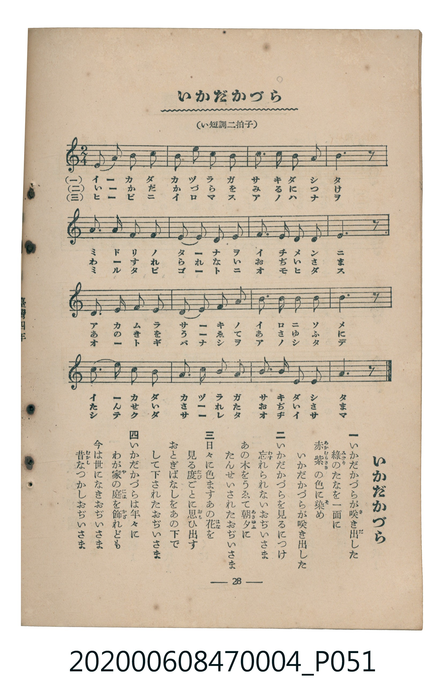

# いかだかづら

<audio controls src="ikadakazura.mp3"></audio>

- 臺灣教育會公認《新定兒童唱歌》尋常科第四學年用（2020.006.0847.0004）

## 說明

原書資訊與歌詞全文（對應 P051.jpg，書頁 p. 28，第三學期第 3 首）：
調性與拍號：い短調二拍子（a 小調 2/4 拍）

## 歌詞

```text
一
いかだかづらが咲（さ）き出（だ）した
綠（みどり）のたなを一面（いちめん）に
赤紫（あかむらさき）の色（いろ）に染（そ）め
いかだかづらが咲き出した

二
いかだかづらを見（み）るにつけ
忘（わす）れられないおぢいさま
あの木（き）をうゑて朝夕（あさゆふ）に
たんせいされたおぢいさま

三
日々（ひび）に色（いろ）ますあの花（はな）を
見る度（たび）ごとに思（おも）ひ出（だ）す
おとぎばなしをあの下（した）で
して下（くだ）されたおぢいさま

四
いかだかづらは年々（ねんねん）に
わが家（や）の庭（には）を飾（かざ）れども
今（いま）は世（よ）になきおぢいさま
昔（むかし）なつかしおぢいさま
```

## ABC

```abc
X:1
T:いかだかづら
C:TMD (Chen, Chih-Han / aguai)
M:2/4
L:1/16
Q:1/4=88
K:Am
V:V1 name="Piano" snm="Pia"
[V:V1]
A,3 B, C2 D2 | E2 F2 E2 D2 | C2 D2 C2 B,2 | A,6 z2 |
E,2 E,2 A,2 B,2 | C2 B,2 A,2 C2 | B,3 A, ^G,2 A,2 | B,6 z2 |
E,2 E,2 A,2 B,2 | C2 B,2 C2 D2 | E3 F E2 D2 | E6 z2 |
C3 D C2 B,2 | A,3 B, C2 D2 | B,3 E, C2 B,2 | A,6 z2 |
```

## TMD 檔案連結

- [主旋律 TMD 檔案](ikadakazura.tmd) [[在 TMD Studio 編輯](https://tmdlang.github.io/Tmd-TS/#tmd=s7IKdvYPcrWy4tLSUnjc2PK4sftx4wIwufRxU6eClhaXoq2ChQWXva2CM1d2aqWtgmMul42RvokdV52C0ov2Xc8bFz-bOvNF06Znc5qftq55sar3cUPXs2kbnq6b9bR10vPVS59O2fhsbc_jhu6nG7qf7tjxfPnE52vWPJ09--naHU93bnk-ZcX7PR1GBkYGegYGZnoGFibmQIaByfs9nUpcXPpaCrbUAlwKCgpP--Y_m73jxeb2Fyu6XnS0A931YuW8p60rnk1rB7ri6YbeZ-2dCgEGpoZ6WQXp7_f0ABW_XNCoUKCnYGQB5AId_mRHJ9Dhz-bMB7IVjBVeLpsGdOn7PbNApr9Ytf9Zw3KQud29L2bOB4oCQ_T5_LVA8Se7eoCCT9dOAFqTqPB0Qz9QTAEYigpAUaABXCDtT3Y0gCjMWHjc2PN00iagzseNU4GKHzf2Pm3fBeYuAHOnP26cD9L5fBuQDxTd_7hx5eOmLrDcOqDc48ZVj5smAY1_OXcRWAHQgoWPmxofN00Gq1kNdvzWJc-3rAZLN4FsbmoA2zwVaBvEoBedECe0PG6CiKx-Nh-oHygyF8RtasTneIiboU4Fe3ZXDw71TZNeLOuG-ANsLlB89ePGJY8bJ4JjcP8MkFxT_-PGmWDpHrCeHpAfQWZ1PW5cBGYAHb4PYgPQO-uezQElM6hfmiY9bmx73DTxceOyZ3PmPl0CDFSIr6c-bmp73LgVESigwGua_LhxNtRIkD3A4ES1BBJ3nSDq2fSljxtawcYBvbwZYhBGwO0Duh3irBddG8FS64HOh7gMHBXLgMHf_XTXMrAc0D6IQVMeN64AhXoDMLyB4l2Pm5rA4ptQU8NMiMOBbgSq7nvcuAEcNNPBvgbZ-WQHJHRBUQHWsByiAchfBpMDhi7EMDxeBmZhXDG-HpixYeGwFhyAIBIpWEHR1_N03TZwVLZA0tfTXWvBGoCRvR4SFi8X7wOLAM0F5TKwU4AJuwkc4LuB6RuSlIGKQHY-2QFUBDSuA2IP2Ne9WBLEsxlTwOoawAZPB6sGKgUmMBAXiwbKix4oUNDS5-LyzE5MScxOrCotSrQKyEzMy3eoMahRqAZZpGBjaKZlB2ZhK_gUwMVPw4uFPQoaJqAy5Pn6Bh14aaWJRQPQPqhhGkCNmlbAgF8CCv7mPUDWajCrAUjWwHmtYHIlOIrWQGW2gnlr4aofN22HyuwHGY4EkK3b1QOyrrEFZl1jNzitLIBohfKWgo3rBJOToDIgQ4GpHywPdlQjyMkgmYl4rNvRCbKuGWQI2LrmyWAWyBiQSyG-hvhhHtiCnVCZRWCxPjDZDya7IDLNm7BbV6NgFq-gC4Tm8QqGQMoIiGuANYGuggkQg2iICEwORAOVgoSgGiHQACQEzki4I3tXD0WR3Twf7CFw-DavgnsUFnWggIJ5GOJdRFA1AvFCMGszNDhAQYkr9CGR3QQOv8aZ4PDtAZMgq0GGgnkQ6xrBDgEnDFCkgi1vXARLKo1ToeL78FgHjWyI78BpBOofUKSDrNuC5LsOMAlLCJBQAFoHTSoNUHFQcsBiHTBiQXEGJsCxB41JeKSCBUG8GggfLGKqDpeCCxMf6Ts6Kcvh4BQNzc8LwCQoP8NzMiRYoPkZlhxg-QMSUI-b9kLEwUkAVyxAc3gTSEPjOjDZC9YMy8ltSNaB8i6wfoHKQPRMBYqD1TSCHAYSBzkal3WQSIdGIDhSm8CWNk-AuhWSjCHWgUooRJKG5XGoODixgHS0Y7eOYKSjZntQxkdke4gI0bENrERpW57jKs3JKMvB-a1pMpA1G8SCZ2FQloU4AZzNweooy9rQ-AOV4-AE0rQeohXq5q1AFsg_8JiEpoomWHiAfQlSDyrrsVgFiUtQlGGWzijFOjTzApMC_mK8lotL104BqWpXAHKVubgA)]
- [鋼琴伴奏 TMD 檔案](ikadakazura_piano.tmd) [[在 TMD Studio 編輯](https://tmdlang.github.io/Tmd-TS/#tmd=s7IKdvYPcrWy4tLSUnjc2PK4sftx4wIwufRxU-f7PR0vu_c8n7DlyZ4tT5f2P-_seL-nU0FLi0vRVsHCgsveVsGZKzu10lbBMZfLxkjfxI6rTkHpRfuu542Ln02d-aJp07M5zU9b17xY1fu4oevZtA1P18162jrp-eqlT6dsfLa253FD99MN3U937Hi-fOLzNWuezp79dO2Opzu3PJ-yAmizkYGRgZ6BgZmegYWJOZBhYAK0XImLyzM7MSUxO7GqtCjRKiAzMS8_yMOhxqBGoZpLAQhsDM207MAsfS0FW3SgALTmyY6GFwt7FDRMFJ5u6H--vkFHIcDA1FAvqyBdE4sGLX2wYTUKZvEKukBoHq9gCKSMgLhGwRhImgAxiIaIwORANFApSAiqEQINQEJc-N23q4cc9xmDrAETYAuhlsPdARYE8WogfLCIqTpcCi5MvDt3dNLAnaiBCwpeROBCRIh2IDA9keNAkAtANmJGIUrcQ4ML6BP8cV2LJcX6oKRYC2iCBWmPBxkIpeB8I5AQgmuMJg2iDIA24TUDzofqhhsCYphDOAQNgTnEEJh0EDygBC4D0J2K0ILXJ8Aw07VTQAo2BUyuMhcXAA)]

## 分析

```text
================================================================================
📊 TMD Song Profile: [ いかだかづら ]
================================================================================
⏱  Duration:       0:21 (21.8s), 16 measures total
🎼 Key & Tempo:    首調基準 C, != 88.0 BPM, <2/4>
   - 分析範圍：      由實際發聲的音符與和弦推測調性；播放脈絡另行呈現
🎤 人聲音域:    E3 (MIDI 52) – F4 (MIDI 65) [跨度: 13 個半音 / 1.1 個八度, 難度: moderate]
   - 最低音:  E3 in [Ikadakazura #1 @ m.5, 0:05]
   - 最高音: F4 in [Ikadakazura #1 @ m.2, 0:01]
   - 適合: contralto, tenor, baritone, bass
🏛  結構:      Ikadakazura (21.8s)
⚡ 編曲密度:        Peak 1 軌道同時演奏
🗝  調性診斷：       A 小調（純淨自然小調，未偵測到可信轉調）
   - 風格氣質:    純淨自然小調（陰鬱抒情、旋律集中，無明顯調外色彩）
   - 轉調歷程:    全曲維持單一推測調性（未偵測到可信轉調）
   - 核心骨幹音:  B, A, E, C, D
   - 調性數值:    A 小調 [相關度: 0.79, 穩定度: High, 自然音純度: 98.3%]
   - 候選調性 (K-S): A 小調 (0.79), A 大調 (0.54), E 小調 (0.52)
   - 五度圈歷程:   +3
   - 各段落調性細節:
     • [Ikadakazura #1]: A 小調 (r: 0.79, 自然音純度: 98.3%, 調外音: G#)

  [ 五度圈游移軌跡 ]
               C  
         F            G  
      Bb               D  
      Eb              [A ]*
         Ab           E  
            Db       B  
               F# 
     (* = active key center)

  [ 十二半音累積音高分佈 ]
     C  : ████████████████████      19.2%
     C# :                            0.0%
     D  : ███████████               10.8%
     D# :                            0.0%
     E  : █████████████████████     20.0%
     F  : ███                        2.5%
     F# :                            0.0%
     G  :                            0.0%
     G# : ██                         1.7%
     A  : ███████████████████████   22.5%
     A# :                            0.0%
     B  : ████████████████████████  23.3%
--------------------------------------------------------------------------------
Assignment 軌道音域：
  - Piano         : E3 – F4 (13 個半音 / 1.1 個八度, 52 個音符)
================================================================================
```


## 原書掃描頁




