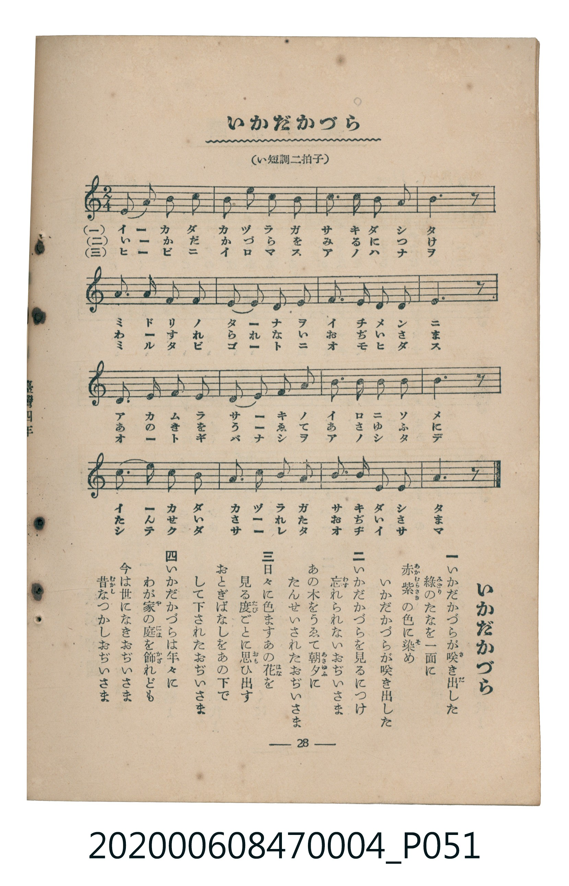

# いかだかづら

> Re:Shōka 使用 AI 協助辨識與重建樂譜，可能會有錯誤。歡迎回報。

- **NEUTRINO 歌聲合成版**：<br><audio controls src="ikadakazura_neutrino.mp3"></audio>
- **鋼琴伴奏版**：<br><audio controls src="ikadakazura.mp3"></audio>


- 臺灣教育會公認《新定兒童唱歌》尋常科第四學年用（2020.006.0847.0004）

## 說明

原書資訊與歌詞全文（對應 P051.jpg，書頁 p. 28，第三學期第 3 首）：
調性與拍號：い短調二拍子（a 小調 2/4 拍）


## 跨冊／重複收錄參照

> 同詞異曲（同採臺灣九重葛題材歌詞「みどりの葉かげにむらさきの…」；《公學校唱歌》第四學年為 F 大調 3/4 拍，《新定兒童唱歌》第四學年為 a 小調 2/4 拍）

- **[同詞異曲]** 《公學校唱歌》第四學年用（昭和12年／1937）：[**〈いかだかづら〉**](../../../kogakko_shoka/grade_4/15_ikadakazura/index.md)（`F` / `3/4` — [原始 TMD](../../../kogakko_shoka/grade_4/15_ikadakazura/ikadakazura.tmd)）
- 總表：[跨冊重複與同名歌曲總索引](../../../duplicate_songs.md)

## 歌詞

```text
一
いかだかづらが咲（さ）き出（だ）した
綠（みどり）のたなを一面（いちめん）に
赤紫（あかむらさき）の色（いろ）に染（そ）め
いかだかづらが咲き出した

二
いかだかづらを見（み）るにつけ
忘（わす）れられないおぢいさま
あの木（き）をうゑて朝夕（あさゆふ）に
たんせいされたおぢいさま

三
日々（ひび）に色（いろ）ますあの花（はな）を
見る度（たび）ごとに思（おも）ひ出（だ）す
おとぎばなしをあの下（した）で
して下（くだ）されたおぢいさま

四
いかだかづらは年々（ねんねん）に
わが家（や）の庭（には）を飾（かざ）れども
今（いま）は世（よ）になきおぢいさま
昔（むかし）なつかしおぢいさま
```

## ABC

```abc
X:1
T:いかだかづら
M:2/4
L:1/16
Q:1/4=88
K:Am
V:V1 name="Piano" snm="Pia"
[V:V1]
E3 A B2 c2 | B2 e2 c2 B2 | c2 c2 B2 A2 | B6 z2 |
w: 1.~イ _ カ ダ | カ ヅ ラ ガ | サ キ ダ シ | タ
w: 2.~い _ か だ | か づ ら を | み る に つ | け
w: 3.~ヒ _ ビ ニ | イ ロ マ ス | ア ノ ハ ナ | ヲ
A2 A2 F2 F2 | E2 E2 D2 E2 | F3 E D2 D2 | E6 z2 |
w: 1.~ミ ド リ ノ | タ _ ナ ヲ | イ チ メ ン | ニ
w: 2.~わ _ す れ | ら れ な い | お ぢ い さ | ま
w: 3.~ミ ル タ ビ | ゴ _ ト ニ | オ モ ヒ ダ | ス
D2 E2 F2 E2 | D2 E2 F2 A2 | B3 B B2 B2 | B6 z2 |
w: 1.~ア カ ム ラ | サ _ キ ノ | イ ロ ニ ソ | メ
w: 2.~あ の き を | う _ ゑ て | あ さ ゆ ふ | に
w: 3.~オ ト ギ バ | ナ _ シ ヲ | ア ノ シ タ | デ
c3 e c2 B2 | A3 c B2 A2 | B3 B D2 D2 | A6 z2 |
w: 1.~イ _ カ ダ | カ ヅ ラ ガ | サ キ ダ シ | タ
w: 2.~たん _ せ い | さ _ れ た | お ぢ い さ | ま
w: 3.~シ テ _ _ | サ _ レ タ | オ ヂ イ サ | マ
```

## TMD 檔案連結

- [主旋律 TMD 檔案](ikadakazura.tmd) [[在 TMD Studio 編輯](https://tmdlang.github.io/Tmd-TS/#tmd=s7IKdvYPcrWy4qpTUCpJTLdSSM7PyUlNLsnMz7MqzsjMK0nNjM_KTMmPL87Iz05Ugisry88pzU21Si9KTEmNN4k3MjAyiDcwMIs3sDAxBzIMTBBKi_NLi5JTrYqTM_Lzc-JLUitKkvLzsxHyBUX5Zal5iXlANQVFIBtTwIoQClLLMlNSQdKpKZkl-UWZiTlI7kgtKga7FWxJfElRYl5xclFmAcgDCFUlGalAxxbkJOYBjdXSUnjc2PK4sftx4wIwufRxU6eClhaXoq2ChQWXva2CM1d2aqWtgmMul42RvokdyJgX7bueNy5-NnXmi6ZNz-Y0P21d82JV7-OGrmfTNjxdN-tp66Tnq5c-nbLx2dqexw3dTzd0P92x4_nyic_XrHk6e_bTtTue7tzyfMqK93s6QAGlBwwoPVBAARkGJu_3dCpxcelrKdhSC3ApKCg87Zv_bPaOF5vbX6zoetHRDnTXi5XznraueDatHeiKpxt6n7V3KgQYmBrqZRWkv9_TA1T8ckGjQoGegpEFkAt0-JMdnUCHP5szH8hWMFZ4uWwa0KXv98wCmf5i1f5nDctB5nb3vpg5HygKDNHn89cCxZ_s6gEKPl07AWhNosLTDf1AMQVgKCoARYEGcIG0P9nRAKIwY-FxY8_TSZuAOh83TgUqftzY-7R9F5i7AMyd_rhxPkjn821APlB0_-PGlY-busBy64ByjxtXPW6aBDT-5dxFYAVACxY-bmp83DQZrGY12PFblzzfshos3QSyuakBbPNUoG0Qg150QpzQ8rgJIrL62XygfqDIXBC3qRGf4yFuhjoV7NldPTjUN016sawb4g-wuUDx1Y8blzxunAiOwf0zQHJN_Y8bZ4Kle8B6ekB-BJnV9bhxEZgBdPg-iA1A76x7NgeUzKB-aZr0uLHtcdPEx43Lns2Z-3QJMFAhvp76uKntceNWRKCAAq9p8uPG2VAjQfYAgxPVEkjcdYKoZ9OXPm5oBRsH9PJmiEEYAbcP6HaIs150bQRLrQc6H-IycFQsAwZ_99Ndy8ByQPsgBk153LgCFOoNwPAGinc9bmoCi29CTQ0zIQ4HuhGouu9x4wZw0EwH-xpk55MdkNAFRQVYw3KIBiB_GUwOGLoQw_B4GZiFccX4emDGhoXDWnAAgkikYAVFX8_TddvAUdkCSV9Pd60FawBG9npIWLxcvA8sAjQXlMvATgEm7CZwgO8Gpm9IUgYqAtn5ZAdQEdC4Dog9YF_3YkkQz2ZMAatrABs8HawaqBSYwEBcLBooL3qgQEFLn4vLMzsxJTE7saq0KNEqIDMxL9-hxqCmGmSPgo2hmZYdmIWt3FMAlz4NLxb2KGiYgIqQ5-sbdOCFlSYWDUDrQIbVAMspXSA0UzAHkoZxQKIGzDQGMcF8EK8GwoTzzeDqYNAAJAI20sewBhiJS6Dij5tWg8jmBrAOGK8VTK4Ey6-BymwF89bCVT9u2g6V2Y-wB8UiI6BkYwvMosZuMLkAognKWwo2qBNMToLKgIwD5iGwPNg5jSDHgmQm4rDIGCjZDNIOtqh5MpgEGQDz6eNmiLvngY3eCZVZBBbrA5P9YLILItO8CdMi_HG7q4ecuAVFEwibQDEktkHYCErXgMVBbJAICMNSBNZobZ4P9gY4PJtXwb2HHEkQT0K8iEgIj5sbgXghmLUZGgigAMRiDyhWm0DBBYnVmeAg7YGaBolJEA-YMcEkKP5BcQeyFcRfBBUD5lGozD7s9oAjFeIfcCoA-wASuSCbtsD90wEmYdENshXEB9oDThKIpA2KdlR7COTXTnLiFBZzoHiDxCCyCHLGNAfTkOyLL6uCkyk0Y4JyDyRjwrIkJBNDkjcsrmFxuhYaLo-b9kJkwDGMI04bm8Cxsg5M9oJ1wXJkG9weUA4E1jVQcZAOSEwCK18wC-QikAzItTjiFBxD0FhrAtvWPAHqOkgagRUtiDQKCgGI_6Ay4LQA0tGOYQ_eOAXWe-TEKbhcBZe5SCUuKCrBRS56gWuOlFchirDHK74iGMRvxVoEQ2IbTxGMEa-gZhDMqsbZYBKWKUFZEGIkJMuCshvZmRXsGJDDwUmhaT3UUygJtRnkFXj0wTNrE6ycBqsERSyopEa1p5aLS9dOAakKVgBylbkA)]
- [鋼琴伴奏 TMD 檔案](ikadakazura_piano.tmd) [[在 TMD Studio 編輯](https://tmdlang.github.io/Tmd-TS/#tmd=s7IKdvYPcrWy4tLSUnjc2PK4sftx4wIwufRxU-f7PR0vu_c8n7DlyZ4tT5f2P-_seL-nU0FLi0vRVsHCgsveVsGZKzu10lbBMZfLxkjfxI6rTkHpRfuu542Ln02d-aJp07M5zU9b17xY1fu4oevZtA1P18162jrp-eqlT6dsfLa253FD99MN3U937Hi-fOLzNWuezp79dO2Opzu3PJ-yAmizkYGRgZ6BgZmegYWJOZBhYAK0XImLyzM7MSUxO7GqtCjRKiAzMS8_yMOhxqCmmksBCGwMzbTswCx9LQVbdKAAtOXJjoYXC3sUNEwUnm7of76-QUchwMDUUC-rIF0TiwYtfbBhNQrGCrpAaKZgDiQN44BEDZhpDGKC-SBeDYQJ55vB1cGgAUgEbKSPYY3C46YlUPHHTatBZHMDWAeM1womV4Ll10BltoJ5a-GqHzdth8rsR9iDYpERULKxBWZRYzeYXADRBOUtBRvUCSYnQWVAxj1ugsiDndMIcixIZiIOi4yBks0g7WCLmieDSZABMJ8-boa4ex7Y6J1QmUVgsT4w2Q8muyAyzZswLcIft7t6yIlbUDSBsAkUQ2IbhI2gdA1YHMQGiYAwLEVgjdbm-WBvgMOzeRXce8iRBPEkxIuIhPC4uRGIF4JZm6GBAApALPaAYrUJFFyQWJ0JDtIeqGmQmATxHjeC7QfHPyjuQLaC-IugYo8bp0Jl9mG3BxypEP-AUwHYB5DIBdm0Be6fDjAJi26QrSA-0B5wkkAkbVC0o9pDIL92khOnsJgDxRskBpFFkDOmOZiGZF98WRWcTKEZE5R7IBkTliUhmRiSvGFxDYvTtdBwedy0FyIDjmEccdrYBI6VdWCyF6wLliPb4PaAcuDjxmVQcZAOSEw-bgKpedwIchFIBuRaHHEKjiForDWBbWueAHUdJI3AihZEGgWFAMR_UBlwWgDpaMewB2-cAkt6cuIUXK6Cy1ykEhcUleAiF73ANUfKqxBF2OMVXxEM4rdiLYIhsY2nCMaI1_mPm0CZBhJVs8EkLFOCsiDESEiWBWU3sjMr2DEgh4OTQtN6qKdQEmozyCvw6INn1iZYOQ1WCYpYUEmNak8tlhrYB7kGtoBWwMBQj49XMI6HUXC-EUgIwTVGkwZRBlAP4TQDzofqhhsCYphDOAQNgTnEMF7BFMEDSuAyAN2pCC14fQIMMl07BaRQi_YxjFVAFzLCFDIGCylzAQA)]

## 分析

```text
================================================================================
📊 TMD Song Profile: [ いかだかづら ]
================================================================================
⏱  Duration:       0:21 (21.8s), 16 measures total
🎼 Key & Tempo:    首調基準 C, != 88.0 BPM, <2/4>
   - 分析範圍：      由實際發聲的音符與和弦推測調性；播放脈絡另行呈現
🎤 人聲音域:    D4 (MIDI 62) – E5 (MIDI 76) [跨度: 14 個半音 / 1.2 個八度, 難度: moderate]
   - 最低音:  D4 in [Ikadakazura #1 @ m.6, 0:07]
   - 最高音: E5 in [Ikadakazura #1 @ m.2, 0:01]
   - 適合: soprano, mezzo-soprano, contralto, tenor, baritone, bass
🏛  結構:      Ikadakazura (21.8s)
⚡ 編曲密度:        Peak 1 軌道同時演奏
🗝  調性診斷：       A 調性不明確（純淨自然大調，未偵測到可信轉調）
   - 風格氣質:    純淨自然大調（陽光明朗、易唱易記，無明顯調外色彩）
   - 轉調歷程:    全曲維持單一推測調性（未偵測到可信轉調）
   - 核心骨幹音:  B, E, A, C, D
   - 調性數值:    A 調性不明確 [相關度: 0.59, 穩定度: Ambiguous, 自然音純度: 100.0%]
   - 候選調性 (K-S): A 小調 (0.59), E 大調 (0.56), E 小調 (0.54)
   - 五度圈歷程:   +3
   - 各段落調性細節:
     • [Ikadakazura #1]: A 調性不明確 (r: 0.59, 自然音純度: 100.0%)

  [ 五度圈游移軌跡 ]
               C  
         F            G  
      Bb               D  
      Eb              [A ]*
         Ab           E  
            Db       B  
               F# 
     (* = active key center)

  [ 十二半音累積音高分佈 ]
     C  : █████████                 11.7%
     C# :                            0.0%
     D  : █████████                 11.7%
     D# :                            0.0%
     E  : █████████████████         20.8%
     F  : ███████                    9.2%
     F# :                            0.0%
     G  :                            0.0%
     G# :                            0.0%
     A  : █████████████             16.7%
     A# :                            0.0%
     B  : ████████████████████████  30.0%
--------------------------------------------------------------------------------
Assignment 軌道音域：
  - Piano         : D4 – E5 (14 個半音 / 1.2 個八度, 52 個音符)
================================================================================
```


## 原書掃描頁




