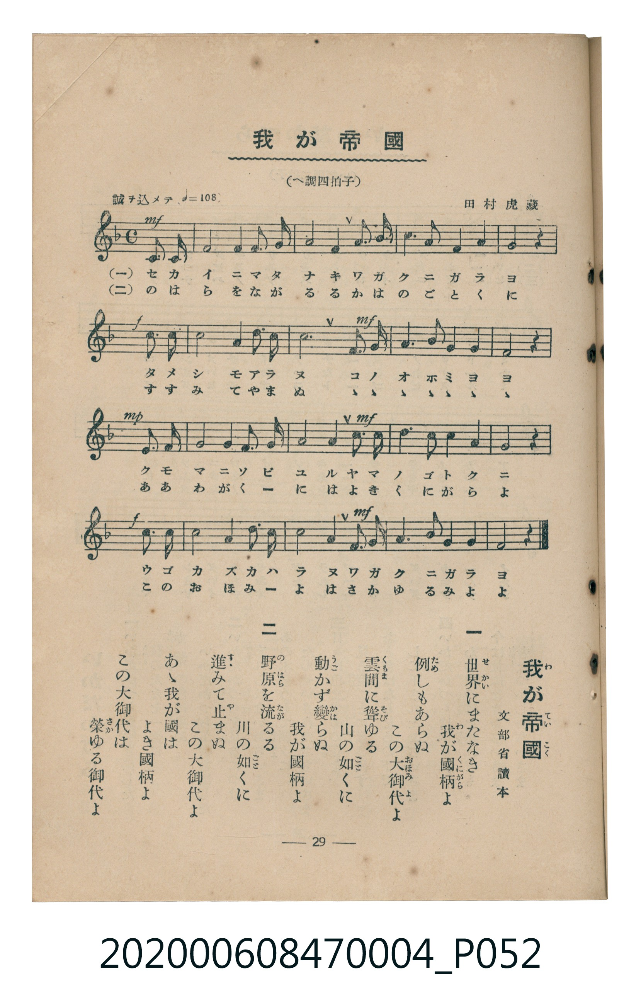

# 我が帝國

<audio controls src="waga_teikoku.mp3"></audio>

- 詞：文部省讀本
- 曲：田村虎藏
- 臺灣教育會公認《新定兒童唱歌》尋常科第四學年用（2020.006.0847.0004）

## 說明

原書資訊與歌詞全文（對應 P052.jpg，書頁 p. 29，第三學期第 4 首）：
調性與拍號：へ調四拍子（F 大調 4/4 拍，弱起一拍）
速度指示：誠ヲ込メテ（♩=108）

## 歌詞

```text
一
世界（せかい）にまたなき我が國柄（くにがら）よ
例（ため）しもあらぬこの大御代（おほみよ）よ
雲間（くもま）に聳（そび）ゆる山の如（ごと）くに
動（うご）かず變（かは）らぬ我が國柄よ

二
野原（のはら）を流（なが）るる川の如（ごと）くに
進（すゝ）みて止（や）まぬこの大御代よ
あゝ我が國はよき國柄よ
この大御代は榮（さか）ゆる御代よ
```

## ABC

```abc
X:1
T:我が帝國
C:曲：田村虎藏
M:4/4
L:1/16
Q:1/4=108
K:F
V:V1 name="Piano" snm="Pia"
[V:V1]
!mf! z4 z4 z4 C3 C | F8 F4 F3 G | A8 A4 G3 A | c6 A2 G4 A4 |
!f! G8 z4 c3 c | d8 A4 d3 c | !mf! c12 c3 A | G6 A2 G4 F4 |
!mp! D4 C4 z4 C3 C | F8 F4 D3 F | !mf! G8 G4 c3 c | d6 c2 A4 G4 |
!f! A8 A4 c3 c | d8 A4 d3 c | !mf! c8 A4 G3 A | F6 G2 A4 G4 |
F8 z4 z4 |
```

## TMD 檔案連結

- [主旋律 TMD 檔案](waga_teikoku.tmd) [[在 TMD Studio 編輯](https://tmdlang.github.io/Tmd-TS/#tmd=s7IKdvYPcrWy4tLSUnjWMfFxY8_THXOfzulW0NLiUrRVMDSw4LK3VXDjsjHRN7HjqlNQerFy3vs9s55Na3_ZvOL5nMYX6xqezVmjBJJ5NnsTUOb5lA3P5k58MbPvxfR-sPCL9l3PGxc_mzrzRdOmZ3Oan7auebGq93FD17NpG56um_W0ddLz1UufTtn4bG3P44bupxu6n-7Y8Xz5xOdr1jydPfvp2h1Pd255PmXF-z0dRgZGBnoGBmZ6BhYm5kCGgcn7PZ1KXFz6Wgq21AJcCgoKT_vmP5u948Xm9hcrul50tAPdBfTy09YVQC8DXfF0Q--z9k6FAANTI72sgvT3e3qAil8uaFQo0FMwsgRygQ5_sqMT6PBnc-YD2QomCi-XTQO6FBg0INNfrNr_rGE5yNzu3hcz5wNFHzfuAAoCPQsUebp2AtAON4WnS5YDxRSAYa4AFAWa-nTPxhdbtz_Z0QDmdoJMetkw_-muZc962p8v2QU05sWqBY-bN73Yt-dx88LHzW1AYx7NXGkLjD-QcpB6oGYINe351B6g9OPG2Y8bux83tgAVPG5c_bhx3-PG-Y8bVz1u7IUmhDndz-YDZYEq-8EKeh43Ab3R-bipA2zQvm6w3PzHTY1gI6Y_bmp63NgEVPS4cc3jxsmPG9cB_fF038InuxeDVXY9btz9uHE_UD_ClJezN72cNhlqCUj_PohzXjRuBgvOfQxiAFW3PW7qfrpxI8jQZU1gqSmPG4HpAqgY5DpwzHVPBUu0AeXAEkDfzXqxrgssCGSvBxsEch2yB0EOAftnVw_YQe19wBQA1rIOqAXm5UnPtgJ9CRQEhg8w9IAi3SAHbQe6D7eDXjYAcwRQYubjprlgif2PG5c9W7sIJNgECXdgoKOHFTRkwEE5F-5SsFuAZvUiXA1WhKq1cf2zZevAdk4FehkRcMgGU55NoEBBS5-LKzwxPTEkNTM7P7vUKiAzMS_focagRqEaZJGCjaGZlh2YhS2TKoCzSsOLhT0KGpD0raANzC5PN_Q_X9-gA89imlh0Ai2GmqoBNEHTCsTBCh437QaTqxVqgOQSdNnmbjhrHljdfpC65i4MU9bC1a0H89eAzQOxkU0CicP4K6EskHkr0MxDmLsfrHYhiod29eDzUOM6MLke7IBODAMnwdWtApM9YHUwbyLUwT3eCHY4xDyw2TDxKWAS5nRgooayQOpWo5mH0DUTSkI9VKNgoKALhuh0dW5arYJpPJgNpGoUDKESMAjjQ2gjoApjNBUwvhGUV6NgiiYLkUGorIGLwCDcOSDXQByjUAMuD3Cn2V094DRLZlJ93LQdPdSaF8FYTSAWKPGAkk0PrlBu2gxW1QeOW1A8w8yZDSbnw_mw2ENOhI-b92CYB07UQFdgJENgkYWuuHEZXFsLmL8PnCRgKR8dAEsoMLkOrAqRs4B1AZiEmQ8snKAskKdgbCyObWyCkvAkZoYjXUDEgfGJki6QISQRwpMPcuJATj6wpAi0CpJgwUkWLQHlFqCkZwJpaEcnRWkIXFyhBAuiKGvaC-ZPBsc6LLIQ6mB593EzqDgEmQRS14dQ0bQFLA6PAngxB1KHXpIgdIFsAunFTENNsKIDrhhYLMFYIDlQLGMrVkDFEsx4kHOAtR9YHcI8iB4k8-BFInIqQgeINAlPQ7hKH2iEG2IpOmB8pEQESmvIqREkilpKgRIRrnKMhDII2FykrAzCCOqmXXAWOEib-8HxDavG4OrgpRJ1q0IYwFICYdTG4JIDwoLUn-DUgxHbSKmncSqY7Aara0OoAFeDhMogXICC8gce46Ckg6i-kBMhSBQz6aAnU_RatYarlotL104BqVWmAOQqc3EBAA)]
- [鋼琴伴奏 TMD 檔案](waga_teikoku_piano.tmd) [[在 TMD Studio 編輯](https://tmdlang.github.io/Tmd-TS/#tmd=s7IKdvYPcrWy4tLSUnjWMfFxY8_THXOfzul-v6fjZfee5xO2PNmz5enS_uedHe_3dCpoaXEp2ioYGlhw2dsquHHZmOib2HHVKSi9WDnv_Z5Zz6a1v2xe8XxO44t1Dc_mrFECyTybvQko83zKhmdzJ76Y2fdiej9Y-EX7rueNi59NnfmiadOzOc1PW9e8WNX7uKHr2bQNT9fNeto66fnqpU-nbHy2tudxQ_fTDd1Pd-x4vnzi8zVrns6e_XTtjqc7tzyfsgLoRiMDIwM9AwMzPQMLE3Mgw8AE6EwlLq7wxPTEkNTM7PzsUquAzMS8_CAPhxqDGoVqLgUgsDE007IDs_S1FGzRgQLQmic7Gl4s7FHQeLpn44ut2xW0FUwUnm7of76-QUchwMDUSC-rIF0Ti04tfbCpNQoGCrpgiE5X56bVKpjGg9lAqkbBECoBgzA-hDYCqjBGUwHjG0F5NQqmaLIQGYTKGrgIDMKdA3INxDEKNVz4Q2RXDzhESAwIMxyuh4gDbUVxPTKEBBXck8heQPYkLMCAVkGCFRywaN7MLUAJdQI-3dFJjk9xxSTUWYZYogHGR_IqKESQwwwkihrjIK_iShMkxCcwI9EnPuFuA3kSkWiRgwskiulJ9ABFz0s1XLVYMroPSkY3geZzUI6EQKAUyCGG8QrRhrEwCmgZgm8ajyRgGg9TAWaB5AzAwQwWhJptApQxgWgGUnC9IAy2DM0AhJkgjUAG0ERQCgU6DpaWEK4xi8_F0IxkKJLVEHebgRSCNUFIIt0KpCCmopsCMdkcSSk4FEFhr2ungBT8CphcZS4uAA)]

## 分析

```text
================================================================================
📊 TMD Song Profile: [ 我が帝國 ]
================================================================================
⏱  Duration:       0:37 (37.8s), 17 measures total
🎼 Key & Tempo:    首調基準 F, != 108.0 BPM, <4/4>
   - 分析範圍：      由實際發聲的音符與和弦推測調性；播放脈絡另行呈現
🎤 人聲音域:    C4 (MIDI 60) – D5 (MIDI 74) [跨度: 14 個半音 / 1.2 個八度, 難度: moderate]
   - 最低音:  C4 in [WagaTeikoku #1 @ m.1, 0:01]
   - 最高音: D5 in [WagaTeikoku #1 @ m.6, 0:11]
   - 適合: soprano, mezzo-soprano, contralto, tenor, baritone, bass
🏛  結構:      WagaTeikoku (37.8s)
⚡ 編曲密度:        Peak 1 軌道同時演奏
🗝  調性診斷：       C 調性不明確（純淨自然大調，未偵測到可信轉調）
   - 風格氣質:    純淨自然大調（陽光明朗、易唱易記，無明顯調外色彩）
   - 轉調歷程:    全曲維持單一推測調性（未偵測到可信轉調）
   - 核心骨幹音:  C, A, G, F, D
   - 調性數值:    C 調性不明確 [相關度: 0.77, 穩定度: Ambiguous, 自然音純度: 100.0%]
   - 候選調性 (K-S): C 大調 (0.77), F 大調 (0.76), A 小調 (0.67)
   - 五度圈歷程:   +0
   - 各段落調性細節:
     • [WagaTeikoku #1]: C 調性不明確 (r: 0.77, 自然音純度: 100.0%)

  [ 五度圈游移軌跡 ]
              [C ]*
         F            G  
      Bb               D  
      Eb               A  
         Ab           E  
            Db       B  
               F# 
     (* = active key center)

  [ 十二半音累積音高分佈 ]
     C  : ████████████████████████  23.4%
     C# :                            0.0%
     D  : ███████████████           14.3%
     D# :                            0.0%
     E  :                            0.0%
     F  : ███████████████████       18.9%
     F# :                            0.0%
     G  : █████████████████████     20.9%
     G# :                            0.0%
     A  : ███████████████████████   22.5%
     A# :                            0.0%
     B  :                            0.0%
--------------------------------------------------------------------------------
Assignment 軌道音域：
  - Piano         : C4 – D5 (14 個半音 / 1.2 個八度, 61 個音符)
================================================================================
```


## 原書掃描頁




