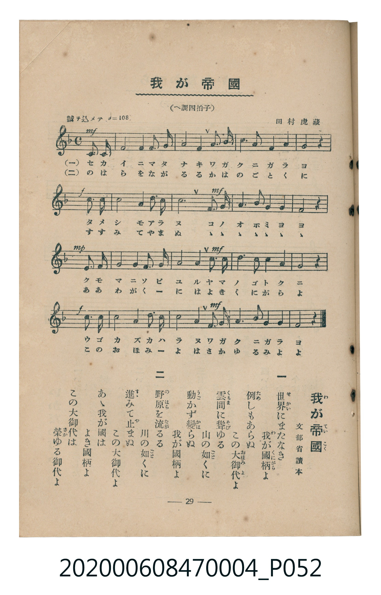

# 我が帝國

> Re:Shōka 使用 AI 協助辨識與重建樂譜，可能會有錯誤。歡迎回報。

- **NEUTRINO 歌聲合成版**：<br><audio controls src="waga_teikoku_neutrino.mp3"></audio>
- **鋼琴伴奏版**：<br><audio controls src="waga_teikoku.mp3"></audio>


- 詞：文部省讀本
- 曲：田村虎藏
- 臺灣教育會公認《新定兒童唱歌》尋常科第四學年用（2020.006.0847.0004）

## 說明

原書資訊與歌詞全文（對應 P052.jpg，書頁 p. 29，第三學期第 4 首）：
調性與拍號：へ調四拍子（F 大調 4/4 拍，弱起一拍）
速度指示：誠ヲ込メテ（♩=108）


## 跨冊／重複收錄參照

> 同曲（《公學校唱歌》、《新定兒童唱歌》共同收錄教材）

- **[同曲]** 《公學校唱歌》第四學年用（昭和12年／1937）：[**〈我が帝國〉**](../../../kogakko_shoka/grade_4/20_waga_teikoku/index.md)（`F` / `4/4` — [原始 TMD](../../../kogakko_shoka/grade_4/20_waga_teikoku/waga_teikoku.tmd)）
- 總表：[跨冊重複與同名歌曲總索引](../../../duplicate_songs.md)

## 歌詞

```text
一
世界（せかい）にまたなき我が國柄（くにがら）よ
例（ため）しもあらぬこの大御代（おほみよ）よ
雲間（くもま）に聳（そび）ゆる山の如（ごと）くに
動（うご）かず變（かは）らぬ我が國柄よ

二
野原（のはら）を流（なが）るる川の如（ごと）くに
進（すゝ）みて止（や）まぬこの大御代よ
あゝ我が國はよき國柄よ
この大御代は榮（さか）ゆる御代よ
```

## ABC

```abc
X:1
T:我が帝國
C:曲：田村虎藏
M:4/4
L:1/16
Q:1/4=108
K:F
V:V1 name="Piano" snm="Pia"
[V:V1]
!mf! z12 C3 C | F8 F4 F3 G | A8 F4 A3 c | d6 A2 F4 A4 |
w: 1.~せ か | い に ま た | な き わ が | く に が ら
w: 2.~の は | ら を な が | る る か は | の ご と く
!f! G8 z4 c3 c | c8 A4 d3 c | !mf! c12 F3 G | A6 c2 A4 A4 |
w: 1.~よ た め | し も あ ら | ぬ こ の | お ほ み よ
w: 2.~に す す | み て や ま | ぬ こ の | お ほ み よ
!mp! F8 z4 E3 F | G8 G4 F3 G | !mf! A8 A4 c3 c | d6 c2 c4 A4 |
w: 1.~よ く も | ま に そ び | ゆ る や ま | の ご と く
w: 2.~よ あ あ | わ が く _ | に は よ き | く に が ら
!f! G8 z4 c3 c | c8 A4 d3 c | !mf! c8 A4 F3 G | A6 c2 A4 A4 |
w: 1.~に う ご | か ず か は | ら ぬ わ が | く に が ら
w: 2.~よ こ の | お ほ み _ | よ は さ か | ゆ る み よ
F8 z8 |
w: 1.~よ
w: 2.~よ
```

## TMD 檔案連結

- [主旋律 TMD 檔案](waga_teikoku.tmd) [[在 TMD Studio 編輯](https://tmdlang.github.io/Tmd-TS/#tmd=s7IKdvYPcrWy4qpTUCpJTLdSSM7PyUlNLsnMz7MqzsjMK0nNjM_KTMmPL87Iz05Ugisry88pzU21Si9KTEmNN4k3MjAyiDcwMIs3sDAxBzIMTBBKi_NLi5JTrYqTM_Lzc-JLUitKkvLzsxHyBUX5Zal5iXlANQVFIBtTwIoQClLLMlNSQdKpKZkl-UWZiTlI7kgtKga7FWxJfElRYl5xclFmAcgDCFUlGalAx2bmFqRCdGtpKTzrmPi4sefpjrlP53QraGlxKdoqGBpYcNnbKrhx2Zjom9iBNL9YOe_9nlnPprW_bF7xfE7ji3UNz-asARv7bPYmoMzzKRuezZ34Ymbfi-n9YOEX7bueNy5-NnXmi6ZNz-Y0P21d82JV7-OGrmfTNjxdN-tp66Tnq5c-nbLx2dqexw3dTzd0P92x4_nyic_XrHk6e_bTtTue7tzyfMqK93s6QOGpBwxPPVB4AhkGJu_3dCpxcelrKdhSC3ApKCg87Zv_bPaOF5vbX6zoetHRDnQX0MtPW1cAvQx0xdMNvc_aOxUCDEyN9LIK0t_v6QEqfrmgUaFAT8HIEsgFOvzJjk6gw5_NmQ9kK5govFw2DehSYNCATH-xav-zhuUgc7t7X8ycDxR93LgDKAj0LFDk6doJQDvcFJ4uWQ4UUwCGuQJQFGjq0z0bX2zd_mRHA5jbCTLpZcP8p7uWPetpf75kF9CYF6sWPG7e9GLfnsfNCx83twGNeTRzpS0w_kDKQeqBmiHUtOdTe4DSjxtnP27sftzYAlTwuHH148Z9jxvnP25c9bixF5oQ5nQ_mw-UBarsByvoedwE9Ebn46YOsEH7usFy8x83NYKNmP64qelxYxNQ0ePGNY8bJz9uXAf0x9N9C5_sXgxW2fW4cffjxv1A_QhTXs7e9HLaZKglIP37IM550bgZLDj3MYgBVN32uKn76caNIEOXNYGlpjxuBKYLoGKQ68Ax1z0VLNEGlANLAH0368W6LrAgkL0ebBDIdcgeBDkE7J9dPWAHtfcBUwBYyzqgFpiXJz3bCvQlUBAYPsDQA4p0gxy0Heg-3A562QDMEUCJmY-b5oIl9j9uXPZs7SKQYBMk3IGBjh5W0JABB-VcuEvBbgGa1YtwNVgRqtbG9c-WrQPbORXoZUTAIRtMeTaBAgUtfS6u8MT0xJDUzOz87FKrgMzEvHyHGl3DmmqQRQo2hmZadmAWtkyqAM4qDS8W9ihoQNK3gjYwuzzd0P98fYMOPItpYtEJtBhqqgbQBE0rEAcreNy0G0yuVqgBkkvQZZu74ax5YHX7QeqauzBMWQtXtx7MXwM2D8RGNgkkDuOvhLJA5q1AMw9h7n6w2oUoHtrVg89DjevA5HqwAzoxDJwEV7cKTPaA1cG8iVAH93gj2OEQ88Bmw8SngEmY04GJGsoCqVuNZh5C10woCfVQjYKBgi5WWJ2bVqtgGg9mA6kaBUM0BTA-hDYCqjDGoQIibgpUYYYkCxJFVaELVGGEZgbMedUg18DMATvdx7BGAeI8TAgsO6F0Nzg8WjDkV8NZ-6D0fLDKVRgqe2Gspn6oCDjOgOGNbh5IBqa2E-4jYK5GMxPmapCdENWNMD8Z4fPTOigNS1to8sC0BVMJ8QUidaGrhImAwgfJTKgNMLkpYHIFnA_zMSSF4fLTTDhdAy63cZctu3rAZQuZRcrjpu3oqbt5EYzVBGKBMjkoe_fgyg1Nm8Gq-sChBMqPMHNmg8n5cD4slyEXFo-b92CYBy58gK7AKC6AVQu64sZlcG0tYP4-cMDCSih0AKxJwOQ6sCpECQiss8EkzHxQcoMASNKDimI6trEJSsKLAkj-QkBYroTkWlD-RVcBg-DCAntBANIC4yOyOXphAs_muQW1CuaQxGSIlNGBrRc0HcDGCDzJQVigLAEJQeyOBIUghIaFIbLcbjC5H246LNPiz8DQIgHoFkQGRpiCMH0Z3FxIUYSIbfq5FRpKQJpQxtzRSVHGBNfVKGkNUY837QXzJ4OzEiwHINTBKq7HzaC2AMgkkLo-hIqmLWBxeLqG1_EgdejVKEIXyCaQXsyMCSzV0RQDS00YCyQHyjrY6lRQmQkzHuQcUE0BqRcQKkB6kMyDtweQsyY6QGR0eMZErxRhfNxVL4wPqcXBTPT6FyQKy8_k1r-w2hM5cSJq1rlQejPYv23oKhG1EFqmoEYtBLENpBspY0JrcGTT4TU2XnNBcQ1zKySDIWIb3e-ktwKQsjr-jAnshFJWY2Kk4aZdcBY4rTb3gzMSrHEMVwevQ6nbwIYBLPUlRhsfXM9BWJBWOThbYmQjpGzZOBVMgpuAwOQHVwFuXBOqMXEBCmpLlExJjdoSBpEzJEZjr3EWnIXS2MNsQMJrI-o3ddFcCq4lkes0iMmgeg3CgtVt2MxEyozAGIb5DL2IgRQvpNaSCHfWcnHp2ikg9Z4VgFxlLgA)]
- [鋼琴伴奏 TMD 檔案](waga_teikoku_piano.tmd) [[在 TMD Studio 編輯](https://tmdlang.github.io/Tmd-TS/#tmd=s7IKdvYPcrWy4tLSUnjWMfFxY8_THXOfzul-v6fjZfee5xO2PNmz5enS_uedHe_3dCpoaXEp2ioYGlhw2dsquHHZmOib2HHVKSi9WDnv_Z5Zz6a1v2xe8XxO44t1Dc_mrFECyTybvQko83zKhmdzJ76Y2fdiej9Y-EX7rueNi59NnfmiadOzOc1PW9e8WNX7uKHr2bQNT9fNeto66fnqpU-nbHy2tudxQ_fTDd1Pd-x4vnzi8zVrns6e_XTtjqc7tzyfsgLoRiMDIwM9AwMzPQMLE3Mgw8AE6EwlLq7wxPTEkNTM7PzsUquAzMS8_CAPhxpdw5pqLgUgsDE007IDs_S1FGzRgQLQmic7Gl4s7FHQeLpn44ut2xW0FUwUnm7of76-QUchwMDUSC-rIF0Ti04tfZipGkATNK1AHKzgcdNuMLlaoQZILkGXbe6Gs-aB1e0HqWvuwjBlLVzdejB_Ddg8EBvZJJA4jL8SygKZtwLNPIS5-8FqF6J4aFcPPg81rgOT68EO6MQwcBJc3Sow2QNWB_MmQh3c441gh0PMA5sNE58CJmFOf9zYD2WB1K1GMw-hayaUhHqoRsFAQRcrrM5Nq1UwjQezgVSNgiGaAhgfQhsBVRjjUAERNwWqMEOSBYmiqtAFqjBCMwPmvGqQa2DmgJ3uY1ijAHEeJnzcOBtKd4PDowVDfjWctQ9KzwerXIWhshfGauqHioDjDBje6OaBZGBqO-E-etzUgWYmzNUgOyGqG2F-MsLnp3VQGpa20OSBaQumEuILROpCVwkTAYUPkplQG2ByU8DkCjgf5mNICsPlp5lwuoYLf9myqwdctpBZpDxu2o6eupsXwVhNIBYok4Oydw-u3NC0GayqDxxKoPwIM2c2mJwP58NyGXJh8bh5D4Z54MIH6AqM4uJxI6gkQVHcuAyurQXM3wcOWFgJhQ4eN04Gk-vAqhAl4ONGcAkKNx-U3CAAkvSgopiObWyCkvCiAJK_EBCWKyG5FpR_0VXAILiwwF4QgLTA-Ihsjl6YwLN5bkGtgjkkMRkiZfTHjdPRdDxuaoInOQgLlCUgIYjdkaAQhNCwMESW2w0m98NNh2Va_BkYWiQA3YLIwAhTEKYvg5sLKYoQsU0_t0JDCUgTypg7OinKmOC6GiWtIerxpr1g_mRwVoLlAIQ6WMX1uBnUFgCZBFLXh1DRtAUsDk_X8DoepA69GkXoAtkE0ouZMYGlOppiYKkJY4HkQFkHW50KKjNhxoOcA6opIPUCQgVID5J58PYActZEB4iMDs-Y6JUijI-76oXxIbU4mIle_4JEYfmZ3PoXVnsiJ05EzToXSm8G-7cNXSWiFkLLFNSohSC2gXQjZUxoDY5sOrzGxmsuKK5hboVkMERso_ud9FYAUlbHnzGBjX7KakyMNNy0C84Cp9XmfnBGgjWO4ergdSh1G9gwgKW-xGjjg-s5CAvSKgdnS4xshJQtG6eCSXATEJj84CrAjWtCNSYuQEFtiZIpqVFbwiByhsRo7DXOgrNQGnuYDUh4bUT9pi6aS8G1JHKdBjEZVK9BWLC6DZuZSJkRGMMwn6EXMZDihdRaEuHOWiydZx-UzrMJtO8M6kNBYA00auMVog1jYRQw-hB803gkAdN4mAowCyRnAC5owYJQs02AMiYQzUAKrheEwZahGYAwE6QRyACaCGpTAR0HNRDJNWbxuRiakQxFshribjOQQrAmCEmkW4EUxFR0UyAmmyMpBYciKOx17RSQgj_aByiHLmQEFlLmAgA)]

## 分析

```text
================================================================================
📊 TMD Song Profile: [ 我が帝國 ]
================================================================================
⏱  Duration:       0:35 (35.6s), 16 measures total
🎼 Key & Tempo:    首調基準 F, != 108.0 BPM, <4/4>
   - 分析範圍：      由實際發聲的音符與和弦推測調性；播放脈絡另行呈現
🎤 人聲音域:    C4 (MIDI 60) – D5 (MIDI 74) [跨度: 14 個半音 / 1.2 個八度, 難度: moderate]
   - 最低音:  C4 in [WagaTeikoku #1 @ m.1, 0:01]
   - 最高音: D5 in [WagaTeikoku #1 @ m.4, 0:06]
   - 適合: soprano, mezzo-soprano, contralto, tenor, baritone, bass
🏛  結構:      WagaTeikoku (35.6s)
⚡ 編曲密度:        Peak 1 軌道同時演奏
🗝  調性診斷：       A 調性不明確（純淨自然大調，未偵測到可信轉調）
   - 風格氣質:    純淨自然大調（陽光明朗、易唱易記，無明顯調外色彩）
   - 轉調歷程:    全曲維持單一推測調性（未偵測到可信轉調）
   - 核心骨幹音:  A, C, F, G, D
   - 調性數值:    A 調性不明確 [相關度: 0.82, 穩定度: Ambiguous, 自然音純度: 100.0%]
   - 候選調性 (K-S): A 小調 (0.82), F 大調 (0.79), C 大調 (0.71)
   - 五度圈歷程:   +3
   - 各段落調性細節:
     • [WagaTeikoku #1]: A 小調 (r: 0.83, 自然音純度: 100.0%)

  [ 五度圈游移軌跡 ]
               C  
         F            G  
      Bb               D  
      Eb              [A ]*
         Ab           E  
            Db       B  
               F# 
     (* = active key center)

  [ 十二半音累積音高分佈 ]
     C  : █████████████████████     27.1%
     C# :                            0.0%
     D  : ██████                     7.5%
     D# :                            0.0%
     E  : █                          1.2%
     F  : ████████████████          20.4%
     F# :                            0.0%
     G  : ███████████               13.3%
     G# :                            0.0%
     A  : ████████████████████████  30.4%
     A# :                            0.0%
     B  :                            0.0%
--------------------------------------------------------------------------------
Assignment 軌道音域：
  - Piano         : C4 – D5 (14 個半音 / 1.2 個八度, 59 個音符)
================================================================================
```


## 原書掃描頁




