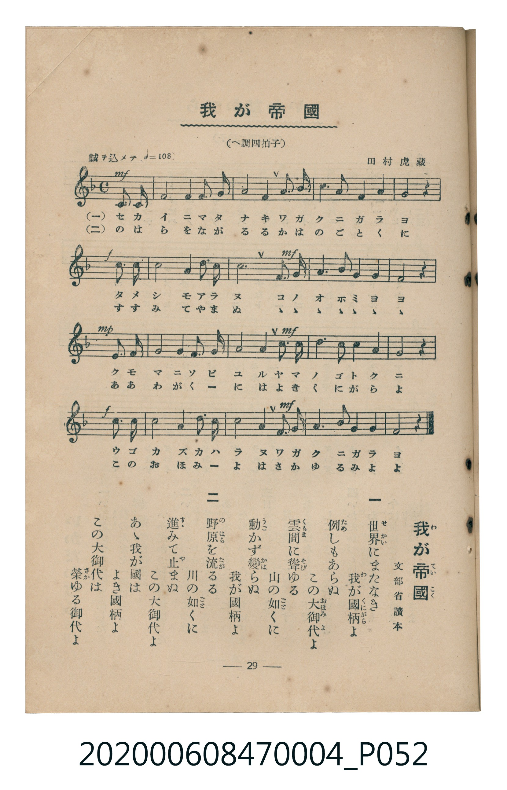

# 我が帝國

> Re:Shōka 使用 AI 協助辨識與重建樂譜，可能會有錯誤。歡迎回報。

- **鋼琴伴奏版**：<br><audio controls src="waga_teikoku.mp3"></audio>
- **NEUTRINO 歌聲合成版**：<br><audio controls src="waga_teikoku_neutrino.mp3"></audio>

- 詞：文部省讀本
- 曲：田村虎藏
- 臺灣教育會公認《新定兒童唱歌》尋常科第四學年用（2020.006.0847.0004）

## 說明

原書資訊與歌詞全文（對應 P052.jpg，書頁 p. 29，第三學期第 4 首）：
調性與拍號：へ調四拍子（F 大調 4/4 拍，弱起一拍）
速度指示：誠ヲ込メテ（♩=108）


## 歌詞

```text
一
世界（せかい）にまたなき我が國柄（くにがら）よ
例（ため）しもあらぬこの大御代（おほみよ）よ
雲間（くもま）に聳（そび）ゆる山の如（ごと）くに
動（うご）かず變（かは）らぬ我が國柄よ

二
野原（のはら）を流（なが）るる川の如（ごと）くに
進（すゝ）みて止（や）まぬこの大御代よ
あゝ我が國はよき國柄よ
この大御代は榮（さか）ゆる御代よ
```

## ABC

<div class="abc-score" data-abc-src="waga_teikoku.abc" aria-label="五線譜載入中"></div>

[下載 ABC 原始檔](waga_teikoku.abc)

## TMD 檔案連結

- [主旋律 TMD 檔案](waga_teikoku.tmd) [[在 TMD Studio 編輯](https://tmdlang.github.io/Tmd-TS/#tmd=s7IKdvYPcrWy4qpTUCpJTLdSSM7PyUlNLsnMz7MqzsjMK0nNjM_KTMmPL87Iz05Ugisry88pzU21Si9KTEmNN4k3MjAyiDcwMIs3sDAxBzIMTBBKi_NLi5JTrYqTM_Lzc-JLUitKkvLzs9Hl4wsS01OtAgxMjRAyBUX5Zal5iXlA3QVFILekgLUjFKSWZaakgqSLkxPz4stSizLTMlNTkFyZWlQM9gnEipKixLzi5KLMApD3EKryi0oy8oE-KciotMrILC7JL8pMTsyJz07MQ_JwSUYq0L-ZuQVASxJzkDVnpmfmWeXm5yWVAsMIUyI1MysTyddaWgrPOiY-bux5umPu0zndClpaXIq2CoYGFlz2tgpuXDYm-iZ2IDNerJz3fs-sZ9PaXzaveD6n8cW6hmdz1oBNfzZ7E1Dm-ZQNz-ZOfDGz78X0frDwi_ZdzxsXP5s680XTpmdzmp-2rnmxqvdxQ9ezaRuerpv1tHXS89VLn07Z-Gxtz-OG7qcbup_u2PF8-cTna9Y8nT376dodT3dueT5lxfs9HaCo1ANGpR4oKoEMA5P3ezqVuLj0tRRsqQW4FBQUnvbNfzZ7x4vN7S9WdL3oaAe6C-jlp60rgF4GuuLpht5n7Z0KoPSgl1WQ_n5PD1DxywWNCgV6CkaWQC7Q4U92dAId_mzOfCBbwUTh5bJpQJcCgwZk-otV-581LAeZ2937YuZ8oOjjxh1AQaBngSJP104A2uGm8HTJcqCYAjDMFYCiQFOf7tn4Yuv2JzsawNxOkEkvG-Y_3bXsWU_78yW7gMa8WLXgcfOmF_v2PG5e-Li5DWjMo5krbYHxB1IOUg_UDKGmPZ_aA5R-3Dj7cWP348YWoILHjasfN-573Dj_ceOqx4290IQwp_vZfKAsUGU_WEHP4yagNzofN3WADdrXDZab_7ipEWzE9MdNTY8bm4CKHjeuedw4-XHjOqA_nu5b-GT3YrDKrseNux837gfqR5jycvaml9MmQy0B6d8Hcc6Lxs1gwbmPQQyg6rbHTd1PN24EGbqsCSw15XEjMF0AFYNcB4657qlgiTagHFgC6LtZL9Z1gQWB7PVgg0CuQ_YgyCFg_-zqATuovQ-YAsBa1gG1wLw86dlWoC-BgsDwAYYeUKQb5KDtQPfhdtDLBmCOAErMfNw0Fyyx_3HjsmdrF4EEmyDhDgx09LCChgw4KOfCXQp2C9CsXoSrwYpQtTauf7ZsHdjOqUAvIwIO2WDKswkUKGjpc3GFJ6YnhqRmZudnl1oFZCbm5TvU6BrWVIMsUrAxNNOyA7OwZVIFcFZpeLGwR0EDkr4VtIHZ5emG_ufrG3TgWUwTi06gxVBTNYAmaFqBOFjB46bdYHK1Qg2QXIIu29wNZ80Dq9sPUtfchWHKWri69WD-GrB5IDaySSBxGH8llAUybwWaeQhz94PVLkTx0K4efB5qXAcm14Md0Ilh4CS4ulVgsgesDuZNhDq4xxvBDoeYBzYbJj4FTMKcDkzUUBZI3Wo08xC6ZkJJqIdqFAwUdLHC6ty0WgXTeDAbSNUoGKIpgPEhtBFQhTEOFRBxU6AKUyRZkCiqCl2gCiM0M2DOqwa5BmYO2Ok-hjUKEOdhQmDZCaW7weHRgiG_Gs7aB6Xng1WuwlDZC2M19UNFwHEGDG9080AyMLWdcB8BczWamTBXg-yEqG6E-ckIn5_WQWlY2kKTB6YtmEqILxCpC10lTAQUPkhmQm2AyU0BkyvgfJiPISkMl59mwukacLmNu2zZ1QMuW8gsUh43bUdP3c2LYKwmEAuUyUHZuwdXbmjaDFbVBw4lUH6EmTMbTM6H82G5DLmweNy8B8M8cOEDdAVGcQGsWtAVNy6Da2sB8_eBAxZWQqEDYE0CJteBVSFKQGCdDSZh5oOSGwRAkh5UFNOxjU1QEl4UIOdOEITlSjMwiZ5_kSG4sMBeEJiAxSBsGI1ZmMCzeW5BrYI5JDEZImV0YOsFTQewMQJPchAWKEtAQhC7I0EhCKFhYYgstxtM7oebDsu0-DMwtEgAugWRgRGmIExfBjcXUhQhYpt-boWGEpAmlDF3dFKUMcF1NUpaQ9TjTXvB_MngrATLAQh1sIrrcTOoLQAyCaSuD6GiaQtYHJ6u4XU8SB16NYrQBbIJpBczYwJLdTTFwFITxgLJgbIOtjoVVGbCjAc5B1RTQOoFhAqQHiTz4O0B5KyJDhAZHZ4x0StFGB931QvjQ2pxMBOUfyE5GQJBorD8TG79C6s9kRMnomadC6U3g_3bhq4SUQuhZQpq1EIQ20C6kTImtAZHNh1eY-M1FxTXMLdCMhgittH9TnorACmr48-YwE4oZTUmRhpu2gVngdNqcz84I8Eax3B18DqUug1sGMBSX2K08cH1HIQFaZWDsyVGNkLKlo1TwSS4CQhMfnAV4MY1oRoTF6CgtkTJlNSoLWEQOUNiNPYaZ8FZKI09zAYkvDaiflMXzaXgWhK5ToOYDKrXICxY3YbNTKTMCIxhmM_QixhI8UJqLYlwZy0Xl66dAlLvWQHIVeYCAA)]
- [鋼琴伴奏 TMD 檔案](waga_teikoku_piano.tmd) [[在 TMD Studio 編輯](https://tmdlang.github.io/Tmd-TS/#tmd=s7IKdvYPcrWy4qpTUCpJTLdSyC8qychPL0osyKi0ysgsLskvykxOzInPTsxLVIIrKs4vLUpOjS9ITE-1CjAwNVLi0tJSeNYx8XFjz9Mdc5_O6X6_p-Nl957nE7Y82bPl6dL-550d7_d0KmhpcSnaKhgaWHDZ2yq4cdmY6JvYgcx8sXLe-z2znk1rf9m84vmcxhfrGp7NWQO27dnsTUCZ51M2PJs78cXMvhfT-8HCL9p3PW9c_GzqzBdNm57NaX7auubFqt7HDV3Ppm14um7W09ZJz1cvfTpl47O1PY8bup9u6H66Y8fz5ROfr1nzdPbsp2t3PN255fmUFUA3GhkYGegZGJjpGViYmAMZBiZAZypxcYUnpieGpGZm52eXWgVkJublB3k41Oga1lRzKQCBjaGZlh2Ypa-lYIsOFIDWPNnR8GJhj4LG0z0bX2zdrqCtYKLwdEP_8_UNOgqg4NLLKkjXxKJTSx9mqgbQBE0rEAcreNy0G0yuVqgBkkvQZZu74ax5YHX7QeqauzBMWQtXtx7MXwM2D8RGNgkkDuOvhLJA5q1AMw9h7n6w2oUoHtrVg89DjevA5HqwAzoxDJwEV7cKTPaA1cG8iVAH93gj2OEQ88Bmw8SngEmY0x839kNZIHWr0cxD6JoJJaEeqlEwUNDFCqtz02oVTOPBbCBVo2CIpgDGh9BGQBXGOFRAxE2BKkyRZEGiqCp0gSqM0MyAOa8a5BqYOWCn-xjWKECchwkfN86G0t3g8GjBkF8NZ-2D0vPBKldhqOyFsZr6oSLgOAOGN7p5IBmY2k64jx43daCZCXM1yE6I6kaYn4zw-WkdlIalLTR5YNqCqYT4ApG60FXCREDhg2Qm1AaY3BQwuQLOh_kYksJw-WkmnK7hwl-27OoBly1kFimPm7ajp-7mRTBWE4gFyuSg7N2DKzc0bQar6gOHEig_wsyZDSbnw_mwXIZcWDxu3oNhHrjwAboCo7h43AgqSVAUNy6Da2sB8_eBAxZWQqGDx42TweQ6sCpECfi4EVyCws0HJTcIgCQ9qCimYxuboCS8KEDOnSAIy5VmYBI9_yJDcGGBvSAwAYtB2DAaszCBZ_PcgloFc0hiMkTK6I8bp6PpeNzUBE9yEBYoS0BCELsjQSEIoWFhiCy3G0zuh5sOy7T4MzC0SAC6BZGBEaYgTF8GNxdSFCFim35uhYYSkCaUMXd0UpQxwXU1SlpD1ONNe8H8yeCsBMsBCHWwiutxM6gtADIJpK4PoaJpC1gcnq7hdTxIHXo1itAFsgmkFzNjAkt1NMXAUhPGAsmBsg62OhVUZsKMBzkHVFNA6gWECpAeJPPg7QHkrIkOEBkdnjHRK0UYH3fVC-NDanEwE5R_ITkZAkGisPxMbv0Lqz2REyeiZp0LpTeD_duGrhJRC6FlCmrUQhDbQLqRMia0Bkc2HV5j4zUXFNcwt0IyGCK20f1OeisAKavjz5jARj9lNSZGGm7aBWeB02pzPzgjwRrHcHXwOpS6DWwYwFJfYrTxwfUchAVplYOzJUY2QsqWjVPBJLgJCEx-cBXgxjWhGhMXoKC2RMmU1KgtYRA5Q2I09hpnwVkojT3MBiS8NqJ-UxfNpeBaErlOg5gMqtcgLFjdhs1MpMwIjGGYz9CLGEjxQmotiXBnLZbOsw9K59kE2neG9aEMQDEVrxBtGAujCPNN44Es0_hYMANoANRAJGUmOIwxi0doRlaAMATFbOzWm0AsoJVzQOECDkldOwWkwIz2AcqhCxmBhZS5AA)]

## 分析

```text
================================================================================
📊 TMD Song Profile: [ 我が帝國 ]
================================================================================
⏱  Duration:       0:35 (35.6s), 16 measures total
🎼 Key & Tempo:    首調基準 F, != 108.0 BPM, <4/4>
   - 分析範圍：      由實際發聲的音符與和弦推測調性；播放脈絡另行呈現
🎤 人聲音域:    C4 (MIDI 60) – D5 (MIDI 74) [跨度: 14 個半音 / 1.2 個八度, 難度: moderate]
   - 最低音:  C4 in [WagaTeikoku #1 @ m.1, 0:01]
   - 最高音: D5 in [WagaTeikoku #1 @ m.6, 0:12]
   - 適合: soprano, mezzo-soprano, contralto, tenor, baritone, bass
🏛  結構:      WagaTeikoku (35.6s)
⚡ 編曲密度:        Peak 1 軌道同時演奏
🗝  調性診斷：       C 調性不明確（純淨自然大調，未偵測到可信轉調）
   - 風格氣質:    純淨自然大調（陽光明朗、易唱易記，無明顯調外色彩）
   - 轉調歷程:    全曲維持單一推測調性（未偵測到可信轉調）
   - 核心骨幹音:  C, A, F, G, D
   - 調性數值:    C 調性不明確 [相關度: 0.81, 穩定度: Ambiguous, 自然音純度: 98.3%]
   - 候選調性 (K-S): C 大調 (0.81), F 大調 (0.80), A 小調 (0.72)
   - 五度圈歷程:   +0
   - 各段落調性細節:
     • [WagaTeikoku #1]: C 大調 (r: 0.82, 自然音純度: 98.3%, 調外音: A#)

  [ 五度圈游移軌跡 ]
              [C ]*
         F            G  
      Bb               D  
      Eb               A  
         Ab           E  
            Db       B  
               F# 
     (* = active key center)

  [ 十二半音累積音高分佈 ]
     C  : ████████████████████████  27.9%
     C# :                            0.0%
     D  : ████                       5.0%
     D# :                            0.0%
     E  : █                          1.2%
     F  : ██████████████████        20.4%
     F# :                            0.0%
     G  : █████████████████         20.0%
     G# :                            0.0%
     A  : ████████████████████      23.7%
     A# : █                          1.7%
     B  :                            0.0%
--------------------------------------------------------------------------------
Assignment 軌道音域：
  - Piano         : C4 – D5 (14 個半音 / 1.2 個八度, 59 個音符)
================================================================================
```


## 原書掃描頁




