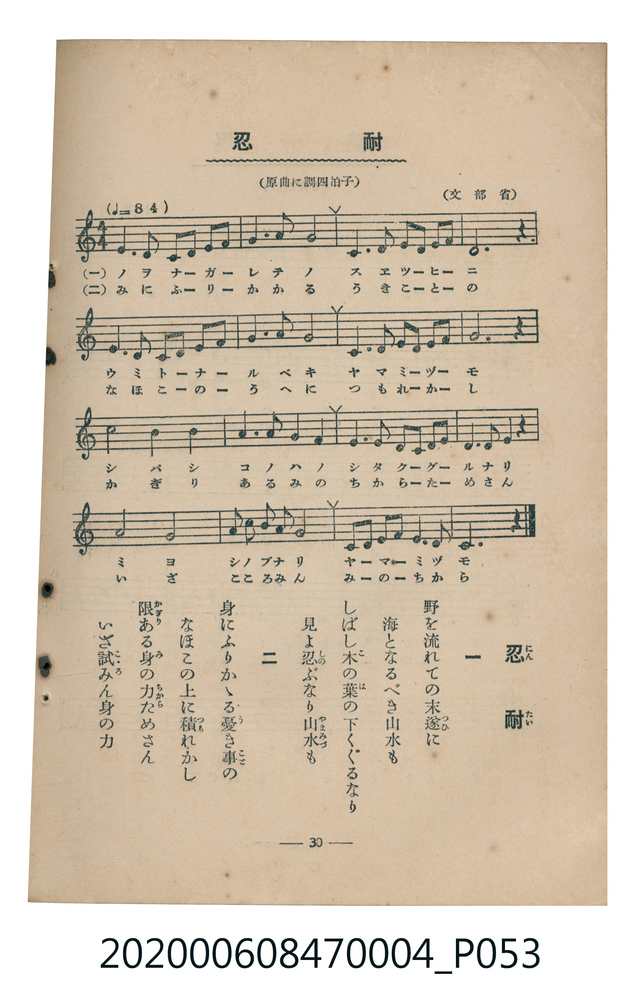

# 忍耐

> Re:Shōka 使用 AI 協助辨識與重建樂譜，可能會有錯誤。歡迎回報。

- **鋼琴伴奏版**：<br><audio controls src="nintai.mp3"></audio>
- **NEUTRINO 歌聲合成版**：<br><audio controls src="nintai_neutrino.mp3"></audio>

- 詞：文部省
- 曲：文部省
- 臺灣教育會公認《新定兒童唱歌》尋常科第四學年用（2020.006.0847.0004）

## 說明

原書資訊與歌詞全文（對應 P053.jpg，書頁 p. 30，第三學期第 5 首）：
調性與拍號：標題註記「原曲に調四拍子」，譜面為 C 大調 4/4 拍
速度指示：♩=84
出處註記：（文部省）

## 歌詞

```text
一
野を流れての末遂（つひ）に
海となるべき山水も
しばし木（こ）の葉（は）の下くゞるなり
見よ忍（しの）ぶなり山水（やまみづ）も

二
身にふりかゝる憂（う）き事（こと）の
なほこの上に積（つも）れかし
限（かぎり）ある身（み）の力（ちから）ためさん
いざ試（こゝろ）みん身の力
```

## ABC

```abc
X:1
T:忍耐
C:曲：文部省
M:4/4
L:1/16
Q:1/4=84
K:C
V:V1 name="Piano" snm="Pia"
[V:V1]
E6 D2 C2 D2 E2 F2 | G6 A2 G8 | C6 D2 E2 D2 E2 F2 | D12 z4 |
w: 1.~ノ ヲ ナ _ ガ _ | レ テ ノ | ス エ ツ _ ヒ _ | ニ
w: 2.~み に ふ _ り _ | か か る | う き こ _ と _ | の
E6 D2 C2 D2 E2 F2 | G6 A2 G8 | C6 D2 E2 D2 E2 F2 | G12 z4 |
w: 1.~ウ ミ ト _ ナ _ | ル ベ キ | ヤ マ ミ _ ヅ _ | モ
w: 2.~な ほ こ _ の _ | う へ に | つ も れ _ か _ | し
c8 B4 B4 | A6 A2 G4 F4 | E6 E2 D2 C2 D2 E2 | D6 D2 E4 z4 |
w: 1.~シ バ シ | コ ノ ハ ノ | シ タ ク _ グ _ | ル ナ リ
w: 2.~か ぎ り | あ る み の | ち か ら _ た _ | め さ ん
A8 G8 | A2 c2 B2 A2 G8 | C2 D2 E2 F2 E6 D2 | C12 z4 |
w: 1.~ミ ヨ | シ ノ ブ ナ リ | ヤ _ マ _ ミ ヅ | モ
w: 2.~い ざ | こ こ ろ み ん | み _ の _ ち か | ら
```

## TMD 檔案連結

- [主旋律 TMD 檔案](nintai.tmd) [[在 TMD Studio 編輯](https://tmdlang.github.io/Tmd-TS/#tmd=s7IKdvYPcrWy4qpTUCpJTLdSSM7PyUlNLsnMz7MqzsjMK0nNjM_KTMmPL87Iz05Ugisry88pzU21Si9KTEmNN4k3MjAyiDcwMIs3sDAxBzIMTBBKi_NLi5JTrYqTM_Lzc-JLUitKkvLzsxHyBUX5Zal5iXlANQVFIBtTwIoQClLLMlNSQdKpKZkl-UWZiTlI7kgtKga7FWxJfElRYl5xclFmAcgDCFX5RSUZ-UC3FmRUWmVkFoMMSU7Mic9OzEPyUklGKtBHqbn5EL1aWgpP9_e-aJigoKXFpWirYGHCZW-r4MxlY6JvYgfS9GLlvPd7Zj2b1v6yecXzOY1gg57N3oQh9qJ91_PGxc-mznzRtOnZnOanrWterOp93ND1bNqGp-tmPW2d9Hz10qdTNj5b2_O4ofvphu6nO3Y8Xz7x-Zo1T2fPfrp2x9OdW55PWfF-TwcojPWAYawHCmMgw8Dk_Z5OJS4ufS0FW2oBLgUFhad985_N3vFic_uLFV0vOtqB7gL69GnrCqCvgK54uqH3WXunQoCBqbFeVkH6-z09QMUvFzQqFOgpGBsAuUCHP9nRCXT4sznzgWwFU4WXy6YBXQoMF5DpL1btf9awHGRud--LmfNBobVi5suFPS9W7H6xYsbjhh6w9ZseN64GqgSGAFDZ07UTHjf0Ao1-sXbOy7mLnjftUnBWeLpkOVCBAjAyFIBKQCa_bJj_dNeyZz3tz5fsAhr7aOZKW2CcgTzUvuvFzKkQC4ASQE_AIwjoLi6Qkic7GsBGtPc9bpr0bGvj46aex43LHjeuezZn9cvGJqCWx41LHjcCI7cT6DKQ0mdbtz9uXPG4cdXjpu7HjTsfN_Y-3bjx2YYtj5uaQNKPG6c_btwAJJ_NAcXd48bJYK3rXkwEBgSQux7CfbIDqLn_cdM8sClAs7rAYbSs-3FTBzD1gZUCDVoHVr0NogJiD0iqqeVx477HjfsfNy4FKQDaDPbLrh6wIbtWA536uHErUMvjRqCBc4F2PGuD-KUNbGDvk13dEMcBvQJxEMTtqx437gaLAh0I1Lz6-UqIU5YA7QDbBAwdoHung8Ns5gSwHJAPDLwusDFNQKuA9oPF90MMfto1G8xdCHYLMBCAgvMfNzU-bpz6uGkyxFqgd6a9WLkM6iSQg4HWAtXtB6oAewdkCkgp5QkdChS09Lm4_ICFTmKmVUBmYl6-Q41BTTXICgUbCy07MANb_lIAp_KGFwt7FDRMFJ5u6H--vkEHnik0sWgAWgQ1TAOoUdNK4XFzH0gASG8C4i4g3qPwuGkNmK4Bkmugsm1wlQog8aadEPGmFUDxFoiu5klwXd1QlQiAbPGuHpDFjfshRjSuBuKtUIshDgAa0QgxAkQDYxFhcWMbVLwXiCdDdDWCHAHRtQ6XxTUKxgq6QGikYAjExgomQBFTsIgZlNYFihhC1RjD1RhB5UDQAKQGbJqPIciXfWBRWMgBWcBwA5kCCjWIDCTUYKaDQg0sDg01kIpJUB3d2O0xAnlqP0QXNKBA-kG2QQIJIgMJJLg9wECCiEMCCcRaAZVZh2EP_tS1q4ei1NW0DBJdzfOBuAOaTuCR3LwaKjsTqHItIpKbl0DF50F1gnS1wnUtwhXJyKlrFTSd7EZKJ-vg6QSWinaAgxVucSPU4qYmIO6B6gIGLlTXdFwWk5u6YHJYUhcw5CBpCBJyIBY01oGhBpGBhBo81oGhBhGHhBqI1QqVWYQnda2CphVIQIFYoDSCnIoggYRIXVB7oIEESX8Qmekkpq4dnZSlru3QaHjcPAEcbSA-KOw2Q0X7gLgfyoLIQHQ8btoPxOuhhc4GjPQISqGQBIQ1bcHKI2BdAzasC5p6mqCGA1MMuHSDlEcgmYVQ9aCM2glNV5CEDXJUI1R2KpA9GT1lGcZBA9QcimuAiQqRtEzAIpDkB0pYkAQIK7hAbMyktR1qIijYQBEJ4kOCDSIKCTYICyID0QELNhBrA1pihAQZZvKCFUugsEIuupqgJkLCCjnZLYSqh4QViAVKzJBwgshAwomoJAZsu1FWPc6HJ7EVUBYkPCChNA0tsUCyIaTAAmVDEA0xAZQZiS68WmCWNk5DGAwqxkC4CVSqgyICllQgdQRyEYec4EDO7cRlKSwt6SIVU2agJGeOVnJBSixYKQcry7CWXOCyB5IoQLUOtNTAEmSoJRcowCDlHUQvLLhwl1ygGhSSIKYhzMISSgg5REJDTmaQEEK3p5aLS9dOAdIqUwCylLkA)]
- [鋼琴伴奏 TMD 檔案](nintai_piano.tmd) [[在 TMD Studio 編輯](https://tmdlang.github.io/Tmd-TS/#tmd=s7IKdvYPcrWy4tLSUni6v_dFw4T3ezpedu95PmHLkz1bni7tf97Z8X5Pp4KWFpeirYKFCZe9rYIzl42JvokdV52C0ouV897vmfVsWvvL5hXP5zQqgcSezd6EIfaifdfzxsXPps580bTp2Zzmp61rXqzqfdzQ9WzahqfrZj1tnfR89dKnUzY-W9vzuKH76Ybupzt2PF8-8fmaNU9nz366dsfTnVueT1kBdJmRgZGBnoGBmZ6BhYk5kGFgAnScEheXX2ZeSWKmVUBmYl5-kIdDjUFNNZcCENhYaNmBGfpaCrboQAFo_pMdDS8W9ihomCg83dD_fH2DjkKAgamxXlZBuiYWDVr6YMNqFIwVdIHQSMEQiI0VTIAipmARMyitCxQxhKoxhqsxgsqBoAFIDdg0H8MahcfNfWDRx82bgLgLxGpaAzblcTOIBsm0wVWBxZt2QsSbVgDFW8AqJkF1dGO3xwgo17gfoqtxNRBvBesH2QaSgegC0Y-bYCaAxNug4r1APBnMWgGVWYdhD_6w3tVDv7CGyWEJ66Zl0BCdD8QdYBY0DJpXQ2VmAlWtRYRB8xKo-DywLhCrFSqzCE9Yr4KG3G54yIFCDDlMd4BjAhHWUHuamoC4BxobEJnpJIb1jk5ywtowDmqFORTXAIMZEdgmYBFIhICCGhIlsIQNYmMG9naoiY-bJ4C9BuKDxDdDRfuAuB_KgshAdDxu2g_E68GsDWjR0wXEoMBFD3BYsn3cCDILkbSboCYCkzY4AyAiYiFUPSjRd4JZoOgFuaIRKjMVyAZFHhGBDiysyAl0SAjrIiVnM1BEmKOlcEjKhuUGWJrHmsLBaRQSVKC8Ck1dwICFBPc0pCBETuGg9A3JFxC9rQRTOKjcgQTTNIRZwLQOxk2gEgMUiaDgg8khgh858EGuAwU_qj21qAW7D3LBbgIt2IHhEK8QbRgLokzj4xF8ECfaND4Wiwq4FJgwgPqIHJOgfBDGMAZJmwmQZQLWBhQwRzIIKAFkIbkIyEMYhKQNqBbMBynExkdxHsw5wPDTtVOABGG0D1AQiWcE5ilzAQA)]

## 分析

```text
================================================================================
📊 TMD Song Profile: [ 忍耐 ]
================================================================================
⏱  Duration:       0:45 (45.7s), 16 measures total
🎼 Key & Tempo:    首調基準 C, != 84.0 BPM, <4/4>
   - 分析範圍：      由實際發聲的音符與和弦推測調性；播放脈絡另行呈現
🎤 人聲音域:    C4 (MIDI 60) – C5 (MIDI 72) [跨度: 12 個半音 / 1.0 個八度, 難度: easy]
   - 最低音:  C4 in [Nintai #1 @ m.1, 0:01]
   - 最高音: C5 in [Nintai #1 @ m.9, 0:22]
   - 適合: soprano, mezzo-soprano, contralto, tenor, baritone, bass
🏛  結構:      Nintai (45.7s)
⚡ 編曲密度:        Peak 1 軌道同時演奏
🗝  調性診斷：       G 調性不明確（流行色彩大調，未偵測到可信轉調）
   - 風格氣質:    流行大調（略帶和弦色彩音與裝飾副屬和弦）
   - 轉調歷程:    全曲維持單一推測調性（未偵測到可信轉調）
   - 核心骨幹音:  G, E, D, C, A
   - 調性數值:    G 調性不明確 [相關度: 0.84, 穩定度: Ambiguous, 自然音純度: 94.2%]
   - 候選調性 (K-S): G 大調 (0.84), C 大調 (0.84), E 小調 (0.70)
   - 五度圈歷程:   +1
   - 各段落調性細節:
     • [Nintai #1]: G 調性不明確 (r: 0.84, 自然音純度: 94.2%, 調外音: F)

  [ 五度圈游移軌跡 ]
               C  
         F           [G ]*
      Bb               D  
      Eb               A  
         Ab           E  
            Db       B  
               F# 
     (* = active key center)

  [ 十二半音累積音高分佈 ]
     C  : █████████████████         17.5%
     C# :                            0.0%
     D  : ██████████████████        18.3%
     D# :                            0.0%
     E  : ██████████████████        19.2%
     F  : ██████                     5.8%
     F# :                            0.0%
     G  : ████████████████████████  25.0%
     G# :                            0.0%
     A  : ██████████                10.0%
     A# :                            0.0%
     B  : ████                       4.2%
--------------------------------------------------------------------------------
Assignment 軌道音域：
  - Piano         : C4 – C5 (12 個半音 / 1.0 個八度, 62 個音符)
================================================================================
```


## 原書掃描頁




