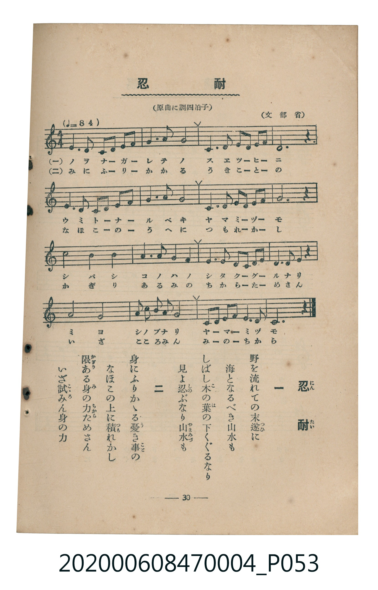

# 忍耐

<audio controls src="nintai.mp3"></audio>

- 詞：文部省
- 曲：文部省
- 臺灣教育會公認《新定兒童唱歌》尋常科第四學年用（2020.006.0847.0004）

## 說明

原書資訊與歌詞全文（對應 P053.jpg，書頁 p. 30，第三學期第 5 首）：
調性與拍號：標題註記「原曲に調四拍子」，譜面為 C 大調 4/4 拍
速度指示：♩=84
出處註記：（文部省）

## 歌詞

```text
一
野を流れての末遂（つひ）に
海となるべき山水も
しばし木（こ）の葉（は）の下くゞるなり
見よ忍（しの）ぶなり山水（やまみづ）も

二
身にふりかゝる憂（う）き事（こと）の
なほこの上に積（つも）れかし
限（かぎり）ある身（み）の力（ちから）ためさん
いざ試（こゝろ）みん身の力
```

## ABC

```abc
X:1
T:忍耐
C:曲：文部省
M:4/4
L:1/16
Q:1/4=84
K:C
V:V1 name="Piano" snm="Pia"
[V:V1]
G6 G2 E2 G2 A2 c2 | c6 d2 c8 | D6 E2 F2 E2 F2 G2 | E12 z4 |
G6 G2 E2 G2 A2 c2 | c6 d2 c8 | D6 G2 G2 E2 F2 A2 | G12 z4 |
d8 B4 d4 | c3 d c2 A2 G8 | F6 F2 E2 G2 c2 A2 | G6 F2 D4 z4 |
c8 E8 | F2 G2 A3 B c8 | G2 E2 G2 A2 D6 D2 | C12 z4 |
```

## TMD 檔案連結

- [主旋律 TMD 檔案](nintai.tmd) [[在 TMD Studio 編輯](https://tmdlang.github.io/Tmd-TS/#tmd=s7IKdvYPcrWy4tLSUni6v_dFwwQFLS0uRVsFCxMue1sFZy4bE30TO646BaUXK-e93zPr2bT2l80rns9pVAKJPZu9CUPsRfuu542Ln02d-aJp07M5zU9b17xY1fu4oevZtA1P18162jrp-eqlT6dsfLa253FD99MN3U937Hi-fOLzNWuezp79dO2Opzu3PJ-y4v2eDiMDIwM9AwMzPQMLE3Mgw8Dk_Z5OJS4ufS0FW2oBLgUFhad985_N3vFic_uLFV0vOtqB7gL69GnrCqCvgK54uqH3WXunQoCBqbFeVkH6-z09QMUvFzQqFOgpGBsAuUCHP9nRCXT4sznzgWwFU4WXy6YBXQoMF5DpL1btf9awHGRud--LmfNBobVi5suFPS9W7H6xYsbjhh6w9ZseN64GqgSGAFDZ07UTHjf0Ao1-sXbOy7mLnjftUnBWeLpkOVCBAjAyFIBKQCa_bJj_dNeyZz3tz5fsAhr7aOZKW2CcgTzUvuvFzKkQC4ASQE_AIwjoLi6Qkic7GsBGtPc9bpr0bGvj46aex43LHjeuezZn9cvGJqCWx41LHjcCI7cT6DKQ0mdbtz9uXPG4cdXjpu7HjTsfN_Y-3bjx2YYtj5uaQNKPG6c_btwAJJ_NAcXd48bJYK3rXkwEBgSQux7CfbIDqLn_cdM8sClAs7rAYbSs-3FTBzD1gZUCDVoHVr0NogJiD0iqqeVx477HjfsfNy4FKQDaDPbLrh6wIbtWA536uHErUMvjRqCBc4F2PGuD-KUNbGDvk13dEMcBvQJxEMTtqx437gaLAh0I1Lz6-UqIU5YA7QDbBAwdoHung8Ns5gSwHJAPDLwusDFNQKuA9oPF90MMfto1G8xdCHYLMBCAgvMfNzU-bpz6uGkyxFqgd6a9WLkM6iSQg4HWAtXtB6oAewdkCkgp5QkdChS09Lm4_DLzShIzrQIyE_PyHWoMahSqQXYo2BiaadmBWdhymAI4nTe8WNijoGGi8HRD__P1DTrwbKGJRQPQKqhhGkCNmlYKj5v7QAJg8Lh5E5jsAuI9Co-b1oDpGiC5BklNG5hE6IIAoKqmnQhVTSvAqlogJjVPgpvUjaYPHSA7cFcPyIGN-xHGNq4Gk1uhDoQ4FGhsI8JYCBsY92gGg1SBnA5T1QsmJ0NMalwBN2kdHseBANSBNcAyRRcOQWxjKG0GxIZxQKIGQsGgEYiDIgKCNQpGSDyQGSZINMi8GjAPGzSAmQHOcrhTyK4eilJI0zJEsDXPB5Md0HiFR0AzKGJgamaCyKa1aAEHUrUESdU8qHkQk1rhJi3CEfAwgCWFrEIY27gbTMLidR08XpHjfgeYRDgZAkCqkBzY1AQme6AmdcNNmo7HcSBA0xQC0g8zC5RCQGah2kROCtnRSVkK2Y4WBI-bJ8CDESYHKiE2g-X6gLgfWoaAAhUVgNQhzHvcBMr-j5vWQ7P8BqwprgtMIpIBBGBJKeilArC-gFsEMgTqgEZI3APjHFj6QMoErA5tXIhkEqTc6YSmF0jCBnmmEUnNVLCayWgmwVMMOAUgQ3PkpAFJDdAEAhQBs0AJAD36a8BJAwZhBQpIFVwLapoBKYGlMiLTDLBZRFm9AypJkMHjZlCdgRbAwJQASyfTwCSoxEGPZ0jJAokgULkCYyFsAJUvEHVklC4taEqADQQ0EVBKAJY4QAyKXUjNAkw3GPEMUgcUhzgPWjaBWOipCOTxTjS96ACeZjAKDPTqApIaYAUPKE1hKWPQyyfkMgfEBtqDpgezjKnl4tK1U4C0ZBSALGUuLgA)]
- [鋼琴伴奏 TMD 檔案](nintai_piano.tmd) [[在 TMD Studio 編輯](https://tmdlang.github.io/Tmd-TS/#tmd=s7IKdvYPcrWy4tLSUni6v_dFw4T3ezpedu95PmHLkz1bni7tf97Z8X5Pp4KWFpeirYKFCZe9rYIzl42JvokdV52C0ouV897vmfVsWvvL5hXP5zQqgcSezd6EIfaifdfzxsXPps580bTp2Zzmp61rXqzqfdzQ9WzahqfrZj1tnfR89dKnUzY-W9vzuKH76Ybupzt2PF8-8fmaNU9nz366dsfTnVueT1kBdJmRgZGBnoGBmZ6BhYk5kGFgAnScEheXX2ZeSWKmVUBmYl5-kIdDjUGNQjWXAhDYGJpp2YFZ-loKtuhAAWjDkx0NLxb2KGiYKDzd0P98fYOOQoCBqbFeVkG6JhYNWvpgw2oUTBV04RDENobSZkBsGAckaiAUDBqBOCgiIFijYITEA5lhgkSDzKsB87BBA5gZXPj9t6tnsPgPpB9mFsh_ILNQbSLHfzs6yfEf2L3I0BzZIxC3Q70DFAGzQM5Fd2wN2CMwCIs8kCq4FlQfgpTAwoRIHwLzADk-xIgM9IQEcTssUkEhgCX-0OMeOT5BbKA9aHow468WNYP6oGRQE2j-BBoUrxBtGAumTGKhfNN4iABQHOiWeKgIlGEOUwWUBWEDoF2kGgVXAhcBEwijsFpqBmKbxecimWgCMQjTPBADq8vQtYH5UAYeHwJDU9dOARKgCigsZS4uAA)]

## 分析

```text
================================================================================
📊 TMD Song Profile: [ 忍耐 ]
================================================================================
⏱  Duration:       0:45 (45.7s), 16 measures total
🎼 Key & Tempo:    首調基準 C, != 84.0 BPM, <4/4>
   - 分析範圍：      由實際發聲的音符與和弦推測調性；播放脈絡另行呈現
🎤 人聲音域:    C4 (MIDI 60) – D5 (MIDI 74) [跨度: 14 個半音 / 1.2 個八度, 難度: moderate]
   - 最低音:  C4 in [Nintai #1 @ m.16, 0:42]
   - 最高音: D5 in [Nintai #1 @ m.2, 0:03]
   - 適合: soprano, mezzo-soprano, contralto, tenor, baritone, bass
🏛  結構:      Nintai (45.7s)
⚡ 編曲密度:        Peak 1 軌道同時演奏
🗝  調性診斷：       C 大調（純淨自然大調，未偵測到可信轉調）
   - 風格氣質:    純淨自然大調（陽光明朗、易唱易記，無明顯調外色彩）
   - 轉調歷程:    全曲維持單一推測調性（未偵測到可信轉調）
   - 核心骨幹音:  C, G, D, E, F
   - 調性數值:    C 大調 [相關度: 0.94, 穩定度: High, 自然音純度: 100.0%]
   - 候選調性 (K-S): C 大調 (0.94), G 大調 (0.76), E 小調 (0.54)
   - 五度圈歷程:   +0
   - 各段落調性細節:
     • [Nintai #1]: C 大調 (r: 0.94, 自然音純度: 100.0%)

  [ 五度圈游移軌跡 ]
              [C ]*
         F            G  
      Bb               D  
      Eb               A  
         Ab           E  
            Db       B  
               F# 
     (* = active key center)

  [ 十二半音累積音高分佈 ]
     C  : ████████████████████████  27.9%
     C# :                            0.0%
     D  : ███████████████           17.1%
     D# :                            0.0%
     E  : ████████████              14.2%
     F  : ██████                     7.5%
     F# :                            0.0%
     G  : █████████████████████     25.0%
     G# :                            0.0%
     A  : █████                      6.2%
     A# :                            0.0%
     B  : ██                         2.1%
--------------------------------------------------------------------------------
Assignment 軌道音域：
  - Piano         : C4 – D5 (14 個半音 / 1.2 個八度, 63 個音符)
================================================================================
```


## 原書掃描頁




