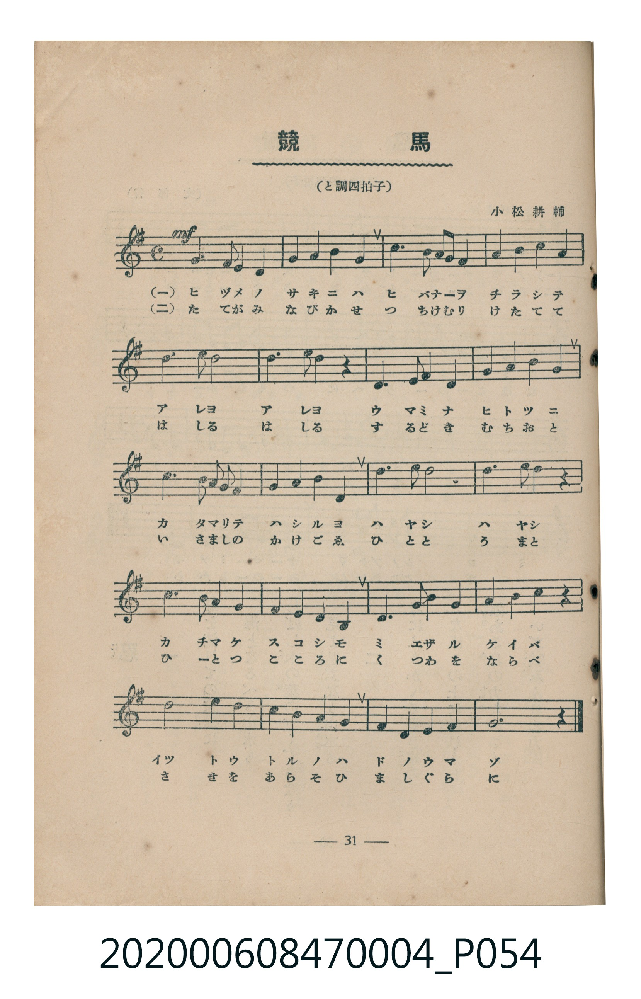
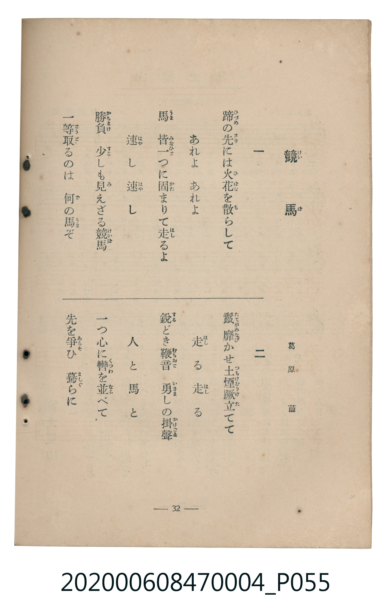

# 競馬

<audio controls src="keiba.mp3"></audio>

- 詞：葛原齒
- 曲：小松耕輔
- 臺灣教育會公認《新定兒童唱歌》尋常科第四學年用（2020.006.0847.0004）

## 說明

原書資訊與歌詞全文（對應 P054.jpg–P055.jpg，書頁 pp. 31–32，第三學期第 6 首）：
調性與拍號：と調四拍子（G 大調 4/4 拍）

## 歌詞

```text
一
蹄（ひづめ）の先（さき）には火花（ひばな）を散（ち）らして
あれよ　あれよ
馬（うま）　皆一（みなひと）つに固（かた）まりて走（はし）るよ
速（はや）し　速（はや）し
勝負（かちまけ）　少（すこ）しも見（み）えざる競馬（けいば）
一等取（とうと）るのは　何（ど）の馬（うま）ぞ

二
鬣（たてがみ）靡（なび）かせ土煙蹴立（つちけむりけた）てて
走（はし）る　走（はし）る
鋭（する）どき鞭音（むちおと）　勇（いさま）しの掛聲（かけごゑ）
人と馬と
一つ心に轡（くつわ）を並（なら）べて
先を爭（あらそ）ひ　驀（ましぐ）らに
```

## ABC

```abc
X:1
T:競馬
C:曲：小松耕輔
M:4/4
L:1/16
Q:1/4=120
K:G
V:V1 name="Piano" snm="Pia"
[V:V1]
!mf! G6 D2 G4 D4 | G4 A4 B4 G4 | c6 c2 B3 A G4 | A4 B4 c4 A4 |
d6 d2 B8 | d6 d2 B4 z4 | D6 D2 G4 D4 | G4 A4 B4 d4 |
c6 A2 d3 c B4 | A4 B4 c4 E4 | d6 d2 B8 | d6 d2 B4 z4 |
c6 c2 c4 A4 | G4 G4 G4 B,4 | D6 E2 F4 A4 | G4 B4 d4 z4 |
e8 d4 B4 | c4 B4 A4 G4 | E4 E4 F4 F4 | G12 z4 |
```

## TMD 檔案連結

- [主旋律 TMD 檔案](keiba.tmd) [[在 TMD Studio 編輯](https://tmdlang.github.io/Tmd-TS/#tmd=s7IKdvYPcrWy4qpTUCpJTLdSSM7PyUlNLsnMz7MqzsjMK0nNjM_KTMmPL87Iz05Ugisry88pzU21Si9KTEmNN4k3MjAyiDcwMIs3sDAxBzIMTBBKi_NLi5JTrYqTM_Lzc-JLUitKkvLzsxHyBUX5Zal5iXlANQVFIBtTwIoQClLLMlNSQdKpKZkl-UWZiTlI7kgtKga7FWxJfElRYl5xclFmAcgDCFUlGalAxxYX5BcBjdXSUni-etvLZWsUtLS4FG0VDI0MuOxtFdy5bEz0TexAel6snPd-z6wXE2c_7Zv_cu8ksDnPZm8Cij3d0P9s7r4XDVNf7JkCFn7Rvut54-JnU2e-aNr0bE7z09Y1L1b1Pm7oejZtw9N1s562Tnq-eunTKRufre153ND9dEP30x07ni-f-HzNmqezZz9du-Ppzi3Pp6x4v6cDFIB6wADUAwUgkGFg8n5PpxIXl76Wgi21AJeCggLQR89m73ixuf3Fiq4XHe1AdwE9-7R1xbNp7UBXPN3Q-6y9UyHAwNREL6sg_VHDZCDTFMR8v6cHqO_lgkaFggI9BWNDoJSxEVAQ6JMnOzqBPnk2Zz6QrWCm8HLZNKDTgWEFsu7Fqv3PGpaDLOrufTFzPlD0ceMKoCDQ90CRp2snAC11V3i6ZDlQTAEY_ApAUaBuLpDeJzsawEbsbAEqety46XHj0sdNjUDZx43rnrZ2gAWnPm4EqX_cuPpx4_rnjatfdG2EKd7wuHEVSKpp0rOpi8GCC8FcoOLpjxuXgYx-3Nj0uKnncVPH44YGOBskAUwcYB1tjxv3gTQ1NDyf1QZ0D1hwP9BgsA3AeAMatgRo-dPZu8BS3Y8bgX4ECu573NQFtOTF1g1g8fVAO8GWd8MsaACqA0s0AX0HdlJDA6YgOMa6577YtABm_EKQ2Y0TIY56ugHIAIrPfNw4GWpKU9OLZd0QZ4JFgIxpQGshCR4sPvFxYwswdEChDAnk52s7n_YD4wwotwLsZbC_gE5tXAdyS0PDk71TwbIrIWGPHjiN8yDRtasH7LM1kMCeD_T-48YeiDtezgWGPVAQGG6bwVqAhs9-CkwxrTNfAHPAaoiLgSEJ9N7Ex00N4NADOhQSmEBzwNGFJTQbGjAFwa7oXgsNmSag2UAzVgITyst5a1_OB9rfAbIBZBXQErBfgSHZDUr-4JABJimIt4CpZN2zvtkvGoEZHxL4QBdNedwECnyIh3cB9QNDA0hCgxLoh6f7m4EJ4sVeiIf7Qb5q6oekwyc7lkFDoQmYP4A27IR6DJiagdLPOyBuBqZDoNxcsIpNoGSxEpLugPEOdBIwx0AS8WqQTsoLBShQ0NLn4vJOzUxKtArITMzLd6gxqFGoBlmhYGNopmUHZmErjBTAJUDDi4U9ChomCsDy8fn6Bh14CaKJRQPQJqhhGkCNmlYKj5sngQTA4HFzK5hcCOf3QVk1Co-btsJEm9bC5bvhrH6EShQTJ4DJLjC5B4g3IalrhKtaCTd7O1ysDcpCdvKuHpCTG-cjLGhcBiZ74Pz9CAsaV8FFN8NZcCc3zkZSuQTJRJD3gekN7JwGIAY5HqYOJApRBXMDxAWoLKiTgZGYm1arYKigC4em8UACJgDmgGANXMgIShtDaZh4jYIJkikgNkSFEZIKdL0wHTDxGnBRgTsh7eqhKCE1LUKEYfMaMLkCLgIPQSJVwUISJD8PTMLDG5yYoOrgSe1xcwec1QJnweIaSxJaj7CgcTqIbIIpRnIGkapmIlSB5YElHlxXL0IdMDHBROE5rBHmGWA5BmXBE48pcrpBilcYxK3CAKEClsTISXww4wklnB2dlCWc1UjhB8q-sChfhVQKgCIbVsYglxIwvYhkhKwSJA7K2ggdMECcKiwJB5a6QFE2FUzuA5PTgXgdwnCkcgZRZkyBsZpgYiCVsCIRlggQSQEGQKpgAYGwEV0VPOEgFxWgOIXEowk8XnEXFWaIREGF1Ic_2QCboVRLNuCqBJJswPymjYiQa9oJF4XXAkgJCFYegRIEUr3SBI6Jpm1wdTDbQCbCTH_cBKs3IBUdMsCSdJAiGlgXIkchogICRfVkuCic1QQrR4BtDySVSCkYbAKwuQPXASsaUSrCpk64eliwwADW5ANiY9Qj8AIDnTZGSj7IBQ84WZnDRDDNQS9wiExBT3ZNoSwFLXnc3IwcBEi1CLwGAqULRN2CKG5gTSPUpg88eBHycJMQ6ROUhkB5GB_Akn5AxQ0SQFQuqJHdBBdFRPZcOAupAQYuRyCioMoNwoKlY4RukEpEXsMO4InHDCnakaMUUfbAkhNMBJYcEA0ZeCkEZ8DTDpyBSDzoEJF4arm4dO0UwA1rBSBDmYsLAA)]
- [鋼琴伴奏 TMD 檔案](keiba_piano.tmd) [[在 TMD Studio 編輯](https://tmdlang.github.io/Tmd-TS/#tmd=s7IKdvYPcrWy4tLSUni-etvLZWve7-l42b3n-YQtT_Zsebq0_3lnx_s9nQpaWlyKtgqGRgZc9rYK7lw2Jvomdlx1CkovVs57v2fWi4mzn_bNf7l3khJI7NnsTUCxpxv6n83d96Jh6os9U8DCL9p3PW9c_GzqzBdNm57NaX7auubFqt7HDV3Ppm14um7W09ZJz1cvfTpl47O1PY8bup9u6H66Y8fz5ROfr1nzdPbsp2t3PN255fmUFUDXGRkYGegZGJjpGViYmAMZBiZABypxcXmnZiYlWgVkJublB3k41BjUKFRzKQCBjaGZlh2Ypa-lYIsOFIAWPNnR8GJhj4KGiQLQ0c_XN-goBBiYmuhlFaRrYtGgpQ82DGh8blqtgqGCLhyaxgMJmACYA4I1cCEjKG0MpWHiNQomSKaA2BAVRkgq0PXCdMDEa7jwe3FXDzleNEX2HZLtMIhbhQFCBSwgyAkimPGEvLejkxzvIQc7yGaIbSZw23EHuxnC6VQII_yeA6Z_Sj0HYmOkGHigo9PGSJ5Djjywp81hIpjmoEcakf57smsKOf4zQ3IZsq2IyIP5GCYCczEiV8GjEc6Aew_OQPgPHSL8V4tS_PigFD8m0NIHVmDEK0QbxsIooOFAhmk8koAJkGGCxDeNh6owAtPmQDGoediMgvANkPXBbMC0C2oOyGCj3FiIDlQ7zUAMs3igJAHrYIkO4ngQBTIRRZMxxBi42VAGyEP4zEIJGCAD4UqE47AYBcIgs4BRo2unAI4dBWSGMhcXAA)]

## 分析

```text
================================================================================
📊 TMD Song Profile: [ 競馬 ]
================================================================================
⏱  Duration:       0:40 (40.0s), 20 measures total
🎼 Key & Tempo:    首調基準 G, != 120.0 BPM, <4/4>
   - 分析範圍：      由實際發聲的音符與和弦推測調性；播放脈絡另行呈現
🎤 人聲音域:    B3 (MIDI 59) – E5 (MIDI 76) [跨度: 17 個半音 / 1.4 個八度, 難度: challenging]
   - 最低音:  B3 in [Keiba #1 @ m.14, 0:27]
   - 最高音: E5 in [Keiba #1 @ m.17, 0:32]
   - 適合: soprano, mezzo-soprano, contralto, tenor, baritone, bass
🏛  結構:      Keiba (40.0s)
⚡ 編曲密度:        Peak 1 軌道同時演奏
🗝  調性診斷：       G 大調（純淨自然大調，未偵測到可信轉調）
   - 風格氣質:    純淨自然大調（陽光明朗、易唱易記，無明顯調外色彩）
   - 轉調歷程:    全曲維持單一推測調性（未偵測到可信轉調）
   - 核心骨幹音:  D, B, G, C, A
   - 調性數值:    G 大調 [相關度: 0.93, 穩定度: High, 自然音純度: 100.0%]
   - 候選調性 (K-S): G 大調 (0.93), B 小調 (0.69), D 大調 (0.68)
   - 五度圈歷程:   +1
   - 各段落調性細節:
     • [Keiba #1]: G 大調 (r: 0.93, 自然音純度: 100.0%)

  [ 五度圈游移軌跡 ]
               C  
         F           [G ]*
      Bb               D  
      Eb               A  
         Ab           E  
            Db       B  
               F# 
     (* = active key center)

  [ 十二半音累積音高分佈 ]
     C  : █████████████             12.8%
     C# :                            0.0%
     D  : ████████████████████████  23.4%
     D# :                            0.0%
     E  : ███████                    7.2%
     F  :                            0.0%
     F# : ████                       3.9%
     G  : █████████████████████     20.4%
     G# :                            0.0%
     A  : ████████████              11.5%
     A# :                            0.0%
     B  : █████████████████████     20.7%
--------------------------------------------------------------------------------
Assignment 軌道音域：
  - Piano         : B3 – E5 (17 個半音 / 1.4 個八度, 73 個音符)
================================================================================
```


## 原書掃描頁






