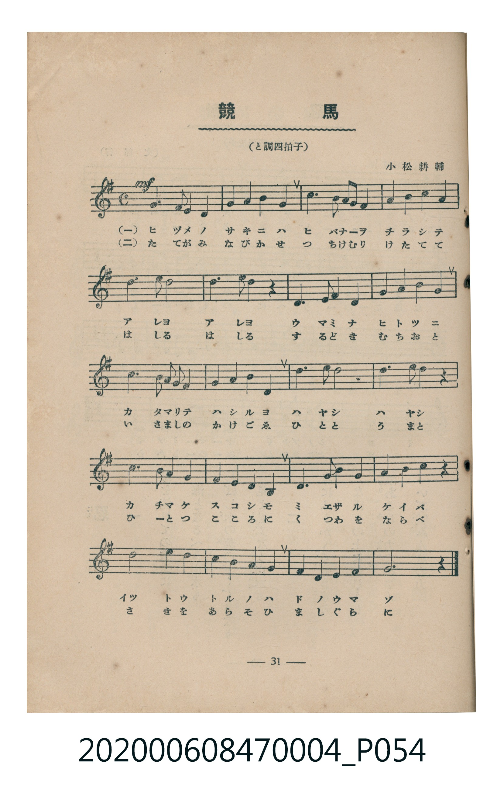
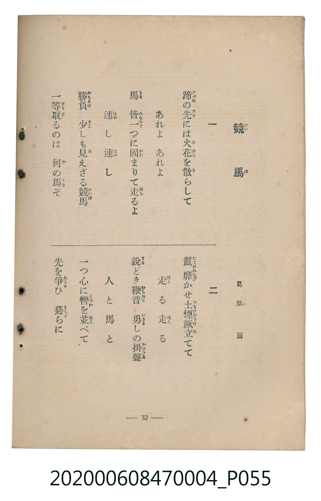

# 競馬

> Re:Shōka 使用 AI 協助辨識與重建樂譜，可能會有錯誤。歡迎回報。

- **鋼琴伴奏版**：<br><audio controls src="keiba.mp3"></audio>
- **NEUTRINO 歌聲合成版**：<br><audio controls src="keiba_neutrino.mp3"></audio>

- 詞：葛原齒
- 曲：小松耕輔
- 臺灣教育會公認《新定兒童唱歌》尋常科第四學年用（2020.006.0847.0004）

## 說明

原書資訊與歌詞全文（對應 P054.jpg–P055.jpg，書頁 pp. 31–32，第三學期第 6 首）：
調性與拍號：と調四拍子（G 大調 4/4 拍）


## 歌詞

```text
一
蹄（ひづめ）の先（さき）には火花（ひばな）を散（ち）らして
あれよ　あれよ
馬（うま）　皆一（みなひと）つに固（かた）まりて走（はし）るよ
速（はや）し　速（はや）し
勝負（かちまけ）　少（すこ）しも見（み）えざる競馬（けいば）
一等取（とうと）るのは　何（ど）の馬（うま）ぞ

二
鬣（たてがみ）靡（なび）かせ土煙蹴立（つちけむりけた）てて
走（はし）る　走（はし）る
鋭（する）どき鞭音（むちおと）　勇（いさま）しの掛聲（かけごゑ）
人と馬と
一つ心に轡（くつわ）を並（なら）べて
先を爭（あらそ）ひ　驀（ましぐ）らに
```

## ABC

<div class="abc-score" data-abc-src="keiba.abc" aria-label="五線譜載入中"></div>

[下載 ABC 原始檔](keiba.abc)

## TMD 檔案連結

- [主旋律 TMD 檔案](keiba.tmd) [[在 TMD Studio 編輯](https://tmdlang.github.io/Tmd-TS/#tmd=s7IKdvYPcrWy4qpTUCpJTLdSSM7PyUlNLsnMz7MqzsjMK0nNjM_KTMmPL87Iz05Ugisry88pzU21Si9KTEmNN4k3MjAyiDcwMIs3sDAxBzIMTBBKi_NLi5JTrYqTM_Lzc-JLUitKkvLzsxHyBUX5Zal5iXlANQVFIBtTwIoQClLLMlNSQdKpKZkl-UWZiTlI7kgtKga7FWxJfElRYl5xclFmAcgDCFX5RSUZ-UC3FmRUWmVkFoMMSU7Mic9OzEPyUklGKtBHxQVAxcg6M9Mz86xKEjOBAQAKhPLE-NzEzLycxLwUdC_GFySmp1oFGJia6AIJUyUuLS2F56u3vVy2RkFLi0vRVsHQyIDL3lbBncvGRN_EDqT7xcp57_fMejFx9tO--S_3TgKb-Gz2JqDY0w39z-bue9Ew9cWeKWDhF-27njcufjZ15oumTc_mND9tXfNiVe_jhq5n0zY8XTfraeuk56uXPp2y8dnanscN3U83dD_dseP58onP16x5Onv207U7nu7c8nzKivd7OkBRpQeMKj1QVAEZBibv93QqcXHpaynYUgtwKSgoAH30bPaOF5vbX6zoetHRDnQX0LNPW1c8m9YOdMXTDb3P2jsVQIGll1WQ_qhhMijIQMz3e3qA-l4uaFQoKNBTMDYEShkbAQWBPnmyoxPok2dz5gPZCmYKL5dNAzodGFYg616s2v-sYTnIou7eFzPnA0UfN64ACgJ9DxR5unYC0FJ3hadLlgPFFIDBrwAUBermAul9sqMBbMTOFqCix42bHjcufdzUCJR93LjuaWsHWHDq40aQ-seNqx83rn_euPpF10aY4g2PG1eBpJomPZu6GCy4EMwFKp7-uHEZyOjHjU2Pm3oeN3U8bmiAs0ESwMQB1tH2uHEfSFNDw_NZbUD3gAX3Aw0G2wCMN6BhS4CWP529CyzV_bgR6Eeg4L7HTV1AS15s3QAWXw-0E2x5N8yCBqA6sEQT0HdgJzU0YAqCY6x77otNC2DGLwSZ3TgR4qinG4AMoPjMx42ToaY0Nb1Y1g1xJlgEyJgGtBaS4MHiEx83tgBDBxTKkEB-vrbzaT8wzoByK8BeBvsL6NTGdSC3NDQ82TsVLLsSEvbogdM4DxJdu3rAPlsDCez5QO8_buyBuOPlXGDYAwWB4bYZrAVo-OynwBTTOvMFMAeshrgYGJJA70183NQADj2gQyGBCTQHHF1YQrOhAVMQ7IrutdCQaQKaDTRjJTChvJy39uV8oP0dIBtAVgEtAfsVGJLdoOQPDhlgkoJ4C5hK1j3rm_2iEZjxIYEPdNGUx02gwId4eBdQPzA0gCQ0KIF-eLq_GZggXuyFeLgf5Kumfkg6fLJjGTQUmoD5A2jDTqjHgKkZKP28A-JmYDoEys0Fq9gEShYrIekOGO9AJwFzDCQRrwbppLxQgAIFLX0uLu_UzKREq4DMxLx8hxqDmmqQDQo2Flp2YAa2okgBnP8bXizsUdAwUQCWjs_XN-jAyw9NLBqA9kAN0wBq1LRSeNw8CSQApFuBeCGY1QckaxQeN20F8ZrWgsW6wWQ_RAauZwIQdwHxHiDeBJVrBMusBOvdDma3AUlki3f1gCxunA8xpHEZEPeAWfshRjSuAvM2g0mwxY2zoTJLoHoWAvFEoAUNQNwFlZsIlgGZCjITRkItrlGozk2rVTBU0AVC83gFs3ggbQoiasCCRkBsDMQgdo2CCViZMVDUEKQYJARTAJICsWvAxvoYQoIDpBwWhCBWH1gPKAiBPGAQgsS6wWQ_RAauBxKEINYmqEwjmLcSrHM7mN2GsM8I5NP5EL3QkAOx9kP0AkMOxNsMJsH2AUMOIrMEqgc15CByE8EyIFNBZsLIGnDBgjvh7eqhKOE1LYImojVAvALMhiQ7XOKg2ASJzwNicCwDww2RHB83d4DJFnhyxZLk1kOTz3SgcSAlUKNxis-EiAPFgGUYWEUv1DENYB44vzSCnAEshZATmyk4tM2gNCiUkUUMICKghAUUiockMVyJEZHOgCEDSTOQkIGZjCkOMR8UYhBxSIiBWNAYB6c-UIiByBZ46kROY-uh6QUSJHC7MMShdgGDCiwODSqQil6oKxqg6Q5EglM6MKgIp64dnZSlrtXQqNsP9f8qaEEE8j2oGIMVTiB1kHQGkwHxl0DloQkBqziW9AVKfKC0MBWI90ECqXEdNC1BCjJIITUF7AAQGyQDKjkhKQiSimCpD-RckDjIJJg4PIVhKaKQkw40NRGRDpHS12poHKKGGSTFgMotWHkEUgdJaTAZEB8SNvCUgiGOZBs4hYHSHSg1oAYWJDVByi5IuTQFbDOIDQksiC5IYCHSJcidIHFIYMFsw5vGgM1gqqQxYIkNCi9QlG6ERF3TTjAPXINB0xmoVAOFCrTWawK6v2kbWAZkCkgPSO_jJlANB6oVcKYxaGoB1bngVAGpFEFBMBnMA5NNoHIK2EqBykCTL1AlsDkElgcVmfCqtqkTLAtyNI40BqsYwSkNUXcaQ1MZpCQzRKpBkatLHMkMGmygyN0IiURgsIF44OoLmtRARRsk2CBJExJssEQICTaQOKh6AwUbZjKDJBhYsQOpCCGhBeKBSWBogdhQE4GhBVEPCS2QPKi4hFevwNACyYLcSkQie7JrCmWJbAmkTgPHObiKA1eEoDCBVHiQAgzUZkO0z8DxCREDq4YkT1Bo7YPGMQJgSWJToVKQ6g6RWJqQEstcMAlt9AFzHaT6BJGgtAtRBZKB5BEsFsKKIlBhBExO4BAGpRZQqkFLcOD0BU51SCUdDKKnLnB4QaMcUsOB60FIgCFKL1ALDdEaA0cpRAysGpIwIQGG1Spw0poKT1rgBARPJk1IyWQumIS27YDhBKk7QSQosUJUQcIJ3Z5aLi5dOwVwr0AByFDmAgA)]
- [鋼琴伴奏 TMD 檔案](keiba_piano.tmd) [[在 TMD Studio 編輯](https://tmdlang.github.io/Tmd-TS/#tmd=s7IKdvYPcrWy4qpTUCpJTLdSyC8qychPL0osyKi0ysgsLskvykxOzInPTsxLVIIrKs4vLUpOjS9ITE-1CjAwNdEFEqZKXFpaCs9Xb3u5bM37PR0vu_c8n7DlyZ4tT5f2P-_seL-nU0FLi0vRVsHQyIDL3lbBncvGRN_EDmTki5Xz3u-Z9WLi7Kd981_unQS25tnsTUCxpxv6n83d96Jh6os9U8DCL9p3PW9c_GzqzBdNm57NaX7auubFqt7HDV3Ppm14um7W09ZJz1cvfTpl47O1PY8bup9u6H66Y8fz5ROfr1nzdPbsp2t3PN255fmUFUDXGRkYGegZGJjpGViYmAMZBiZABypxcXmnZiYlWgVkJublB3k41BjUVHMpAIGNhZYdmKGvpWCLDhSAxj_Z0fBiYY-ChokC0MnP1zfoKICCRS-rIF0TiwYtfbBhNQrVuWm1CoYKukBoHq9gFg-kTUFEDVjQCIiNgRjErlEwASszBooaghSDhGAKQFIgdg3YWB_DGoXHzZPAyh83twLxQjCrD6zncdNWEK9pLVisG0z2Q2TgeiYAcReYtQkq0wjmrQTr3A5mtyHsMwKqaJwP0du4DIh7wKz9EL2Nq8C8zWASbF_jbKjMEqiehUA8EWhyAxCD7AXJTQTLgEwFmQkja7jwR8OuHnKiwRTsDjMoDbIfWcQAIgIKcqBQPCTwcUUTIgaaFkFDcw0Qr4CbjCkOMf9xE8h_IPF5QAz2NzgOYPHyuLkDTLbA4w059NdDQ3I60ByQHNQuDHGoXY0zIeJAsceN4Fht7IW6ogEaIyASnAYaQW4kFO47OskJdyxJGjlAoWFMROwghfpqqM_2Q0NyFSytQtM5LP2C1EHCHyYD4i-BykPDD0McyTZwuINiAxRGU4F4HyScG9dBwxiS1iHpeArYZhAbJAPKVZCQhYQuLLZA7gSJg0yCpwz8IQ8s1ygLeVjxAg5_RAlkDA17SKo3RCqHkAsdHIEPLC5AgQ_y8kaI15p2gnngQgAaAaBsAApiaMHRBAyMpm3wqAHpAel93AQqJEBFEmbgQ4IRlkQhxQlIfDKYByabQMn6cSPUxEZodAJVPm6CJAZQ1oIXUk2dYFmQW4kI-ie7ppBf2ICSLzCowbaDQhIUomiRAQ57cIwg5Q0YRA_5JZCSARL84JICXJ6AAhhSbkDSO6gOQJT3YO9CxMCqIZEGMm4fdqvAwT4VHuzgwIUHYRNSEM4Fk9DaA5ieIWUQiARFJEQVSAaSYJDtqUWphH2QK2ETaCUMqzfjgUEUr2ACoYDBE68QbRofC6YNY0HhGg9iw-VBJFQPUJ05UAXUNKgGuD4E3wCqDWwunIFpFSxXoVoItQymmIBFKGaA7QKrgXoRrgdqIjofRCEMgcoC9cFDAsRANRXsKCN0x4EwyCBgPOjaKYCjItoHKIbgGIE5ylwA)]

## 分析

```text
================================================================================
📊 TMD Song Profile: [ 競馬 ]
================================================================================
⏱  Duration:       0:40 (40.0s), 20 measures total
🎼 Key & Tempo:    首調基準 G, != 120.0 BPM, <4/4>
   - 分析範圍：      由實際發聲的音符與和弦推測調性；播放脈絡另行呈現
🎤 人聲音域:    B3 (MIDI 59) – E5 (MIDI 76) [跨度: 17 個半音 / 1.4 個八度, 難度: challenging]
   - 最低音:  B3 in [Keiba #1 @ m.14, 0:27]
   - 最高音: E5 in [Keiba #1 @ m.5, 0:08]
   - 適合: soprano, mezzo-soprano, contralto, tenor, baritone, bass
🏛  結構:      Keiba (40.0s)
⚡ 編曲密度:        Peak 1 軌道同時演奏
🗝  調性診斷：       G 調性不明確（純淨自然大調，未偵測到可信轉調）
   - 風格氣質:    純淨自然大調（陽光明朗、易唱易記，無明顯調外色彩）
   - 轉調歷程:    全曲維持單一推測調性（未偵測到可信轉調）
   - 核心骨幹音:  D, G, B, A, C
   - 調性數值:    G 調性不明確 [相關度: 0.87, 穩定度: Ambiguous, 自然音純度: 100.0%]
   - 候選調性 (K-S): G 大調 (0.87), D 大調 (0.86), B 小調 (0.65)
   - 五度圈歷程:   +1
   - 各段落調性細節:
     • [Keiba #1]: G 調性不明確 (r: 0.87, 自然音純度: 100.0%)

  [ 五度圈游移軌跡 ]
               C  
         F           [G ]*
      Bb               D  
      Eb               A  
         Ab           E  
            Db       B  
               F# 
     (* = active key center)

  [ 十二半音累積音高分佈 ]
     C  : ████████                   9.9%
     C# :                            0.0%
     D  : ████████████████████████  30.3%
     D# :                            0.0%
     E  : ███████                    8.6%
     F  :                            0.0%
     F# : ███████                    8.6%
     G  : ███████████████           18.4%
     G# :                            0.0%
     A  : █████████                 11.8%
     A# :                            0.0%
     B  : ██████████                12.5%
--------------------------------------------------------------------------------
Assignment 軌道音域：
  - Piano         : B3 – E5 (17 個半音 / 1.4 個八度, 73 個音符)
================================================================================
```


## 原書掃描頁






