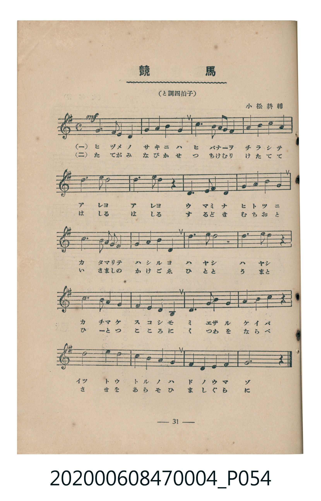
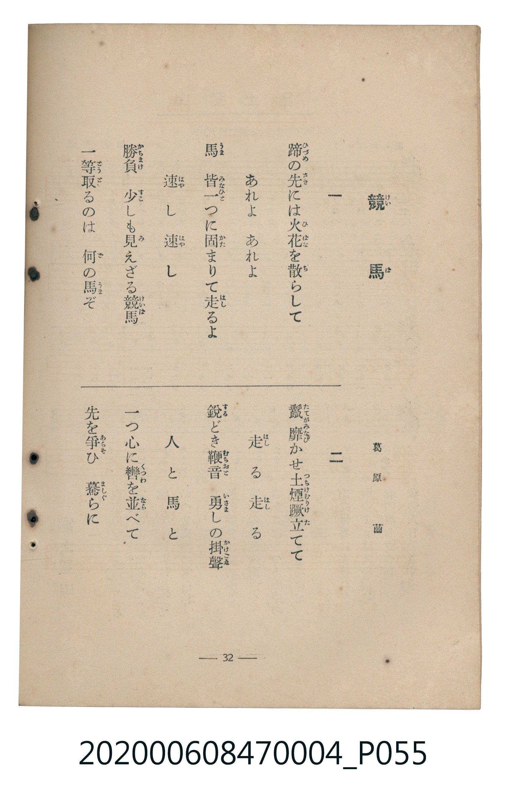

# 競馬

> Re:Shōka 使用 AI 協助辨識與重建樂譜，可能會有錯誤。歡迎回報。

<audio controls src="keiba.mp3"></audio>

- 詞：葛原齒
- 曲：小松耕輔
- 臺灣教育會公認《新定兒童唱歌》尋常科第四學年用（2020.006.0847.0004）

## 說明

原書資訊與歌詞全文（對應 P054.jpg–P055.jpg，書頁 pp. 31–32，第三學期第 6 首）：
調性與拍號：と調四拍子（G 大調 4/4 拍）

## 歌詞

```text
一
蹄（ひづめ）の先（さき）には火花（ひばな）を散（ち）らして
あれよ　あれよ
馬（うま）　皆一（みなひと）つに固（かた）まりて走（はし）るよ
速（はや）し　速（はや）し
勝負（かちまけ）　少（すこ）しも見（み）えざる競馬（けいば）
一等取（とうと）るのは　何（ど）の馬（うま）ぞ

二
鬣（たてがみ）靡（なび）かせ土煙蹴立（つちけむりけた）てて
走（はし）る　走（はし）る
鋭（する）どき鞭音（むちおと）　勇（いさま）しの掛聲（かけごゑ）
人と馬と
一つ心に轡（くつわ）を並（なら）べて
先を爭（あらそ）ひ　驀（ましぐ）らに
```

## ABC

```abc
X:1
T:競馬
C:曲：小松耕輔
M:4/4
L:1/16
Q:1/4=120
K:G
V:V1 name="Piano" snm="Pia"
[V:V1]
!mf! G6 F2 E4 D4 | G4 A4 B4 G4 | c6 B2 A2 G2 F4 | A4 B4 c4 A4 |
w: 1.~ヒ ヅ メ ノ | サ キ ニ ハ | ヒ バ ナ _ ヲ | チ ラ シ テ
w: 2.~た て が み | な び か せ | つ ち け む り | け た て て
d6 e2 d8 | d6 e2 d4 z4 | D6 E2 F4 D4 | G4 A4 B4 G4 |
w: 1.~ア レ ヨ | ア レ ヨ | ウ マ ミ ナ | ヒ ト ツ ニ
w: 2.~は し る | は し る | す る ど き | む ち お と
c6 B2 A2 G2 F4 | G4 A4 B4 D4 | d6 e2 d8 | d6 e2 d4 z4 |
w: 1.~カ タ マ リ テ | ハ シ ル ヨ | ハ ヤ シ | ハ ヤ シ
w: 2.~い さ ま し の | か け ご ゑ | ひ と と | う ま と
c6 B2 A4 G4 | F4 E4 D4 B,4 | D6 G2 B4 G4 | A4 B4 c4 z4 |
w: 1.~カ チ マ ケ | ス コ シ モ | ミ エ ザ ル | ケ イ バ
w: 2.~ひ _ と つ | こ こ ろ に | く つ わ を | な ら べ
d8 e4 d4 | c4 B4 A4 G4 | F4 D4 E4 F4 | G12 z4 |
w: 1.~イツ ト ウ | ト ル ノ ハ | ド ノ ウ マ | ゾ
w: 2.~さ き を | あ ら そ ひ | ま し ぐ ら | に
```

## TMD 檔案連結

- [主旋律 TMD 檔案](keiba.tmd) [[在 TMD Studio 編輯](https://tmdlang.github.io/Tmd-TS/#tmd=s7IKdvYPcrWy4qpTUCpJTLdSSM7PyUlNLsnMz7MqzsjMK0nNjM_KTMmPL87Iz05Ugisry88pzU21Si9KTEmNN4k3MjAyiDcwMIs3sDAxBzIMTBBKi_NLi5JTrYqTM_Lzc-JLUitKkvLzsxHyBUX5Zal5iXlANQVFIBtTwIoQClLLMlNSQdKpKZkl-UWZiTlI7kgtKga7FWxJfElRYl5xclFmAcgDCFX5RSUZ-UC3FmRUWmVkFoMMSU7Mic9OzEPyUklGKtBHxQVAxUpcWloKz1dve7lsjYKWFpeirYKhkQGXva2CO5eNib6JHUjPi5Xz3u-Z9WLi7Kd981_unQQ259nsTUCxpxv6n83d96Jh6os9U8DCL9p3PW9c_GzqzBdNm57NaX7auubFqt7HDV3Ppm14um7W09ZJz1cvfTpl47O1PY8bup9u6H66Y8fz5ROfr1nzdPbsp2t3PN255fmUFe_3dIBCWQ8YynqgUAYyDEze7-lU4uLS11KwpRbgUlBQAPro2ewdLza3v1jR9aKjHeguoGeftq54Nq0d6IqnG3qftXcqBBiYmuhlFaQ_apgMZJqCmO_39AD1vVzQqFBQoKdgbAiUMjYCCgJ98mRHJ9Anz-bMB7IVzBReLpsGdDowrEDWvVi1_1nDcpBF3b0vZs4Hij5uXAEUBPoeKPJ07QSgpe4KT5csB4opAINfASgK1M0F0vtkRwPYiJ0tQEWPGzc9blz6uKkRKPu4cd3T1g6w4NTHjSD1jxtXP25c_7xx9YuujTDFGx43rgJJNU16NnUxWHAhmAtUPP1x4zKQ0Y8bmx439Txu6njc0ABngySAiQOso-1x4z6QpoaG57PagO4BC-4HGgy2ARhvQMOWAC1_OnsXWKr7cSPQj0DBfY-buoCWvNi6ASy-Hmgn2PJumAUNQHVgiSag78BOamjAFATHWPfcF5sWwIxfCDK7cSLEUU83ABlA8ZmPGydDTWlqerGsG-JMsAiQMQ1oLSTBg8UnPm5sAYYOKJQhgfx8befTfmCcAeVWgL0M9hfQqY3rQG5paHiydypYdiUk7NEDp3EeJLp29YB9tgYS2POB3n_c2ANxx8u5wLAHCgLDbTNYC9Dw2U-BKaZ15gtgDlgNcTEwJIHem_i4qQEcekCHQgITaA44urCEZkMDpiDYFd1roSHTBDQbaMZKYEJ5OW_ty_lA-ztANoCsAloC9iswJLtByR8cMsAkBfEWMJWse9Y3-0UjMONDAh_ooimPm0CBD_HwLqB-YGgASWhQAv3wdH8zMEG82AvxcD_IV039kHT4ZMcyaCg0AfMH0IadUI8BUzNQ-nkHxM3AdAiUmwtWsQmULFZC0h0w3oFOAuYYSCJeDdJJeaEABQpa-lxc3qmZSYlWAZmJefkONQY11SAbFGwstOzADGxFkQI4_ze8WNijoGGiACwdn69v0IGXH5pYNADtgRqmAdSoaaXwuHkSSABItwLxQjCrD0jWKDxu2griNa0Fi3WDyX6IDFzPBCDuAuI9QLwJKtcIllkJ1rsdzG4DksgW7-oBWdw4H2JI4zIg7gGz9kOMaFwF5m0Gk2CLG2dDZZZA9SwE4olACxqAuAsqNxEsAzIVZCaMhFpco1Cdm1arYKigC4Tm8Qpm8UDaFETUgAWNgNgYiEHsGgUTsDJjoKghSDFICKYAJAVi14CN9TGEBAdIOSwIQaw-sB5QEAJ5wCAEiXWDyX6IDFwPJAhBrE1QmUYwbyVY53Ywuw1hnxHIp_MheqEhB2Lth-gFhhyItxlMgu0DhhxEZglUD2rIQeQmgmVApoLMhJE14IIFd8Lb1UNRwmtaBE1Ea4B4BZgNSXa4xEGxCRKfB8TgWAaGGyI5Pm7uAJMt8OSKJcmthyaf6UDjQEqgRuMUnwkRB4oByzCwil6oYxrAPHB-aQQ5A1gKISc2U3Bom0FpUCgjixhAREAJCygUD0liuBIjIp0BQwaSZiAhAzMZUxxiPijEIOKQEAOxoDEOTn2gEAORLfDUiZzG1kPTCyRI4HZhiEPtAgYVWBwaVCAVvVBXNEDTHYgEp3RgUBFOXTs6KUtdq6FRtx_q_1XQggjke1AxBiucQOog6QwmA-IvgcpDEwJWcSzpC5T4QGlhKhDvgwRS4zpoWoIUZJBCagrYASA2SAZUckJSECQVwVIfyLkgcZBJMHF4CsNSRCEnHWhqIiIdIqWv1dA4RA0zSIoBlVuw8gikDpLSYDIgPiRs4CkFQxzJNnAKA6U7UGpADSxIaoKUXZByaQrYZhAbElgQXZDAQqRLkDtB4pDAgtmGN40Bm8FUSWPAEhsUXqAo3QiJuqadYB64BoOmM1CpBgoVaK3XBHR_0zawDMgUkB6Q3sdNoBoOVCvgTGPQ1AKqc8GpAlIpgoJgMpgHJptA5RSwlQKVgSZfoEpgcwgsDyoy4VVtUydYFuRoHGkMVjGCUxqi7jSGpjJISWaIVIMiV5c4khk02ECRuxESicBgA_HA1Rc0qYGKNkiwQZImJNhgiRASbCBxUPUGCjbMZAZJMLBiB1IRQkILxAOTwNACsaEmAkMLoh4SWiB5UHEJr16BoQWSBbmViET2ZNcUyhLZEkidBo5zcBUHrghBYQKp8CAFGKjNhmifgeMTIgZWDUmeoNDaB41jBMCSxKZCpSDVHSKxNCEllrlgEtroA-Y6SPUJIkFpF6IKJAPJI1gshBVFoMIImJzAIQxKLaBUg5bgwOkLnOqQSjoYRE9d4PCCRjmkhgPXg5AAQ5ReoBYaojUGjlKIGFg1JGFCAgyrVeCkNRWetMAJCJ5MmpCSyVwwCW3bAcMJUneCSFBihaiChBO6PbVcXLp2CuBegQKQocwFAA)]
- [鋼琴伴奏 TMD 檔案](keiba_piano.tmd) [[在 TMD Studio 編輯](https://tmdlang.github.io/Tmd-TS/#tmd=s7IKdvYPcrWy4tLSUni-etvLZWve7-l42b3n-YQtT_Zsebq0_3lnx_s9nQpaWlyKtgqGRgZc9rYK7lw2Jvomdlx1CkovVs57v2fWi4mzn_bNf7l3khJI7NnsTUCxpxv6n83d96Jh6os9U8DCL9p3PW9c_GzqzBdNm57NaX7auubFqt7HDV3Ppm14um7W09ZJz1cvfTpl47O1PY8bup9u6H66Y8fz5ROfr1nzdPbsp2t3PN255fmUFUDXGRkYGegZGJjpGViYmAMZBiZABypxcXmnZiYlWgVkJublB3k41BjUVHMpAIGNhZYdmKGvpWCLDhSAxj_Z0fBiYY-ChokC0MnP1zfoKAQYmJroZRWka2LRoKUPNqxGoTo3rVbBUEEXCM3jFczigbQpiKgBCxoBsTEQg9g1CiZgZcZAUUOQYpAQTAFICsSuARvrY1ij8Lh5Elj54-ZWIF4IZvWB9Txu2griNa0Fi3WDyX6IDFzPBCDuArM2QWUawbyVYJ3bwew2hH1GQBWN8yF6G5cBcQ-YtR-it3EVmLcZTILta5wNlVkC1bMQiCcCTW4AYpC9ILmJYBmQqSAzYWQNF_5o2NVDTjSYgt1hBqVB9iOLGEBEQEEOFIqHBD6uaELEQNMiaGiuAeIVcJMxxSHmP24C-Q8kPg-Iwf4GxwEsXh43d4DJFni8IYf-emhITgeaA5KD2oUhDrWrcSZEHCj2uBEcq429UFc0QGMERILTQCPIjYTCfUcnOeGOJUkjByg0jImIHaRQXw312X5oSK6CpVVoOoelX5A6SPjDZED8JVB5aPhhiCPZBg53UGyAwmgqEO-DhHPjOmgYQ9I6JB1PAdsMYoNkQLkKErKQ0IXFFsidIHGQSfCUgT_kgeUaZSEPK17A4Y8ogYyhYQ9J9YZI5RByoYMj8IHFBSjwQV7eCPFa004wD1wIQCMAlA1AQQwtOJqAgdG0DR41ID0gvY-bQIUEqEjCDHxIMMKSKKQ4AYlPBvPAZBMoWT9uhJrYCI1OoMrHTZDEAMpa8EKqqRMsC3IrEUH_ZNcU8gsbUPIFBjXYdlBIgkIULTLAYQ-OEaS8AYPoIb8EUjJAgh9cUoDLE1AAQ8oNSHoH1QGI8h7sXYgYWDUk0kDG7cNuFTjYp8KDHRy48CBsQgrCuWASWnsA0zOkDAKRoIiEqALJQBIMsj21KJWwD3IlbAKthGH1ZjwwiOIVTCAUMHjiFaJN42PBtGEsKFzjQWy4PIiE6gGqMweqgJoG1QDXh-AbQLWBzYUzMK2C5SpUC6GWwRQTsAjFDLBdYDVQL8L1QE1E54MohCFQWaA-eEiAGKimgh1lhO44EAYZBIwHXTsFcFRE-wDFEBwjMEeZCwA)]

## 分析

```text
================================================================================
📊 TMD Song Profile: [ 競馬 ]
================================================================================
⏱  Duration:       0:40 (40.0s), 20 measures total
🎼 Key & Tempo:    首調基準 G, != 120.0 BPM, <4/4>
   - 分析範圍：      由實際發聲的音符與和弦推測調性；播放脈絡另行呈現
🎤 人聲音域:    B3 (MIDI 59) – E5 (MIDI 76) [跨度: 17 個半音 / 1.4 個八度, 難度: challenging]
   - 最低音:  B3 in [Keiba #1 @ m.14, 0:27]
   - 最高音: E5 in [Keiba #1 @ m.5, 0:08]
   - 適合: soprano, mezzo-soprano, contralto, tenor, baritone, bass
🏛  結構:      Keiba (40.0s)
⚡ 編曲密度:        Peak 1 軌道同時演奏
🗝  調性診斷：       G 調性不明確（純淨自然大調，未偵測到可信轉調）
   - 風格氣質:    純淨自然大調（陽光明朗、易唱易記，無明顯調外色彩）
   - 轉調歷程:    全曲維持單一推測調性（未偵測到可信轉調）
   - 核心骨幹音:  D, G, B, A, C
   - 調性數值:    G 調性不明確 [相關度: 0.87, 穩定度: Ambiguous, 自然音純度: 100.0%]
   - 候選調性 (K-S): G 大調 (0.87), D 大調 (0.86), B 小調 (0.65)
   - 五度圈歷程:   +1
   - 各段落調性細節:
     • [Keiba #1]: G 調性不明確 (r: 0.87, 自然音純度: 100.0%)

  [ 五度圈游移軌跡 ]
               C  
         F           [G ]*
      Bb               D  
      Eb               A  
         Ab           E  
            Db       B  
               F# 
     (* = active key center)

  [ 十二半音累積音高分佈 ]
     C  : ████████                   9.9%
     C# :                            0.0%
     D  : ████████████████████████  30.3%
     D# :                            0.0%
     E  : ███████                    8.6%
     F  :                            0.0%
     F# : ███████                    8.6%
     G  : ███████████████           18.4%
     G# :                            0.0%
     A  : █████████                 11.8%
     A# :                            0.0%
     B  : ██████████                12.5%
--------------------------------------------------------------------------------
Assignment 軌道音域：
  - Piano         : B3 – E5 (17 個半音 / 1.4 個八度, 73 個音符)
================================================================================
```


## 原書掃描頁






