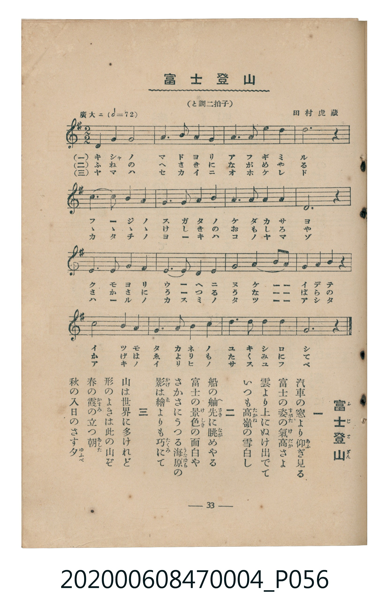

# 富士登山

> Re:Shōka 使用 AI 協助辨識與重建樂譜，可能會有錯誤。歡迎回報。

- **鋼琴伴奏版**：<br><audio controls src="fuji_tozan.mp3"></audio>
- **NEUTRINO 歌聲合成版**：<br><audio controls src="fuji_tozan_neutrino.mp3"></audio>

- 詞：巖谷小波
- 曲：田村虎藏
- 臺灣教育會公認《新定兒童唱歌》尋常科第四學年用（2020.006.0847.0004）

## 說明

原書資訊與歌詞全文（對應 P056.jpg，書頁 p. 33，第三學期第 7 首）：
調性與拍號：と調二拍子（G 大調 2/2 拍）
速度指示：廣大ニ（𝅗𝅥=72）


## 歌詞

```text
一
汽車の窓より仰（あふ）ぎ見る
富士の姿（すがた）の氣高（けだか）さよ
雲より上にぬけ出でて
いつも高嶺（たかね）の雪白し

二
船の舳先（へさき）に眺（なが）めやる
富士の景色（けしき）の面白や
さかさにうつる海原（うなばら）の
影（かげ）は繪（ゑ）よりも巧（たくみ）にて

三
山は世界に多けれど
形のよきは此の山ぞ
春の霞（かすみ）の立つ朝（あした）
秋の入日のさす夕（ゆふべ）
```

## ABC

<div class="abc-score" data-abc-src="fuji_tozan.abc" aria-label="五線譜載入中"></div>

[下載 ABC 原始檔](fuji_tozan.abc)

## TMD 檔案連結

- [主旋律 TMD 檔案](fuji_tozan.tmd) [[在 TMD Studio 編輯](https://tmdlang.github.io/Tmd-TS/#tmd=s7IKdvYPcrWy4qpTUCpJTLdSSM7PyUlNLsnMz7MqzsjMK0nNjM_KTMmPL87Iz05Ugisry88pzU21Si9KTEmNN4k3MjAyiDcwMIs3sDAxBzIMTBBKi_NLi5JTrYqTM_Lzc-JLUitKkvLzsxHyBUX5Zal5iXlANQVFIBtTwIoQClLLMlNSQdKpKZkl-UWZiTlI7kgtKga7FWxJfElRYl5xclFmAcgDCFX5RSUZ-UC3FmRUWmVkFoMMSU7Mic9OzEPyUklGKtBHeYklpUWpyFoz0zPzrHJTM7MykRyvpaXwdH3P08Wrn8_c_XTjRgUtLS5FWwVDExMue1sFdy4bI30jO5AZL1bOe79n1tPt015s2P50Q_-zzYvARj-bvQko_HzKhmdzJ76Y2fdiej9Y-EX7rueNi59NnfmiadOzOc1PW9e8WNX7uKHr2bQNT9fNeto66fnqpU-nbHy2tudxQ_fTDd1Pd-x4vnzi8zVrns6e_XTtjqc7tzyfsuL9ng5QdOgBo0MPFB1AhoHJ-z2dSlxc-loKttQCXAoKCk_75j-bvePF5vYXK7pedLQD3QX079PWFc-mtQNd8XRD77P2ToUAA1MzvayC9Pd7eoCKXy5oVCjQUzA2BnKBDn-yoxPo8Gdz5gPZCuYKL5dNA7oUGDQg01-s2v-sYTnI3O7eFzPnA0UfN64ACj7Z1QMUebp2AtAOd4WnS5YDxRSAAa4AFAXqBml92TD_6a5lz3rany_ZBQr_3YuByh43dwN1fJjbOs_W3AikEKTyyY4GEPVs494Xu7seN657vmry46aOx01dT3ZvAKp-3Nj0uHErUPHjxr4Xy7ofN3WD_Q2OeqDqp8v3gxXNfNzY87gR6ESgunXPNix-uXoGWHzi48YFjxuB1gLFpwLNBbtt9iaoDTuAFgJNWQNU97R91-PG5Y8bl4FUPG5sedy45HFTE9CYp9uAHgCaNB9ozOPGtRAbXs5e9Xzm3seN0yFe2NUDDq6OnUCpFx2bn7Z2gLXsANnZCAoSoDXP50DMWQV0KUikqfFxUwu6d57NXP-iE5gyIS6fDtO87uXcRSD7mlogrgOaCnQLkATqaQO7tPvZ1u3AxADWCRQBWrLhcRMwHkGawTbs3QiWA2qbBBZd_3znKpBI00SwY0DBAfTv0-3LYZ7tf9wIDFqQy0GBAokpcNQCcxtQ-5Md055PBQb56qdLgKli4uMmIHslxKZFQDtBJjb2AtU9W7sEFE0gPfPA8TxjKcg_c4C5EuIcYMxB7Fn3fDWQu-TZnLmwaAf6HxSjIG3PlwPl1j1tXfpsOkg_2PMzny6ZCvYC0MNbHzfuhCqlPGdBgYKWPheXW2lWZkh-VWKeVUBmYl6-Q41BTTXIFgUbCy07MANbnlYA56yGFwt7FDRMFIDlzvP1DTrwjKiJRQPQLqhhGkCNmlYKj5vWguK6afvj5sUKj5v7QLJAUANkzwOzHjd3AvEKMGsVRKZpEVRmKpC9DsyaD9WzGqofAZBt3NUDsrFxKzh1ge1tBGmHWti4A2JsI9DYxl4wC2QcSAZkMYjfA7SwEezeFqhTuvFauKMTZGHzErAbQf553NyPsLBpN8TYptVADFEDMg4kA7WweTaQvRHMWgORAYYGDgtrFEzjFXQVDKEYBGsUjMC0MZgGicJEjBRMgaQJWMQYqhoEDUAiYON8DEHuWAvkQyMHyABGD8xgkHdALFj0gFirIDLA6IHIQKIHxJoP1bMau1VGoDDeClIJjBUQCdIFtQcYK2DToLECYoFMgcQKRAYSKyCHtkBd0I3dHmOQG5aAXQRyPSgy4PYAIwNsGjQyQLIgUyCRAfEPJDJArDVQ_3Ri2IM_r-zqoSivAEMUkiz2AF0CSq2QDANy405oUloDxPtRZEDJB8RvAPsNpAaU_kGuB2UqrEkJKbM074Vq3wtlQ0hQ8E-EyDROh2cXUGYCyXRBHdMElgWxQPIgx4CyDW4rIdkF7EqQpv1Ay8C5DeYXqIsh_gfnX3B2Ahm8GSrTh5LdQDL7cFlZA07_oFwAygGgfFEDzTmGYB5IFJFfQDREDTib4cgwwBiCiIPiB5ZjIPEDEYXED7IMKEWB-JD4AakB5QSIb_HnFkjqnwEmQTkGEikQUUikIMt0QV0AiRQQCyQPiRScuQXsIpBaSFwguRvuOmghAc5LkJiA-AcSE7C8BokJ0nLLjk7Kapb10DSxCKMCWYZIR80zwCxowdvcA00jsGIXpGIPWA8kVbWDyTbUlIRcuUCzaGM3lI2oRCCawEY2gg0DVx4IGZBakAORLG3cAFYHKvMRVRWWCgZSqUA0gvM4PPfD8tJOcCmMLAMqJSC6QJkS2aeg6hVY6INJmCp4njGDpH4gBcor5iAesiA4c4C5sMwEyTagKggiAsta6FXNemi6gcQWcn2yDJbSgHGFVC4D4wqWAiF5CKIakubawWQbqj3gnAPJobAIQq5PQKohcmAzwLUIqjikJoCIbgCrAdUAkDyGXs_A6hZIrYfI77AcBYkRZBlQuQDRAcuRsNoUFBuQXEhUzgF20yjLOaDkiZw2QCkCkWbAdWQzuMiHl8zQHAUsC6AppxlUPoP0gHioAEuugTWjgO12MAnKuiDN0DqmqQOIQbUKqPiC5BlQYgap7AdicIUHz2cQp-CyEFrHQJqQEBcj5wqIz0Fp73Ez2ClwGVCtCctJICsgtTHI7zNxWQirYSAJHrmGMQKLQNpfoJaYLpAE0SCMyDhYKhhw8kYkElDUICceWNQgF9SQ7AOLGpAMqMCGRA3uCgbWhALFCIgEZU9IjEBMg8QIpEKBZAhQYgaphMQIcsaCZWBsFQyksYioRmCZAeJPWEQgy0CqPlhEgGRA2RgSEej21HJx6dopwHs3CkCOMhcA)]
- [鋼琴伴奏 TMD 檔案](fuji_tozan_piano.tmd) [[在 TMD Studio 編輯](https://tmdlang.github.io/Tmd-TS/#tmd=s7IKdvYPcrWy4tLSUni6vufp4tXPZ-5-unHj-z0dL7v3PJ-w5cmeLU-X9j_v7Hi_p1NBS4tL0VbB0MSEy95WwZ3LxkjfyI6rTkHpxcp57_fMerp92osN259u6H-2eZESSPjZ7E1A4edTNjybO_HFzL4X0_vBwi_adz1vXPxs6swXTZuezWl-2rrmxarexw1dz6ZteLpu1tPWSc9XL306ZeOztT2PG7qfbuh-umPH8-UTn69Z83T27KdrdzzdueX5lBVABxoZGBnoGRiY6RlYmJgDGQYmQDcqcXG5lWZlhuRXJeZZBWQm5uUHeTjUGNRUcykAgY2Flh2Yoa-lYIsOFIBWPNnR8GJhj4KGiQLQH8_XN-goBBiYmullFaRrYtGgpQ82rEbBNF5BV8EQikGwRsEITBuDaZAoTMRIwRRImoBFjKGqQdAAJAI2zsewRuFx01og_3HT9sfNi0GM5j64wY-b54FZj5s7gXgFmLUKItO0CCozFcheB2bNh-pZjd0qI6Bc41aQykawhY0gXVB7GndATGsEmtbYC2aBTAHJgOwD8XuA9jSCHdoCdUE3dnuMQW5YAnYRyPWPm_sR9jTthpjWtBqIIWpApoBkoPY0zwayN4JZa6D-6cSwB3-87uohJ15B0QSKLFBEgaKvBhrBhmAeSBQRrSAaogacGnDEKzBqIOKPm0DBC4lYkFd3QkXXAPF-FBmQx0H8BnAQgdSAIgxkFijy8UUqJJJmgElQxILEJ0JFp8MjFSbTBXVBE1gWxALJg1wAilwckQp2EUjtfqB7wEkB5m6466BpGRzlIB2bof7pQ0kSIJl9GPYQyKyd5ESqGSR6gBQoMs1BPGRBcOyBubDYhsQrKCtDRGBxj55l10M9tggjXy6DBUUzODJg6bu5Bx5EkEiGqIYESjuYbEO1Bxy1kCT0uLEbykbkS5BqiBzYDHBuRBWH5CiI6AawGlBOgiQC9PwKy6OQ0gORIGFRvhNaviBkQAkXogOWZGClErAoA5MgFURELbCoJz-_QmIHOb8agUUghS6o-NUFkiAahBGxjCW7guMC4SNQ3CL7FFxmNYOzETzZQ-IalOihfm4GJX-QHhAPV3aFlZuPGyeBSVBaAumBZtemDiAGZVBQ9oTEHijkQSr7gRhcYMBTASy1YcuukBoCkSlhMQfxJyjFPm4GuwAuAylIILENMhlShIF8OhPDnlqM2tcHufY1gda-oCIyXiHaMFbBEEJBBIAcmDhUhWl8LIxhDhKEKgdhA6i3gJEOFDSBGAVSD1cFNRJYQgP5Rrlwk1BMBxMIs8xA4mbxQMUgljFIN0IIrAnMQrEDhMECUAvxuwyqCChFnB-BQaprpwAP1WgfoDiqgBG6gDFYQJkLAA)]

## 分析

```text
================================================================================
📊 TMD Song Profile: [ 富士登山 ]
================================================================================
⏱  Duration:       0:26 (26.7s), 16 measures total
🎼 Key & Tempo:    首調基準 G, != 144.0 BPM, <2/2>
   - 分析範圍：      由實際發聲的音符與和弦推測調性；播放脈絡另行呈現
🎤 人聲音域:    D4 (MIDI 62) – D5 (MIDI 74) [跨度: 12 個半音 / 1.0 個八度, 難度: easy]
   - 最低音:  D4 in [FujiTozan #1 @ m.1, 0:00]
   - 最高音: D5 in [FujiTozan #1 @ m.3, 0:04]
   - 適合: soprano, mezzo-soprano, contralto, tenor, baritone, bass
🏛  結構:      FujiTozan (26.7s)
⚡ 編曲密度:        Peak 1 軌道同時演奏
🗝  調性診斷：       G 大調（純淨自然大調，未偵測到可信轉調）
   - 風格氣質:    純淨自然大調（陽光明朗、易唱易記，無明顯調外色彩）
   - 轉調歷程:    全曲維持單一推測調性（未偵測到可信轉調）
   - 核心骨幹音:  G, A, D, B, C
   - 調性數值:    G 大調 [相關度: 0.85, 穩定度: High, 自然音純度: 100.0%]
   - 候選調性 (K-S): G 大調 (0.85), D 大調 (0.69), A 小調 (0.57)
   - 五度圈歷程:   +1
   - 各段落調性細節:
     • [FujiTozan #1]: G 大調 (r: 0.85, 自然音純度: 100.0%)

  [ 五度圈游移軌跡 ]
               C  
         F           [G ]*
      Bb               D  
      Eb               A  
         Ab           E  
            Db       B  
               F# 
     (* = active key center)

  [ 十二半音累積音高分佈 ]
     C  : ██████████                10.0%
     C# :                            0.0%
     D  : █████████████████         16.7%
     D# :                            0.0%
     E  : ████████                   8.3%
     F  :                            0.0%
     F# : ██                         1.7%
     G  : ████████████████████████  24.2%
     G# :                            0.0%
     A  : ████████████████████████  24.2%
     A# :                            0.0%
     B  : ███████████████           15.0%
--------------------------------------------------------------------------------
Assignment 軌道音域：
  - Piano         : D4 – D5 (12 個半音 / 1.0 個八度, 52 個音符)
================================================================================
```


## 原書掃描頁




