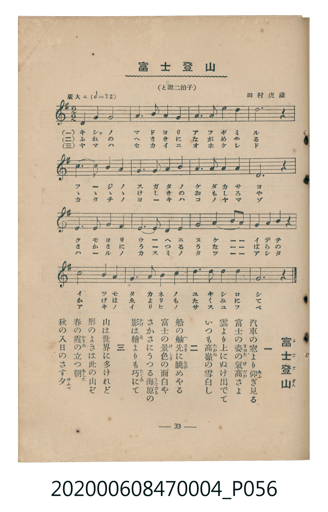

# 富士登山

<audio controls src="fuji_tozan.mp3"></audio>

- 詞：巖谷小波
- 曲：田村虎藏
- 臺灣教育會公認《新定兒童唱歌》尋常科第四學年用（2020.006.0847.0004）

## 說明

原書資訊與歌詞全文（對應 P056.jpg，書頁 p. 33，第三學期第 7 首）：
調性與拍號：と調二拍子（G 大調 2/2 拍）
速度指示：廣大ニ（𝅗𝅥=72）

## 歌詞

```text
一
汽車の窓より仰（あふ）ぎ見る
富士の姿（すがた）の氣高（けだか）さよ
雲より上にぬけ出でて
いつも高嶺（たかね）の雪白し

二
船の舳先（へさき）に眺（なが）めやる
富士の景色（けしき）の面白や
さかさにうつる海原（うなばら）の
影（かげ）は繪（ゑ）よりも巧（たくみ）にて

三
山は世界に多けれど
形のよきは此の山ぞ
春の霞（かすみ）の立つ朝（あした）
秋の入日のさす夕（ゆふべ）
```

## 原書掃描頁



## 分析

```text
================================================================================
📊 TMD Song Profile: [ 富士登山 ]
================================================================================
⏱  Duration:       0:29 (29.1s), 16 measures total
🎼 Key & Tempo:    首調基準 G, != 132.0 BPM, <2/2>
   - 分析範圍：      由實際發聲的音符與和弦推測調性；播放脈絡另行呈現
🎤 人聲音域:    D4 (MIDI 62) – E5 (MIDI 76) [跨度: 14 個半音 / 1.2 個八度, 難度: moderate]
   - 最低音:  D4 in [FujiTozan #1 @ m.1, 0:00]
   - 最高音: E5 in [FujiTozan #1 @ m.3, 0:05]
   - 適合: soprano, mezzo-soprano, contralto, tenor, baritone, bass
🏛  結構:      FujiTozan (29.1s)
⚡ 編曲密度:        Peak 1 軌道同時演奏
🗝  調性診斷：       D 大調（純淨自然大調，未偵測到可信轉調）
   - 風格氣質:    純淨自然大調（陽光明朗、易唱易記，無明顯調外色彩）
   - 轉調歷程:    全曲維持單一推測調性（未偵測到可信轉調）
   - 核心骨幹音:  D, A, G, B, E
   - 調性數值:    D 大調 [相關度: 0.85, 穩定度: Moderate, 自然音純度: 100.0%]
   - 候選調性 (K-S): D 大調 (0.85), G 大調 (0.77), B 小調 (0.60)
   - 五度圈歷程:   +2
   - 各段落調性細節:
     • [FujiTozan #1]: D 大調 (r: 0.85, 自然音純度: 100.0%)

  [ 五度圈游移軌跡 ]
               C  
         F            G  
      Bb              [D ]*
      Eb               A  
         Ab           E  
            Db       B  
               F# 
     (* = active key center)

  [ 十二半音累積音高分佈 ]
     C  :                            0.0%
     C# :                            0.0%
     D  : ████████████████████████  29.2%
     D# :                            0.0%
     E  : ███████████               13.3%
     F  :                            0.0%
     F# :                            0.0%
     G  : ████████████████          19.2%
     G# :                            0.0%
     A  : ██████████████████        21.7%
     A# :                            0.0%
     B  : ██████████████            16.7%
--------------------------------------------------------------------------------
Assignment 軌道音域：
  - Piano         : D4 – E5 (14 個半音 / 1.2 個八度, 49 個音符)
================================================================================
```

## ABC

```abc
X:1
T:富士登山
C:曲：田村虎藏
M:2/2
L:1/16
Q:1/2=66
K:G

V:V1 name="Piano" snm="Pia"

[V:V1]
d8 d4 g4 | a6 b2 a4 g4 | a6 b2 d4 e4 | d12 z4 |
e8 d4 b4 | a6 g2 e4 b4 | a6 e2 g4 a4 | d12 z4 |
g6 a2 b4 g4 | a6 b2 d8 | b8 e4 d4 | b4 g4 a4 z4 |
d8 b4 g4 | e6 g2 a4 d4 | b6 d2 e4 a4 | g12 z4 |
```

- [主旋律 TMD 檔案](fuji_tozan.tmd)
- [鋼琴伴奏 TMD 檔案](fuji_tozan_piano.tmd)
