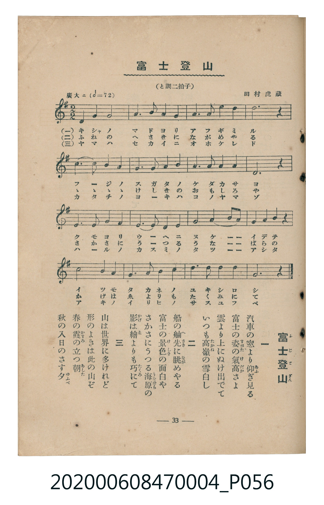

# 富士登山

> Re:Shōka 使用 AI 協助辨識與重建樂譜，可能會有錯誤。歡迎[回報](https://github.com/TMDLang/reshoka/issues)。

- **鋼琴伴奏版**：<br><audio controls src="fuji_tozan.mp3"></audio>
- **NEUTRINO 歌聲合成版**：<br><audio controls src="fuji_tozan_neutrino.mp3"></audio>

- 詞：巖谷小波
- 曲：田村虎藏
- 臺灣教育會公認《新定兒童唱歌》尋常科第四學年用（2020.006.0847.0004）

## 說明

原書資訊與歌詞全文（對應 P056.jpg，書頁 p. 33，第三學期第 7 首）：
調性與拍號：と調二拍子（G 大調 2/2 拍）
速度指示：廣大ニ（𝅗𝅥=72）


## 歌詞

```text
一
汽車の窓より仰（あふ）ぎ見る
富士の姿（すがた）の氣高（けだか）さよ
雲より上にぬけ出でて
いつも高嶺（たかね）の雪白し

二
船の舳先（へさき）に眺（なが）めやる
富士の景色（けしき）の面白や
さかさにうつる海原（うなばら）の
影（かげ）は繪（ゑ）よりも巧（たくみ）にて

三
山は世界に多けれど
形のよきは此の山ぞ
春の霞（かすみ）の立つ朝（あした）
秋の入日のさす夕（ゆふべ）
```

## ABC

<div class="abc-score" data-abc-src="fuji_tozan.abc" aria-label="五線譜載入中"></div>

[下載 ABC 原始檔](fuji_tozan.abc)

## TMD 檔案連結

- [主旋律 TMD 檔案](fuji_tozan.tmd) [[在 TMD Studio 編輯](https://tmdlang.github.io/Tmd-TS/#tmd=s7IKdvYPcrWy4qpTUCpJTLdSSM7PyUlNLsnMz7MqzsjMK0nNjM_KTMmPL87Iz05Ugisry88pzU21Si9KTEmNN4k3MjAyiDcwMIs3sDAxBzIMTBBKi_NLi5JTrYqTM_Lzc-JLUitKkvLzsxHyBUX5Zal5iXlANQVFIBtTwIoQClLLMlNSQdKpKZkl-UWZiTlI7kgtKga7FWxJfElRYl5xclFmAcgDCFX5RSUZ-UC3FmRUWmVkFoMMSU7Mic9OzEPyUklGKtBHeYklpUWpyFoz0zPzrHJTM7MysTgeam9BYnqqVYCBqZkSl5aWwtP1PU8Xr34-c_fTjRsVtLS4FG0VDE1MuOxtFdy5bIz0jexA2l-snPd-z6yn26e92LD96Yb-Z5sXgU19NnsTUPj5lA3P5k58MbPvxfR-sPCL9l3PGxc_mzrzRdOmZ3Oan7auebGq93FD17NpG56um_W0ddLz1UufTtn4bG3P44bupxu6n-7Y8Xz5xOdr1jydPfvp2h1Pd255PmXF-z0doIjSA0aUHiiigAwDk_d7OpW4uPS1FGypBbgUFBSe9s1_NnvHi83tL1Z0vehoB7oL6N-nrSueTWsHuuLpht5n7Z0KoADTyypIf7-nB6j45YJGhQI9BWNjIBfo8Cc7OoEOfzZnPpCtYK7wctk0oEuBQQMy_cWq_c8aloPM7e59MXM-UPRx4wqg4JNdPUCRp2snAO1wV3i6ZDlQTAEY4ApAUaBukNaXDfOf7lr2rKf9-ZJdoPDfvRio7HFzN1DHh7mt82zNjUAKQSqf7GgAUc827n2xu-tx47rnqyY_bup43NT1ZPcGoOrHjU2PG7cCFT9u7HuxrPtxUzfY3-CoB6p-unw_WNHMx409jxuBTgSqW_dsw-KXq2eAxSc-blzwuBFoLVB8KtBcsNtmb4LasANoIdCUNUB1T9t3PW5c_rhxGUjF48aWx41LHjc1AY15ug3oAaBJ84HGPG5cC7Hh5exVz2fufdw4HeKFXT3g4OrYCZR60bH5aWsHWMsOkJ2NoCABWvN8DsScVUCXgkSaGh83taB759nM9S86gSkT4vLpMM3rXs5dBLKvqQXiOqCpQLcASaCeNrBLu59t3Q5MDGCdQBGgJRseNwHjEaQZbMPejWA5oLZJYNH1z3euAok0TQQ7BhQcQP8-3b4c5tn-x43AoAW5HBQokJgCRy0wtwG1P9kx7flUYJCvfroEmComPm4CsldCbFoEtBNkYmMvUN2ztUtA0QTSMw8czzOWgvwzB5grIc4BxhzEnnXPVwO5S57NmQuLdqD_QTEK0vZ8OVBu3dPWpc-mg_SDPT_z6ZKpYC8APbz1ceNOqFLKcxYUKGjpc3G5lWZlhuRXJeZZBWQm5uU71BjUVINsUbCx0LIDM7DlaQVwzmp4sbBHQcNEAVjuPF_foAPPiJpYNADtghqmAdSoaaXwuGktKK6btj9uXqzwuLkPJAsENUD2PDDrcXMnEK8As1ZBZJoWQWWmAtnrwKz5UD2rofoRANnGXT0gGxu3glMX2N5GkHaohY07IMY2Ao1t7AWzQMaBZEAWg_g9QAsbwe5tgTqlG6-FOzpBFjYvAbsR5J_Hzf0IC5t2Q4xtWg3EEDUg40AyUAubZwPZG8GsNRAZYGjgsLBGwTReQVfBEIpBsEbBCEwbg2mQKEzESMEUSJqARYyhqkHQACQCNs7HEOSOtUA-NHKADGD0wAwGeQfEgkUPiLUKIgOMHogMJHpArPlQPauxW2UECuOtIJXAWAGRIF1Qe4CxAjYNGisgFsgUSKxAZCCxAnJoC9QF3djtMQa5YQnYRSDXgyIDbg8wMsCmQSMDJAsyBRIZEP9AIgPEWgP1TyeGPfjzyq4eivIKMEQhyWIP0CWg1ArJMCA37oQmpTVAvB9FBpR8QPwGsN9AakDpH-R6UKbCmpSQMkvzXqj2vVA2hAQF_0SITON0eHYBZSaQTBfUMU1gWRALJA9yDCjb4LYSkl3ArgRp2g-0DJzbYH6Buhjif3D-BWcnkMGboTJ9KNkNJLMPl5U14PQPygWgHADKFzXQnGMI5oFEEfkFREPUgLMZjgwDjCGIOCh-YDkGEj8QUUj8IMuAUhSID4kfkBpQToD4Fn9ugaT-GWASlGMgkQIRhUQKskwX1AWQSAGxQPKQSMGZW8AuAqmFxAWSu-GugxYS4LwEiQmIfyAxActrkJggLbfs6KSsZlkPTROLMCqQZYh01DwDzIIWvM090DQCK3ZBKvaA9UBSVTuYbENNSciVCzSLNnZD2YhKBKIJbGQj2DBw5YGQAakFORDJ0sYNYHWgMh9RVWGpYCCVCkQjOI_Dcz8sL-0El8LIMqBSAqILlCmRfQqqXoGFPpiEqYLnGTNI6gdSoLxiDuIhC4IzB5gLy0yQbAOqgiAisKyFXtWsh6YbSGwh1yfLYCkNGFdI5TIwrmApEJKHIKohaa4dTLah2gPOOZAcCosg5PoEpBoiBzYDXIugikNqAojoBrAaUA0AyWPo9QysboHUeoj8DstRkBhBlgGVCxAdsBwJq01BsQHJhUTlHGA3jbKcA0qeyGkDlCIQaQZcRzaDi3x4yQzNUcCyAJpymkHlM0gPiIcKsOQaWDMK2G4Hk6CsC9IMrWOaOoAYVKuAii9IngElZpDKfiAGV3jwfAZxCi4LoXUMpAkJcTFyroD4HJT2HjeDnQKXAdWasJwEsgJSG4P8PhOXhbAaBpLgkWsYI7AIpP0FaonpAkkQDcKIjIOlggEnb0QiAUUNcuKBRQ1yQQ3JPrCoAcmACmxI1OCuYGBNKFCMgEhQ9oTECMQ0SIxAKhRIhgAlZpBKSIwgZyxYBsZWwUAai4hqBJYZIP6ERQSyDKTqg0UESAaUjSERgW5PLReXrp0CvHejAOQocwEA)]
- [鋼琴伴奏 TMD 檔案](fuji_tozan_piano.tmd) [[在 TMD Studio 編輯](https://tmdlang.github.io/Tmd-TS/#tmd=s7IKdvYPcrWy4qpTUCpJTLdSyC8qychPL0osyKi0ysgsLskvykxOzInPTsxLVIIrKs4vLUpOjS9ITE-1CjAwNVPi0tJSeLq-5-ni1c9n7n66ceP7PR0vu_c8n7DlyZ4tT5f2P-_seL-nU0FLi0vRVsHQxITL3lbBncvGSN_IDmTmi5Xz3u-Z9XT7tBcbtj_d0P9s8yKwVc9mbwIKP5-y4dnciS9m9r2Y3g8WftG-63nj4mdTZ75o2vRsTvPT1jUvVvU-buh6Nm3D03WznrZOer566dMpG5-t7Xnc0P10Q_fTHTueL5_4fM2ap7NnP1274-nOLc-nrAA60MjAyEDPwMBMz8DCxBzIMDABulGJi8utNCszJL8qMc8qIDMxLz_Iw6HGoKaaSwEIbCy07MAMfS0FW3SgALTiyY6GFwt7FDRMFID-eL6-QUcBFDx6WQXpmlg0aOmDDatRMI1X0FUwhGIQrFEwAtPGYBokChMxUjAFkiZgEWOoahA0AImAjfMxrFF43LQWyH_ctP1x82IQo7kPbvDj5nlg1uPmTiBeAWatgsg0LYLKTAWy14FZ86F6VmO3yggo17gVpLIRbGEjSBfUnsYdENMagaY19oJZIFNAMiD7QPweoD2NYIe2QF3Qjd0eY5AbloBdBHL94-Z-hD1NuyGmNa0GYogakCkgGag9zbOB7I1g1hqofzox7MEfr7t6yIlXUDSBIgsUUaDoq4FGsCGYBxJFRCuIhqgBpwYc8QqMGoj44yZQ8EIiFuTVnVDRNUC8H0UG5HEQvwEcRCA1oAgDmQWKfHyRComkGWASFLEg8YlQ0enwSIXJdEFd0ASWBbFA8iAXgCIXR6SCXQRSux_oHnBSgLkb7jpoWgZHOUjHZqh_-lCSBEhmH4Y9BDJrJzmRagaJHiAFikxzEA9ZEBx7YC4stiHxCsrKEBFY3KNn2fVQjy3CyJfLYEHRDI4MWPpu7oEHESSSIaohgdIOJttQ7QFHLSQJPW7shrIR-RKkGiIHNgOcG1HFITkKIroBrAaUkyCJAD2_wvIopPRAJEhYlO-Eli8IGVDCheiAJRlYqQQsysAkSAURUQss6snPr5DYQc6vRmARSKELKn51gSSIBmFELGPJruC4QPgIFLfIPgWXWc3gbARP9pC4BiV6qJ-bQckfpAfEw5VdYeXm48ZJYBKUlkDiHVDTOoAYlEFB2RMiAwp5kMp-IAYXGPBUAEtt2LIrpIZAZEpYzEH8CUqxj5vBLoDLQAoSSGyDTIYUYSCfzsSwpxaj9vVBrn1NoLUvqIiMV4g2jFUwhFAQASAHJg5VYRofC2OYgwShykHYAOotYKQDBU0gRoHUw1VBjQSW0EC-US7cJBTTwQTCLDOQuFk8UDGIZQzSjRACawKzUOwAYbAA1EL8LoMqAkoR50dgkOraKcBDNdoHKI4qYIQuYAwWUOYCAA)]

## 分析

```text
================================================================================
📊 TMD Song Profile: [ 富士登山 ]
================================================================================
⏱  Duration:       0:26 (26.7s), 16 measures total
🎼 Key & Tempo:    首調基準 G, != 144.0 BPM, <2/2>
   - 分析範圍：      由實際發聲的音符與和弦推測調性；播放脈絡另行呈現
🎤 人聲音域:    D4 (MIDI 62) – D5 (MIDI 74) [跨度: 12 個半音 / 1.0 個八度, 難度: easy]
   - 最低音:  D4 in [FujiTozan #1 @ m.1, 0:00]
   - 最高音: D5 in [FujiTozan #1 @ m.3, 0:04]
   - 適合: soprano, mezzo-soprano, contralto, tenor, baritone, bass
🏛  結構:      FujiTozan (26.7s)
⚡ 編曲密度:        Peak 1 軌道同時演奏
🗝  調性診斷：       G 大調（純淨自然大調，未偵測到可信轉調）
   - 風格氣質:    純淨自然大調（陽光明朗、易唱易記，無明顯調外色彩）
   - 轉調歷程:    全曲維持單一推測調性（未偵測到可信轉調）
   - 核心骨幹音:  G, A, D, B, C
   - 調性數值:    G 大調 [相關度: 0.85, 穩定度: High, 自然音純度: 100.0%]
   - 候選調性 (K-S): G 大調 (0.85), D 大調 (0.69), A 小調 (0.57)
   - 五度圈歷程:   +1
   - 各段落調性細節:
     • [FujiTozan #1]: G 大調 (r: 0.85, 自然音純度: 100.0%)

  [ 五度圈游移軌跡 ]
               C  
         F           [G ]*
      Bb               D  
      Eb               A  
         Ab           E  
            Db       B  
               F# 
     (* = active key center)

  [ 十二半音累積音高分佈 ]
     C  : ██████████                10.0%
     C# :                            0.0%
     D  : █████████████████         16.7%
     D# :                            0.0%
     E  : ████████                   8.3%
     F  :                            0.0%
     F# : ██                         1.7%
     G  : ████████████████████████  24.2%
     G# :                            0.0%
     A  : ████████████████████████  24.2%
     A# :                            0.0%
     B  : ███████████████           15.0%
--------------------------------------------------------------------------------
Assignment 軌道音域：
  - Piano         : D4 – D5 (12 個半音 / 1.0 個八度, 52 個音符)
================================================================================
```


## 原書掃描頁




