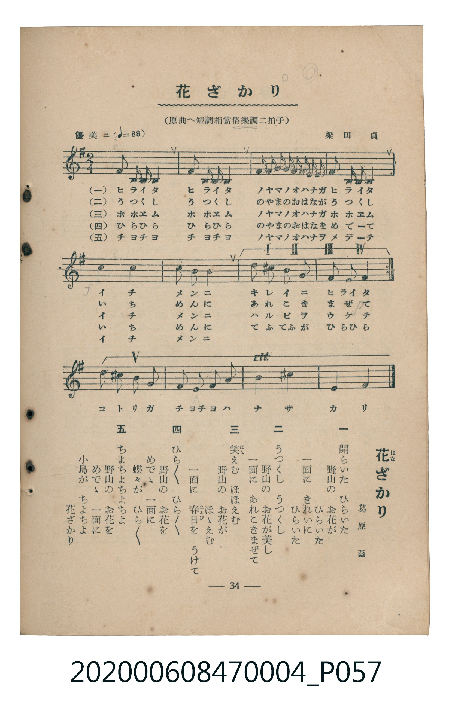

# 花ざかり

> Re:Shōka 使用 AI 協助辨識與重建樂譜，可能會有錯誤。歡迎[回報](https://github.com/TMDLang/reshoka/issues)。

- **鋼琴伴奏版**：<br><audio controls src="hanazakari.mp3"></audio>
- **NEUTRINO 歌聲合成版**：<br><audio controls src="hanazakari_neutrino.mp3"></audio>

- 詞：葛原しげる
- 曲：梁田貞
- 臺灣教育會公認《新定兒童唱歌》尋常科第四學年用（2020.006.0847.0004）

## 說明

原書資訊與歌詞全文（對應 P057.jpg，書頁 p. 34，參考教材第 1 首）：
調性與拍號：原曲へ短調相當俗樂調二拍子（譜面移調為 1 個升記號之俗樂調 2/4 拍）
速度指示：優美ニ（♩=88）


## 歌詞

```text
一
開（ひ）らいた　ひらいた
野山（のやま）の　お花（はな）が　ひらいた
一面（いちめん）に　きれいに　ひらいた

二
うつくし　うつくし
野山の　お花が美（うつく）し
一面に　あれこきまぜて

三
笑（ほゝ）えむ　ほほえむ
野山の　お花が　ほゝえむ
一面に　春日（はるび）を　うけて

四
ひら／＼　ひら／＼
野山の　お花を　めでゝ
一面に　蝶々（てふ／＼）が　ひら／＼

五
ちよちよちよ　ちよちよちよ
野山の　お花を　めでゝ
一面に　小鳥（ことり）が　ちよちよ
花ざかり
```

## ABC

<div class="abc-score" data-abc-src="hanazakari.abc" aria-label="五線譜載入中"></div>

[下載 ABC 原始檔](hanazakari.abc)

## TMD 檔案連結

- [主旋律 TMD 檔案](hanazakari.tmd) [[在 TMD Studio 編輯](https://tmdlang.github.io/Tmd-TS/#tmd=s7IKdvYPcrWy4qpTUCpJTLdSSM7PyUlNLsnMz7MqzsjMK0nNjM_KTMmPL87Iz05Ugisry88pzU21Si9KTEmNN4k3MjAyiDcwMIs3sDAxBzIMTBBKi_NLi5JTrYqTM_Lzc-JLUitKkvLzsxHyBUX5Zal5iXlANQVFIBtTwIoQClLLMlNSQdKpKZkl-UWZiTlI7kgtKga7FWxJfElRYl5xclFmAcgDCFX5RSUZ-UC3FmRUWmVkFoMMSU7Mic9OzEPyUklGKtBHBTmJeUh2A1WmZ-ZZlSRmAgMAFAjlifG5iZl5QFUp6F6ML0hMT7UKMDA1V-LS0lJ40bXxceO0x43dj5u6FLS0uBRtFSwsuOxtFdy5slMrbRVcc7lsjPRN7ECmvFg57_2eWS8mzn7aN_9x4_THjZMeN3WDzX82exNQ5tmixudTNrzYNA8s9qJ91_PGxc-mznzRtOnZnOanrWterOp93ND1bNqGp-tmPW2d9Hz10qdTNj5b2_O4ofvphu6nO3Y8Xz7x-Zo1T2fPfrp2x9OdW55PWfF-Twco1vSAsaYHijUgw8Dk_Z5OJS4ufS0FW2oBLgUFBaCnns3e8WJz-4sVXS862oHuAvr3aeuKZ9Paga54uqH3WXunAijc9LIK0t_v6QEqfrmgUaFAT8EY6KKep_3NLxqagd59NncC0BMKhgovl00DuhQYLiDTX6za_6xhOcjc7t4XM-cDRcH2bXrcuOP5_LVA2eezdzyfuu3J_unPVjQBuU929QBVPl07AWj3i7VzXs5d9Hz5bpCypl1Ao58CQ6wX6NAZQKOe7OyG61IARpUCUB_QXpClLxvmP9217FlP-_Mlu0A2tqx6vq_vcXM30MxHM1faWliA1IEUPtnRAFY_DST1uBEYmZ2PmzofN7Y8bpz_uKEBKALngtW19z3duBGsdN3jJqDoPpAGIBuktAuYpMBS6x83rgKLAyMYwwigjUA_gdUBhRY-bmp83DQZrHo1WHXv46YesBSEi6QZrHtXD4h63Nj2uHHJ48Z-UGoEKUNwEc5EdhfQLcAQANsKVQq2Eqwa4iKYhU1g-yeDHNK473HjnMeNy6AhBQ7Z52smgk3Z_bhpLtiIjsdNDWCNu8EIxMXpBKi6prkIdciWP5ux9Nn0pdAgbOp-3LgZHB2TYD6cCHMLMKNAQgEUOu_3AP2yBx5YEC4OJ0DMAgZ543KgK9DtfzF32-OGVrD9yx43boWYhBaRUOMhcTEF4gpgJAK1IJEgxeiCZLno6Yb-l5shIQKMkRXAogrJOahmI5dnID7lZQMUKGjpc3F5AMviqsTsxKJMq4DMxLx8hxqDmmqQNQo2hmZadmAWtnIJmF7WAD30on0zMM6erQOGacfTCasVPB81TPYMU3i-dcLTDcAs1GOhAPTp8_UNQCaioOnEYhzQLVCrNIDGalopPG6eBMQrFR43LQHi_Qo1WEX6gBjIa54HYTetAtL9QNwFZK_BogfZml09IGsa24AYKNkI1NY4HaQFi8g6oOYWIL0Pwm4EGt-4HoiB1jX2YNEDtaZGwTxeQVfBOB6KdMEQjygQGQIhhGUGRjhUg833MYT4UBfFjzDz8MkQE25Y9ULsNYJ4GagCydNw0_HIEBOQWPVC7DUGuWw22GWzgSatANILkHyFW4awf3HohdhrAnLZJpCKpk4wC0QjfIVbBo9_myaBVDQ1gv27HEwug9uKnhmAkQAskJobwYnqcfNCIN4MxN0QftNaIHsNJKqAYvBkjyfVt0AKOKj-RiCeDOSvhvAbm4D8HiANEusFi4A8MAesZxkidVen1SqYQN0Mo2vALGMohoiYguTVoUKGYCFwogYmb10ICy1NA90NEQN5GRGLC8Eim8FkN0Ic6H2QyBpwLIB0QmSRUjFUGGsyboFZBQwNhJHgaAGGCUh8NVKENoHFe8DiENleqMw-MG8OWkTCky1pXgImTpAIyObHzWB7mkGJDGQOyOzHTRvBYqDMgp5MSfMP2LTGrRBXwxgg7yGla0QCh9lWi1xxhJFRc-yaAqkzXjZsetq6VAGpxjA0IKfK2DUFXGUA03EzKPtCaFA4YorgKQqAYQzLXe1AvAccwvQqyyGuBcUqwr2I9IBbhhj_gPS2o6UY9MAjUMSA2B1ADCq5ICUm2CGIEO4HC3aBDGnaBtUEKk9AWhRoUWaABeFhR2KRARHpAJOrwKkbVHwghTQiyEEkKDtC7KqBuxHsOoh5YEeBIHphBgkSqMOAwYJwACwTQqyHZytdOwVEzlJA4YWBuMpcAA)]
- [鋼琴伴奏 TMD 檔案](hanazakari_piano.tmd) [[在 TMD Studio 編輯](https://tmdlang.github.io/Tmd-TS/#tmd=s7IKdvYPcrWy4qpTUCpJTLdSyC8qychPL0osyKi0ysgsLskvykxOzInPTsxLVIIrKs4vLUpOjS9ITE-1CjAwNVfi0tJSeNG18XHjtMeN3Y-but7v6XjZvef5hC1P9mx5urT_eWfH-z2dClpaXIq2ChYWXPa2Cu5c2amVtgquuVw2RvomdiCjX6yc937PrBcTZz_tm_-4cfrjxkmPm7rBlj6bvQko82xR4_MpG15smgcWe9G-63nj4mdTZ75o2vRsTvPT1jUvVvU-buh6Nm3D03WznrZOer566dMpG5-t7Xnc0P10Q_fTHTueL5_4fM2ap7NnP1274-nOLc-nrAC608jAyEDPwMBMz8DCxBzIMDABOlWJi8sD6OOqxOzEokyrgMzEvPwgD4cag5pqLgUgsDE007IDs_S1FGzRgQLQkic7Gl60bwZa9WzdVqAlTyesVvB81DDZM0zh-dYJTzfse7-nx0Lh6Yb-5-sbgExQGOplFaSDAgnTOC19sFU1CubxCroKxvFQpAuGeESByBAIISwzMMKhGmy-j2GNwuPmSUD-4-aVCo-blgDxfrh5-GT6gBgo1jwPwm5aBaT7gbgLyF6DTy_EXiOgisY2kIpGoGwjUGfjdITpeGTWAc1qAdL7IOxGoH2N64EYaH9jDz69EHuNQS6bDXbZbKBJK4D0AiRf4ZYh7F8ceiH2moBctgmkoqkTzALRCF_hlsHj36ZJIBVNjWD_LgeTy-C2QpNPdVqtgglUEEbXgFnGUAwRMQXJq0OFDMFC4FQDTD-6EBZaogFGKkTscTPIAbBgWggW2QwmuxHiTWvBImvA3gTphMgiJROoMNZ00gKzqhFkPMxIsL-bJoPFVyOFWBNYvAcsDpHthcrsA_PmoIUUPF2Q5iVg7INEQDY_bgbb0wyKRZA5ILMfN20Ei4FSI3o6IM0_Cx83tYMFIQkbxIWxQZ5ESj6IdASzsxazTPNBLtMsoEVaDbBgiFeINo7PjUVi4RM1BWIQbQbEONRBTTYBCpjEwigwH6QI2UCQYUYQIUOYcSCDkQ1D8UoYWeXzrimQkvllw6anrUsVkMplQ4PBVjCDUhg4RTSDSpNGMI1Ie7hl8JRTwPSJSM_gJIWUOqleXoAF4X4hsbiAiHSAyVXgNA0qOpB8jggCEAnKirDkBnMj2HUQ88COAkH0ggxkYBfMYU3bkBwAy4AQ67FkJmgKHGq5CSQHDym4HqBqiM0gEqoVKd_p2ikgPB7tYxirgCZihCFijCECdC2KSBiIq8wFAA)]

## 分析

```text
================================================================================
📊 TMD Song Profile: [ 花ざかり ]
================================================================================
⏱  Duration:       0:24 (24.5s), 18 measures total
🎼 Key & Tempo:    首調基準 G, != 88.0 BPM, <2/4>
   - 分析範圍：      由實際發聲的音符與和弦推測調性；播放脈絡另行呈現
🎤 人聲音域:    B3 (MIDI 59) – D5 (MIDI 74) [跨度: 15 個半音 / 1.2 個八度, 難度: moderate]
   - 最低音:  B3 in [Hanazakari #1 @ m.1, 0:00]
   - 最高音: D5 in [Hanazakari #1 @ m.7, 0:08]
   - 適合: soprano, mezzo-soprano, contralto, tenor, baritone, bass
🏛  結構:      Hanazakari (10.9s) -> HanazakariV (13.6s)
⚡ 編曲密度:        Peak 1 軌道同時演奏
🗝  調性診斷：       B 調性不明確（流行色彩大調，未偵測到可信轉調）
   - 風格氣質:    調式色彩／藍調前衛（調外音豐富，張力強烈）
   - 轉調歷程:    全曲維持單一推測調性（未偵測到可信轉調）
   - 核心骨幹音:  B, F#, C, E, G
   - 調性數值:    B 調性不明確 [相關度: 0.74, 穩定度: Ambiguous, 自然音純度: 76.4%]
   - 候選調性 (K-S): B 大調 (0.74), B 小調 (0.73), E 小調 (0.42)
   - 五度圈歷程:   +5 -> +5
   - 各段落調性細節:
     • [Hanazakari #1]: B 調性不明確 (r: 0.72, 自然音純度: 84.4%, 調外音: C)
     • [HanazakariV #1]: B 調性不明確 (r: 0.75, 自然音純度: 77.5%, 調外音: C, D, G)

  [ 五度圈游移軌跡 ]
               C  
         F            G  
      Bb               D  
      Eb               A  
         Ab           E  
            Db      [B ]*
               F# 
     (* = active key center)

  [ 十二半音累積音高分佈 ]
     C  : █████████                 13.9%
     C# : ███                        5.6%
     D  : ██                         2.8%
     D# :                            0.0%
     E  : █████                      8.3%
     F  :                            0.0%
     F# : ███████████████           23.6%
     G  : ████                       6.9%
     G# :                            0.0%
     A  :                            0.0%
     A# :                            0.0%
     B  : ████████████████████████  38.9%
--------------------------------------------------------------------------------
Assignment 軌道音域：
  - Piano         : B3 – D5 (15 個半音 / 1.2 個八度, 69 個音符)
================================================================================
```


## 原書掃描頁




