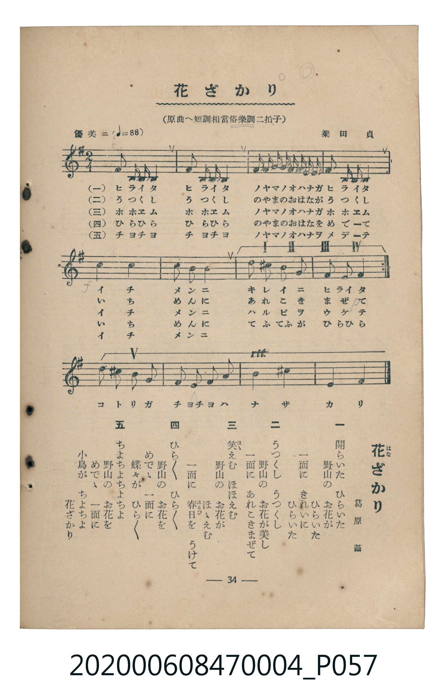

# 花ざかり

> Re:Shoka 使用 AI 協助辨識與重建樂譜，可能會有錯誤。歡迎回報。

<audio controls src="hanazakari.mp3"></audio>

- 詞：葛原しげる
- 曲：梁田貞
- 臺灣教育會公認《新定兒童唱歌》尋常科第四學年用（2020.006.0847.0004）

## 說明

原書資訊與歌詞全文（對應 P057.jpg，書頁 p. 34，參考教材第 1 首）：
調性與拍號：原曲へ短調相當俗樂調二拍子（譜面移調為 e 小調／1 個升記號 2/4 拍）
速度指示：優美ニ（♩=88）

## 歌詞

```text
一
開（ひ）らいた　ひらいた
野山（のやま）の　お花（はな）が　ひらいた
一面（いちめん）に　きれいに　ひらいた

二
うつくし　うつくし
野山の　お花が美（うつく）し
一面に　あれこきまぜて

三
笑（ほゝ）えむ　ほほえむ
野山の　お花が　ほゝえむ
一面に　春日（はるび）を　うけて

四
ひら／＼　ひら／＼
野山の　お花を　めでゝ
一面に　蝶々（てふ／＼）が　ひら／＼

五
ちよちよちよ　ちよちよちよ
野山の　お花を　めでゝ
一面に　小鳥（ことり）が　ちよちよ
花ざかり
```

## ABC

```abc
X:1
T:花ざかり
C:曲：梁田貞
M:2/4
L:1/16
Q:1/4=88
K:Em
V:V1 name="Piano" snm="Pia"
[V:V1]
A2 F F E4 | A2 F F E4 | B B B B B A A B | A2 F F E4 |
!f! e4 d4 | e3 d B4 | d2 ^c2 B2 A2 | A2 F F E4 |
A2 F F E4 | A2 F F E4 | B B B B B A A B | A2 F F E4 |
!f! e4 d4 | e3 d B4 | e2 ^d2 e2 B2 | A2 F2 A2 B2 |
A4 F4 | E4 E4 |
```

## TMD 檔案連結

- [主旋律 TMD 檔案](hanazakari.tmd) [[在 TMD Studio 編輯](https://tmdlang.github.io/Tmd-TS/#tmd=s7IKdvYPcrWy4qpTUCpJTLdSSM7PyUlNLsnMz7MqzsjMK0nNjM_KTMmPL87Iz05Ugisry88pzU21Si9KTEmNN4k3MjAyiDcwMIs3sDAxBzIMTBBKi_NLi5JTrYqTM_Lzc-JLUitKkvLzsxHyBUX5Zal5iXlANQVFIBtTwIoQClLLMlNSQdKpKZkl-UWZiTlI7kgtKga7FWxJfElRYl5xclFmAcgDCFUlGalAxxbkJOYBjdXSUnjRtfFx47THjd2Pm7oUtLS4FG0VLCy47G0V3LmyUyttFVxzuWyM9E3sQAa8WDnv_Z5ZLybOfto3_3Hj9MeNkx43dYONfjZ7E1Dm2aLG51M2vNg0Dyz2on3X88bFz6bOfNG06dmc5qeta16s6n3c0PVs2oan62Y9bZ30fPXSp1M2Plvb87ih--mG7qc7djxfPvH5mjVPZ89-unbH051bnk9Z8X5PByhA9YABqgcKUCDDwOT9nk4lLi59LQVbagEuBQUFoKeezd7xYnP7ixVdLzrage4C-vdp64pn09qBrni6ofdZe6dCgIGpuV5WQfr7PT1AxS8XNCoU6CkYA13U87S_-UVDM9C7z-ZOAHpCwVDh5bJpQJcCwwVk-otV-581LAeZ2937YuZ8oCjYvk2PG3c8n78WKPt89o7nU7c92T_92YomIPfJrh6gyqdrJwDtfrF2zsu5i54v3w1S1rRLIVXh6YZ-IPv9nn5DhafAwOsFunkG0FQFYEwpALUBrQXZ-bJh_tNdy571tD9fsgtkYcuq5_v6Hjd3A418NHOlrYUFSB1I4ZMdDWD100BSjxuBcdn5uKnzcWPL48b5jxsagCJwLlhde9_TjRvBStc9bgKK7gNpALJBSruAKQostf5x4yqwODB-MYwA2gj0ElgdUGjh46bGx02TwapXg1X3Pm7qAUtBuEiawbp39YCox41tjxuXPG7sByVGkDIEF-FMZHcB3QIMAbCtUKVgK8GqIS6CWdgEtn8yyCGN-x43znncuAwaUuCQfb5mItiU3Y-b5oKN6Hjc1ADWuBuMQFycToCqa5qLUIds-bMZS59NXwoNwqbux42bwdExCebDiTC3APMJJBRAoQNMC-_37IEHFoSLwwkQs4BB3rgc6Ap0-1_M3fa4oRVs_7LHjVshJqFFJNR4SFxMgbgCGIlALUgkSDG6IFkuAqb2l5shIQKMkRXAkgrJOahmIxdnID7lRQMUKGjpc3F5JOYlViVmJxZlWgVkJublO9QY1ChUg-xRsDE007IDs7CVS8AEswbooxftm4GR9mwdMFA7nk5YreD5qGGyZ5jC860Tnm4A5qEeC1DGfr6-AchEFDSdWIwDOgZqlQbQWE0rhcfNk4B4pcLjpiVAvF-hBqtIHxADec3zIOymVUC6H4i7gOw1WPQgW7OrB2RNYxsQAyUbgdoap4O0YBFZB9TcAqT3QdiNQOMb1wMx0LrGHix6oNbUKBgp6CqYx4OQWTyQCYI4BI3h0AgIjXEoAydQ5FAC-at5DxA3gmmQjxdCRTYDcTdIpGktkLUGqhYsQjhUgL4FGdIIMQxkCMQCYKEGFF0N9nMTkNcDpEEivWARUPjMAeJlQNPgYVCdVqtgBvWAKdy_EBFToE9hIiA5E3UgARICeZ5AEGBPk7umQFLjy4ZNT1uXKlCaFndNAadFkOdXwGlQCGKK4EmLzZvgMdMOjZ02uiQSiPOJSiQgVgcQA50NzTqoXgR5BiQK8g4oHWyDp4zVULNAHt5DeryDRExB8Q5igIThvoIkA7AQUlCBIFgSqh3GRAqAWi4uXTsFROGmAOQpc3EBAA)]
- [鋼琴伴奏 TMD 檔案](hanazakari_piano.tmd) [[在 TMD Studio 編輯](https://tmdlang.github.io/Tmd-TS/#tmd=s7IKdvYPcrWy4tLSUnjRtfFx47THjd2Pm7re7-l42b3n-YQtT_Zsebq0_3lnx_s9nQpaWlyKtgoWFlz2tgruXNmplbYKrrlcNkb6JnZcdQpKL1bOe79n1ouJs5_2zX_cOP1x46THTd1KIJlnszcBZZ4tanw-ZcOLTfPAYi_adz1vXPxs6swXTZuezWl-2rrmxarexw1dz6ZteLpu1tPWSc9XL306ZeOztT2PG7qfbuh-umPH8-UTn69Z83T27KdrdzzdueX5lBVAdxoZGBnoGRiY6RlYmJgDGQYmQKcqcXF5JOYlViVmJxZlWgVkJublB3k41BjUKFRzKQCBjaGZlh2Ypa-lYIsOFIC2PNnR8KJ9M9CuZ-u2Am15OmG1guejhsmeYQrPt054umHf-z09FgpPN_Q_X98AZAYYmJrrZRWkg0IJ0zgtfbBVNQpGCroK5vEgZBYPZIIgDkFjODQCQmMcyqDGVqfVKphBxUzhRkBETIGaYSIgORN1IAESApmHw1T8AbNrCiRIXjZsetq6VAEpQAwNhlqIgERMQSECYoCE4aZCAggshORUEARLQrXDmEgOqMVMej4oSc8CmvKAJsYrRBvlxgJ1Axlm8UAWdjFjINMYyILJQUVQFEGNRIjANGEXAxuFLIDTxAF0JEIMm-VwdWgOhVqLrt0AEje6dgqI6FEA8pS5uAA)]

## 分析

```text
================================================================================
📊 TMD Song Profile: [ 花ざかり ]
================================================================================
⏱  Duration:       0:24 (24.5s), 18 measures total
🎼 Key & Tempo:    首調基準 G, != 88.0 BPM, <2/4>
   - 分析範圍：      由實際發聲的音符與和弦推測調性；播放脈絡另行呈現
🎤 人聲音域:    E4 (MIDI 64) – E5 (MIDI 76) [跨度: 12 個半音 / 1.0 個八度, 難度: easy]
   - 最低音:  E4 in [Hanazakari #1 @ m.1, 0:00]
   - 最高音: E5 in [Hanazakari #1 @ m.5, 0:05]
   - 適合: soprano, mezzo-soprano, contralto, tenor, baritone, bass
🏛  結構:      Hanazakari (24.5s)
⚡ 編曲密度:        Peak 1 軌道同時演奏
🗝  調性診斷：       E 大調（流行色彩大調，未偵測到可信轉調）
   - 風格氣質:    流行大調（略帶和弦色彩音與裝飾副屬和弦）
   - 轉調歷程:    全曲維持單一推測調性（未偵測到可信轉調）
   - 核心骨幹音:  E, A, B, F#, D
   - 調性數值:    E 大調 [相關度: 0.81, 穩定度: Moderate, 自然音純度: 91.7%]
   - 候選調性 (K-S): E 大調 (0.81), A 大調 (0.74), E 小調 (0.67)
   - 五度圈歷程:   +4
   - 各段落調性細節:
     • [Hanazakari #1]: E 大調 (r: 0.81, 自然音純度: 91.7%, 調外音: D)

  [ 五度圈游移軌跡 ]
               C  
         F            G  
      Bb               D  
      Eb               A  
         Ab          [E ]*
            Db       B  
               F# 
     (* = active key center)

  [ 十二半音累積音高分佈 ]
     C  :                            0.0%
     C# : █                          1.4%
     D  : █████                      8.3%
     D# : █                          1.4%
     E  : ████████████████████████  37.5%
     F  :                            0.0%
     F# : █████████                 13.9%
     G  :                            0.0%
     G# :                            0.0%
     A  : ████████████              19.4%
     A# :                            0.0%
     B  : ████████████              18.1%
--------------------------------------------------------------------------------
Assignment 軌道音域：
  - Piano         : E4 – E5 (12 個半音 / 1.0 個八度, 70 個音符)
================================================================================
```


## 原書掃描頁




