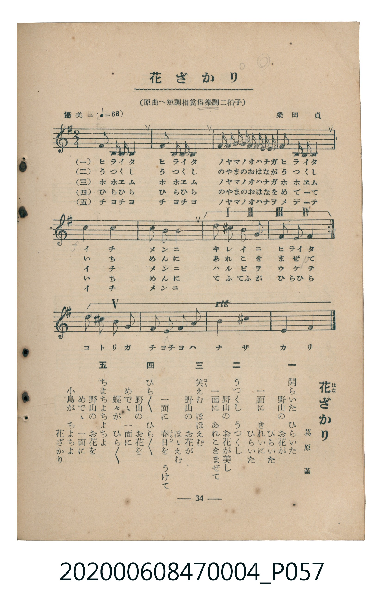

# 花ざかり

> Re:Shōka 使用 AI 協助辨識與重建樂譜，可能會有錯誤。歡迎回報。

- **NEUTRINO 歌聲合成版**：<br><audio controls src="hanazakari_neutrino.mp3"></audio>
- **鋼琴伴奏版**：<br><audio controls src="hanazakari.mp3"></audio>


- 詞：葛原しげる
- 曲：梁田貞
- 臺灣教育會公認《新定兒童唱歌》尋常科第四學年用（2020.006.0847.0004）

## 說明

原書資訊與歌詞全文（對應 P057.jpg，書頁 p. 34，參考教材第 1 首）：
調性與拍號：原曲へ短調相當俗樂調二拍子（譜面移調為 1 個升記號之俗樂調 2/4 拍）
速度指示：優美ニ（♩=88）


## 歌詞

```text
一
開（ひ）らいた　ひらいた
野山（のやま）の　お花（はな）が　ひらいた
一面（いちめん）に　きれいに　ひらいた

二
うつくし　うつくし
野山の　お花が美（うつく）し
一面に　あれこきまぜて

三
笑（ほゝ）えむ　ほほえむ
野山の　お花が　ほゝえむ
一面に　春日（はるび）を　うけて

四
ひら／＼　ひら／＼
野山の　お花を　めでゝ
一面に　蝶々（てふ／＼）が　ひら／＼

五
ちよちよちよ　ちよちよちよ
野山の　お花を　めでゝ
一面に　小鳥（ことり）が　ちよちよ
花ざかり
```

## ABC

```abc
X:1
T:花ざかり
C:曲：梁田貞
M:2/4
L:1/16
Q:1/4=88
K:Em
V:V1 name="Piano" snm="Pia"
[V:V1]
F2 B, B, B,4 | F2 B, B, B,4 | F F G G F F E E | F2 B, B, B,4 |
w: 1.~ヒ ラ イ タ | ヒ ラ イ タ | ノ ヤ マ ノ オ ハ ナ ガ | ヒ ラ イ タ
w: 2.~う つ く し | う つ く し | の や ま の お は な が | う つ く し
w: 3.~ホ ホ エ ム | ホ ホ エ ム | ノ ヤ マ ノ オ ハ ナ ガ | ホ ホ エ ム
w: 4.~ひ ら ひ ら | ひ ら ひ ら | の や ま の お は な を | め で _ て
!f! c4 c4 | c2 B2 B4 | d2 ^c2 B2 G2 | F2 E2 F4 |
w: 1.~イ チ | メ ン ニ | キ レ イ ニ | ヒ ライ タ
w: 2.~い ち | め ん に | あ れ こ き | ま ぜ て
w: 3.~イ チ | メ ン ニ | ハ ル ビ ヲ | ウ ケ テ
w: 4.~い ち | め ん に | て ふ てふ が | ひ らひ ら
F2 B, B, B,4 | F2 B, B, B,4 | F F G G F F E E | F2 B, B, B,4 |
w: チ ヨ チ ヨ | チ ヨ チ ヨ | ノ ヤ マ ノ オ ハ ナ ヲ | メ デ _ テ
!f! c4 c4 | c2 B2 B4 | d2 ^c2 B2 G2 | F2 E2 F2 G2 |
w: イ チ | メ ン ニ | コ ト リ ガ | チ ヨチ ヨ ハ
B4 ^c4 | E4 F4 |
w: ナ ザ | カ リ
```

## TMD 檔案連結

- [主旋律 TMD 檔案](hanazakari.tmd) [[在 TMD Studio 編輯](https://tmdlang.github.io/Tmd-TS/#tmd=s7IKdvYPcrWy4qpTUCpJTLdSSM7PyUlNLsnMz7MqzsjMK0nNjM_KTMmPL87Iz05Ugisry88pzU21Si9KTEmNN4k3MjAyiDcwMIs3sDAxBzIMTBBKi_NLi5JTrYqTM_Lzc-JLUitKkvLzsxHyBUX5Zal5iXlANQVFIBtTwIoQClLLMlNSQdKpKZkl-UWZiTlI7kgtKga7FWxJfElRYl5xclFmAcgDCFX5RSUZ-UC3FmRUWmVkFoMMSU7Mic9OzEPyUklGKtBHBTmJeUC7tbQUXnRtfNw47XFj9-OmLgUtLS5FWwULCy57WwV3ruzUSlsF11wuGyN9EzuQAS9Wznu_Z9aLibOf9s1_3Dj9ceOkx03dYKOfzd4ElHm2qPH5lA0vNs0Di71o3_W8cfGzqTNfNG16Nqf5aeuaF6t6Hzd0PZu24em6WU9bJz1fvfTplI3P1vY8buh-uqH76Y4dz5dPfL5mzdPZs5-u3fF055bnU1a839MBCnU9YKjrgUIdyDAweb-nU4mLS19LwZZagEtBQQHoqWezd7zY3P5iRdeLjnagu4D-fdq64tm0dqArnm7ofdbeqRBgYGqul1WQ_n5PD1DxywWNCgV6CsZAF_U87W9-0dAM9O6zuROAnlAwVHi5bBrQpcBwAZn-YtX-Zw3LQeZ2976YOR8oCrZv0-PGHc_nrwXKPp-94_nUbU_2T3-2ognIfbKrB6jy6doJQLtfrJ3zcu6i58t3g5Q17QIa_RQYYr1Ah84AGvVkZzdclwIwqhSA-oD2gix92TD_6a5lz3rany_ZBbKxZdXzfX2Pm7uBZj6audLWwgKkDqTwyY4GsPppIKnHjcDI7Hzc1Pm4seVx4_zHDQ1AETgXrK697-nGjWCl6x43AUX3gTQA2SClXcAkBZZa_7hxFVgcGMEYRgBtBPoJrA4otPBxU-Pjpslg1avBqnsfN_WApSBcJM1g3bt6QNTjxrbHjUseN_aDUiNIGYKLcCayu4BuAYYA2FaoUrCVYNUQF8EsbALbPxnkkMZ9jxvnPG5cBg0pcMg-XzMRbMrux01zwUZ0PG5qAGvcDUYgLk4nQNU1zUWoQ7b82Yylz6YvhQZhU_fjxs3g6JgE8-FEmFuAGQUSCqDQeb8H6Jc98MCCcHE4AWIWMMgblwNdgW7_i7nbHje0gu1f9rhxK8QktIiEGg-JiykQVwAjEagFiQQpRhcky0VPN_S_3AwJEWCMrAAWVUjOQTUbuTwD8SkvG6BAQUufi8sDWJZWJWYnFmVaBWQm5uU71BjUVIOsUbAxNNOyA7OwlUvA9LIG6KEX7ZuBcfZsHTBMO55OWK3g-ahhsmeYwvOtE55uAGahHgsFoE-fr28AMhEFTScW44BugVqlATRW00rhcfMkIF6p8LhpCRDvV6jBKtIHxEBe8zwIu2kVkO4H4i4gew0WPcjW7OoBWdPYBsRAyUagtsbpIC1YRNYBNbcA6X0QdiPQ-Mb1QAy0rrEHix6oNTUK5vEKugrG8VCkC4Z4RIHIEAghLDMwwqEabL6PIcSHuih-hJmHT4aYcMOqF2KvEcTLQBVInoabjkeGmIDEqhdirzHIZbPBLpsNNGkFkF6A5CvcMoT9i0MvxF4TkMs2gVQ0dYJZIBrhK9wyePzbNAmkoqkR7N_lYHIZ3Fb0zACMBGCB1NwITlSPmxcC8WYg7obwm9YC2WsgUQUUgyd7PKm-BVLAQfU3AvFkIH81hN_YBOT3AGmQWC9YBOSBOWA9yxCpuzqtVsEE6mYYXQNmGUMxRMQUJK8OFTIEC4ETNTB560JYaGka6G6IGMjLiFhcCBbZDCa7EeJA74NE1oBjAaQTIouUiqHCWJNxC8wqYGggjARHCzBMQOKrkSK0CSzeAxaHyPZCZfaBeXPQIhKebEnzEjBxgkRANj9uBtvTDEpkIHNAZj9u2ggWA2UW9GRKmn_ApjVuhbgaxgB5DyldIxI4zLZa5IojjIyaY9cUSJ3xsmHT09alCkg1hqEBOVXGringKgOYjptB2RdCg8IRUwRPUQAMY1juagfiPeAQpldZDnEtKFYR7kWkB9wyxPgHpLcdLcWgBx6BIgbE7gBiUMkFKTHBDkGEcD9YsAtkSNM2qCZQeQLSokCLMgMsCA87EosMiEgHmFwFTt2g4gMppBFBDiJB2RFiVw3cjWDXQcwDOwoE0QszSJBAHQYMFoQDYJkQYj08W-naKSBylgIKLwzEVeYCAA)]
- [鋼琴伴奏 TMD 檔案](hanazakari_piano.tmd) [[在 TMD Studio 編輯](https://tmdlang.github.io/Tmd-TS/#tmd=s7IKdvYPcrWy4tLSUnjRtfFx47THjd2Pm7re7-l42b3n-YQtT_Zsebq0_3lnx_s9nQpaWlyKtgoWFlz2tgruXNmplbYKrrlcNkb6JnZcdQpKL1bOe79n1ouJs5_2zX_cOP1x46THTd1KIJlnszcBZZ4tanw-ZcOLTfPAYi_adz1vXPxs6swXTZuezWl-2rrmxarexw1dz6ZteLpu1tPWSc9XL306ZeOztT2PG7qfbuh-umPH8-UTn69Z83T27KdrdzzdueX5lBVAdxoZGBnoGRiY6RlYmJgDGQYmQKcqcXF5JOYlViVmJxZlWgVkJublB3k41BjUVHMpAIGNoZmWHZilr6Vgiw4UgJY82dHwon0z0Kpn67YCLXk6YbWC56OGyZ5hCs-3Tni6Yd_7PT0WCk839D9f3wBkBhiYmutlFaSDAgnTOC19sFU1CubxCroKxvFQpAuGeESByBAIISwzMMKhGmy-j2GNwuPmSUD-4-aVCo-blgDxfrh5-GT6gBgo1jwPwm5aBaT7gbgLyF6DTy_EXiOgisY2kIpGoGwjUGfjdITpeGTWAc1qAdL7IOxGoH2N64EYaH9jDz69EHuNQS6bDXbZbKBJK4D0AiRf4ZYh7F8ceiH2moBctgmkoqkTzALRCF_hlsHj36ZJIBVNjWD_LgeTy-C2QpNPdVqtgglUEEbXgFnGUAwRMQXJq0OFDMFC4FQDTD-6EBZaogFGKkTscTPIAbBgWggW2QwmuxHiTWvBImvA3gTphMgiJROoMNZ00gKzqhFkPMxIsL-bJoPFVyOFWBNYvAcsDpHthcrsA_PmoIUUPF2Q5iVg7INEQDY_bgbb0wyKRZA5ILMfN20Ei4FSI3o6IM0_YNMat0JcDWOAvIeUcBApCGZbLWZp5oNcmllAC7MaYJEQrxBtHJ8bi8TCJ2oKxCDaDIhxqIOabAIUMImFUWA-SBGygSDDjCBChjDjQAYjG4bilTCySuZdUyBl8suGTU9blyoglciGBoOtSAalLXBaaAaVI41gGpHqcMvgKaGAKRORktvR0iXVSwqwINwvJBYUEJEOMLkKnKZBhQaSzxFBACJBmRCW3GBuBLsOYh7YUSCIXoSBDOyCOaxpG5IDYFkPYj2WzARNgUMtN4Hk4CEF1wNUDbEZREK1IuU7XTsFhMejfQxjFdBEjDBEjDFEgK5FEQkDcZW5AA)]

## 分析

```text
================================================================================
📊 TMD Song Profile: [ 花ざかり ]
================================================================================
⏱  Duration:       0:24 (24.5s), 18 measures total
🎼 Key & Tempo:    首調基準 G, != 88.0 BPM, <2/4>
   - 分析範圍：      由實際發聲的音符與和弦推測調性；播放脈絡另行呈現
🎤 人聲音域:    B3 (MIDI 59) – D5 (MIDI 74) [跨度: 15 個半音 / 1.2 個八度, 難度: moderate]
   - 最低音:  B3 in [Hanazakari #1 @ m.1, 0:00]
   - 最高音: D5 in [Hanazakari #1 @ m.7, 0:08]
   - 適合: soprano, mezzo-soprano, contralto, tenor, baritone, bass
🏛  結構:      Hanazakari (10.9s) -> HanazakariV (13.6s)
⚡ 編曲密度:        Peak 1 軌道同時演奏
🗝  調性診斷：       B 調性不明確（流行色彩大調，未偵測到可信轉調）
   - 風格氣質:    調式色彩／藍調前衛（調外音豐富，張力強烈）
   - 轉調歷程:    全曲維持單一推測調性（未偵測到可信轉調）
   - 核心骨幹音:  B, F#, C, E, G
   - 調性數值:    B 調性不明確 [相關度: 0.74, 穩定度: Ambiguous, 自然音純度: 76.4%]
   - 候選調性 (K-S): B 大調 (0.74), B 小調 (0.73), E 小調 (0.42)
   - 五度圈歷程:   +5 -> +5
   - 各段落調性細節:
     • [Hanazakari #1]: B 調性不明確 (r: 0.72, 自然音純度: 84.4%, 調外音: C)
     • [HanazakariV #1]: B 調性不明確 (r: 0.75, 自然音純度: 77.5%, 調外音: C, D, G)

  [ 五度圈游移軌跡 ]
               C  
         F            G  
      Bb               D  
      Eb               A  
         Ab           E  
            Db      [B ]*
               F# 
     (* = active key center)

  [ 十二半音累積音高分佈 ]
     C  : █████████                 13.9%
     C# : ███                        5.6%
     D  : ██                         2.8%
     D# :                            0.0%
     E  : █████                      8.3%
     F  :                            0.0%
     F# : ███████████████           23.6%
     G  : ████                       6.9%
     G# :                            0.0%
     A  :                            0.0%
     A# :                            0.0%
     B  : ████████████████████████  38.9%
--------------------------------------------------------------------------------
Assignment 軌道音域：
  - Piano         : B3 – D5 (15 個半音 / 1.2 個八度, 69 個音符)
================================================================================
```


## 原書掃描頁




