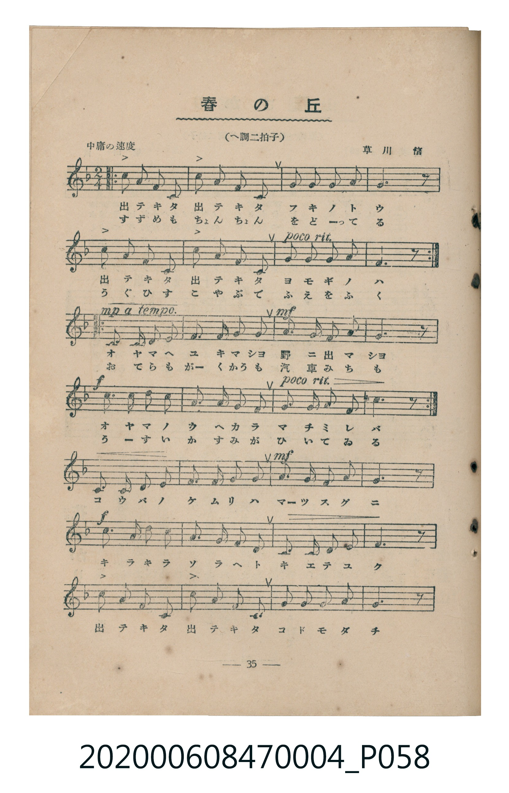
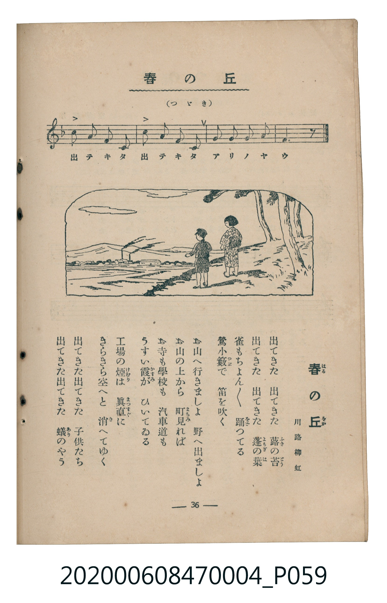

# 春の丘

> Re:Shoka 使用 AI 協助辨識與重建樂譜，可能會有錯誤。歡迎回報。

<audio controls src="haru_no_oka.mp3"></audio>

- 詞：川路柳虹
- 曲：草川信
- 臺灣教育會公認《新定兒童唱歌》尋常科第四學年用（2020.006.0847.0004）

## 說明

原書資訊與歌詞全文（對應 P058.jpg–P059.jpg，書頁 pp. 35–36，參考教材第 2 首）：
調性與拍號：へ調二拍子（F 大調 2/4 拍）
速度指示：中庸の速度

## 歌詞

```text
出てきた　出てきた　蕗（ふき）の苔（とう）
出てきた　出てきた　蓬（よもぎ）の葉（は）
雀（すずめ）もちょん／＼　踊（をど）つてる
鶯（うぐひす）小藪（こやぶ）で　笛（ふえ）を吹（ふ）く

お山（やま）へ行（ゆ）きましょ　野（の）へ出（で）ましょ
お山の上（うへ）から　町見（まちみ）れば
お寺（てら）も學校（がくかう）も　汽車道（きしゃみち）も
うすい霞（かすみ）が　ひいてゐる

工場（こうば）の煙（けむり）は　眞直（まつすぐ）に
きらきら空（そら）へと　消（き）へてゆく
出てきた出てきた　子供（こども）たち
出てきた出てきた　蟻（あり）のやう
```

## ABC

```abc
X:1
T:春の丘
C:曲：草川信
M:2/4
L:1/16
Q:1/4=96
K:F
V:V1 name="Piano" snm="Pia"
[V:V1]
c2 A2 F2 C2 | c2 A2 F2 C2 | F2 G2 A2 c2 | A6 z2 |
c2 A2 F2 C2 | c2 A2 F2 C2 | G2 A2 G2 E2 | F6 z2 |
c2 A2 F2 C2 | c2 A2 F2 C2 | F2 G2 A2 c2 | A6 z2 |
c2 A2 F2 C2 | c2 A2 F2 C2 | G2 A2 G2 E2 | F6 z2 |
!mp! C2 F2 F2 F2 | A3 A G2 F2 | !mf! G2 G2 G2 A2 | c6 z2 |
!f! f2 d2 d2 d2 | c3 A F2 A2 | G2 c2 =B2 G2 | c6 z2 |
!mp! C2 F2 F2 F2 | A3 A G2 F2 | !mf! G2 G2 G2 A2 | c6 z2 |
!f! f2 d2 d2 d2 | c3 A F2 A2 | G2 c2 =B2 G2 | c6 z2 |
C2 F2 F2 F2 | A2 A2 G2 F2 | !mf! G3 G G2 A2 | c6 z2 |
!f! f2 d2 d2 d2 | c3 A F2 A2 | G2 F2 G2 A2 | G6 z2 |
c2 A2 F2 C2 | c2 A2 F2 C2 | F2 G2 A2 c2 | A6 z2 |
c2 A2 F2 C2 | c2 A2 F2 C2 | G2 A2 G2 E2 | F6 z2 |
```

## TMD 檔案連結

- [主旋律 TMD 檔案](haru_no_oka.tmd) [[在 TMD Studio 編輯](https://tmdlang.github.io/Tmd-TS/#tmd=s7IKdvYPcrWy4qpTUCpJTLdSSM7PyUlNLsnMz7MqzsjMK0nNjM_KTMmPL87Iz05Ugisry88pzU21Si9KTEmNN4k3MjAyiDcwMIs3sDAxBzIMTBBKi_NLi5JTrYqTM_Lzc-JLUitKkvLzsxHyBUX5Zal5iXlANQVFIBtTwIoQClLLMlNSQdKpKZkl-UWZiTlI7kgtKga7FWxJfElRYl5xclFmAcgDCFUlGalAx-YllpQWpaKLFqcmFufnFeMU1tJSeDZj6ePGdU92zFDQ0uJStFWwNOOyt1Vw47Ix0jexA-l7sXLe-z2znm6f-2L7-mfzN7-YuRNs3LPZm4DCL3o7gTJP9i8Ei71o3_W8cfGzqTNfNG16Nqf5aeuaF6t6Hzd0PZu24em6WU9bJz1fvfTplI3P1vY8buh-uqH76Y4dz5dPfL5mzdPZs5-u3fF055bnU1a839MBCnE9YIjrgUIcyDAweb-nU4mLS19LwZZagEtBQeFp3_xns3e82Nz-YkXXi452oLuAnn3auuLZtHagK55u6H3W3qkQYGBqoZdVkP6oYTKQaQlivt_TA9T3ckGjQkGBnoKxKVDK2Awo-LS_-UVDM9D_z-ZOAPpKwUjh5bJpQKcDAwpk3YtV-581LAdZ1N37YuZ8oOjjxh1AwSe7eoAiT9dOAFrqpvB0yXKgmAIw-BWAokDdIK0vG-Y_3bXsWU_78yW7gPqe7Fj7dNcOYLxBxLnAnmnf9bhx2ePG3seN8x83NKBxX0ydDjT9ceNWoAjQTKDWF91TwCIrHje2QW0hYMTkNSANTUDU9LixD2rKRKDvgKashzl0dgOYP_Nx46zHTY0gRSDVCx83tT9umvx-T__7PXtAZu3oAps16XHjSrBBS0A2NXWDjdgGNAxoRNvjxgmPGzcBzQKqeLqh_8X0VWDxyY-bWh43bgNrWw406_ma2TCvdYDtm_R0wk6ICFhNPzh4Hjd2Pd24EWwpUPc-sMyOFwt7wCKgAAD7c9_jxukgpzY0vGwH-hBoxjqISmBYgLnLwVyoMoS54CwE9hLI2TvAirofN3WCnDdl14tl3WApoLaFjxv3gx3Z87hxA0z_eojZwAAABiYowICZ4dmChWBBoLp-kFngSAKFZUPDs417X-zuetkIDE6gAqCrgW5pBpoLNB2iBmIu0CHAWGh5OQeYf4HqgEYAuWDLgYY2NICDFhgUQFsngEIenAC2L326YAs0lEEGbIDE8vNWYBwABSc-bmp43AT0J1BwPchvc-Y9nw1RD_QbMA6BNgBTMVB2NcQNvaAwAJPPV0I8ORfqyUZg8l0B8sw2YKSBvAETBLoHaHE_enpET5trJzzZB4l3oEtXAj0N1j8fGAYEdL6YvxusrQnmkXXgFNEG0kZ5sQIFClr6XFweiUWlfvn-2YlWAZmJefkONQY1CtUgaxRsDM207MAsbEWaArDseLKj4dk6YPrteNrf-2JZ29PWlc_WAGO359n6fiBDwUIBmCGerwfmtR5Y-QT0CxajgO6AWgM1dM1CK1DoKDxublN43LQWiPcr1GARedw8FcJr7gPiDpBI0zIgaw_MyBoFUwVdBWMgNgRi03gggVUIxDSCCoOka8AsGDQAiZDtxBVAvAjIWwd2JkiknxwnwpwHos0RrkZ1I7IjgQU2yJHA9A7Es4AOaATiJpADwCUdkDMZmQkKu0lAgZUgxz1uXAxkLgMLdtMhQOFuBQZd4wQg3gR2N8itQEc2tQDpbUC8HCyyFYg7oK7dChahfYBiT_9AZ9Ms_T9uWgX01RIgngfEM8AJB5i2wakdKNK0_XEzKDiAVQBQoBua8uaBYwwshRIi1bkFtRB_g7wIw7BIMQaHAUSkOjetFsyFYZASSPgRyg6oLgYndXBunAGkVwPplWA_gOSAKbF5PhCvAYsA4xvFrUAHGMYB7TBDwjAXGIOdCXETyHUgURN1qFOxORNrKusCJ25gIQ_PET1gN4BTErgeg0oAazEFYDUGFNwPyitgLzXRM2iRMwbYgaDM3AJ2MjBfgnkgl_WARUCZBpRVQF6bgC3v0iZocdQNnZC8YWiGmQ1Qmqn4c8Tjps3QZARKJpBEtRHIWgDEoOTWD0lU4MBpBnq-aScQbwALohdc2OMIVgSgxRFIkIg4guRHYJkJpUHO2wsRAaV7aJ0EqgxA1QAoEiGF6noKIga5bIWIYHUaUbUTKHSbgdkAXENB6itQ5qRleU-cu4DuAccvqHRbAi9KaFPI13Jx6dopwFtCCkCOMhcXAA)]
- [鋼琴伴奏 TMD 檔案](haru_no_oka_piano.tmd) [[在 TMD Studio 編輯](https://tmdlang.github.io/Tmd-TS/#tmd=s7IKdvYPcrWy4tLSUng2Y-njxnVPdsx4v6fjZfee5xO2PNmz5enS_uedHe_3dCpoaXEp2ipYmnHZ2yq4cdkY6ZvYcdUpKL1YOe_9nllPt899sX39s_mbX8zcqQQSfjZ7E1D4RW8nUObJ_oVgsRftu543Ln42deaLpk3P5jQ_bV3zYlXv44auZ9M2PF0362nrpOerlz6dsvHZ2p7HDd1PN3Q_3bHj-fKJz9eseTp79tO1O57u3PJ8ygqg44wMjAz0DAzM9AwsTMyBDAMToPuUuLg8EotK_fL9sxOtAjIT8_KDPBxqDGoUqrkUgMDG0EzLDszS11KwRQcKQEue7Gh4tm4r0Pin_b0vlrU9bV35bM3C93t6nq3vBzIULBSebuh_vr4BKBJgYGqhl1WQDgoVTKO09MHW1CiYKugqGAOxIRCbxgMJrEIgphFUGCRdA2bBoAFIhCTzYGaBaHOEFeQbOCAOxB9Tu3qoG1PVuQW1EOeBXALDMI8ag50KEanOTasFc2EYpATiTWwhUg1UbRgHFDBDwjDlxmAzIQaAjAKJmqhDzcVj5tBwLIG81gmJQUMzzMh61DAZyLQkJodhDwVY6kILBZAglUMBOW9ARIZYPqvFKDV9UEpNC2ihCdQbrxBtGAujSOEbwB1OSI9pPJBlGm8ei8QizyR6uQa_USZAygTJKLhJuJwE1QDXh26uEZBhRHbo0N85A-GeXBRjUCNx8CUgYAbUtVOA50EFIEeZiwsA)]

## 分析

```text
================================================================================
📊 TMD Song Profile: [ 春の丘 ]
================================================================================
⏱  Duration:       1:00 (60.0s), 48 measures total
🎼 Key & Tempo:    首調基準 F, != 96.0 BPM, <2/4>
   - 分析範圍：      由實際發聲的音符與和弦推測調性；播放脈絡另行呈現
🎤 人聲音域:    C4 (MIDI 60) – F5 (MIDI 77) [跨度: 17 個半音 / 1.4 個八度, 難度: challenging]
   - 最低音:  C4 in [HaruNoOka #1 @ m.1, 0:00]
   - 最高音: F5 in [HaruNoOka #1 @ m.21, 0:25]
   - 適合: soprano, mezzo-soprano, contralto, tenor, baritone, bass
🏛  結構:      HaruNoOka (60.0s)
⚡ 編曲密度:        Peak 1 軌道同時演奏
🗝  調性診斷：       F 大調（純淨自然大調，未偵測到可信轉調）
   - 風格氣質:    純淨自然大調（陽光明朗、易唱易記，無明顯調外色彩）
   - 轉調歷程:    全曲維持單一推測調性（未偵測到可信轉調）
   - 核心骨幹音:  C, F, A, G, D
   - 調性數值:    F 大調 [相關度: 0.84, 穩定度: Moderate, 自然音純度: 98.9%]
   - 候選調性 (K-S): F 大調 (0.84), C 大調 (0.80), A 小調 (0.73)
   - 五度圈歷程:   -1
   - 各段落調性細節:
     • [HaruNoOka #1]: F 大調 (r: 0.84, 自然音純度: 98.9%, 調外音: B)

  [ 五度圈游移軌跡 ]
               C  
        [F ]*          G  
      Bb               D  
      Eb               A  
         Ab           E  
            Db       B  
               F# 
     (* = active key center)

  [ 十二半音累積音高分佈 ]
     C  : ████████████████████████  28.6%
     C# :                            0.0%
     D  : ████                       5.0%
     D# :                            0.0%
     E  : █                          1.7%
     F  : ████████████████████      23.9%
     F# :                            0.0%
     G  : ██████████████            16.7%
     G# :                            0.0%
     A  : ███████████████████       23.1%
     A# :                            0.0%
     B  : █                          1.1%
--------------------------------------------------------------------------------
Assignment 軌道音域：
  - Piano         : C4 – F5 (17 個半音 / 1.4 個八度, 156 個音符)
================================================================================
```


## 原書掃描頁






